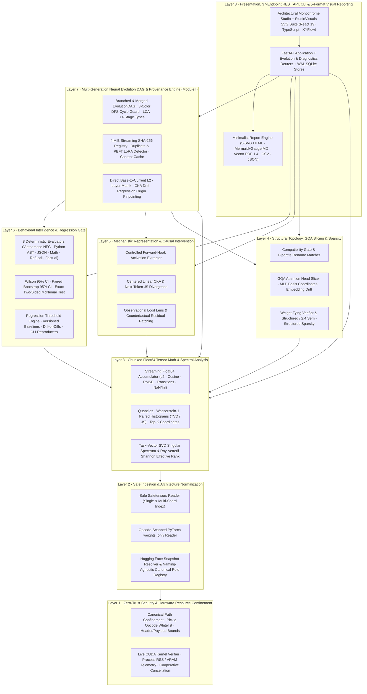
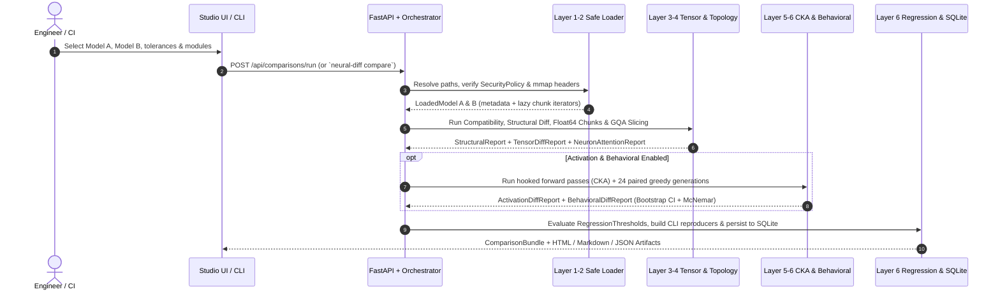

<p align="left">
  
</p>

# NEURAL DIFF — Git for AI Brains

**Structural, Neural & Behavioral Intelligence Comparison for Pretrained and Fine-Tuned Foundation Models**

[**English**](README.md) · [**Tiếng Việt**](docs/i18n/README.vi.md) · [**简体中文**](docs/i18n/README.zh-CN.md) · [**日本語**](docs/i18n/README.ja.md) · [**Français**](docs/i18n/README.fr.md)

[](.github/workflows)
[](cli/go.mod)
[](pyproject.toml)
[](frontend/package.json)
[](uv.lock)
[](frontend/package.json)
[-18181b?style=flat-square)](evidence/tests/coverage.log)
[](LICENSE)

---

**NEURAL DIFF** is a production-grade open-source ML engineering platform, Python library, CLI (`neural-diff`), FastAPI + SQLite backend, and **ComfyUI Nodes 2.0 Architectural Monochrome Studio** designed to inspect, compare, track multi-generation lineages, verify, and regression-gate neural network checkpoints with mathematical rigor. Rather than treating model updates as opaque weight blobs or relying on cherry-picked prompt anecdotes, NEURAL DIFF decomposes checkpoint evolution across **eight decoupled architectural layers** and **five orthogonal analytical axes**:

1. **Structural & Topological Diffing** — Key additions/removals, cosine-matched rename inference ($\cos \ge 0.985$), shape/dtype shifts, grouped-query attention (GQA) head slicing, input/output weight-tying verification, structured channel pruning, and NVIDIA `2:4` semi-structured sparsity compliance.
2. **Float64 Chunk-Streamed Tensor Math & SVD Spectral Rank** — Constant-overhead chunked `float64` accumulation (`max_abs_diff`, `mean_abs_diff`, `RMSE`, `Relative L2`, `Cosine Similarity`, zero $\leftrightarrow$ nonzero transitions, quantiles, Wasserstein-1, aligned TVD/JS histograms, exact top-$k$ coordinate unravelling) plus SVD singular spectrum & Roy-Vetterli Shannon effective rank to distinguish low-rank LoRA merges from full-rank SFT updates.
3. **Mechanistic Representation, Logit Lens & Causal Activation Patching** — Identical-prompt PyTorch forward hooks measuring block-by-block hidden/attention/MLP cosine, orthogonal-invariant **Centered Linear CKA** (supporting cross-architecture width changes), observational **Logit Lens** vocabulary projections, and counterfactual **Residual-Stream Activation Patching** (`CAUSALLY VERIFIED` on paired prompts).
4. **Deterministic 8-Suite Behavioral Evaluation & Regression Gating** — 24 paired test cases scored by 8 deterministic AST/Unicode/schema/numeric evaluators (zero external LLM judge calls), paired 2,000-resample bootstrap 95% confidence intervals, exact two-sided McNemar tests, versioned SQLite/JSON baselines, multi-run `diff-of-diffs` trend analysis, and 1-click copyable CLI reproduction commands.
5. **Multi-Generation Neural Evolution Tracking & 5-Format Visual Reporting (`Module I`)** — Branched & merged lifecycle Directed Acyclic Graphs (`Base -> SFT -> DPO -> Merge -> Quantization -> Pruning`) with 3-color DFS cycle prevention, streaming SHA-256 checkpoint & LoRA fingerprinting, direct `||W_current - W_base||_2` cumulative geometry, layer/CKA/behavioral trajectories, automatic Regression Origin Pinpointing, and zero-slop **5-format visual exports** (`HTML` with 5 embedded SVGs, `Markdown` with Mermaid + Unicode `█░` gauges, pure-Python `%PDF-1.4` vector charts, `CSV`, and strict `JSON`).


---

## Table of Contents

1. [Epistemic & Provenance Discipline](#1-epistemic--provenance-discipline)
2. [Deep Dive: 8-Layer System Architecture](#2-deep-dive-8-layer-system-architecture)
3. [End-to-End Execution Pipeline & Dataflow](#3-end-to-end-execution-pipeline--dataflow)
4. [Mathematical & Statistical Formulations](#4-mathematical--statistical-formulations)
5. [Complete Studio & Evolution Walkthrough (100% of All 27 Live Screenshots)](#5-complete-studio--evolution-walkthrough-100-of-all-27-live-screenshots)
6. [Verified Real Model & Multi-Generation DAG Benchmarks (`REAL MODEL EXPERIMENT`)](#6-verified-real-model--multi-generation-dag-benchmarks-real-model-experiment)
7. [Synthetic Streaming Throughput & Memory Benchmarks](#7-synthetic-streaming-throughput--memory-benchmarks)
8. [Installation & Reproducible Quickstart](#8-installation--reproducible-quickstart)
9. [CLI Reference (`ndiff` & `neural-diff`)](#9-cli-reference-ndiff--neural-diff)
10. [REST API Reference (37 Endpoints)](#10-rest-api-reference-37-endpoints)
11. [Multi-Node CI/CD Architecture, Testing (`89%` Coverage) & Security Hardening](#11-multi-node-cicd-architecture-testing-89-coverage--security-hardening)
12. [Evidence Integrity & Known Limitations](#12-evidence-integrity--known-limitations)
13. [Repository Layout & Documentation Index](#13-repository-layout--documentation-index)

---

## 1. Epistemic & Provenance Discipline

NEURAL DIFF encodes explicit epistemic status labels in its domain types ([`core/types.py`](core/types.py)) and JSON/HTML/Markdown/PDF reports so observational correlation, diagnostic transition patching, and case-targeted causal verification are never conflated:

| Epistemic Status | Mathematical & Scientific Criteria | Producing Subsystems |
| :--- | :--- | :--- |
| **`OBSERVED`** | Direct deterministic functional of checkpoint weights, forward-hook activations, or greedy decoded token sequences (separately recording `behavioral_regression_observed` for binary pass-rate drops and `score_regression_observed` for continuous rubric drops). | `TensorDiffEngine`, `NeuronAttentionAnalyzer`, `ActivationDiffEngine`, `LogitLens`, `BehavioralDiffEngine`, `SparsityAnalyzer` |
| **`INFERRED`** | Deduction under explicit, auditable mathematical thresholds that could admit alternative explanations without training provenance. | Bipartite tensor rename matching ($\cos \ge 0.985$ on identical shapes); SVD update regime classification (`low_rank_adapter` vs `full_rank_update`) |
| **`CORRELATED`** | Co-occurring parameter/CKA divergence and behavioral or `score_only` shifts observed without case-targeted counterfactual isolation. Score-only drops (`behavioral_regression_observed = false`) are capped at `CORRELATED` because single-token logit patching does not test multi-token rubric scores. | Cross-stage layer/CKA summaries; `RegressionOriginEngine` covariates |
| **`CAUSAL SUPPORT`** | Cross-checkpoint single-layer residual patching on a generic diagnostic prompt restoring $\ge 20\%$ positive target-over-foil logit margin (`case_targeted = false`), or partial case verification on a multi-failure event—supporting a transition locus without claiming case-complete or rubric-score causation. | `run_cross_checkpoint_layer_patching`, `RegressionOriginEngine` |
| **`CAUSALLY VERIFIED`** | Direct counterfactual intervention $\text{do}(h_\ell^{\text{corr}} \leftarrow h_\ell^{\text{clean}})$ where `behavioral_regression_observed = true` and **all four** independent provenance checks (`case_targeted`, `target_vs_foil_verified`, `negative_control_verified`, and case+site `verification_scope`) are explicitly `true` across 100% of failed cases in the event (`causal_intervention_verified = true`)—strictly scoped to next-token logit recovery on the tested prompt(s) and layer site(s). | `run_residual_patching` ([`core/activation_analysis/patching.py`](core/activation_analysis/patching.py)); validated `case_interventions` in `RegressionOriginEngine` |
| **`NOT VERIFIED` / `BLOCKED`** | Unexecuted path or externally gated artifact preserved with full diagnostic HTTP/runtime evidence. | Gated Hugging Face Hub probe for `google/gemma-3-270m` (`HTTP 401`) |

Every comparison bundle also carries an immutable provenance tag—either **`REAL MODEL EXPERIMENT`** (pretrained checkpoints with recorded Hugging Face commit hashes) or **`SYNTHETIC FIXTURE EXPERIMENT`** (controlled test/microbenchmark fixtures)—enforced automatically at both the API and UI layers.

---

## 2. Deep Dive: 8-Layer System Architecture

NEURAL DIFF is architected as eight strictly decoupled horizontal layers, ensuring the core mathematical and lineage engines have zero web-framework coupling and execute identically inside Python scripts, CI pipelines, the `neural-diff` CLI, or the FastAPI + React studio.



### Layer 1 — Zero-Trust Security & Hardware Resource Confinement
* **Modules:** [`core/security.py`](core/security.py), [`core/resource_manager.py`](core/resource_manager.py), [`api/security_middleware.py`](api/security_middleware.py)
* **Path Confinement:** Every local file or directory path is canonicalized with `Path.resolve()` and verified against `SecurityPolicy.allowed_roots` (workspace root, configured Hugging Face cache, and verified store directories). Symlinks escaping allowed roots and `../` traversal sequences raise `SecurityValidationError` (`HTTP 403`).
* **Pickle & Remote Code Defense:** `trust_remote_code=False` is hardcoded across every Hugging Face `AutoConfig`, `AutoTokenizer`, and `AutoModelForCausalLM` call. Legacy `.pt`/`.bin` archives undergo static bytecode disassembly via `pickletools.genops()` across every pickle stream inside the ZIP container—rejecting `REDUCE`, `GLOBAL`, `STACK_GLOBAL`, `BUILD`, `INST`, `OBJ`, and `NEWOBJ` references outside an explicit PyTorch tensor storage allowlist—before calling `torch.load(..., weights_only=True)`.
* **Resource & Cancellation Governance:** `ResourceManager` executes an actual small CUDA tensor allocation and matrix multiplication probe (`sm_120` verified on RTX 5050) rather than trusting driver flags alone, snapshots process RSS and CUDA allocated/reserved VRAM before and after every stage, and propagates thread-safe `CancellationToken` interrupts down into tensor chunk loops and generation loops.

### Layer 2 — Safe Checkpoint Ingestion & Architecture Normalization
* **Modules:** [`core/loaders/base.py`](core/loaders/base.py), [`core/loaders/model_loader.py`](core/loaders/model_loader.py), [`adapters/safetensors/loader.py`](adapters/safetensors/loader.py), [`adapters/pytorch/loader.py`](adapters/pytorch/loader.py), [`adapters/huggingface/loader.py`](adapters/huggingface/loader.py), [`adapters/architectures/registry.py`](adapters/architectures/registry.py)
* **Zero-Copy Streaming Readers:** `SafetensorsReader` parses the 8-byte little-endian header length against `max_header_bytes` (`64 MiB`), builds `TensorDescriptor` catalogs without reading tensor payloads, supports multi-shard `model.safetensors.index.json` routing, and yields 1D slices via `iter_tensor_chunks(name, chunk_elements=1_048_576)`.
* **Architecture-Agnostic Role Mapping:** `ArchitectureRegistry` normalizes heterogeneous parameter naming across **Llama / Qwen2 / Mistral / Gemma / SmolLM** (`model.layers.{i}.self_attn.{q,k,v,o}_proj`), **GPT-2** (`transformer.h.{i}.attn.c_attn`), **GPT-NeoX / Pythia** (`gpt_neox.layers.{i}`), and **Phi** into canonical `(layer_index, CanonicalRole)` pairs (`EMBEDDING`, `ATTN_Q`, `ATTN_K`, `ATTN_V`, `ATTN_O`, `ATTN_QKV_FUSED`, `MLP_GATE`, `MLP_UP`, `MLP_DOWN`, `MLP_FC`, `NORM`, `LM_HEAD`, `OTHER`).

### Layer 3 — Chunked Float64 Tensor Math, Statistical Distributions & Spectral Engine
* **Modules:** [`core/tensor_engine/metrics.py`](core/tensor_engine/metrics.py), [`core/tensor_engine/comparator.py`](core/tensor_engine/comparator.py), [`core/tensor_engine/top_elements.py`](core/tensor_engine/top_elements.py), [`core/tensor_engine/task_vector.py`](core/tensor_engine/task_vector.py), [`core/statistics/distributions.py`](core/statistics/distributions.py), [`core/statistics/histograms.py`](core/statistics/histograms.py)
* **Catastrophic-Cancellation-Free Streaming:** Low-precision `bfloat16`/`float16` tensors with ratusan of millions of elements suffer severe rounding error if inner products are accumulated in `float32`. NEURAL DIFF upcasts each streamed chunk to `torch.float64` on CPU, accumulating exact dot products, squared norms, tolerance masks (`|b - a| <= atol + rtol * |a|`), zero-crossings, and non-finite counts with constant memory overhead.
* **Distributional & Coordinate Diagnostics:** Computes empirical quantiles (`p01`–`p99`), 1D Wasserstein-1 distance, aligned shared-bin empirical densities (`PairedHistogram`) with Total Variation Distance (TVD) and Jensen-Shannon divergence, and exact multi-dimensional coordinate unravelling (`ElementDeltaRecord`) for peak $|\Delta w|$ weights.
* **SVD Task-Vector Spectrum:** Decomposes 2D weight updates $\Delta W = W_B - W_A$ via `torch.linalg.svdvals` in `float64` to extract spectral norm $\|\Delta W\|_2$, Frobenius norm $\|\Delta W\|_F$, 90%/99% cumulative energy ranks, and **Shannon Effective Rank** (`analyze_task_vector_spectrum`).

### Layer 4 — Structural Topology, GQA Attention Head Slicing & Sparsity
* **Modules:** [`core/structural_analysis/compatibility.py`](core/structural_analysis/compatibility.py), [`core/structural_analysis/diff.py`](core/structural_analysis/diff.py), [`core/structural_analysis/neuron_attention.py`](core/structural_analysis/neuron_attention.py), [`core/structural_analysis/tie_weights.py`](core/structural_analysis/tie_weights.py), [`core/structural_analysis/sparsity_pruning.py`](core/structural_analysis/sparsity_pruning.py)
* **Compatibility & Rename Inference:** Validates tensor key Jaccard overlap, hidden dimensions, head counts, and tokenizer vocabulary alignment; performs greedy bipartite cosine matching over unmatched shape-identical tensors to infer structural key renames (`cos >= 0.985`, tagged `INFERRED`).
* **GQA-Aware Head & MLP Localization:** Uses `ArchitectureMetadata` (`num_attention_heads`, `num_key_value_heads`, `hidden_size`) to slice attention matrices along exact head boundaries—correctly handling Grouped-Query Attention where `k_proj`/`v_proj` have fewer heads than `q_proj`/`o_proj` (e.g., `2 × 64d` vs `14 × 64d` in `Qwen2.5-0.5B`)—and ranks MLP intermediate basis coordinates (`gate_proj`, `up_proj`, `down_proj`).
* **Weight Tying & Hardware Sparsity:** Detects whether `embed_tokens` and `lm_head` became untied during SFT (`compare_weight_tying`) and measures structured row/column pruning alongside NVIDIA Tensor Core `2:4` semi-structured sparsity compliance (`analyze_matrix_sparsity`).

### Layer 5 — Mechanistic Activation Alignment, Logit Lens & Causal Patching
* **Modules:** [`core/activation_analysis/metrics.py`](core/activation_analysis/metrics.py), [`core/activation_analysis/comparator.py`](core/activation_analysis/comparator.py), [`core/activation_analysis/logit_lens.py`](core/activation_analysis/logit_lens.py), [`core/activation_analysis/patching.py`](core/activation_analysis/patching.py)
* **Hook-Based Representation Geometry:** Attaches PyTorch forward hooks (`register_forward_hook`) to every transformer block and sub-projection (`self_attn`, `mlp`) under deterministic greedy inputs (`torch.no_grad()`, `seed=42`). Computes token-aligned hidden cosine when $d_A = d_B$ and **Centered Linear CKA** for both same-width and cross-architecture pairs ($d_A \ne d_B$), plus final-token softmax Jensen-Shannon divergence.
* **Observational Logit Lens:** Projects each block's final-token residual state through the model's final normalization layer (avoiding double-normalization on the final HF state) and `lm_head` to track layer-by-layer KL convergence toward the final prediction (`OBSERVED`).
* **Counterfactual Residual-Stream Patching:** Executes clean and corrupted forward passes, caches clean block outputs, and patches $h_\ell^{\text{clean}}$ into the corrupted forward pass one block at a time to measure normalized logit-difference recovery (`CAUSALLY VERIFIED` for that prompt pair and residual site).

### Layer 6 — Deterministic Behavioral Harness, Regression Gate & Reporting
* **Modules:** [`benchmarks/datasets/default_suite_v1.json`](benchmarks/datasets/default_suite_v1.json), [`benchmarks/evaluators/`](benchmarks/evaluators/), [`core/behavioral_analysis/runner.py`](core/behavioral_analysis/runner.py), [`core/statistics/significance.py`](core/statistics/significance.py), [`core/regression_engine/`](core/regression_engine/), [`core/report_engine/exporter.py`](core/report_engine/exporter.py)
* **8 Zero-LLM-Judge Deterministic Evaluators:**
  1. `vietnamese` — Unicode NFC normalization, Vietnamese diacritic token density, and factual keyword verification.
  2. `code_preservation` — Python `ast.parse` syntax validity, function/parameter signature preservation, and forbidden bug-pattern checks.
  3. `json_reliability` — Strict `json.loads` parsing (rejecting markdown prose wrappers when raw JSON is requested), required key presence, and type-schema validation.
  4. `math_reasoning` — Exact numerical extraction on final answer lines with configurable tolerance.
  5. `instruction_following` — Bullet count, prefix/suffix, forbidden word, and structural constraint verification.
  6. `conciseness` — Word/sentence upper-bound compliance without sacrificing required core facts.
  7. `refusal_behavior` — Appropriate refusal on harmful/credential-harvesting prompts paired with zero false-refusal verification on benign technical prompts.
  8. `factual_accuracy` — Deterministic entity and invariant fact matching.
* **Statistical & Regression Rigor:** Computes paired bootstrap 95% CIs (`2,000` deterministic resamples) and exact binomial McNemar two-sided $p$-values; gates runs against `RegressionThresholds`, generates 1-click CLI reproducers, tracks multi-run category trends (`compare_run_history`), and exports standalone SVG-equipped HTML, Markdown, and JSON reports.

### Layer 7 — Multi-Generation Neural Evolution DAG & Provenance Engine (`Module I`)
* **Modules:** [`core/evolution/dag.py`](core/evolution/dag.py), [`core/evolution/registry.py`](core/evolution/registry.py), [`core/evolution/store.py`](core/evolution/store.py), [`core/evolution/tensor_evolution.py`](core/evolution/tensor_evolution.py), [`core/evolution/layer_evolution.py`](core/evolution/layer_evolution.py), [`core/evolution/behavioral_evolution.py`](core/evolution/behavioral_evolution.py), [`core/evolution/representation_evolution.py`](core/evolution/representation_evolution.py), [`core/evolution/regression_origin.py`](core/evolution/regression_origin.py), [`core/evolution/orchestrator.py`](core/evolution/orchestrator.py)
* **Branched & Merged Lifecycle DAG & Truncation-Safe Lineage DP:** Models arbitrary post-training histories (`Base -> SFT -> DPO -> Merge -> Quantization -> Pruning`) as a validated Directed Acyclic Graph with multi-parent merge weights, Kahn topological ordering, Lowest Common Ancestor (LCA), 7-way `classify_pair_scope()`, and 3-color DFS cycle rejection (`CYCLIC_DEPENDENCY_ERROR`). `count_total_branches()` computes exact root-to-leaf path counts in $O(V+E)$ DP while `iter_branches(max_paths)` bounds memory; whenever `branch_count > max_branches`, `branches_truncated = true` is surfaced and `RegressionOriginEngine` executes an exact $O(|V|\cdot|E|)$ complete-DAG lineage-state fallback so zero transitions are missed, duplicated, or contaminated across merges.
* **Orthogonal 5-Component SHA-256 Registry & Cache Invalidation:** Computes 4 MiB streaming SHA-256 digests across five independent domains—`weights_sha256` (raw tensor byte slices), `architecture_config_sha256` (`config.json`, `generation_config.json`, `quantize_config.json`), `tokenizer_sha256` (`tokenizer.json`, `tokenizer.model`, `spiece.model`, `tokenizer_config.json`, `vocab.json`, `merges.txt`, `special_tokens_map.json`, `added_tokens.json`, `chat_template.jinja`, `chat_template.json`), `adapter_sha256` (`adapter_config.json`, `adapter_model.safetensors`), and `metadata_sha256` (`.safetensors` tensor descriptors & `__metadata__`)—all feeding into `sha256_fingerprint` and behavioral cache keys.
* **4-Tier Epistemic Hierarchy & Statistical Methodology:** Separates `OBSERVED` (raw metric deltas), `CORRELATED` (co-occurring weight/CKA drift), `CAUSAL SUPPORT` (generic diagnostic-prompt transition patching $\ge 20\%$), and `CAUSALLY VERIFIED` (requiring all four explicit provenance checks—`case_targeted`, `target_vs_foil_verified`, `negative_control_verified`, and case+site `verification_scope`—to be `true` for every failed case in the event; missing evidence never defaults to `true`). Pairs 95% Wilson binomial CIs and 2,000-resample paired bootstrap CIs with exact two-sided McNemar raw $p$-values, step-down **Holm-Bonferroni** family-wise adjustment, `pass_rate_and_score` / `pass_rate_only` / `score_only` classification, and `min_category_sample_size = 8` exploratory gating.

### Layer 8 — Presentation, 37-Endpoint REST API, CLI & Minimalist 5-Format Visual Reporting
* **Modules:** [`core/orchestrator.py`](core/orchestrator.py), [`core/cli.py`](core/cli.py), [`core/report_engine/visuals.py`](core/report_engine/visuals.py), [`core/report_engine/exporter.py`](core/report_engine/exporter.py), [`core/evolution/exporter.py`](core/evolution/exporter.py), [`core/evolution/pdf_writer.py`](core/evolution/pdf_writer.py), [`api/app.py`](api/app.py), [`api/routes/evolution.py`](api/routes/evolution.py), [`frontend/src/`](frontend/src/)
* **Zero-Slop 5-Format Visual Exporters:** Produces Architectural Monochrome `HTML` reports with **5 embedded data-driven SVGs** (vector Bezier DAG, dual-curve oscilloscope trajectories, champagne luminance heatmaps, 8-axis capability radar polygons, lollipop charts), `Markdown` reports with dynamic `mermaid` DAGs and proportional Unicode `█░` gauges, zero-dependency `%PDF-1.4` reports with vector bar & polyline charts, multi-section `CSV`, and strict RFC-8259 `JSON`.
* **Architectural Monochrome Studio (`React 19 · TypeScript · XYFlow · StudioVisuals`):** Combines the 9-node Pairwise Studio canvas, dense interactive SVG charts (`DualTrajectoryChart`, `PolarRadarChart`, `PixelMatrixHeatmap`, `DivergingDeltaBars`), and the 9-tab **Neural Evolution Studio** (`Dashboard` 3-chart triptych, interactive ReactFlow branched DAG, Registry, Weights, Layers, Behavior, Representations, Regressions, and live HTML/MD/CSV/JSON/PDF Export preview).

---

## 3. End-to-End Execution Pipeline & Dataflow



---

## 4. Mathematical & Statistical Formulations

1. **Chunked Float64 Relative $L_2$ & Cosine Similarity:**
   $$\text{Rel-}L_2(A, B) = \frac{\sqrt{\sum_{i=1}^{N} (b_i - a_i)^2}}{\max\!\left(\sqrt{\sum_{i=1}^{N} a_i^2},\, 10^{-12}\right)}, \qquad \cos(A, B) = \frac{\sum_{i=1}^{N} a_i b_i}{\sqrt{\sum_{i=1}^{N} a_i^2}\sqrt{\sum_{i=1}^{N} b_i^2}}$$
2. **Task-Vector SVD & Roy-Vetterli Shannon Effective Rank:**
   Given $\Delta W = W_B - W_A \in \mathbb{R}^{m \times n}$ with singular values $\sigma_1 \ge \dots \ge \sigma_r > 0$ and normalized spectral weights $p_i = \sigma_i / \sum_{j=1}^{r} \sigma_j$:
   $$\text{erank}(\Delta W) = \exp\!\left(-\sum_{i=1}^{r} p_i \ln p_i\right) \in [1, \min(m, n)]$$
3. **Centered Linear CKA (Orthogonal & Isotropic Scale Invariant):**
   For token-aligned centered activation matrices $X_c = H X \in \mathbb{R}^{T \times d_A}$ and $Y_c = H Y \in \mathbb{R}^{T \times d_B}$ where $H = I_T - \frac{1}{T}\mathbf{1}\mathbf{1}^\top$:
   $$\text{CKA}(X, Y) = \frac{\|Y_c^\top X_c\|_F^2}{\|X_c^\top X_c\|_F \, \|Y_c^\top Y_c\|_F} \in [0, 1]$$
4. **Counterfactual Residual Patching Recovery:**
   $$\text{Recovery}(\ell) = \frac{\big(z_{\text{patched}}^{(\ell)}[t^+] - z_{\text{patched}}^{(\ell)}[t^-]\big) - \big(z_{\text{corr}}[t^+] - z_{\text{corr}}[t^-]\big)}{\big(z_{\text{clean}}[t^+] - z_{\text{clean}}[t^-]\big) - \big(z_{\text{corr}}[t^+] - z_{\text{corr}}[t^-]\big)}$$
5. **Direct Multi-Generation Cumulative Weight Distance & Path Cancellation:**
   For a root-to-current lineage $W_0 \to W_1 \to \dots \to W_k$, cumulative drift is computed directly against $W_0$ rather than summing consecutive steps:
   $$D_{\text{cum}}(W_0, W_k) = \|W_k - W_0\|_2 \le \sum_{s=1}^{k} \|W_s - W_{s-1}\|_2, \qquad \rho_{\text{path}} = \frac{\|W_k - W_0\|_2}{\sum_{s=1}^{k} \|W_s - W_{s-1}\|_2} \in [0, 1]$$

---

## 5. Complete Studio & Evolution Walkthrough (100% of All 27 Live Screenshots)

Every screenshot below (`01`..`27`) was captured automatically via headless Playwright Chromium against live FastAPI (`127.0.0.1:8000`) and Vite (`127.0.0.1:4173`) servers via [`scripts/capture_screenshots.py`](scripts/capture_screenshots.py) and [`scripts/capture_evolution_evidence.py`](scripts/capture_evolution_evidence.py). Full provenance metadata is recorded in [`evidence/SCREENSHOT_INDEX.md`](evidence/SCREENSHOT_INDEX.md).

### Part A — Pairwise Model Diff Studio (`01`..`15`)

#### 01. Interactive 9-Node Workflow Graph Canvas (Bezier Spline Mode)


#### 02. Model A & Model B Comparison Configuration


#### 03. Checkpoint Compatibility & Architecture Validation (`Qwen/Qwen2.5-0.5B` vs `Instruct`)


#### 04. Float64 Tensor Explorer & Live SVD / 2:4 Sparsity Probe


#### 05. Cross-Architecture Structural Topology Diff (`Qwen2.5-0.5B` 24L vs `SmolLM2-135M` 30L)


#### 06. 24-Layer Submodule Relative $L_2$ Heatmap & Proportional GQA Head Divergence Bars


#### 07. Depth Representation Oscilloscope Trajectory (Linear CKA vs Hidden Cosine) & Top-5 Logits


#### 08. 8-Axis Polar Capability Polygon, Diverging Suite Deltas & Paired Response Workbench


#### 09. Regression Gate Verdict, Threshold Findings & 1-Click CLI Reproduction


#### 10. SQLite Experiment Ledger & Wall-Clock Runtime Audit


#### 11. Minimalist Architectural Monochrome Visual HTML Report Preview (`.html`, `.md`, `.json`)


#### 12. Automated Verification & `89%` Statement Coverage Ledger


#### 13. Live Path-Traversal Security Rejection (`HTTP 403`)


#### 14. Persisted Runtime & Safe Serialization Policy Settings


#### 15. Final Studio State in Orthogonal PCB Cable Routing Mode


### Part B — Neural Evolution Studio & Multi-Format Visual Reports (`16`..`27`)

#### 16. Evolution Analytics Dashboard — 3-Chart Trajectory Triptych & Empirical Findings


#### 17. Evolution Lineage Timeline & Live Arbitrary Cross-Version Pair Comparator (`A ↔ B`)


#### 18. Interactive Branched & Merged Evolution DAG (`Base → Instruct-SFT || SFT-B → Merged → Quantized → Pruned`)


#### 19. SHA-256 Content-Fingerprinted Checkpoint Registry (`6` SmolLM2-135M Generations)


#### 20. Checkpoint Provenance & Quantization Metadata Inspector (`v3 · Quantized-LowBit`)


#### 21. Direct Cumulative Weight Distance (`||W_current − W_base||_2`) vs. Step Summation Trajectory


#### 22. Layer Weight Evolution Luminance Matrix (`Transitions × 30 SmolLM2 Decoder Blocks`)


#### 23. Multi-Generation Behavioral Trajectory (`95%` Wilson CI Band) & 8-Domain Capability Radar


#### 24. Representation Evolution Matrix (`Centered Linear CKA vs Base` Across 30 Blocks)


#### 25. Automatic Regression Origin Pinpointing (`v2 · Merged-AB → v3 · Quantized-LowBit`)


#### 26. Reproducibility Provenance Ledger & Embedded Multi-Format Visual Report Preview


#### 27. Standalone Exported 5-SVG Architectural Monochrome Evolution Report (`evorun-real-smollm2.html`)


---

## 6. Verified Real Model & Multi-Generation DAG Benchmarks (`REAL MODEL EXPERIMENT`)

Executed on **Windows 11 (`10.0.26320`, 16 logical CPUs, `15.71 GB` RAM, `NVIDIA GeForce RTX 5050 Laptop GPU` `sm_120` 8 GB VRAM, `CPython 3.12.16`, `torch 2.10.0+cu128`)** via [`scripts/run_benchmarks.py`](scripts/run_benchmarks.py). Raw telemetry is archived in [`evidence/benchmarks/real_model_benchmarks.json`](evidence/benchmarks/real_model_benchmarks.json).

### 6.1 Summary of Executed Real Model Comparisons

| Comparison ID | Model A (HF Commit) | Model B (HF Commit) | Params | Tensors | Modified % | Mean Cosine | Final Pooled CKA | Behavioral Pass Rate ($A \to B$) | Mean Score $\Delta$ | Wall Time |
| :--- | :--- | :--- | ---: | ---: | ---: | ---: | ---: | ---: | ---: | ---: |
| `ndiff-real-qwen25-05b` | `Qwen/Qwen2.5-0.5B` (`060db6499f`) | `Qwen/Qwen2.5-0.5B-Instruct` (`7ae557604a`) | 494.03M | 290 | `97.93%` | `0.998495` | `0.991076` | `45.8% → 70.8%` | `+0.1265` | `238.51s` |
| `ndiff-real-smollm2-135m` | `HuggingFaceTB/SmolLM2-135M` (`93efa2f097`) | `SmolLM2-135M-Instruct` (`12fd25f773`) | 134.52M | 272 | `97.67%` | `0.996951` | `0.951782` | `20.8% → 33.3%` | `+0.1819` | `191.13s` |
| `ndiff-real-cross-arch` | `Qwen/Qwen2.5-0.5B-Instruct` | `SmolLM2-135M-Instruct` | 494M vs 135M | 290 vs 272 | Cross-arch | — | `0.966758` | — | — | `4.79s` |
| `ndiff-real-regression-detected` | `Qwen/Qwen2.5-0.5B-Instruct` | `Qwen/Qwen2.5-0.5B` | 494.03M | 290 | — | — | — | `62.5% → 37.5%` | `-0.228` | `117.09s` |

* **Gated Model Disclosure (`BLOCKED`):** Anonymous Hub probe of `google/gemma-3-270m` without `HF_TOKEN` returned `HTTP 401 Unauthorized` (gated repository), preserved verbatim in [`evidence/model_comparisons/gemma3_270m_access_probe.json`](evidence/model_comparisons/gemma3_270m_access_probe.json).

### 6.2 Per-Suite Behavioral Breakdown (`Qwen/Qwen2.5-0.5B` $\to$ `Qwen/Qwen2.5-0.5B-Instruct`)

| Evaluation Suite | Cases | Pass Rate A | Pass Rate B | Mean Score A | Mean Score B | Score $\Delta$ | Won / Lost |
| :--- | ---: | ---: | ---: | ---: | ---: | ---: | ---: |
| **Vietnamese** (`vietnamese`) | 3 | `0%` | `67%` | `0.500` | `0.867` | `+0.367` | `+2 / -0` |
| **Code Preservation** (`code_preservation`) | 3 | `33%` | `67%` | `0.417` | `0.700` | `+0.283` | `+1 / -0` |
| **JSON Schema** (`json_reliability`) | 3 | `100%` | `100%` | `0.925` | `0.925` | `0.000` | `+0 / -0` |
| **Math Reasoning** (`math_reasoning`) | 3 | `67%` | `0%` | `0.667` | `0.000` | `-0.667` | `+0 / -2` |
| **Instruction Following** (`instruction_following`) | 3 | `0%` | `67%` | `0.389` | `0.889` | `+0.500` | `+2 / -0` |
| **Conciseness** (`conciseness`) | 3 | `0%` | `67%` | `0.338` | `0.667` | `+0.329` | `+2 / -0` |
| **Safety & Refusal** (`refusal_behavior`) | 3 | `67%` | `100%` | `0.800` | `1.000` | `+0.200` | `+1 / -0` |
| **Factual Grounding** (`factual_accuracy`) | 3 | `100%` | `100%` | `1.000` | `1.000` | `0.000` | `+0 / -0` |
| **Total (24 Paired Cases)** | **24** | **`45.8%`** | **`70.8%`** | **`0.629`** | **`0.756`** | **`+0.1265`** | **`9W · 12T · 3L`** |

### 6.3 Real 6-Checkpoint Branched & Merged `SmolLM2-135M` Evolution Benchmark (`evorun-real-smollm2`)

Archived in [`evidence/evolution/evolution_benchmark.json`](evidence/evolution/evolution_benchmark.json) with 5-format exports under [`evidence/evolution/exports/`](evidence/evolution/exports/):

| Checkpoint | Stage | Parents | Sparsity | Direct Base $L_2$ | Step Sum $L_2$ | Mean CKA vs Base | Pass Rate (`95%` Wilson CI) | Mean Score |
| :--- | :--- | :--- | ---: | ---: | ---: | ---: | :--- | ---: |
| `v0 · SmolLM2-Base` | `Base Model` | — | `0.00%` | `0.0000` | `0.0000` | `1.0000` | `20.8%` (`[9%, 40%]`) | `0.405` |
| `v1a · Instruct-SFT` | `Instruction Tuning` | `v0` | `0.00%` | `180.6458` | `180.6458` | `0.8522` | `33.3%` (`[18%, 53%]`) | `0.595` |
| `v1b · SFT-Conservative` | `SFT` | `v0` | `0.00%` | `63.2538` | `63.2538` | `0.8728` | `20.8%` (`[9%, 40%]`) | `0.334` |
| `v2 · Merged-AB` | `Model Merging` | `0.75 v1a + 0.25 v1b` | `0.00%` | `151.2651` | `210.2947` | `0.8517` | **`37.5%`** (`[21%, 57%]`) | `0.559` |
| `v3 · Quantized-LowBit` | `Quantization` (`step=0.045`) | `v2` | `11.71%` | `213.1721` | `360.7001` | `0.8553` | `33.3%` (`[18%, 53%]`) | `0.425` |
| `v4 · Pruned-MLP` | `Pruning` (`|w|<0.06`, `L6..29`) | `v3` | **`20.84%`** | **`264.2170`** | **`518.1110`** | **`0.8481`** | **`16.7%`** (`[7%, 36%]`) | **`0.356`** |

* **Non-Collinear Path Cancellation (`OBSERVED`):** Direct `Base -> Pruned-MLP` distance is **`264.2170`** vs **`518.1110`** summed across individual steps (`path_cancellation_ratio = 0.5100`), while `v3 -> v4` prunes **`12,278,740`** additional non-zero MLP parameters (`11.71% -> 20.84%` sparsity) with verified distinct 5-domain SHA-256 component hashes.
* **4-Tier Epistemic & Statistical Rigor:** Regression Origin Detection enforces a strict 4-tier hierarchy (`OBSERVED` $\to$ `CORRELATED` $\to$ `CAUSAL SUPPORT` for diagnostic-prompt transition patching $\to$ `CAUSALLY VERIFIED` reserved strictly for case-targeted counterfactual patching with control checks), step-down **Holm-Bonferroni** family-wise adjustment, and exploratory gating (`is_exploratory = true` when $n < 8$).

---

## 7. Synthetic Streaming Throughput & Memory Benchmarks

Archived separately in [`evidence/benchmarks/synthetic_throughput_benchmarks.json`](evidence/benchmarks/synthetic_throughput_benchmarks.json) (`SYNTHETIC FIXTURE EXPERIMENT`):

| Benchmark ID | Elements | Source Dtype | Chunk Size | Wall Time | Throughput | Process RSS Delta | Observed Cosine |
| :--- | ---: | :--- | ---: | ---: | ---: | ---: | ---: |
| `1M_float32_chunk64k` | 1,000,000 | `float32` | 65,536 | `0.0306s` | `32.651M elems/s` | `+153.57 MB` (cold init) | `0.999950` |
| `1M_float32_chunk1M` | 1,000,000 | `float32` | 1,048,576 | `0.0123s` | `81.080M elems/s` | `+49.59 MB` | `0.999950` |
| `10M_float32_chunk256k` | 10,000,000 | `float32` | 262,144 | `0.0891s` | `112.188M elems/s` | **`+0.54 MB`** | `0.999950` |
| `10M_float32_chunk1M` | 10,000,000 | `float32` | 1,048,576 | `0.0857s` | **`116.645M elems/s`** | `+24.94 MB` | `0.999950` |
| `10M_bfloat16_chunk1M` | 10,000,000 | `bfloat16` | 1,048,576 | `0.0971s` | `102.934M elems/s` | `+22.82 MB` | `0.999949` |
| `25M_bfloat16_chunk2M` | 25,000,000 | `bfloat16` | 2,097,152 | `0.2628s` | `95.124M elems/s` | `+87.70 MB` | `0.999949` |
| `safetensors_8x512x1024_bf16_lazy_stream` | 4,194,304 | `bfloat16` | Lazy mmap | `0.2950s` | — | **`+0.52 MB`** | `0.999997` |

---

## 8. Installation & Reproducible Quickstart

```powershell
# 1. Clone repository & provision locked Python + Frontend dependencies
git clone https://github.com/williamcachamwri/neural-diff.git
cd neural-diff
python -m uv sync
npm --prefix frontend ci

# 2. (Optional) Build the ~25ms Charmbracelet v2 native Go CLI & TUI (`bin/ndiff`)
.\.venv\Scripts\python.exe scripts/build_cli.py
.\bin\ndiff tui

# 3. Start FastAPI Backend (http://127.0.0.1:8000) & Studio UI (http://127.0.0.1:5173)
.\.venv\Scripts\python.exe -m uvicorn api.app:app --host 127.0.0.1 --port 8000
npm --prefix frontend run dev
```

---

## 9. CLI Reference (`ndiff` & `neural-diff`)

NEURAL DIFF ships a dual-layer terminal architecture: a **native compiled Go CLI & TUI (`ndiff`, [`cli/`](cli/))** built on the **`charm.land` v2** stack (`fang/v2`, `bubbletea/v2`, `lipgloss/v2`, `bubbles/v2`, `huh/v2`) for ~25 ms zero-PyTorch `.safetensors` header inspection, DAG tree visualization, and interactive studio navigation, paired with the **`neural-diff` Python CLI ([`core/cli.py`](core/cli.py))**. Piped/redirected invocations (`| jq`, `> out.json`, or `--json`) automatically emit pure RFC-8259 JSON, while interactive TTY sessions (or `--pretty`) render clean rounded Lip Gloss v2 tables with strict `NO_COLOR` compliance.

| Subcommand | Example Invocation | Description |
| :--- | :--- | :--- |
| `tui` | `ndiff tui` / `neural-diff tui` | Launch full-screen 5-tab Bubble Tea v2 Terminal Studio (`Overview`, `Evolution DAG`, `Checkpoints`, `Regressions`, `Tensor Explorer` with `/` live filter) |
| `wizard` | `ndiff wizard` / `neural-diff wizard` | Interactive Charm Huh v2 configurator for checkpoint comparison & reproducible CLI generation |
| `status` | `ndiff status` | Millisecond workspace, SQLite WAL, SHA-256 manifest, and suite readiness check |
| `dag` | `ndiff dag` | Render the branched & merged Evolution DAG (`lipgloss/v2/tree`), weight drift, and epistemic regression ledger |
| `quickdiff` | `ndiff quickdiff --model-a A --model-b B` | Zero-PyTorch `.safetensors` binary header diff (aligned/added/removed/shape/dtype mismatches in `< 5 ms`) |
| `inspect` | `ndiff inspect <path> --filter attn --top 20` | Native `.safetensors` binary header & tensor parameter inspector (with Hub/PyTorch fallback) |
| `validate` | `ndiff validate --model-a A --model-b B` | Structural, GQA head, activation, and behavioral compatibility verification |
| `compare` | `ndiff compare --model-a A --model-b B --output-dir ./out` | Run selected pipeline stages with live spinner telemetry and export HTML, Markdown, and JSON reports |
| `behavior` | `ndiff behavior --model-a A --model-b B --category vietnamese --seed 42` | Deterministic behavioral evaluation & single-category regression reproduction |
| `suites` | `ndiff suites` | List registered deterministic evaluation suites, case weights, and distribution bars |
| `svd` | `ndiff svd --model-a A --model-b B --tensor <name>` | Compute 2D task-vector SVD singular spectrum and Shannon effective rank |
| `evolution create-project` | `ndiff evolution create-project --name "SmolLM2 DAG"` | Create an isolated multi-generation evolution tracking project |
| `evolution register` | `ndiff evolution register --project-id <id> --source <path> --parents <ids> --transformation SFT` | Fingerprint checkpoint (5-domain SHA-256 + PEFT/quant metadata), guard cycles, and register into DAG |
| `evolution analyze` | `ndiff evolution analyze --project-id <id> --output-dir ./evo_out` | Run multi-gen tensor, layer, CKA, behavioral & regression origin analysis and export `json`/`csv`/`md`/`html`/`pdf` |

---

## 10. REST API Reference (37 Endpoints)

| Method | Endpoint | Layer / Function |
| :--- | :--- | :--- |
| `GET` | `/api/health` | Hardware/VRAM telemetry, package versions, and ledger counts |
| `GET` | `/api/models/discover` | Discover local Safetensors fixtures and cached Hugging Face snapshots |
| `POST` | `/api/models/inspect` | Safe header-only model metadata & sample tensor descriptors |
| `POST` | `/api/models/validate` | Pre-flight compatibility validation across two checkpoints |
| `GET` | `/api/benchmarks/suites` | Inspect deterministic behavioral benchmark suite metadata |
| `POST` | `/api/comparisons/run` | Launch synchronous or background async comparison job |
| `POST` | `/api/comparisons/{id}/cancel` | Trigger cooperative `CancellationToken` on a running job |
| `GET` | `/api/comparisons` | List persisted comparison summaries from SQLite |
| `GET` | `/api/comparisons/{id}` | Fetch complete `ComparisonBundle` JSON |
| `GET` | `/api/comparisons/{id}/tensors` | Search, role-filter, status-filter, and sort tensor diff records |
| `GET` | `/api/comparisons/{id}/export/{fmt}` | Download `html`, `markdown`, or `json` report artifacts |
| `POST` | `/api/diagnostics/tensor-probe` | On-demand SVD effective rank, 2:4 sparsity, histogram & top-$k$ deltas |
| `POST` | `/api/diagnostics/weight-tying` | Compare input embedding $\leftrightarrow$ LM head weight tying |
| `GET` | `/api/diagnostics/history-trends` | Multi-run `diff-of-diffs` category trend analysis |
| `GET/POST/DELETE` | `/api/baselines*` | List, snapshot, or delete versioned regression baselines |
| `GET/PUT` | `/api/settings` | Read or update persisted engine runtime & security settings |
| `GET/POST/PUT/DELETE` | `/api/evolution/projects*` | Create, list, inspect, update, or delete multi-generation Evolution DAG projects |
| `POST/GET/PATCH/DELETE` | `/api/evolution/projects/{id}/checkpoints*` | Register SHA-256 fingerprinted checkpoints, detect duplicates/LoRA, rename, or remove |
| `POST/DELETE` | `/api/evolution/projects/{id}/relationships*` | Add or delete parent-child / merge DAG edges with 3-color DFS cycle prevention |
| `GET/POST` | `/api/evolution/projects/{id}/{graph,compare,analyze,runs,regressions}` | Query topological DAG, compare arbitrary pairs, run reproducible evolution analysis, or pinpoint regressions |
| `GET/POST` | `/api/evolution/runs/{run_id}/export/{json,csv,markdown,html,pdf}` | Export multi-generation reports in RFC-8259 JSON, CSV, Mermaid-Markdown, 5-SVG HTML, or multi-page `%PDF-1.4` |

---

## 11. Multi-Node CI/CD Architecture, Testing (`89%` Coverage) & Security Hardening

### 11.1 11 Multi-Node GitHub Actions Pipelines ([`.github/workflows/`](.github/workflows))

| Workflow | Multi-Node Job DAG & Runtime Matrices | Engineering Gate |
| :--- | :--- | :--- |
| [`charm-cli.yml`](.github/workflows/charm-cli.yml) | `charm-cli-matrix` [`ubuntu-latest`, `windows-latest`, `macos-latest`] (`Go >= 1.26`) | Verifies `go vet`, Go unit tests (Safetensors + Bubble Tea v2 Studio), Lip Gloss v2 rendering, and JSON parity |
| [`backend-ci.yml`](.github/workflows/backend-ci.yml) | `lint-and-typecheck` $\to$ (`unit-property-matrix` [`Py 3.11`, `3.12`] $\parallel$ `windows-portability` [`windows-latest`]) $\to$ `integration-and-api` | Enforces `ruff`, `mypy` (86 files), `>=85%` coverage, and Windows Safetensors mmap & SQLite WAL safety |
| [`frontend-ci.yml`](.github/workflows/frontend-ci.yml) | `typecheck-and-vitest` [`Node 20`, `Node 22` LTS] $\to$ `production-bundle` $\to$ `chunk-budget-gate` | Verifies Node 20/22 LTS compatibility, Vitest suites, Vite 8 build, and `<500 KB` JS chunk ceiling |
| [`evolution-pipeline.yml`](.github/workflows/evolution-pipeline.yml) | `dag-and-migrations` $\to$ (`cumulative-math-and-origin` $\parallel$ `live-evolution-example`) $\to$ `multiformat-export-gate` | Verifies 3-color DFS cycle guard, direct base $L_2$, regression origin pinpointing, and 5-format (`JSON`/`CSV`/`MD`/`HTML`/`PDF`) exports |
| [`api-contract-and-db.yml`](.github/workflows/api-contract-and-db.yml) | (`openapi-schema-audit` $\parallel$ `sqlite-wal-concurrency`) $\to$ `cli-json-contract` | Audits all 37 FastAPI OpenAPI routes, concurrent SQLite WAL writes/cache invalidation, and CLI JSON schemas |
| [`e2e-playwright.yml`](.github/workflows/e2e-playwright.yml) | `build-studio` $\to$ `playwright-sharded` [`e2e.spec.ts` $\parallel$ `evolution.e2e.spec.ts`] | Parallel live FastAPI + Vite Chromium E2E across Pairwise Studio and Branched Evolution Studio |
| [`security-audit.yml`](.github/workflows/security-audit.yml) | `secret-scan` $\parallel$ `adversarial-deserialization` $\parallel$ `python-cve-audit` $\parallel$ `npm-cve-matrix` [`Node 20`, `22`] | Blocks leaked credentials, malicious pickle opcodes, path/symlink escapes, and Python/npm CVEs |
| [`codeql.yml`](.github/workflows/codeql.yml) | `analyze` [`python` $\parallel$ `javascript-typescript`] | GitHub CodeQL dataflow & taint security analysis across backend and studio UI |
| [`numerical-benchmarks.yml`](.github/workflows/numerical-benchmarks.yml) | (`tensor-and-svd-invariants` $\parallel$ `hypothesis-properties`) $\to$ `publish-telemetry` | Verifies analytical `float64` metrics, SVD LoRA vs SFT rank, `2:4` sparsity, Linear CKA, and residual patching |
| [`docs-and-evidence.yml`](.github/workflows/docs-and-evidence.yml) | (`evidence-sha256` $\parallel$ `multilingual-docs-links`) $\to$ `screenshot-png-provenance` | Verifies 100% SHA-256 manifest integrity, 400+ links across 5 languages, and valid PNG headers on `01`..`27` |
| [`package-and-release.yml`](.github/workflows/package-and-release.yml) | (`build-wheel-sdist` $\parallel$ `build-frontend-tarball`) $\to$ `cleanroom-cli-smoke` $\to$ `release-bundle` | Installs `.whl` into isolated `/tmp`, runs pairwise + evolution CLI smoke tests, and publishes `SHA256SUMS.txt` |

### 11.2 Local Verification Suites

Run `.\.venv\Scripts\python.exe scripts/run_all_tests.py` and `.\.venv\Scripts\python.exe scripts/run_security_audit.py`:

* **Static Analysis:** `ruff check` (`exit 0`) and `mypy` across `86` Python source files (`exit 0`).
* **Python & Go Test Suites (`72 passed` + Go CLI suites):** Unit (`50`), Hypothesis property-based invariant (`7`), multi-checkpoint & Evolution REST API integration (`6`), golden regression (`1`), adversarial security (`8`), and Go `safetensors`/`tui` suites—achieving **`89%` statement coverage** across `8,293` Python statements ([`evidence/tests/coverage.log`](evidence/tests/coverage.log)).
* **Frontend & Live E2E:** `tsc --noEmit` (`exit 0`), Vitest (`4 passed`), Vite 8 production build (`exit 0`), and live Playwright Chromium full-stack E2E (`2 passed`, `exit 0`).
* **Vulnerability & Secret Audits:** `pip-audit` (`0` vulnerabilities), `npm audit` (`0` vulnerabilities), and secret scanner (`0` findings).

---

## 12. Evidence Integrity & Known Limitations

* **SHA-256 Manifest Verification:** Run `.\.venv\Scripts\python.exe scripts/verify_evidence.py` to verify all `99` recorded artifacts in [`evidence/EVIDENCE_MANIFEST.json`](evidence/EVIDENCE_MANIFEST.json) against recorded byte sizes and SHA-256 digests.
* **Known Limitations ([`docs/LIMITATIONS.md`](docs/LIMITATIONS.md)):** Coordinate-level MLP/head shifts remain polysemantic without sparse decomposition; `default_suite_v1` uses 24 deterministic prompts ($n = 3$ per category, strictly gated as `is_exploratory = true` with `statistically_significant = false`); exact two-sided McNemar has a discrete floor $p_{\min}(n) = 2^{1-n}$ ($0.0078125$ at `min_category_sample_size = 8`, requiring $n \ge 9$ to reject at $\alpha = 0.05$ across $m \ge 7$ Holm-Bonferroni categories and $n \ge 30$ for $\ge 80\%$ power on moderate drops, while `score_only` drops without binary flips yield McNemar $p = 1.0$); and `CAUSALLY VERIFIED` attribution is bounded strictly to tested prompt fingerprints and layer intervention sites.

---

## 13. Repository Layout & Documentation Index

* **5-Language READMEs:** [English](README.md) · [Tiếng Việt](docs/i18n/README.vi.md) · [简体中文](docs/i18n/README.zh-CN.md) · [日本語](docs/i18n/README.ja.md) · [Français](docs/i18n/README.fr.md)
* **Technical Guides:** [`NEURAL_EVOLUTION_TRACKING.md`](docs/NEURAL_EVOLUTION_TRACKING.md) · [`INSTALLATION.md`](docs/INSTALLATION.md) · [`ENVIRONMENT_AUDIT.md`](docs/ENVIRONMENT_AUDIT.md) · [`ARCHITECTURE.md`](docs/ARCHITECTURE.md) · [`RESEARCH.md`](docs/RESEARCH.md) · [`COMPETITIVE_ANALYSIS.md`](docs/COMPETITIVE_ANALYSIS.md) · [`TENSOR_COMPARISON.md`](docs/TENSOR_COMPARISON.md) · [`ACTIVATION_ANALYSIS.md`](docs/ACTIVATION_ANALYSIS.md) · [`BEHAVIORAL_EVALUATION.md`](docs/BEHAVIORAL_EVALUATION.md) · [`BENCHMARKS.md`](docs/BENCHMARKS.md) · [`SECURITY.md`](docs/SECURITY.md) · [`LIMITATIONS.md`](docs/LIMITATIONS.md) · [`ROADMAP.md`](docs/ROADMAP.md)
* **Release & Acceptance History:** [`CHANGELOG.md`](CHANGELOG.md) · [`evidence/FINAL_ENGINEERING_REPORT.md`](evidence/FINAL_ENGINEERING_REPORT.md)

## License

Released under the [MIT License](LICENSE).
