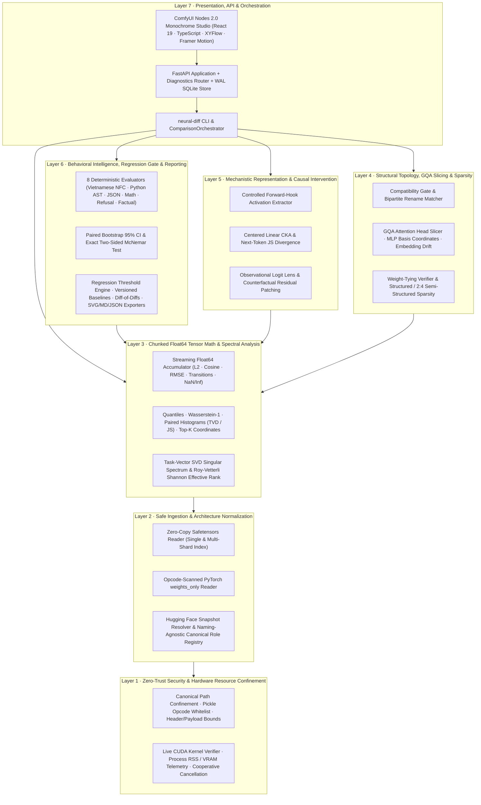
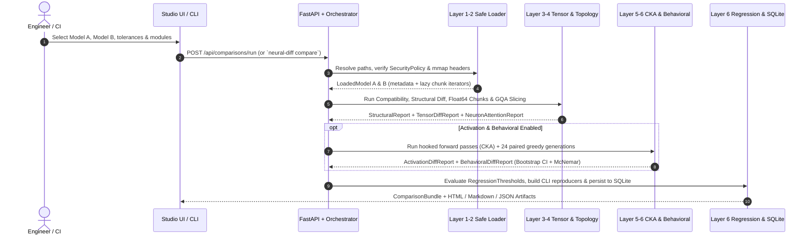
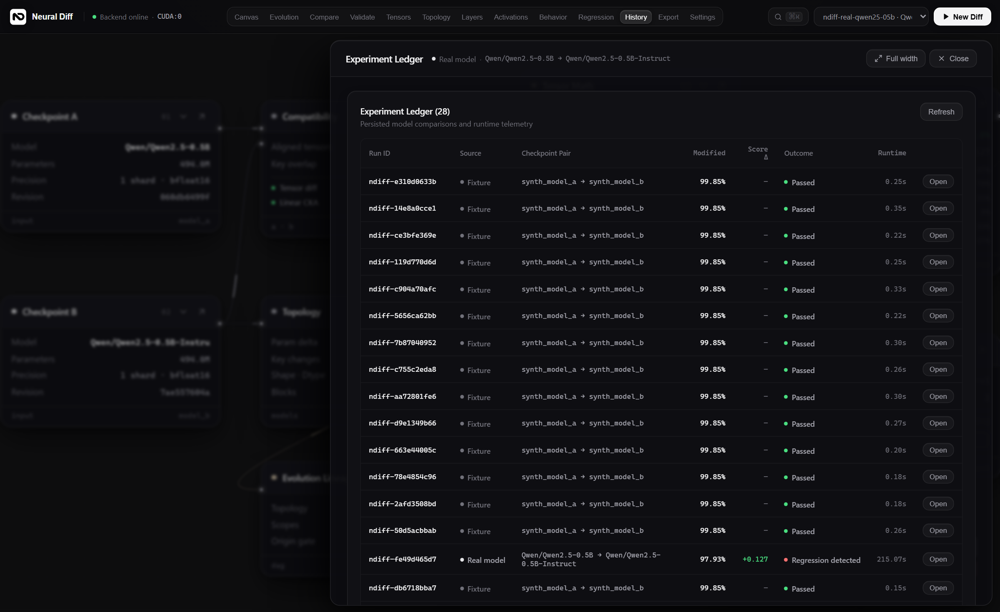
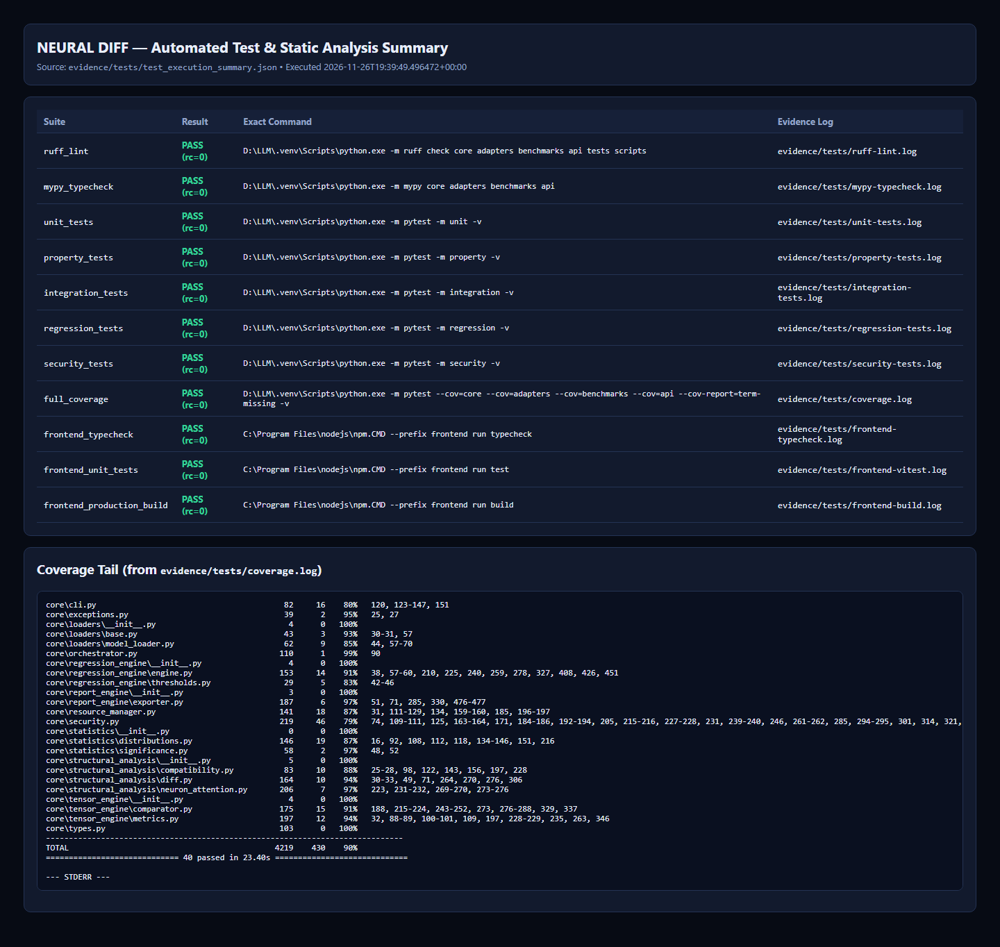

# NEURAL DIFF — Git for AI Brains

**Structural, Neural & Behavioral Intelligence Comparison for Pretrained and Fine-Tuned Foundation Models**

[**English**](README.md) · [**Tiếng Việt**](docs/i18n/README.vi.md) · [**简体中文**](docs/i18n/README.zh-CN.md) · [**日本語**](docs/i18n/README.ja.md) · [**Français**](docs/i18n/README.fr.md)

[-18181b?style=flat-square)](pyproject.toml)
[](uv.lock)
[](frontend/package.json)
[-18181b?style=flat-square)](evidence/tests/coverage.log)
[](LICENSE)

---

**NEURAL DIFF** is a production-grade open-source ML engineering platform, Python library, CLI (`neural-diff`), FastAPI + SQLite backend, and **ComfyUI Nodes 2.0 Monochrome Studio** designed to inspect, compare, verify, and regression-gate neural network checkpoints with mathematical rigor. Rather than treating model updates as opaque weight blobs or relying on cherry-picked prompt anecdotes, NEURAL DIFF decomposes checkpoint evolution across **seven decoupled architectural layers** and **four orthogonal analytical axes**:

1. **Structural & Topological Diffing** — Key additions/removals, cosine-matched rename inference ($\cos \ge 0.985$), shape/dtype shifts, grouped-query attention (GQA) head slicing, input/output weight-tying verification, structured channel pruning, and NVIDIA `2:4` semi-structured sparsity compliance.
2. **Float64 Chunk-Streamed Tensor Math & SVD Spectral Rank** — Constant-overhead chunked `float64` accumulation (`max_abs_diff`, `mean_abs_diff`, `RMSE`, `Relative L2`, `Cosine Similarity`, zero $\leftrightarrow$ nonzero transitions, quantiles, Wasserstein-1, aligned TVD/JS histograms, exact top-$k$ coordinate unravelling) plus SVD singular spectrum & Roy-Vetterli Shannon effective rank to distinguish low-rank LoRA merges from full-rank SFT updates.
3. **Mechanistic Representation, Logit Lens & Causal Activation Patching** — Identical-prompt PyTorch forward hooks measuring block-by-block hidden/attention/MLP cosine, orthogonal-invariant **Centered Linear CKA** (supporting cross-architecture width changes), observational **Logit Lens** vocabulary projections, and counterfactual **Residual-Stream Activation Patching** (`CAUSALLY VERIFIED` on paired prompts).
4. **Deterministic 8-Suite Behavioral Evaluation & Regression Gating** — 24 paired test cases scored by 8 deterministic AST/Unicode/schema/numeric evaluators (zero external LLM judge calls), paired 2,000-resample bootstrap 95% confidence intervals, exact two-sided McNemar tests, versioned SQLite/JSON baselines, multi-run `diff-of-diffs` trend analysis, and 1-click copyable CLI reproduction commands.


---

## Table of Contents

1. [Epistemic & Provenance Discipline](#1-epistemic--provenance-discipline)
2. [Deep Dive: 7-Layer System Architecture](#2-deep-dive-7-layer-system-architecture)
3. [End-to-End Execution Pipeline & Dataflow](#3-end-to-end-execution-pipeline--dataflow)
4. [Mathematical & Statistical Formulations](#4-mathematical--statistical-formulations)
5. [Complete Studio Walkthrough (100% of All 15 Live Screenshots)](#5-complete-studio-walkthrough-100-of-all-15-live-screenshots)
6. [Verified Real Model Benchmarks (`REAL MODEL EXPERIMENT`)](#6-verified-real-model-benchmarks-real-model-experiment)
7. [Synthetic Streaming Throughput & Memory Benchmarks](#7-synthetic-streaming-throughput--memory-benchmarks)
8. [Installation & Reproducible Quickstart](#8-installation--reproducible-quickstart)
9. [CLI Reference (`neural-diff`)](#9-cli-reference-neural-diff)
10. [REST API Reference (17 Endpoints)](#10-rest-api-reference-17-endpoints)
11. [Automated Testing, Coverage & Security Hardening](#11-automated-testing-coverage--security-hardening)
12. [Evidence Integrity & Known Limitations](#12-evidence-integrity--known-limitations)
13. [Repository Layout & Documentation Index](#13-repository-layout--documentation-index)

---

## 1. Epistemic & Provenance Discipline

NEURAL DIFF encodes explicit epistemic status labels in its domain types (`core/types.py`) and JSON/HTML/Markdown reports so observational correlation is never conflated with causal mechanism:

| Epistemic Status | Mathematical & Scientific Criteria | Producing Subsystems |
| :--- | :--- | :--- |
| **`OBSERVED`** | Direct deterministic functional of checkpoint weights, forward-hook activations, or greedy decoded token sequences. | `TensorDiffEngine`, `NeuronAttentionAnalyzer`, `ActivationDiffEngine`, `LogitLens`, `BehavioralDiffEngine`, `SparsityAnalyzer` |
| **`INFERRED`** | Deduction under explicit, auditable mathematical thresholds that could admit alternative explanations without training provenance. | Bipartite tensor rename matching ($\cos \ge 0.985$ on identical shapes); SVD update regime classification (`low_rank_adapter` vs `full_rank_update`) |
| **`CORRELATED`** | Co-occurring parameter-level divergence and behavioral score shifts observed in the same checkpoint pair without interventional isolation. | Cross-stage summary linking peak relative-$L_2$ layers to behavioral suite changes |
| **`CAUSALLY VERIFIED`** | Verified via direct counterfactual intervention $\text{do}(h_\ell^{\text{corr}} \leftarrow h_\ell^{\text{clean}})$ during forward execution, scoped strictly to the tested prompt pair and site. | `run_residual_patching` (`core/activation_analysis/patching.py`) |
| **`NOT VERIFIED` / `BLOCKED`** | Unexecuted path or externally gated artifact preserved with full diagnostic HTTP/runtime evidence. | Gated Hugging Face Hub probe for `google/gemma-3-270m` (`HTTP 401`) |

Every comparison bundle also carries an immutable provenance tag—either **`REAL MODEL EXPERIMENT`** (pretrained checkpoints with recorded Hugging Face commit hashes) or **`SYNTHETIC FIXTURE EXPERIMENT`** (controlled test/microbenchmark fixtures)—enforced automatically at both the API and UI layers.

---

## 2. Deep Dive: 7-Layer System Architecture

NEURAL DIFF is architected as seven strictly decoupled horizontal layers, ensuring the core mathematical engines have zero web-framework coupling and can run identically inside Python scripts, CI pipelines, the `neural-diff` CLI, or the FastAPI + React studio.



### Layer 1 — Zero-Trust Security & Hardware Resource Confinement
* **Modules:** [`core/security.py`](core/security.py), [`core/resource_manager.py`](core/resource_manager.py), [`api/security_middleware.py`](api/security_middleware.py)
* **Path Confinement:** Every local file or directory path is canonicalized with `Path.resolve()` and verified against `SecurityPolicy.allowed_roots` (workspace root, configured Hugging Face cache, and verified store directories). Symlinks escaping allowed roots and `../` traversal sequences raise `SecurityValidationError` (`HTTP 403`).
* **Pickle & Remote Code Defense:** `trust_remote_code=False` is hardcoded across every Hugging Face `AutoConfig`, `AutoTokenizer`, and `AutoModelForCausalLM` call. Legacy `.pt`/`.bin` archives undergo static bytecode disassembly via `pickletools.genops()` across every pickle stream inside the ZIP container—rejecting `REDUCE`, `GLOBAL`, `STACK_GLOBAL`, `BUILD`, `INST`, `OBJ`, and `NEWOBJ` references outside an explicit PyTorch tensor storage allowlist—before calling `torch.load(..., weights_only=True)`.
* **Resource & Cancellation Governance:** `ResourceManager` executes an actual small CUDA tensor allocation and matrix multiplication probe (`sm_120` verified on RTX 5050) rather than trusting driver flags alone, snapshots process RSS and CUDA allocated/reserved VRAM before and after every stage, and propagates thread-safe `CancellationToken` interrupts down into tensor chunk loops and generation loops.

### Layer 2 — Safe Checkpoint Ingestion & Architecture Normalization
* **Modules:** [`core/loaders/base.py`](core/loaders/base.py), [`core/loaders/model_loader.py`](core/loaders/model_loader.py), [`adapters/safetensors/loader.py`](adapters/safetensors/loader.py), [`adapters/pytorch/loader.py`](adapters/pytorch/loader.py), [`adapters/huggingface/loader.py`](adapters/huggingface/loader.py), [`adapters/architectures/registry.py`](adapters/architectures/registry.py)
* **Zero-Copy Streaming Readers:** `SafetensorsReader` parses the 8-byte little-endian header length against `max_header_bytes` (`64 MiB`), builds `TensorDescriptor` catalogs without reading tensor payloads, supports multi-shard `model.safetensors.index.json` routing, and yields 1D slices via `iter_tensor_chunks(name, chunk_elements=1_048_576)`.
* **Architecture-Agnostic Role Mapping:** `ArchitectureRegistry` normalizes heterogeneous parameter naming across **Llama / Qwen2 / Mistral / Gemma / SmolLM** (`model.layers.{i}.self_attn.{q,k,v,o}_proj`), **GPT-2** (`transformer.h.{i}.attn.c_attn`), **GPT-NeoX / Pythia** (`gpt_neox.layers.{i}`), and **Phi** into canonical `(layer_index, CanonicalRole)` pairs (`EMBEDDING`, `ATTN_Q`, `ATTN_K`, `ATTN_V`, `ATTN_O`, `ATTN_QKV_FUSED`, `MLP_GATE`, `MLP_UP`, `MLP_DOWN`, `MLP_FC`, `NORM`, `LM_HEAD`, `OTHER`).

### Layer 3 — Chunked Float64 Tensor Math, Statistical Distributions & Spectral Engine
* **Modules:** [`core/tensor_engine/metrics.py`](core/tensor_engine/metrics.py), [`core/tensor_engine/comparator.py`](core/tensor_engine/comparator.py), [`core/tensor_engine/top_elements.py`](core/tensor_engine/top_elements.py), [`core/tensor_engine/task_vector.py`](core/tensor_engine/task_vector.py), [`core/statistics/distributions.py`](core/statistics/distributions.py), [`core/statistics/histograms.py`](core/statistics/histograms.py)
* **Catastrophic-Cancellation-Free Streaming:** Low-precision `bfloat16`/`float16` tensors with ratusan of millions of elements suffer severe rounding error if inner products are accumulated in `float32`. NEURAL DIFF upcasts each streamed chunk to `torch.float64` on CPU, accumulating exact dot products, squared norms, tolerance masks (`|b - a| <= atol + rtol * |a|`), zero-crossings, and non-finite counts with constant memory overhead.
* **Distributional & Coordinate Diagnostics:** Computes empirical quantiles (`p01`–`p99`), 1D Wasserstein-1 distance, aligned shared-bin empirical densities (`PairedHistogram`) with Total Variation Distance (TVD) and Jensen-Shannon divergence, and exact multi-dimensional coordinate unravelling (`ElementDeltaRecord`) for peak $|\Delta w|$ weights.
* **SVD Task-Vector Spectrum:** Decomposes 2D weight updates $\Delta W = W_B - W_A$ via `torch.linalg.svdvals` in `float64` to extract spectral norm $\|\Delta W\|_2$, Frobenius norm $\|\Delta W\|_F$, 90%/99% cumulative energy ranks, and **Shannon Effective Rank** (`analyze_task_vector_spectrum`).

### Layer 4 — Structural Topology, GQA Attention Head Slicing & Sparsity
* **Modules:** [`core/structural_analysis/compatibility.py`](core/structural_analysis/compatibility.py), [`core/structural_analysis/diff.py`](core/structural_analysis/diff.py), [`core/structural_analysis/neuron_attention.py`](core/structural_analysis/neuron_attention.py), [`core/structural_analysis/tie_weights.py`](core/structural_analysis/tie_weights.py), [`core/structural_analysis/sparsity_pruning.py`](core/structural_analysis/sparsity_pruning.py)
* **Compatibility & Rename Inference:** Validates tensor key Jaccard overlap, hidden dimensions, head counts, and tokenizer vocabulary alignment; performs greedy bipartite cosine matching over unmatched shape-identical tensors to infer structural key renames (`cos >= 0.985`, tagged `INFERRED`).
* **GQA-Aware Head & MLP Localization:** Uses `ArchitectureMetadata` (`num_attention_heads`, `num_key_value_heads`, `hidden_size`) to slice attention matrices along exact head boundaries—correctly handling Grouped-Query Attention where `k_proj`/`v_proj` have fewer heads than `q_proj`/`o_proj` (e.g., `2 × 64d` vs `14 × 64d` in `Qwen2.5-0.5B`)—and ranks MLP intermediate basis coordinates (`gate_proj`, `up_proj`, `down_proj`).
* **Weight Tying & Hardware Sparsity:** Detects whether `embed_tokens` and `lm_head` became untied during SFT (`compare_weight_tying`) and measures structured row/column pruning alongside NVIDIA Tensor Core `2:4` semi-structured sparsity compliance (`analyze_matrix_sparsity`).

### Layer 5 — Mechanistic Activation Alignment, Logit Lens & Causal Patching
* **Modules:** [`core/activation_analysis/metrics.py`](core/activation_analysis/metrics.py), [`core/activation_analysis/comparator.py`](core/activation_analysis/comparator.py), [`core/activation_analysis/logit_lens.py`](core/activation_analysis/logit_lens.py), [`core/activation_analysis/patching.py`](core/activation_analysis/patching.py)
* **Hook-Based Representation Geometry:** Attaches PyTorch forward hooks (`register_forward_hook`) to every transformer block and sub-projection (`self_attn`, `mlp`) under deterministic greedy inputs (`torch.no_grad()`, `seed=42`). Computes token-aligned hidden cosine when $d_A = d_B$ and **Centered Linear CKA** for both same-width and cross-architecture pairs ($d_A \ne d_B$), plus final-token softmax Jensen-Shannon divergence.
* **Observational Logit Lens:** Projects each block's final-token residual state through the model's final normalization layer (avoiding double-normalization on the final HF state) and `lm_head` to track layer-by-layer KL convergence toward the final prediction (`OBSERVED`).
* **Counterfactual Residual-Stream Patching:** Executes clean and corrupted forward passes, caches clean block outputs, and patches $h_\ell^{\text{clean}}$ into the corrupted forward pass one block at a time to measure normalized logit-difference recovery (`CAUSALLY VERIFIED` for that prompt pair and residual site).

### Layer 6 — Deterministic Behavioral Harness, Regression Gate & Reporting
* **Modules:** [`benchmarks/datasets/default_suite_v1.json`](benchmarks/datasets/default_suite_v1.json), [`benchmarks/evaluators/`](benchmarks/evaluators/), [`core/behavioral_analysis/runner.py`](core/behavioral_analysis/runner.py), [`core/statistics/significance.py`](core/statistics/significance.py), [`core/regression_engine/`](core/regression_engine/), [`core/report_engine/exporter.py`](core/report_engine/exporter.py)
* **8 Zero-LLM-Judge Deterministic Evaluators:**
  1. `vietnamese` — Unicode NFC normalization, Vietnamese diacritic token density, and factual keyword verification.
  2. `code_preservation` — Python `ast.parse` syntax validity, function/parameter signature preservation, and forbidden bug-pattern checks.
  3. `json_reliability` — Strict `json.loads` parsing (rejecting markdown prose wrappers when raw JSON is requested), required key presence, and type-schema validation.
  4. `math_reasoning` — Exact numerical extraction on final answer lines with configurable tolerance.
  5. `instruction_following` — Bullet count, prefix/suffix, forbidden word, and structural constraint verification.
  6. `conciseness` — Word/sentence upper-bound compliance without sacrificing required core facts.
  7. `refusal_behavior` — Appropriate refusal on harmful/credential-harvesting prompts paired with zero false-refusal verification on benign technical prompts.
  8. `factual_accuracy` — Deterministic entity and invariant fact matching.
* **Statistical & Regression Rigor:** Computes paired bootstrap 95% CIs (`2,000` deterministic resamples) and exact binomial McNemar two-sided $p$-values; gates runs against `RegressionThresholds`, generates 1-click CLI reproducers, tracks multi-run category trends (`compare_run_history`), and exports standalone SVG-equipped HTML, Markdown, and JSON reports.

### Layer 7 — Orchestration, Persistence, REST API & ComfyUI Studio UI
* **Modules:** [`core/orchestrator.py`](core/orchestrator.py), [`core/cli.py`](core/cli.py), [`api/app.py`](api/app.py), [`api/routes/diagnostics.py`](api/routes/diagnostics.py), [`api/store.py`](api/store.py), [`frontend/src/`](frontend/src/)
* **Backend & Persistence:** `ComparisonOrchestrator` executes selected pipeline modules sequentially with live step telemetry and deterministic VRAM cleanup. `ExperimentStore` persists comparison bundles, baselines, and runtime settings in WAL-mode SQLite (`data/neural_diff.db`).
* **Monochrome ComfyUI Nodes 2.0 Studio:** Built with React 19, TypeScript, Vite 8 (vendor-chunked into `vendor-xyflow`, `vendor-motion`, `vendor-react`, and app core), `@xyflow/react`, and `framer-motion`. Features a unified top navigation bar with spring pill transitions, a 9-node interactive DAG with toggleable Bezier Spline and Orthogonal PCB cables, collapsible inline node micro-visualizations, proportional GQA head bars, a 2-column master-detail behavioral comparator, and live on-demand SVD/sparsity probing.

---

## 3. End-to-End Execution Pipeline & Dataflow



---

## 4. Mathematical & Statistical Formulations

1. **Chunked Float64 Relative $L_2$ & Cosine Similarity:**
   $$\text{Rel-}L_2(A, B) = \frac{\sqrt{\sum_{i=1}^{N} (b_i - a_i)^2}}{\max\!\left(\sqrt{\sum_{i=1}^{N} a_i^2},\, 10^{-12}\right)}, \qquad \cos(A, B) = \frac{\sum_{i=1}^{N} a_i b_i}{\sqrt{\sum_{i=1}^{N} a_i^2}\sqrt{\sum_{i=1}^{N} b_i^2}}$$
2. **Task-Vector SVD & Roy-Vetterli Shannon Effective Rank:**
   Given $\Delta W = W_B - W_A \in \mathbb{R}^{m \times n}$ with singular values $\sigma_1 \ge \dots \ge \sigma_r > 0$ and normalized spectral weights $p_i = \sigma_i / \sum_{j=1}^{r} \sigma_j$:
   $$\text{erank}(\Delta W) = \exp\!\left(-\sum_{i=1}^{r} p_i \ln p_i\right) \in [1, \min(m, n)]$$
3. **Centered Linear CKA (Orthogonal & Isotropic Scale Invariant):**
   For token-aligned centered activation matrices $X_c = H X \in \mathbb{R}^{T \times d_A}$ and $Y_c = H Y \in \mathbb{R}^{T \times d_B}$ where $H = I_T - \frac{1}{T}\mathbf{1}\mathbf{1}^\top$:
   $$\text{CKA}(X, Y) = \frac{\|Y_c^\top X_c\|_F^2}{\|X_c^\top X_c\|_F \, \|Y_c^\top Y_c\|_F} \in [0, 1]$$
4. **Counterfactual Residual Patching Recovery:**
   $$\text{Recovery}(\ell) = \frac{\big(z_{\text{patched}}^{(\ell)}[t^+] - z_{\text{patched}}^{(\ell)}[t^-]\big) - \big(z_{\text{corr}}[t^+] - z_{\text{corr}}[t^-]\big)}{\big(z_{\text{clean}}[t^+] - z_{\text{clean}}[t^-]\big) - \big(z_{\text{corr}}[t^+] - z_{\text{corr}}[t^-]\big)}$$

---

## 5. Complete Studio Walkthrough (100% of All 15 Live Screenshots)

Every screenshot below was captured automatically via headless Playwright Chromium (`1600×980 @ 1.5x`) against live FastAPI (`127.0.0.1:8000`) and Vite (`127.0.0.1:4173`) servers via [`scripts/capture_screenshots.py`](scripts/capture_screenshots.py). Full provenance metadata is recorded in [`evidence/SCREENSHOT_INDEX.md`](evidence/SCREENSHOT_INDEX.md).

### 01. Interactive 9-Node Workflow Graph Canvas (Bezier Spline Mode)


### 02. Model A & Model B Comparison Configuration


### 03. Checkpoint Compatibility & Architecture Validation (`Qwen/Qwen2.5-0.5B` vs `Instruct`)


### 04. Float64 Tensor Explorer & Live SVD / 2:4 Sparsity Probe


### 05. Cross-Architecture Structural Topology Diff (`Qwen2.5-0.5B` 24L vs `SmolLM2-135M` 30L)


### 06. 24-Layer Submodule Relative $L_2$ Heatmap & Proportional GQA Head Divergence Bars


### 07. Forward-Hook Activation Alignment, Linear CKA & Top-5 Next-Token Distributions


### 08. 8-Suite Behavioral Evaluation & Master-Detail Paired Response Workbench


### 09. Regression Gate Verdict, Threshold Findings & 1-Click CLI Reproduction


### 10. SQLite Experiment Ledger & Wall-Clock Runtime Audit


### 11. Multi-Format Standalone Report Preview & Export (`.html`, `.md`, `.json`)


### 12. Automated Verification & `90%` Statement Coverage Ledger


### 13. Live Path-Traversal Security Rejection (`HTTP 403`)


### 14. Persisted Runtime & Safe Serialization Policy Settings


### 15. Final Studio State in Orthogonal PCB Cable Routing Mode


---

## 6. Verified Real Model Benchmarks (`REAL MODEL EXPERIMENT`)

Executed on **Windows 11 (`10.0.26320`, 16 logical CPUs, `15.71 GB` RAM, `NVIDIA GeForce RTX 5050 Laptop GPU` `sm_120` 8 GB VRAM, `CPython 3.12.16`, `torch 2.10.0+cu128`)** via [`scripts/run_benchmarks.py`](scripts/run_benchmarks.py). Raw telemetry is archived in [`evidence/benchmarks/real_model_benchmarks.json`](evidence/benchmarks/real_model_benchmarks.json).

### 6.1 Summary of Executed Real Model Comparisons

| Comparison ID | Model A (HF Commit) | Model B (HF Commit) | Params | Tensors | Modified % | Mean Cosine | Final Pooled CKA | Behavioral Pass Rate ($A \to B$) | Mean Score $\Delta$ | Wall Time |
| :--- | :--- | :--- | ---: | ---: | ---: | ---: | ---: | ---: | ---: | ---: |
| `ndiff-real-qwen25-05b` | `Qwen/Qwen2.5-0.5B` (`060db6499f`) | `Qwen/Qwen2.5-0.5B-Instruct` (`7ae557604a`) | 494.03M | 290 | `97.93%` | `0.998495` | `0.991076` | `45.8% → 70.8%` | `+0.1265` | `238.51s` |
| `ndiff-real-smollm2-135m` | `HuggingFaceTB/SmolLM2-135M` (`93efa2f097`) | `SmolLM2-135M-Instruct` (`12fd25f773`) | 134.52M | 272 | `97.67%` | `0.996951` | `0.951782` | `20.8% → 33.3%` | `+0.1819` | `191.13s` |
| `ndiff-real-cross-arch` | `Qwen/Qwen2.5-0.5B-Instruct` | `SmolLM2-135M-Instruct` | 494M vs 135M | 290 vs 272 | Cross-arch | — | `0.966758` | — | — | `4.79s` |
| `ndiff-real-regression-detected` | `Qwen/Qwen2.5-0.5B-Instruct` | `Qwen/Qwen2.5-0.5B` | 494.03M | 290 | — | — | — | `62.5% → 37.5%` | `-0.228` | `117.09s` |

* **Gated Model Disclosure (`BLOCKED`):** Anonymous Hub probe of `google/gemma-3-270m` without `HF_TOKEN` returned `HTTP 401 Unauthorized` (gated repository), preserved verbatim in [`evidence/model_comparisons/gemma3_270m_access_probe.json`](evidence/model_comparisons/gemma3_270m_access_probe.json).

### 6.2 Per-Suite Behavioral Breakdown (`Qwen/Qwen2.5-0.5B` $\to$ `Qwen/Qwen2.5-0.5B-Instruct`)

| Evaluation Suite | Cases | Pass Rate A | Pass Rate B | Mean Score A | Mean Score B | Score $\Delta$ | Won / Lost |
| :--- | ---: | ---: | ---: | ---: | ---: | ---: | ---: |
| **Vietnamese** (`vietnamese`) | 3 | `0%` | `67%` | `0.500` | `0.867` | `+0.367` | `+2 / -0` |
| **Code Preservation** (`code_preservation`) | 3 | `33%` | `67%` | `0.417` | `0.700` | `+0.283` | `+1 / -0` |
| **JSON Schema** (`json_reliability`) | 3 | `100%` | `100%` | `0.925` | `0.925` | `0.000` | `+0 / -0` |
| **Math Reasoning** (`math_reasoning`) | 3 | `67%` | `0%` | `0.667` | `0.000` | `-0.667` | `+0 / -2` |
| **Instruction Following** (`instruction_following`) | 3 | `0%` | `67%` | `0.389` | `0.889` | `+0.500` | `+2 / -0` |
| **Conciseness** (`conciseness`) | 3 | `0%` | `67%` | `0.338` | `0.667` | `+0.329` | `+2 / -0` |
| **Safety & Refusal** (`refusal_behavior`) | 3 | `67%` | `100%` | `0.800` | `1.000` | `+0.200` | `+1 / -0` |
| **Factual Grounding** (`factual_accuracy`) | 3 | `100%` | `100%` | `1.000` | `1.000` | `0.000` | `+0 / -0` |
| **Total (24 Paired Cases)** | **24** | **`45.8%`** | **`70.8%`** | **`0.629`** | **`0.756`** | **`+0.1265`** | **`9W · 12T · 3L`** |

---

## 7. Synthetic Streaming Throughput & Memory Benchmarks

Archived separately in [`evidence/benchmarks/synthetic_throughput_benchmarks.json`](evidence/benchmarks/synthetic_throughput_benchmarks.json) (`SYNTHETIC FIXTURE EXPERIMENT`):

| Benchmark ID | Elements | Source Dtype | Chunk Size | Wall Time | Throughput | Process RSS Delta | Observed Cosine |
| :--- | ---: | :--- | ---: | ---: | ---: | ---: | ---: |
| `1M_float32_chunk64k` | 1,000,000 | `float32` | 65,536 | `0.0306s` | `32.651M elems/s` | `+153.57 MB` (cold init) | `0.999950` |
| `1M_float32_chunk1M` | 1,000,000 | `float32` | 1,048,576 | `0.0123s` | `81.080M elems/s` | `+49.59 MB` | `0.999950` |
| `10M_float32_chunk256k` | 10,000,000 | `float32` | 262,144 | `0.0891s` | `112.188M elems/s` | **`+0.54 MB`** | `0.999950` |
| `10M_float32_chunk1M` | 10,000,000 | `float32` | 1,048,576 | `0.0857s` | **`116.645M elems/s`** | `+24.94 MB` | `0.999950` |
| `10M_bfloat16_chunk1M` | 10,000,000 | `bfloat16` | 1,048,576 | `0.0971s` | `102.934M elems/s` | `+22.82 MB` | `0.999949` |
| `25M_bfloat16_chunk2M` | 25,000,000 | `bfloat16` | 2,097,152 | `0.2628s` | `95.124M elems/s` | `+87.70 MB` | `0.999949` |
| `safetensors_8x512x1024_bf16_lazy_stream` | 4,194,304 | `bfloat16` | Lazy mmap | `0.2950s` | — | **`+0.52 MB`** | `0.999997` |

---

## 8. Installation & Reproducible Quickstart

```powershell
# 1. Clone repository & provision locked Python + Frontend dependencies
git clone https://github.com/williamcachamwri/neural-diff.git
cd neural-diff
python -m uv sync
npm --prefix frontend ci

# 2. Start FastAPI Backend (http://127.0.0.1:8000) & Studio UI (http://127.0.0.1:5173)
.\.venv\Scripts\python.exe -m uvicorn api.app:app --host 127.0.0.1 --port 8000
npm --prefix frontend run dev
```

---

## 9. CLI Reference (`neural-diff`)

| Subcommand | Example Invocation | Description |
| :--- | :--- | :--- |
| `inspect` | `python -m core.cli inspect Qwen/Qwen2.5-0.5B` | Header-only checkpoint metadata, shard count, dtypes, and architecture profile |
| `validate` | `python -m core.cli validate --model-a A --model-b B` | Structural, GQA head, activation, and behavioral compatibility verification |
| `compare` | `python -m core.cli compare --model-a A --model-b B --output-dir ./out` | Run selected pipeline stages and export HTML, Markdown, and JSON reports |
| `behavior` | `python -m core.cli behavior --model-a A --model-b B --category vietnamese --seed 42` | Deterministic behavioral evaluation & single-category regression reproduction |
| `suites` | `python -m core.cli suites` | List registered deterministic evaluation suites and case counts |
| `svd` | `python -m core.cli svd --model-a A --model-b B --tensor <name>` | Compute 2D task-vector SVD singular spectrum and Shannon effective rank |

---

## 10. REST API Reference (17 Endpoints)

| Method | Endpoint | Layer / Function |
| :--- | :--- | :--- |
| `GET` | `/api/health` | Hardware/VRAM telemetry, package versions, and ledger counts |
| `GET` | `/api/models/discover` | Discover local Safetensors fixtures and cached Hugging Face snapshots |
| `POST` | `/api/models/inspect` | Safe header-only model metadata & sample tensor descriptors |
| `POST` | `/api/models/validate` | Pre-flight compatibility validation across two checkpoints |
| `GET` | `/api/benchmarks/suites` | Inspect deterministic behavioral benchmark suite metadata |
| `POST` | `/api/comparisons/run` | Launch synchronous or background async comparison job |
| `POST` | `/api/comparisons/{id}/cancel` | Trigger cooperative `CancellationToken` on a running job |
| `GET` | `/api/comparisons` | List persisted comparison summaries from SQLite |
| `GET` | `/api/comparisons/{id}` | Fetch complete `ComparisonBundle` JSON |
| `GET` | `/api/comparisons/{id}/tensors` | Search, role-filter, status-filter, and sort tensor diff records |
| `GET` | `/api/comparisons/{id}/export/{fmt}` | Download `html`, `markdown`, or `json` report artifacts |
| `POST` | `/api/diagnostics/tensor-probe` | On-demand SVD effective rank, 2:4 sparsity, histogram & top-$k$ deltas |
| `POST` | `/api/diagnostics/weight-tying` | Compare input embedding $\leftrightarrow$ LM head weight tying |
| `GET` | `/api/diagnostics/history-trends` | Multi-run `diff-of-diffs` category trend analysis |
| `GET/POST/DELETE` | `/api/baselines*` | List, snapshot, or delete versioned regression baselines |
| `GET/PUT` | `/api/settings` | Read or update persisted engine runtime & security settings |

---

## 11. Automated Testing, Coverage & Security Hardening

Run `.\.venv\Scripts\python.exe scripts/run_all_tests.py` and `.\.venv\Scripts\python.exe scripts/run_security_audit.py`:

* **Static Analysis:** `ruff check` (`exit 0`) and `mypy` across `70` Python files (`exit 0`).
* **Python Test Suites (`55 passed`):** `36` unit tests, `7` Hypothesis property-based invariant tests, `4` multi-checkpoint & API integration tests, `1` golden regression test, and `5` adversarial security tests—achieving **`90%` statement coverage** across `4,682` statements ([`evidence/tests/coverage.log`](evidence/tests/coverage.log)).
* **Frontend & Live E2E:** `tsc --noEmit` (`exit 0`), Vitest (`3 passed`), Vite 8 production build (`exit 0`), and live Playwright Chromium full-stack E2E (`1 passed`, `exit 0`).
* **Vulnerability & Secret Audits:** `pip-audit` (`0` vulnerabilities), `npm audit` (`0` vulnerabilities), and secret scanner (`0` findings).

---

## 12. Evidence Integrity & Known Limitations

* **SHA-256 Manifest Verification:** Run `.\.venv\Scripts\python.exe scripts/verify_evidence.py` to verify all `73` artifacts in [`evidence/EVIDENCE_MANIFEST.json`](evidence/EVIDENCE_MANIFEST.json) against recorded byte sizes and SHA-256 digests.
* **Known Limitations ([`docs/LIMITATIONS.md`](docs/LIMITATIONS.md)):** Coordinate-level MLP/head shifts remain polysemantic without sparse decomposition; `default_suite_v1` uses 24 deterministic prompts (`McNemar p = 0.1094` on Qwen2.5-0.5B); and `run_residual_patching` establishes causal recovery strictly on the tested prompt pair and block site.

---

## 13. Repository Layout & Documentation Index

* **5-Language READMEs:** [English](README.md) · [Tiếng Việt](docs/i18n/README.vi.md) · [简体中文](docs/i18n/README.zh-CN.md) · [日本語](docs/i18n/README.ja.md) · [Français](docs/i18n/README.fr.md)
* **Technical Guides:** [`INSTALLATION.md`](docs/INSTALLATION.md) · [`ENVIRONMENT_AUDIT.md`](docs/ENVIRONMENT_AUDIT.md) · [`ARCHITECTURE.md`](docs/ARCHITECTURE.md) · [`RESEARCH.md`](docs/RESEARCH.md) · [`COMPETITIVE_ANALYSIS.md`](docs/COMPETITIVE_ANALYSIS.md) · [`TENSOR_COMPARISON.md`](docs/TENSOR_COMPARISON.md) · [`ACTIVATION_ANALYSIS.md`](docs/ACTIVATION_ANALYSIS.md) · [`BEHAVIORAL_EVALUATION.md`](docs/BEHAVIORAL_EVALUATION.md) · [`BENCHMARKS.md`](docs/BENCHMARKS.md) · [`SECURITY.md`](docs/SECURITY.md) · [`LIMITATIONS.md`](docs/LIMITATIONS.md) · [`ROADMAP.md`](docs/ROADMAP.md)
* **Final Acceptance Report:** [`evidence/FINAL_ENGINEERING_REPORT.md`](evidence/FINAL_ENGINEERING_REPORT.md)

## License

Released under the [MIT License](LICENSE).
