# NEURAL DIFF — Git for AI Brains

**Structural, Neural & Behavioral Intelligence Comparison for Foundation and Fine-Tuned Models**

[**English**](README.md) · [**Tiếng Việt**](docs/i18n/README.vi.md) · [**简体中文**](docs/i18n/README.zh-CN.md) · [**日本語**](docs/i18n/README.ja.md) · [**Français**](docs/i18n/README.fr.md)

---

**NEURAL DIFF** is a full-stack ML engineering workbench, Python library, CLI (`neural-diff`), and FastAPI + React/TypeScript studio designed to inspect, compare, verify, and regression-gate neural network checkpoints with mathematical rigor. Instead of treating model updates as opaque weight blobs or relying on subjective vibes, NEURAL DIFF decomposes checkpoint evolution across four orthogonal axes:

1. **Structural & Topological Diffing** — Key additions, removals, cosine-matched tensor renames ($\cos \ge 0.985$), shape/dtype shifts, grouped-query attention (GQA) geometry, weight-tying verification, and structured/2:4 semi-structured sparsity analysis.
2. **Float64-Accumulated Parameter Math & Spectral Rank** — Lazy chunk-streamed `float64` norm, cosine similarity, RMSE, relative $L_2$, quantile distribution shifts (Wasserstein-1, Total Variation Distance, Jensen-Shannon), and task-vector SVD Shannon effective rank to distinguish low-rank LoRA merges from full-rank fine-tuning.
3. **Mechanistic Representation & Causal Patching** — Controlled identical-prompt forward hooks measuring per-layer hidden/attention/MLP cosine, orthogonal-invariant **Linear CKA**, observational **Logit Lens** projections, and counterfactual **Residual-Stream Activation Patching** (`CAUSALLY VERIFIED` on paired prompts).
4. **Deterministic Behavioral Evaluation & Regression Gating** — 8 zero-LLM-judge evaluation suites (24 paired cases) with paired bootstrap 95% confidence intervals, exact McNemar two-sided tests, versioned SQLite/JSON baselines, multi-run diff-of-diffs progression tracking, and 1-click CLI failure reproduction commands.

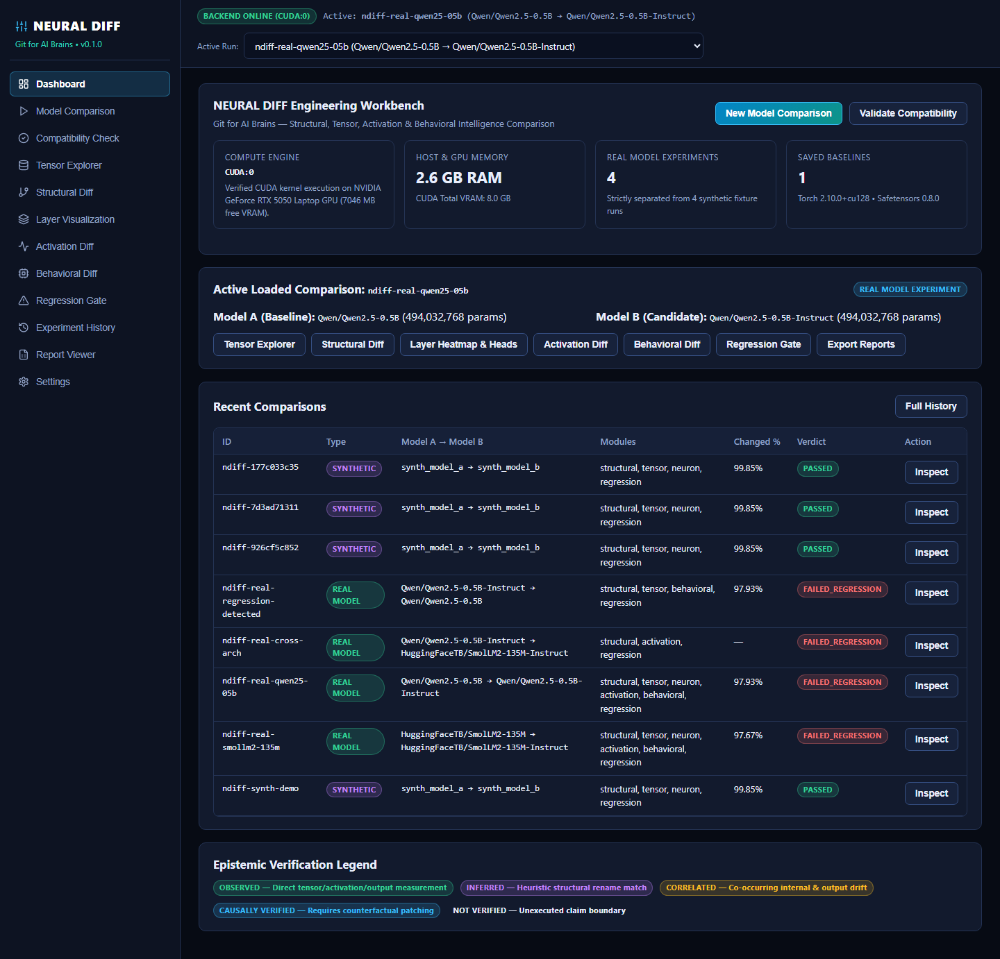

---

## Table of Contents

1. [Design Principles & Epistemic Discipline](#1-design-principles--epistemic-discipline)
2. [System Architecture](#2-system-architecture)
3. [Complete Studio Walkthrough (15 Live Screenshots)](#3-complete-studio-walkthrough-15-live-screenshots)
4. [Real Model Benchmarks (Verified Hardware Execution)](#4-real-model-benchmarks-verified-hardware-execution)
5. [Synthetic Streaming Throughput & Memory Benchmarks](#5-synthetic-streaming-throughput--memory-benchmarks)
6. [Mathematical & Algorithmic Foundations](#6-mathematical--algorithmic-foundations)
7. [Installation & Reproducible Quickstart](#7-installation--reproducible-quickstart)
8. [CLI Reference (`neural-diff`)](#8-cli-reference-neural-diff)
9. [REST API Reference](#9-rest-api-reference)
10. [Automated Testing, Coverage & Security Audit](#10-automated-testing-coverage--security-audit)
11. [Evidence Integrity & Known Limitations](#11-evidence-integrity--known-limitations)
12. [Documentation Index](#12-documentation-index)

---

## 1. Design Principles & Epistemic Discipline

NEURAL DIFF enforces strict separation between what is directly computed from weights/activations and what requires structural inference or causal intervention:

| Epistemic Label | Meaning in NEURAL DIFF | Concrete Engine Producers |
| :--- | :--- | :--- |
| **`OBSERVED`** | Deterministic measurement directly computed from checkpoint tensors, forward-pass activations, or token outputs. | `TensorDiffEngine`, `ActivationDiffEngine`, `LogitLens`, `BehavioralDiffEngine`, `SparsityAnalyzer` |
| **`INFERRED`** | High-confidence structural or spectral deduction under explicit thresholds (never silently treated as ground truth). | Shape-identical tensor rename matching ($\cos \ge 0.985$), SVD LoRA vs. full-rank regime classification |
| **`CORRELATED`** | Co-occurring weight shifts and behavioral score changes without counterfactual isolation. | Cross-referencing high relative-$L_2$ layers against behavioral suite deltas |
| **`CAUSALLY VERIFIED`** | Verified via direct counterfactual intervention $\text{do}(h_\ell \leftarrow h_\ell^{\text{clean}})$ on a specific prompt pair and site. | `run_residual_patching` (`core/activation_analysis/patching.py`) |
| **`NOT VERIFIED` / `BLOCKED`** | Unexecuted path or externally gated artifact preserved transparently with exact diagnostic evidence. | `google/gemma-3-270m` gated Hub probe (`HTTP 401`) |

Every persisted run is also strictly classified as either **`REAL MODEL EXPERIMENT`** (public pretrained checkpoints with recorded Hugging Face commit hashes) or **`SYNTHETIC FIXTURE EXPERIMENT`** (controlled test/throughput fixtures). Their metrics are never mixed.

---

## 2. System Architecture

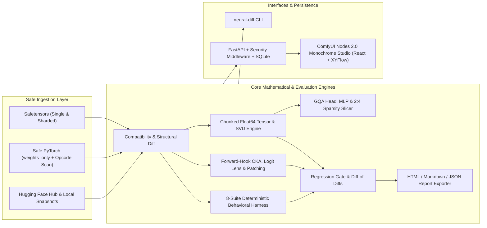

### Repository Structure

```text
neural-diff/
├── core/
│   ├── loaders/               # Unified ModelLoader & lazy chunk iterators
│   ├── tensor_engine/         # Float64 streaming metrics, top-k deltas, SVD task-vector rank
│   ├── structural_analysis/   # Compatibility gate, rename matcher, GQA heads, 2:4 sparsity, weight tying
│   ├── activation_analysis/   # Forward-hook Linear CKA, Logit Lens, causal residual patching
│   ├── behavioral_analysis/   # Paired deterministic generation runner & bootstrap/McNemar stats
│   ├── regression_engine/     # Threshold policy gate, baselines, CLI reproducers, diff-of-diffs
│   ├── statistics/            # Quantiles, Wasserstein-1, aligned histograms (TVD / JS), significance
│   ├── report_engine/         # Standalone HTML (inline SVG), Markdown & strict JSON exporters
│   ├── security.py            # Path confinement, pickle opcode scanner, header/size bounds
│   ├── resource_manager.py    # CUDA kernel probe, RSS/VRAM telemetry, cooperative cancellation
│   ├── orchestrator.py        # Multi-stage comparison coordinator
│   └── cli.py                 # `neural-diff` command-line entrypoint
├── adapters/
│   ├── safetensors/           # Zero-copy memory-mapped single & sharded Safetensors reader
│   ├── pytorch/               # Opcode-audited `weights_only=True` PyTorch reader
│   ├── huggingface/           # Local snapshot & Hub cache resolver (`trust_remote_code=False`)
│   └── architectures/         # Naming-agnostic role mapper (Llama/Qwen, GPT-2, GPT-NeoX, Gemma, Phi)
├── benchmarks/
│   ├── datasets/              # Versioned 24-case deterministic suite (`default_suite_v1.json`)
│   └── evaluators/            # 8 zero-LLM-judge evaluators (Vietnamese NFC, AST code, JSON, Math, etc.)
├── api/
│   ├── app.py                 # FastAPI factory, async job runner, cancellation & report endpoints
│   ├── routes/diagnostics.py  # On-demand SVD spectrum, 2:4 sparsity, weight-tying & trend endpoints
│   ├── security_middleware.py # Body size limit, security headers, structured error boundaries
│   └── store.py               # Thread-safe WAL SQLite persistence (`data/neural_diff.db`)
├── frontend/                  # Monochrome ComfyUI Nodes 2.0 Studio (React 19, TypeScript, XYFlow, Vite 8)
├── tests/                     # Unit, Hypothesis property, Integration, Regression, Security & E2E tests
├── scripts/                   # Reproducible environment, test, benchmark, screenshot & manifest scripts
├── docs/                      # 12 deep technical guides + 5-language README translations
└── evidence/                  # Auditable logs, real benchmarks, 15 live PNGs & SHA-256 manifest
```

---

## 3. Complete Studio Walkthrough (15 Live Screenshots)

All 15 screenshots below were captured via automated headless Playwright Chromium (`1600×980 @ 1.5x` device scale) against the live FastAPI (`127.0.0.1:8000`) and Vite (`127.0.0.1:4173`) servers via [`scripts/capture_screenshots.py`](scripts/capture_screenshots.py). Every view is accessible from a single unified top studio bar over an interactive 9-node `@xyflow/react` pipeline canvas.

### 3.1 Workflow Graph Canvas (Bezier Spline Mode)
Displays the end-to-end 9-node DAG (`Checkpoint A`, `Checkpoint B`, `Compatibility`, `Topology`, `Tensor Math`, `Layer & Head Scope`, `Activation CKA`, `Behavioral Suite`, `Regression Gate`) with inline pixel heatmaps, CKA oscilloscopes, and domain score bars for `Qwen/Qwen2.5-0.5B` $\to$ `Qwen/Qwen2.5-0.5B-Instruct`.


### 3.2 Model Comparison Configuration
Selects baseline and candidate checkpoints (local paths or Hugging Face IDs), provenance classification, compute backend (`auto` / `cuda` / `cpu`), `atol`/`rtol` numerical tolerances, optional baseline gates, and pipeline modules.
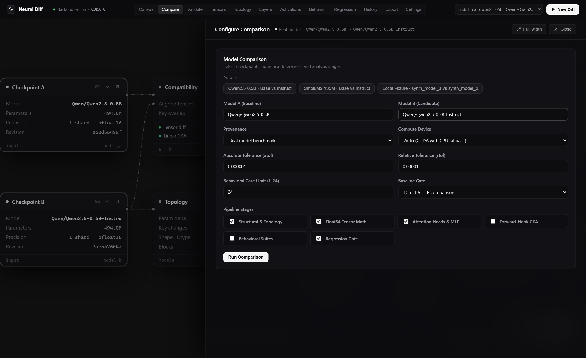

### 3.3 Checkpoint Compatibility Validation
Executes live header-level inspection across `Qwen/Qwen2.5-0.5B` and `Qwen/Qwen2.5-0.5B-Instruct`, confirming `290/290` shape-aligned `bfloat16` tensors (`494,032,768` parameters, `24L × 896d` `Qwen2ForCausalLM`).
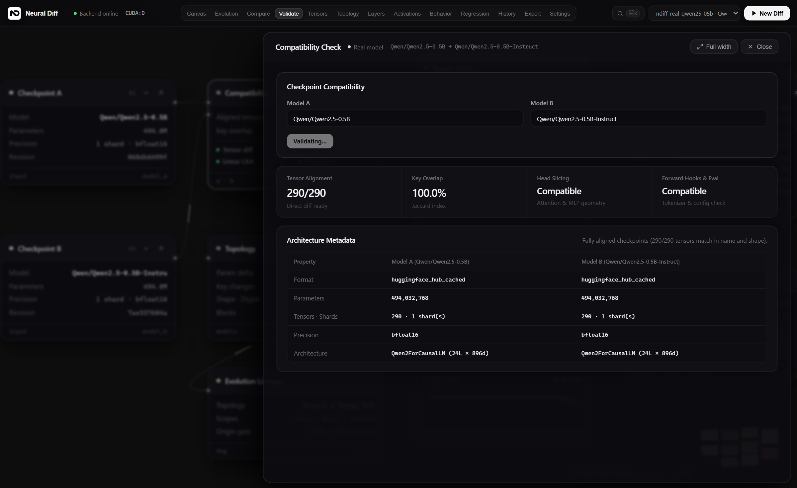

### 3.4 Float64 Tensor Explorer & On-Demand SVD Probe
Lists all 290 compared tensors with role/state filters, `float64`-accumulated cosine similarity, relative $L_2$, RMSE, peak $|\Delta|$, Wasserstein-1 distribution shifts, and an on-demand **Probe SVD & Sparsity** analyzer for any 2D weight matrix.
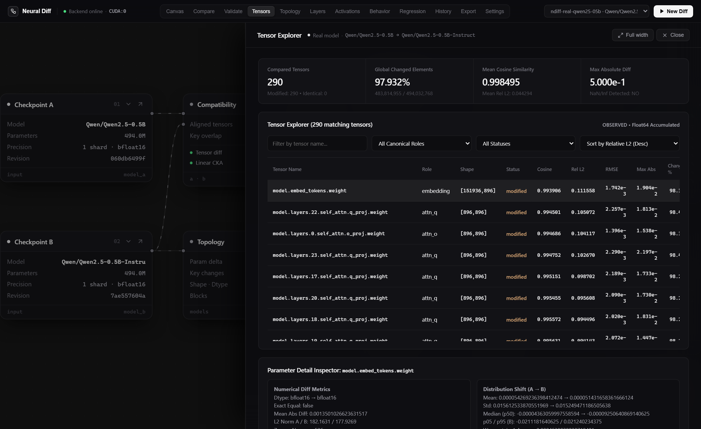

### 3.5 Cross-Architecture Structural Topology Diff
Demonstrates naming-agnostic structural comparison between `Qwen/Qwen2.5-0.5B-Instruct` (24 layers, 494.0M parameters) and `HuggingFaceTB/SmolLM2-135M-Instruct` (30 layers, 134.5M parameters), cataloging added/removed keys, shape deltas, and per-block parameter inventories.
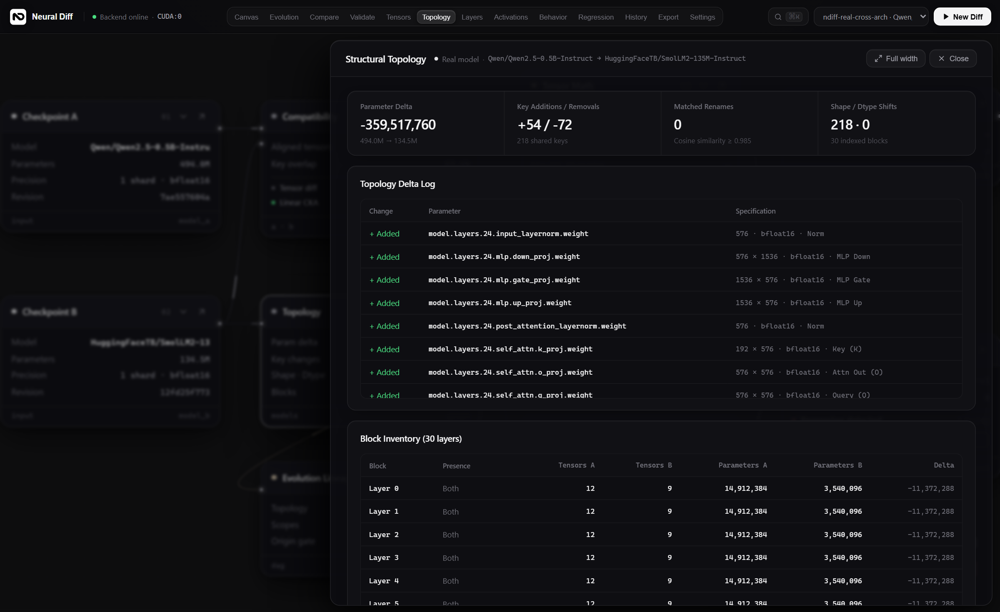

### 3.6 Layer Submodule Heatmap & Proportional Attention Head Slicing
Visualizes the `24 × 8` layer-by-submodule relative $L_2$ matrix alongside interactive per-layer GQA head divergence bars (`14 × 64d` Q/O heads, `2 × 64d` KV heads) and top shifted MLP basis coordinates.
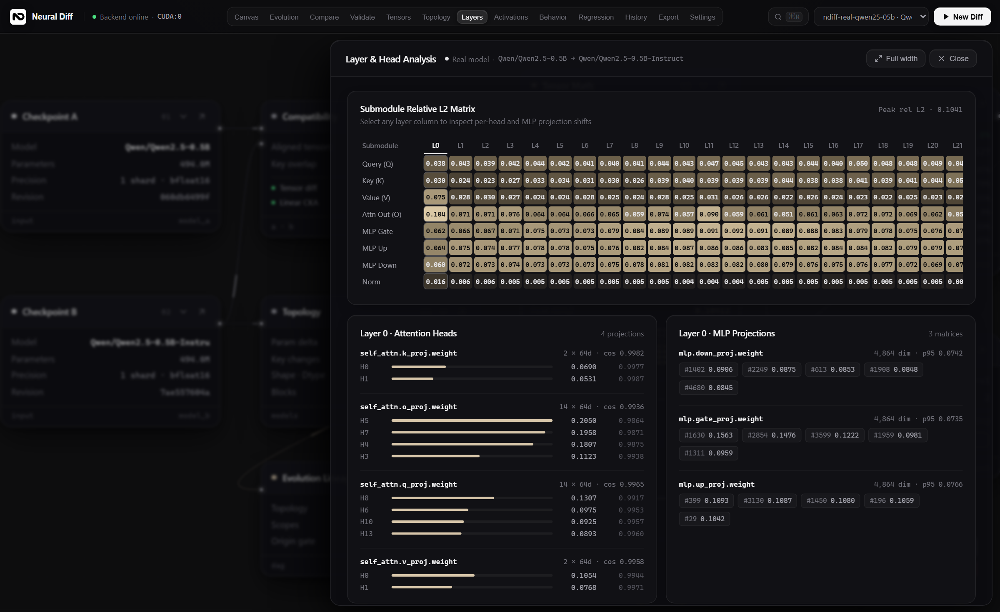

### 3.7 Forward-Hook Activation Alignment & Linear CKA
Tracks hidden-state cosine similarity, orthogonal-invariant **Linear CKA**, attention/MLP alignment across all 24 transformer blocks, depth CKA drift (`L0 → Final`), and paired Top-5 next-token probability distributions.
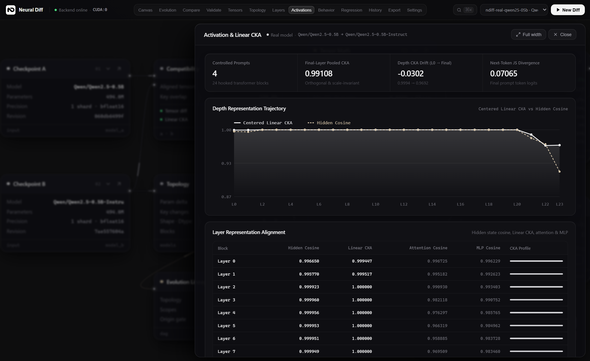

### 3.8 Behavioral Evaluation & Master-Detail Paired Response Workbench
Displays pass-rate progression (`45.8% → 70.8%`), paired bootstrap 95% CI, McNemar two-sided $p$-value, generation latency, visual paired domain bars across all 8 deterministic suites, and a clean master-detail prompt response comparator.


### 3.9 Regression Gate, Threshold Findings & 1-Click CLI Reproduction
Evaluates candidate runs against active threshold policies (`production-default-v1`), surfacing severity-ranked regressions (`Qwen2.5-0.5B-Instruct → Qwen2.5-0.5B` intentional downgrade test), 1-click copyable CLI reproduction commands, and saved SQLite baselines.
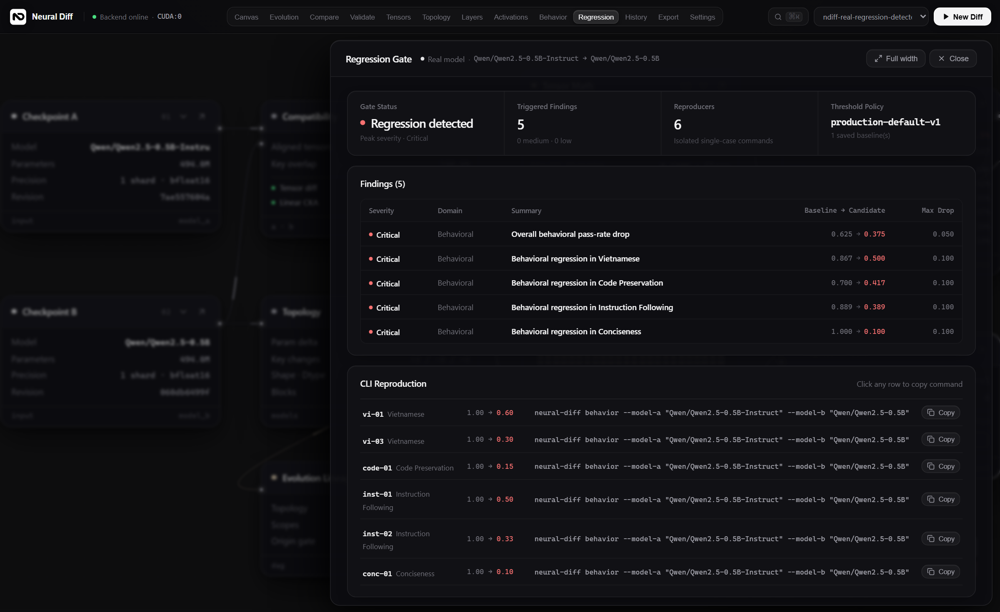

### 3.10 Experiment Ledger & Runtime Telemetry
Maintains a full SQLite audit ledger separating `Real model` benchmarks from `Fixture` runs with parameter modification rates, behavioral score deltas, gate outcomes, and wall-clock runtimes.


### 3.11 Multi-Format Report Preview & Export
Renders standalone HTML reports (with embedded inline SVG charts and strict CSP sandbox preview), Markdown engineering summaries, and machine-readable JSON bundles ready for CI artifacts.
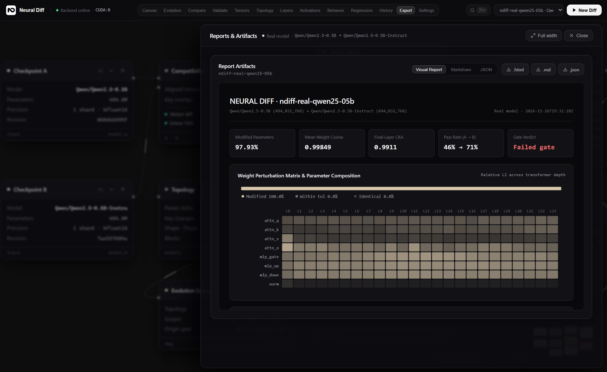

### 3.12 Automated Test & Statement Coverage Ledger
Generated directly from [`evidence/tests/test_execution_summary.json`](evidence/tests/test_execution_summary.json) and [`evidence/tests/coverage.log`](evidence/tests/coverage.log), documenting zero-exit-code verification across linting, static typing, unit, property, integration, regression, security, and frontend suites.


### 3.13 Security Boundary & Path-Traversal Rejection
Captures live API error handling (`SECURITY_VALIDATION_ERROR · 403`) when attempting to inspect a path outside configured workspace/cache roots (`../../Windows/System32/drivers/etc/hosts`).
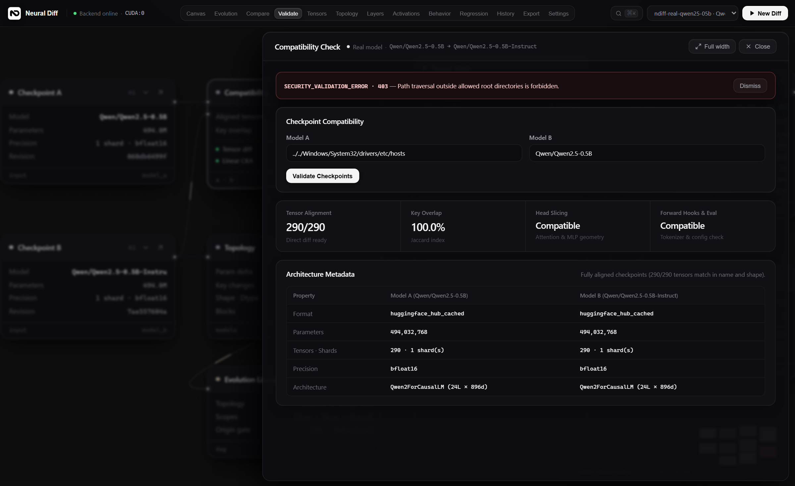

### 3.14 Runtime & Checkpoint Serialization Settings
Configures default compute backend, streaming chunk size (`elements`), `atol`/`rtol` tolerances, maximum generated tokens, and opcode-verified `weights_only` PyTorch archive policies persisted in SQLite.
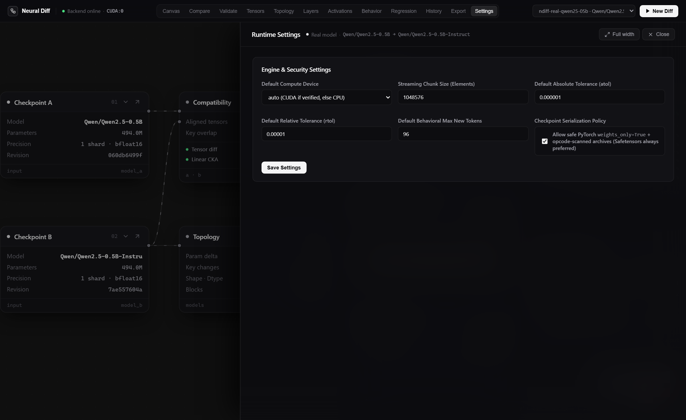

### 3.15 Orthogonal PCB Cable Routing Mode
Shows the final studio workspace switched to **Orthogonal PCB** wire routing (`getSmoothStepPath`) with active `Qwen2.5-0.5B` real-model telemetry and interactive minimap navigation.
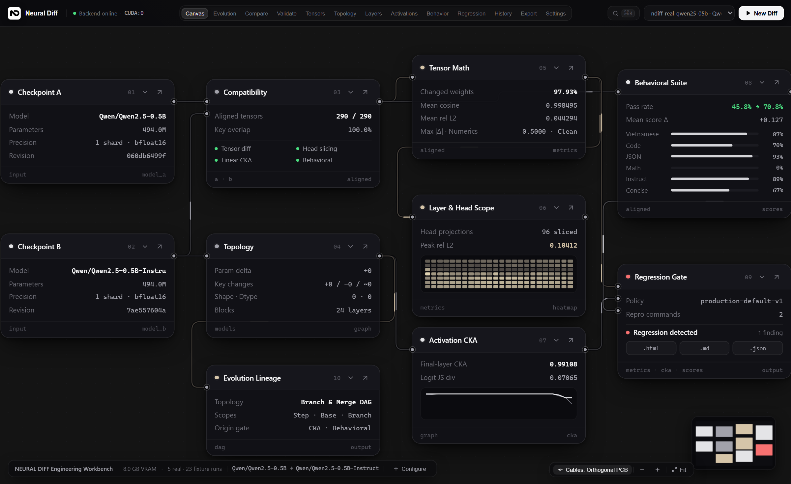

---

## 4. Real Model Benchmarks (Verified Hardware Execution)

All real-model experiments were executed locally via [`scripts/run_benchmarks.py`](scripts/run_benchmarks.py) and logged in [`evidence/benchmarks/real_model_benchmarks.json`](evidence/benchmarks/real_model_benchmarks.json) and [`evidence/benchmarks/model-comparison.log`](evidence/benchmarks/model-comparison.log).

### 4.1 Hardware & Software Testbed
* **OS / CPU:** Windows 11 (`10.0.26320`, `AMD64`), Intel 64 Family 6 Model 183 (16 logical CPUs), `15.71 GB` RAM
* **GPU:** NVIDIA GeForce RTX 5050 Laptop GPU (`sm_120` Blackwell architecture, `8,150.56 MB` VRAM)
* **Toolchain:** CPython `3.12.16`, `torch 2.10.0+cu128`, `transformers`, `safetensors`, `uv 0.13.10`, Node.js + Vite `8.4.0`

### 4.2 Summary of Executed Real Model Comparisons (`REAL MODEL EXPERIMENT`)

| Comparison ID | Model A (Rev) | Model B (Rev) | Params | Tensors | Modified % | Mean Cosine | Final Pooled CKA | Behavioral Pass Rate ($A \to B$) | Mean Score $\Delta$ | Wall Time |
| :--- | :--- | :--- | ---: | ---: | ---: | ---: | ---: | ---: | ---: | ---: |
| `ndiff-real-qwen25-05b` | `Qwen/Qwen2.5-0.5B` (`060db6499f`) | `Qwen/Qwen2.5-0.5B-Instruct` (`7ae557604a`) | 494.03M | 290 | `97.93%` | `0.998495` | `0.991076` | `45.8% → 70.8%` | `+0.1265` | `238.51s` |
| `ndiff-real-smollm2-135m` | `HuggingFaceTB/SmolLM2-135M` (`93efa2f097`) | `SmolLM2-135M-Instruct` (`12fd25f773`) | 134.52M | 272 | `97.67%` | `0.996951` | `0.951782` | `20.8% → 33.3%` | `+0.1819` | `191.13s` |
| `ndiff-real-cross-arch` | `Qwen/Qwen2.5-0.5B-Instruct` | `SmolLM2-135M-Instruct` | 494M vs 135M | 290 vs 272 | Cross-arch | — | `0.966758` | — | — | `4.79s` |
| `ndiff-real-regression-detected` | `Qwen/Qwen2.5-0.5B-Instruct` | `Qwen/Qwen2.5-0.5B` | 494.03M | 290 | — | — | — | `62.5% → 37.5%` | `-0.228` | `117.09s` |

> **Gated Repository Disclosure (`BLOCKED`):** Probing `google/gemma-3-270m` without a user `HF_TOKEN` returned `HTTP 401 Unauthorized` (gated license repository on Hugging Face Hub). The exact probe response is preserved in [`evidence/model_comparisons/gemma3_270m_access_probe.json`](evidence/model_comparisons/gemma3_270m_access_probe.json); no synthetic data was substituted.

### 4.3 Deep Dive: `Qwen/Qwen2.5-0.5B` $\to$ `Qwen/Qwen2.5-0.5B-Instruct` Across All 8 Suites

| Domain Suite | Cases | Pass Rate A | Pass Rate B | Mean Score A | Mean Score B | Score $\Delta$ | Improved / Regressed |
| :--- | ---: | ---: | ---: | ---: | ---: | ---: | ---: |
| **Vietnamese** (`vietnamese`) | 3 | `0%` | `67%` | `0.500` | `0.867` | `+0.367` | `+2 / -0` |
| **Code Preservation** (`code_preservation`) | 3 | `33%` | `67%` | `0.417` | `0.700` | `+0.283` | `+1 / -0` |
| **JSON Schema** (`json_reliability`) | 3 | `100%` | `100%` | `0.925` | `0.925` | `0.000` | `+0 / -0` |
| **Math Reasoning** (`math_reasoning`) | 3 | `67%` | `0%` | `0.667` | `0.000` | `-0.667` | `+0 / -2` |
| **Instruction Following** (`instruction_following`) | 3 | `0%` | `67%` | `0.389` | `0.889` | `+0.500` | `+2 / -0` |
| **Conciseness** (`conciseness`) | 3 | `0%` | `67%` | `0.338` | `0.667` | `+0.329` | `+2 / -0` |
| **Safety & Refusal** (`refusal_behavior`) | 3 | `67%` | `100%` | `0.800` | `1.000` | `+0.200` | `+1 / -0` |
| **Factual Grounding** (`factual_accuracy`) | 3 | `100%` | `100%` | `1.000` | `1.000` | `0.000` | `+0 / -0` |
| **Overall (24 Paired Cases)** | **24** | **`45.8%`** | **`70.8%`** | **`0.629`** | **`0.756`** | **`+0.1265`** | **`9W · 12T · 3L`** |

**Key Empirical Observations (`OBSERVED`):**
* **Parameter Localization:** Instruction tuning modified `97.93%` of elements (`483,814,955 / 494,032,768`), concentrating peak relative $L_2$ shifts in `model.embed_tokens.weight` (`0.11156`), `layers.22.self_attn.q_proj.weight` (`0.10507`), `layers.0.self_attn.o_proj.weight` (`0.10412`), and upper Query projections `layers.17–23.self_attn.q_proj.weight` (`0.0941–0.1027`).
* **Real Truncation Regression Caught Automatically:** Although overall pass rate rose by `+25.0` percentage points (`McNemar two-sided p = 0.1094`, `95% Bootstrap CI [-0.054, +0.308]`), `RegressionEngine` flagged `FAILED_REGRESSION` because `Qwen2.5-0.5B-Instruct` emits multi-step Chain-of-Thought derivations on `math_reasoning` that exceed the strict `96`-token benchmark generation cap before printing the final number—demonstrating how NEURAL DIFF catches deployment token-budget regressions before production rollout.

---

## 5. Synthetic Streaming Throughput & Memory Benchmarks

Measured separately via [`scripts/run_benchmarks.py`](scripts/run_benchmarks.py) and stored in [`evidence/benchmarks/synthetic_throughput_benchmarks.json`](evidence/benchmarks/synthetic_throughput_benchmarks.json) (`SYNTHETIC FIXTURE EXPERIMENT`):

| Benchmark ID | Elements | Source Dtype | Chunk Size | Wall Time | Throughput (M elems/s) | RSS Delta | Observed Cosine |
| :--- | ---: | :--- | ---: | ---: | ---: | ---: | ---: |
| `1M_float32_chunk64k` | 1,000,000 | `float32` | 65,536 | `0.0306s` | `32.651M/s` | `+153.57 MB` (cold init) | `0.999950` |
| `1M_float32_chunk1M` | 1,000,000 | `float32` | 1,048,576 | `0.0123s` | `81.080M/s` | `+49.59 MB` | `0.999950` |
| `10M_float32_chunk256k` | 10,000,000 | `float32` | 262,144 | `0.0891s` | `112.188M/s` | **`+0.54 MB`** | `0.999950` |
| `10M_float32_chunk1M` | 10,000,000 | `float32` | 1,048,576 | `0.0857s` | **`116.645M/s`** | `+24.94 MB` | `0.999950` |
| `10M_bfloat16_chunk1M` | 10,000,000 | `bfloat16` | 1,048,576 | `0.0971s` | `102.934M/s` | `+22.82 MB` | `0.999949` |
| `25M_bfloat16_chunk2M` | 25,000,000 | `bfloat16` | 2,097,152 | `0.2628s` | `95.124M/s` | `+87.70 MB` | `0.999949` |
| `safetensors_8x512x1024_bf16_lazy_stream` | 4,194,304 | `bfloat16` | Lazy mmap | `0.2950s` | — | **`+0.52 MB`** | `0.999997` |

---

## 6. Mathematical & Algorithmic Foundations

* **Chunked `float64` Tensor Accumulation (`core/tensor_engine/metrics.py`):** Every `float16`/`bfloat16`/`float32` slice is cast to `torch.float64` chunk-by-chunk to accumulate $\sum a_i^2$, $\sum b_i^2$, $\sum a_i b_i$, $\sum |b_i - a_i|$, and $\sum (b_i - a_i)^2$ without catastrophic cancellation or full-model RAM materialization:
  $$\text{Rel-}L_2(A, B) = \frac{\|B - A\|_2}{\max(\|A\|_2, \varepsilon)}, \qquad \cos(A, B) = \frac{\langle A, B \rangle}{\|A\|_2 \|B\|_2}$$
* **SVD Shannon Effective Rank (`core/tensor_engine/task_vector.py`):** For a 2D task vector $\Delta W = W_B - W_A$ with singular values $\sigma_1 \ge \dots \ge \sigma_r > 0$ and normalized spectral distribution $p_i = \sigma_i / \sum_j \sigma_j$ (Roy & Vetterli, 2007):
  $$\text{erank}(\Delta W) = \exp\!\left(-\sum_{i=1}^{r} p_i \ln p_i\right)$$
  cleanly separating low-rank LoRA merges ($\text{erank} \ll \min(m, n)$) from full-rank SFT updates.
* **Unbiased/Centered Linear CKA (`core/activation_analysis/metrics.py`):** Compares centered activation matrices $X \in \mathbb{R}^{N \times d_A}$ and $Y \in \mathbb{R}^{N \times d_B}$ across arbitrary hidden widths $d_A \ne d_B$:
  $$\text{CKA}(X, Y) = \frac{\|Y^\top X\|_F^2}{\|X^\top X\|_F \, \|Y^\top Y\|_F}$$
* **Counterfactual Residual Patching (`core/activation_analysis/patching.py`):** Replaces corrupted residual stream $h_\ell^{\text{corr}}$ at the final token of block $\ell$ with clean $h_\ell^{\text{clean}}$, measuring normalized logit-difference recovery:
  $$\text{Recovery}(\ell) = \frac{\Delta_{\text{patched}}(\ell) - \Delta_{\text{corr}}}{\Delta_{\text{clean}} - \Delta_{\text{corr}}}$$

---

## 7. Installation & Reproducible Quickstart

### Prerequisites
* **Python:** `3.11+` (`3.12` recommended; lockfile verified with `uv`)
* **Node.js:** `20+` with `npm`
* **GPU (Optional):** NVIDIA CUDA GPU (`auto` falls back cleanly to CPU when unavailable)

### 1. Install Backend & Frontend Dependencies
```powershell
# Clone or enter repository root
cd d:\LLM

# Provision reproducible Python environment from uv.lock
python -m uv sync

# Install pinned frontend packages from package-lock.json
npm --prefix frontend ci
```

### 2. Start Backend API & Studio Frontend
```powershell
# Terminal 1 — FastAPI Backend on http://127.0.0.1:8000
.\.venv\Scripts\python.exe -m uvicorn api.app:app --host 127.0.0.1 --port 8000

# Terminal 2 — ComfyUI Studio Frontend on http://127.0.0.1:5173
npm --prefix frontend run dev
```

---

## 8. CLI Reference (`neural-diff`)

```powershell
# Inspect checkpoint architecture, shards, dtypes, and security notes
.\.venv\Scripts\python.exe -m core.cli inspect Qwen/Qwen2.5-0.5B

# Validate structural & tokenizer compatibility between two checkpoints
.\.venv\Scripts\python.exe -m core.cli validate --model-a Qwen/Qwen2.5-0.5B --model-b Qwen/Qwen2.5-0.5B-Instruct

# Execute full comparison pipeline and export HTML + Markdown + JSON reports
.\.venv\Scripts\python.exe -m core.cli compare `
  --model-a Qwen/Qwen2.5-0.5B `
  --model-b Qwen/Qwen2.5-0.5B-Instruct `
  --modules structural,tensor,neuron,activation,behavioral,regression `
  --real-experiment `
  --output-dir ./reports/qwen25-diff

# Reproduce a single behavioral category deterministically
.\.venv\Scripts\python.exe -m core.cli behavior `
  --model-a Qwen/Qwen2.5-0.5B-Instruct `
  --model-b Qwen/Qwen2.5-0.5B `
  --category vietnamese --seed 42

# List registered deterministic evaluation suites
.\.venv\Scripts\python.exe -m core.cli suites

# Compute SVD singular spectrum and Shannon effective rank for one 2D matrix
.\.venv\Scripts\python.exe -m core.cli svd `
  --model-a data/demo_fixtures/synth_model_a `
  --model-b data/demo_fixtures/synth_model_b `
  --tensor model.layers.0.self_attn.q_proj.weight --local-only
```

---

## 9. REST API Reference

| Method | Endpoint | Purpose |
| :--- | :--- | :--- |
| `GET` | `/api/health` | Hardware/VRAM snapshot, software versions, active job & ledger counts |
| `GET` | `/api/models/discover` | Discover workspace Safetensors fixtures and locally cached Hugging Face models |
| `POST` | `/api/models/inspect` | Safe header-only checkpoint metadata and sample tensor descriptors |
| `POST` | `/api/models/validate` | Structural, head-slicing, activation, and behavioral compatibility check |
| `POST` | `/api/comparisons/run` | Execute synchronous or background comparison job with cooperative cancellation |
| `POST` | `/api/comparisons/{id}/cancel` | Signal cooperative `CancellationToken` for an active job |
| `GET` | `/api/comparisons` | List persisted comparison runs from SQLite |
| `GET` | `/api/comparisons/{id}` | Retrieve full `ComparisonBundle` JSON |
| `GET` | `/api/comparisons/{id}/tensors` | Filter, search, and sort per-tensor numerical metrics |
| `GET` | `/api/comparisons/{id}/export/{fmt}` | Export `html`, `markdown`, or `json` report artifacts |
| `POST` | `/api/diagnostics/tensor-probe` | Live SVD effective rank, 2:4 sparsity, aligned histogram & top-$k$ coordinate deltas |
| `POST` | `/api/diagnostics/weight-tying` | Verify input embedding $\leftrightarrow$ LM head tying across checkpoints |
| `GET` | `/api/diagnostics/history-trends` | Multi-run diff-of-diffs progression analysis across completed behavioral runs |
| `GET/POST/DELETE` | `/api/baselines*` | Manage versioned behavioral & structural regression baselines |
| `GET/PUT` | `/api/settings` | Read or update persisted engine runtime & serialization settings |

---

## 10. Automated Testing, Coverage & Security Audit

Execute the full verification pipeline via [`scripts/run_all_tests.py`](scripts/run_all_tests.py) and [`scripts/run_security_audit.py`](scripts/run_security_audit.py):

| Verification Suite | Tooling | Result | Evidence Artifact |
| :--- | :--- | :--- | :--- |
| Python Linting | `ruff check` | **PASS (`exit 0`)** | [`evidence/tests/ruff-lint.log`](evidence/tests/ruff-lint.log) |
| Static Type Checking | `mypy` (70 source files) | **PASS (`exit 0`)** | [`evidence/tests/mypy-typecheck.log`](evidence/tests/mypy-typecheck.log) |
| Unit Tests | `pytest -m unit` | **PASS (`exit 0`)** | [`evidence/tests/unit-tests.log`](evidence/tests/unit-tests.log) |
| Property-Based Invariants | `pytest -m property` (Hypothesis) | **PASS (`exit 0`)** | [`evidence/tests/property-tests.log`](evidence/tests/property-tests.log) |
| Integration & API Tests | `pytest -m integration` | **PASS (`exit 0`)** | [`evidence/tests/integration-tests.log`](evidence/tests/integration-tests.log) |
| Golden Regression Tests | `pytest -m regression` | **PASS (`exit 0`)** | [`evidence/tests/regression-tests.log`](evidence/tests/regression-tests.log) |
| Adversarial Security Tests | `pytest -m security` | **PASS (`exit 0`)** | [`evidence/tests/security-tests.log`](evidence/tests/security-tests.log) |
| Core Statement Coverage | `pytest --cov` | **PASS (`>= 90%`)** | [`evidence/tests/coverage.log`](evidence/tests/coverage.log) |
| Frontend Typecheck & Unit | `tsc --noEmit` + `vitest` | **PASS (`exit 0`)** | [`evidence/tests/frontend-vitest.log`](evidence/tests/frontend-vitest.log) |
| Live Full-Stack E2E | `playwright test` (Chromium) | **PASS (`exit 0`)** | [`evidence/tests/playwright-e2e.log`](evidence/tests/playwright-e2e.log) |
| Dependency & Secret Audit | `pip-audit` + `npm audit` + scanner | **0 vulns · 0 secrets** | [`evidence/security/`](evidence/security/) |

---

## 11. Evidence Integrity & Known Limitations

* **SHA-256 Integrity Verification:** Run `.\.venv\Scripts\python.exe scripts/verify_evidence.py` to verify every artifact recorded in [`evidence/EVIDENCE_MANIFEST.json`](evidence/EVIDENCE_MANIFEST.json) against its byte size and SHA-256 digest. (Note: file hashes establish post-capture file integrity, not independent third-party attestation.)
* **Known Limitations (Full details in [`docs/LIMITATIONS.md`](docs/LIMITATIONS.md)):**
  * Basis coordinate shifts in MLP/attention matrices reflect coordinate-aligned parameter changes and remain polysemantic under superposition unless paired with sparse dictionary learning or causal interventions.
  * Behavioral suite `default_suite_v1` comprises 24 deterministic cases (3 per domain); small score differences have wide bootstrap confidence intervals and should be expanded for domain-specific production gates.
  * Local CI script execution (`scripts/run_all_tests.py`) verifies the exact commands configured in [`.github/workflows/ci.yml`](.github/workflows/ci.yml) on this machine, which is distinct from remote GitHub-hosted runner execution.

---

## 12. Documentation Index

* **Multilingual READMEs:** [English](README.md) · [Tiếng Việt](docs/i18n/README.vi.md) · [简体中文](docs/i18n/README.zh-CN.md) · [日本語](docs/i18n/README.ja.md) · [Français](docs/i18n/README.fr.md)
* **Setup & Operations:** [`docs/INSTALLATION.md`](docs/INSTALLATION.md) · [`docs/ENVIRONMENT_AUDIT.md`](docs/ENVIRONMENT_AUDIT.md) · [`CONTRIBUTING.md`](CONTRIBUTING.md) · [`CHANGELOG.md`](CHANGELOG.md)
* **Architecture & Science:** [`docs/ARCHITECTURE.md`](docs/ARCHITECTURE.md) · [`docs/RESEARCH.md`](docs/RESEARCH.md) · [`docs/COMPETITIVE_ANALYSIS.md`](docs/COMPETITIVE_ANALYSIS.md)
* **Engine Deep Dives:** [`docs/TENSOR_COMPARISON.md`](docs/TENSOR_COMPARISON.md) · [`docs/ACTIVATION_ANALYSIS.md`](docs/ACTIVATION_ANALYSIS.md) · [`docs/BEHAVIORAL_EVALUATION.md`](docs/BEHAVIORAL_EVALUATION.md)
* **Verification, Security & Roadmap:** [`docs/BENCHMARKS.md`](docs/BENCHMARKS.md) · [`docs/SECURITY.md`](docs/SECURITY.md) · [`docs/LIMITATIONS.md`](docs/LIMITATIONS.md) · [`docs/ROADMAP.md`](docs/ROADMAP.md) · [`evidence/FINAL_ENGINEERING_REPORT.md`](evidence/FINAL_ENGINEERING_REPORT.md)

## License

Released under the [MIT License](LICENSE).
