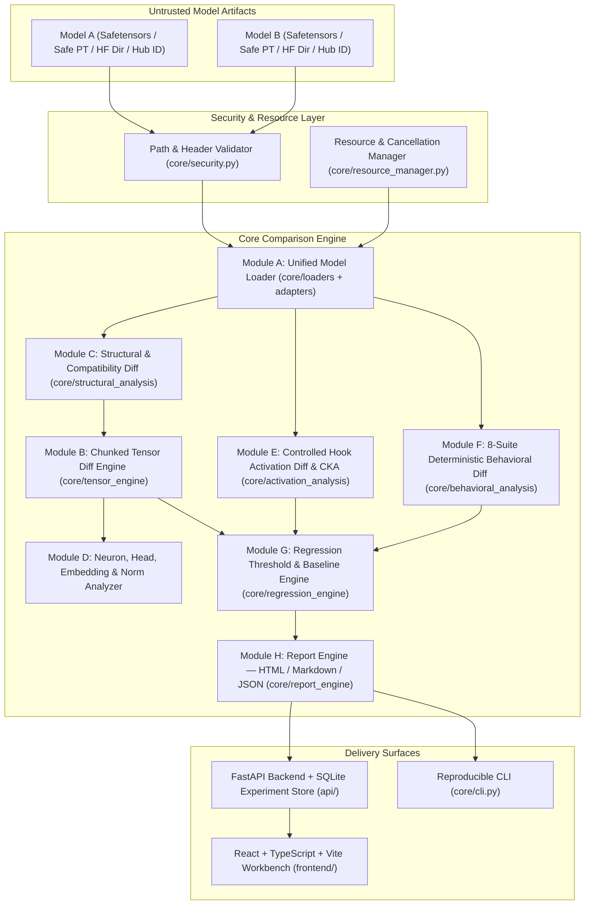

# System Architecture — NEURAL DIFF

**Tagline:** *Git for AI Brains — Structural, Neural & Behavioral Intelligence Comparison*

---

## 1. Architectural Principles

1. **Zero Implicit Execution:** Model checkpoints and Hugging Face directories are treated as untrusted external data. `trust_remote_code=False` is enforced unconditionally, `safetensors` is prioritized via lazy slicing, and legacy PyTorch archives strictly enforce `weights_only=True`.
2. **Out-of-Core & Memory-Bounded Processing:** Two checkpoints are never blindly materialized into RAM simultaneously during structural or tensor diffing. Tensors are iterated key-by-key and reduced in configurable element chunks (`float64` scalar accumulators) so 0.5B–7B checkpoints can be compared safely on a 16 GB laptop.
3. **Epistemic Discipline:** Every analytical finding carries an explicit `EpistemicStatus`:
   - `OBSERVED`: Direct deterministic measurement over weights, shapes, activations, or outputs.
   - `INFERRED`: Rule-based structural deduction (e.g., rename heuristic across unmatched keys of identical shape and high cosine similarity).
   - `CORRELATED`: Co-occurring internal drift (e.g., Layer $L$ MLP norm delta alongside downstream behavioral shift) without causal intervention.
   - `CAUSALLY_VERIFIED`: Reserved strictly for controlled causal interventions when performed and verified.
   - `NOT_VERIFIED`: Claim or capability not executed under current configuration.
4. **No Mock Data on Production Paths:** Every CLI command, REST endpoint, report exporter, and React frontend view consumes genuine calculations from the core engine.

---

## 2. High-Level Data Flow



---

## 3. Repository Layout

```text
neural-diff/                        # Mounted at workspace root (d:\LLM)
├── core/
│   ├── types.py                    # EpistemicStatus, VerificationStatus, Severity, shared models
│   ├── exceptions.py               # Typed domain & security exceptions
│   ├── security.py                 # Path traversal protection, file/header caps, allowlists
│   ├── resource_manager.py         # CPU/CUDA selection, RAM/VRAM telemetry, CancellationToken
│   ├── orchestrator.py             # End-to-end comparison pipeline coordinator
│   ├── cli.py                      # Command-line entrypoint
│   ├── loaders/                    # Module A: Unified loader interface & metadata models
│   ├── tensor_engine/              # Module B: Exact/chunked numerical diff & tolerance engine
│   ├── structural_analysis/        # Module C & D: Structural diff, compatibility, head/MLP/norm analysis
│   ├── activation_analysis/        # Module E: Non-invasive PyTorch forward hooks, CKA, activation drift
│   ├── behavioral_analysis/        # Module F: Paired inference & deterministic behavioral diff runner
│   ├── regression_engine/          # Module G: Versioned baselines, thresholds, SQLite persistence
│   ├── statistics/                 # Histograms, quantiles, paired bootstrap & McNemar utilities
│   ├── report_engine/              # Module H: Self-contained HTML (SVG heatmaps), Markdown, JSON
│   └── evolution/                  # Module I: Multi-generation DAG lineage, cumulative weights, CKA, regression origin & PDF/CSV/HTML/JSON exporter
├── adapters/
│   ├── safetensors/                # Binary header verifier + single/sharded lazy slice reader
│   ├── pytorch/                    # Safe weights_only=True checkpoint adapter
│   ├── huggingface/                # Local HF directory & cached Hub snapshot resolver
│   └── architectures/              # Architecture mapping (Qwen2, Llama, SmolLM2, Gemma, GPT-2, BERT, Generic)
├── benchmarks/
│   ├── datasets/                   # 8 curated deterministic JSON benchmark suites
│   ├── evaluators/                 # Vietnamese, Code, JSON, Math, Instruction, Conciseness, Refusal, Factual
│   └── runners/                    # Micro-benchmarks & real-model comparison runners
├── api/
│   ├── app.py                      # FastAPI application factory, security headers, error handlers
│   ├── schemas.py                  # Strict Pydantic v2 request/response contracts
│   ├── store.py                    # SQLite persistence for runs, baselines, and runtime settings
│   └── routes/                     # Modular endpoints (health, models, comparisons, regressions, reports)
├── frontend/                       # React 19 + TypeScript + Vite 12-view analytical web app
├── tests/
│   ├── unit/                       # Mathematical & component unit tests
│   ├── integration/                # End-to-end pipeline, loader, API, and report tests
│   ├── property/                   # Hypothesis invariant tests (symmetry, zero-identity, scaling)
│   ├── regression/                 # Deterministic golden-fixture regression tests
│   ├── security/                   # Adversarial path traversal, malformed header, & pickle tests
│   └── fixtures/                   # Deterministic synthetic checkpoint builders
├── docs/                           # Complete engineering, research, security, and benchmark docs
├── scripts/                        # Reproducible environment, test, benchmark, screenshot, & manifest scripts
├── examples/                       # Runnable Python & CLI usage examples
├── evidence/                       # Verifiable logs, real model results, screenshots, & SHA-256 manifest
└── .github/workflows/              # 8 specialized GitHub Actions CI, Security, SAST, Benchmark & Release workflows
```

---

## 4. Module Specifications & Contracts

### Module A — Model Loader (`core/loaders/`, `adapters/`)
- **Inputs:** Local `.safetensors` file, sharded `model.safetensors.index.json` or directory, `.pt`/`.pth`/`.bin` (`weights_only=True` enforced), or Hugging Face model ID resolved via `huggingface_hub.snapshot_download` (ignoring `*.py` execution).
- **Outputs:** `LoadedModelHandle` exposing lazy `iter_tensor_names()`, `get_tensor_meta(name)`, `load_tensor(name)` / `iter_tensor_chunks(name, chunk_elements)`, `ModelMetadata` (parameter count, byte footprint, architecture family, layer count, head counts, vocab size, SHA/revision).

### Module B — Tensor Diff Engine (`core/tensor_engine/`)
- Computes in `float64`-accumulated chunks:
  - `max_abs_diff`: $\max_i |b_i - a_i|$
  - `mean_abs_diff`: $\frac{1}{N}\sum_i |b_i - a_i|$
  - `rmse`: $\sqrt{\frac{1}{N}\sum_i (b_i - a_i)^2}$
  - `relative_l2`: $\frac{\|b - a\|_2}{\max(\|a\|_2, \epsilon)}$
  - `cosine_similarity`: $\frac{\langle a, b \rangle}{\|a\|_2 \|b\|_2}$ (with explicit zero-norm handling: `1.0` if both identically zero, `0.0` if one is zero and the other nonzero)
  - `exact_equal`: boolean bit/value equality
  - `changed_pct`: percentage where $|b_i - a_i| > \text{atol} + \text{rtol} \cdot |a_i|$
  - `zero_to_nonzero` & `nonzero_to_zero` counts
  - `nan_count_a/b`, `inf_count_a/b`, and summary quantiles/mean/std shift.

### Module C & D — Structural, Neuron & Attention Analysis (`core/structural_analysis/`, `adapters/architectures/`)
- Classifies keys into `shared_compatible`, `shape_mismatch`, `dtype_mismatch`, `added`, `removed`, and `inferred_renamed` (explicitly marked `EpistemicStatus.INFERRED`).
- Maps architecture-specific tensor names (e.g., `model.layers.0.self_attn.q_proj.weight` vs `transformer.h.0.attn.c_attn.weight`) into canonical roles (`embedding`, `attn_q`, `attn_k`, `attn_v`, `attn_o`, `mlp_gate`, `mlp_up`, `mlp_down`, `norm`, `lm_head`, `other`) without forcing incompatible architectures to match.
- Slices `q_proj`, `k_proj`, `v_proj`, and `o_proj` along head dimensions (`num_attention_heads` / `num_key_value_heads`) when `config.json` provides exact head dimensions, reporting per-head L2/cosine drift (`OBSERVED`).
- Computes MLP neuron row/column norm changes with explicit warnings against monosemantic neuron interpretation.

### Module E — Activation Diff (`core/activation_analysis/`)
- Attaches temporary PyTorch forward hooks (cleaned up via `try/finally`) across transformer layers, attention blocks, and MLP blocks.
- Runs identical deterministic prompts (`do_sample=False`, fixed `torch.manual_seed`) and compares matching representations via per-layer cosine similarity, relative L2 drift, activation distribution moments, max-divergent token index, and **Linear CKA** (capable of comparing representations even when hidden dimensions differ!).

### Module F — Behavioral Diff (`core/behavioral_analysis/`, `benchmarks/`)
- Executes 8 deterministic evaluation suites against Model A and Model B under identical generation settings (`temperature=0.0`, `do_sample=False`, explicit `max_new_tokens`).
- Records exact prompts, raw completions, deterministic per-case subscores, suite aggregates, and paired statistical confidence intervals (`core/statistics/significance.py`).

### Module G — Regression Engine (`core/regression_engine/`)
- Evaluates structural, tensor, activation, and behavioral deltas against versioned threshold rules (`CRITICAL`, `HIGH`, `MEDIUM`, `LOW`, `INFO`).
- Generates deterministic CLI reproduction commands for every failing regression case and persists baselines and historical comparisons in SQLite.

### Module H — Report Engine (`core/report_engine/`)
- Produces JSON (machine-readable schema), Markdown (Git PR / documentation ready), and standalone HTML (inline CSS + data-driven SVG layer heatmaps and behavioral charts, zero external CDN dependencies) stamped with environment, git commit, model revisions, and epistemic badges.
