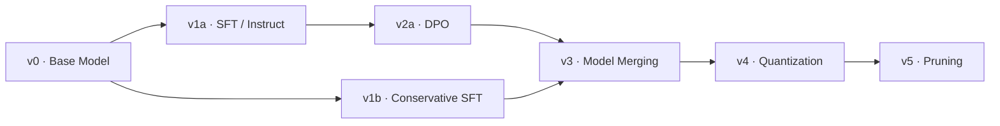

# Neural Evolution Tracking — Technical & Research Guide

**Neural Evolution Tracking** extends **NEURAL DIFF** from pairwise model comparison into a complete multi-generation lifecycle lineage engine. Instead of inspecting two checkpoints in isolation, researchers and ML engineers can organize linear chains, experimental branches, and multi-parent merges into a validated **Directed Acyclic Graph (DAG)** and track how weights, layer roles, internal representations, and deterministic capabilities evolve from a base pretrained model to production deployment.



---

## 1. Creating an Evolution Project

Projects act as isolated containers for a model family's evolution history.

### REST API
```bash
curl -X POST http://127.0.0.1:8000/api/evolution/projects \
  -H "Content-Type: application/json" \
  -d '{
    "name": "SmolLM2-135M Post-Training Lifecycle",
    "description": "Tracking Base -> SFT -> Merge -> Quantization -> Pruning",
    "tags": ["smollm2", "post-training", "compression"]
  }'
```

### CLI
```bash
neural-diff evolution create-project \
  --name "SmolLM2-135M Post-Training Lifecycle" \
  --description "Tracking Base -> SFT -> Merge -> Quantization -> Pruning"
```

### Python API
```python
from core.evolution.store import EvolutionStore

evo_store = EvolutionStore()
project = evo_store.create_project(
    name="SmolLM2-135M Post-Training Lifecycle",
    description="Tracking Base -> SFT -> Merge -> Quantization -> Pruning",
)
```

---

## 2. Registering Checkpoints & Supported Transformations

Every registered checkpoint is validated through `ModelLoader` and `SecurityPolicy` (`trust_remote_code=False`, Safetensors binary header verification, and `weights_only=True` + `pickletools` opcode whitelist for `.pt`/`.bin` archives). Registration computes a streaming **SHA-256 content fingerprint** (4 MiB chunks) and a **tensor metadata structure hash**, automatically flagging exact duplicate checkpoints (`DUPLICATE_CONTENT`) and PEFT LoRA adapter directories (`ADAPTER_ONLY`).

Supported transformation types (`TransformationType`):
`Base Model`, `Fine-Tuning`, `Instruction Tuning`, `SFT`, `DPO`, `RLHF`, `LoRA`, `QLoRA`, `Model Merging`, `Quantization`, `Pruning`, `Distillation`, `Weight Modification`, and `Unknown Transformation`.

```bash
# Register root Base Model
neural-diff evolution register \
  --project-id evo-a1b2c3d4e5 \
  --source "HuggingFaceTB/SmolLM2-135M" \
  --label "v0-base" \
  --transformation "Base Model" \
  --local-only

# Register child SFT checkpoint
neural-diff evolution register \
  --project-id evo-a1b2c3d4e5 \
  --source "HuggingFaceTB/SmolLM2-135M-Instruct" \
  --label "v1-instruct" \
  --parents "ckpt-0001" \
  --transformation "Instruction Tuning" \
  --local-only
```

---

## 3. Creating Branches & Multi-Parent Model Merging DAGs

- **Branching:** Register two or more child checkpoints referencing the same parent checkpoint ID (`parent_checkpoint_ids: ["ckpt-base"]`).
- **Model Merging:** Supply multiple parent IDs (`parent_checkpoint_ids: ["ckpt-dpo-a", "ckpt-sft-b"]`) with optional `merge_weights` (`{"ckpt-dpo-a": 0.75, "ckpt-sft-b": 0.25}`).
- **Cycle Prevention:** `EvolutionDAG` runs 3-color depth-first cycle detection before persisting any checkpoint or edge mutation. Self-loops (`A -> A`) and ancestor cycles (`A -> B -> C -> A`) are rejected with `CYCLIC_DEPENDENCY_ERROR` (`HTTP 422`) and the exact offending cycle path.

---

## 4. Running Evolution Analysis

```bash
neural-diff evolution analyze \
  --project-id evo-a1b2c3d4e5 \
  --local-only \
  --output-dir ./evolution_reports
```

Or via REST (`POST /api/evolution/projects/{project_id}/analyze`):
```json
{
  "include_tensor_evolution": true,
  "include_layer_evolution": true,
  "include_behavioral_evolution": true,
  "include_representation_evolution": true,
  "enable_causal_patching": true,
  "seed": 42,
  "allow_cache": true,
  "force_rerun": false,
  "async_job": false
}
```

Long-running jobs support background execution (`async_job: true`), live step telemetry (`GET /api/evolution/runs/{run_id}`), and cooperative cancellation (`POST /api/evolution/runs/{run_id}/cancel`). Checkpoints are streamed and evaluated sequentially one model at a time so multiple checkpoints never occupy GPU VRAM simultaneously.

---

## 5. Interpreting Weight & Cumulative Tensor Evolution

`MultiGenTensorEvolutionEngine` maintains **three strictly separated scopes**:

1. **`consecutive` (`parent -> child`):** Measures the incremental perturbation introduced by a single training or compression stage (`L2`, `Relative L2`, `RMSE`, `Max |Δ|`, `Cosine Similarity`, `0 -> !=0` / `!=0 -> 0` zero transitions, `Sparsity Δ`, and Wasserstein-1 distribution shift).
2. **`base_to_current` (`Base -> Current`):** Measures **true cumulative weight distance** by comparing the current checkpoint's tensors **directly** against the original root checkpoint (`W_current - W_base`).
   > [!IMPORTANT]
   > Cumulative Euclidean distance is **never** computed by summing consecutive step distances. Because sequential training updates (e.g., SFT followed by DPO or quantization) are non-collinear and often partially revert earlier parameter directions, $\|W_k - W_0\|_2 \le \sum_{i=1}^{k} \|W_i - W_{i-1}\|_2$ by the triangle inequality. NEURAL DIFF reports both the direct `l2_distance` and `path_cancellation_ratio = direct_l2 / sum_of_step_l2`.
3. **`branch_to_branch` (`Branch A <-> Branch B`):** Measures direct divergence between leaf checkpoints or any arbitrary pair (`POST /api/evolution/projects/{project_id}/compare`), reporting their Lowest Common Ancestor (LCA).

---

## 6. Interpreting Representation Drift

`RepresentationEvolutionEngine` attaches forward hooks across decoder blocks on controlled diagnostic prompts:

- **Centered Linear CKA (`[0.0, 1.0]`):** Invariant to orthogonal transformations and isotropic scaling. Values near `1.000` indicate preserved representational geometry relative to the Base Model; `representation_drift = 1.0 - CKA` quantifies structural representation reorganization across depth.
- **Hidden-State Cosine Similarity:** Sensitive to coordinate-aligned rotation and sign flips when hidden dimensions match.
- **Next-Token Logit JS Divergence:** Bounded symmetric divergence (`[0, ln 2]`) between output token probability distributions.
- **Logit Lens (`OBSERVED`):** Projects intermediate residual states through the final normalization and unembedding head (`lm_head`) when dimensionally compatible.

---

## 7. Regression Origin Pinpointing & Correlation vs. Causation

When evaluating a lineage such as `Base (92%) -> SFT (95%) -> DPO (91%) -> Quantized (78%) -> Pruned (76%)`, `RegressionOriginEngine` walks each root-to-leaf branch and pinpoints **the first transition** (`DPO -> Quantized`) where pass-rate or category score degradation breached policy thresholds, while tracking whether downstream stages (`Pruned`) inherited or recovered from those failures.

> [!WARNING]
> **Strict Epistemic Boundary (`CORRELATED` vs. `CAUSALLY VERIFIED`):**
> - Behavioral pass-rate drops and tensor L2 norms are **directly `OBSERVED`**.
> - Layers exhibiting large weight `Relative L2` or CKA drops on the same transition are labeled **`CORRELATED`**. Weight modification or CKA drift alone **never** proves that a specific layer caused a behavioral failure.
> - A layer site is labeled **`CAUSALLY VERIFIED`** *only* when interventional cross-checkpoint residual-stream patching (`run_cross_checkpoint_layer_patching`, substituting the clean parent layer's output into the regressed child model) restores `>= 20%` of the clean target-vs-foil logit margin — and even then, strictly scoped to that tested prompt and residual site.

---

## 8. Statistical Limitations

- **Sample Size & Confidence Intervals:** Every behavioral pass rate reports sample size `n` alongside an exact **95% Wilson binomial confidence interval**, and every transition reports **95% paired bootstrap confidence intervals** plus an **exact two-sided McNemar p-value**.
- **Anti-Overclaiming:** Observed score increases on finite deterministic benchmark suites (`default_suite_v1`, `n=24` across 8 categories) reflect performance on those specific programmatic rubrics and must **not** be interpreted as unrestricted general capability acquisition without larger domain-specific evaluation suites.

---

## 9. Architecture & Tokenization Compatibility Limitations

- **Mismatched Shapes / Added / Removed Tensors:** Never compared elementwise or silently ignored; explicitly listed under `added_tensors`, `removed_tensors`, and `shape_mismatched_tensors` with `compatible_for_direct_tensor_diff = false`.
- **Representation Space Compatibility:** Token-pooled Linear CKA requires identical token sequence alignment across prompts (`token_ids_a == token_ids_b`). If two checkpoints use different tokenizers/vocabularies producing different token lengths, direct representation comparison is blocked with an explicit `compatibility_warnings` entry rather than comparing unaligned token positions.
- **LoRA Adapter-Only Checkpoints (`ADAPTER_ONLY`):** Stored with full PEFT metadata (`r`, `lora_alpha`, `target_modules`) and SHA-256 hashes; full model behavioral generation and residual CKA require merged checkpoints.

---

## 10. Reproducibility & Multi-Format Exports (`JSON`, `CSV`, `Markdown`, `HTML`, `PDF`)

Every analysis computes a deterministic **content-addressed SHA-256 cache key** over:
1. Sorted checkpoint SHA-256 content fingerprints & tensor structure hashes
2. Directed parent-child / merge relationships
3. Benchmark suite SHA-256 fingerprint
4. Canonical analysis configuration (`seed`, `tolerances`, thresholds, modules)
5. `neural_diff` software version.

Cached runs are **automatically invalidated** whenever any checkpoint weight, DAG edge, dataset case, seed, or tolerance changes, and can always be bypassed with `force_rerun=True`. Completed runs export directly via `GET /api/evolution/runs/{run_id}/export/{json|csv|markdown|html|pdf}` or `EvolutionReportExporter`, including embedded Mermaid DAGs & Unicode gauges in Markdown, 5 data-driven SVGs in HTML, and multi-page vector bar & polyline charts in PDF 1.4.
