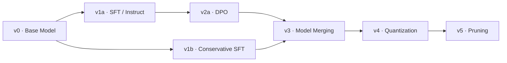

# Neural Evolution Tracking — Technical & Research Guide

**Neural Evolution Tracking** extends **NEURAL DIFF** from pairwise model comparison into a complete multi-generation lifecycle lineage engine. Instead of inspecting two checkpoints in isolation, researchers and ML engineers can organize linear chains, experimental branches, and multi-parent merges into a validated **Directed Acyclic Graph (DAG)** and track how weights, layer roles, internal representations, and deterministic capabilities evolve from a base pretrained model to production deployment.



---

## 1. Creating an Evolution Project

Projects act as isolated containers for a model family's evolution history.

### REST API
```bash
curl -X POST http://127.0.0.1:8000/api/evolution/projects \
  -H "Content-Type: application/json" \
  -d '{
    "name": "SmolLM2-135M Post-Training Lifecycle",
    "description": "Tracking Base -> SFT -> Merge -> Quantization -> Pruning",
    "tags": ["smollm2", "post-training", "compression"]
  }'
```

### CLI
```bash
neural-diff evolution create-project \
  --name "SmolLM2-135M Post-Training Lifecycle" \
  --description "Tracking Base -> SFT -> Merge -> Quantization -> Pruning"
```

### Python API
```python
from core.evolution.store import EvolutionStore

evo_store = EvolutionStore()
project = evo_store.create_project(
    name="SmolLM2-135M Post-Training Lifecycle",
    description="Tracking Base -> SFT -> Merge -> Quantization -> Pruning",
)
```

---

## 2. Registering Checkpoints & Supported Transformations

Every registered checkpoint is validated through `ModelLoader` and `SecurityPolicy` (`trust_remote_code=False`, Safetensors binary header verification, and `weights_only=True` + `pickletools` opcode whitelist for `.pt`/`.bin` archives). Registration computes an **orthogonal 5-domain SHA-256 fingerprint hierarchy** (4 MiB streaming chunks over deterministically sorted POSIX relative paths):

1. `weights_sha256`: Raw tensor byte slices of primary weight shards (`.safetensors`, `.pt`, `.pth`, `.bin` excluding PEFT adapter files), keeping pure parameter buffer hashes orthogonal to `.safetensors` JSON headers.
2. `architecture_config_sha256`: `config.json`, `generation_config.json`, `model.safetensors.index.json`, `pytorch_model.bin.index.json`, and `quantize_config.json`.
3. `tokenizer_sha256`: `tokenizer.json`, `tokenizer.model`, `spiece.model`, `tokenizer_config.json`, `special_tokens_map.json`, `vocab.json`, `merges.txt`, `added_tokens.json`, `chat_template.jinja`, and `chat_template.json`.
4. `adapter_sha256`: `adapter_config.json`, `adapter_model.safetensors` (raw tensor slices), and `adapter_model.bin`.
5. `metadata_sha256`: Canonical JSON SHA-256 over sorted `.safetensors` `(tensor_name, dtype, shape, byte_length)` descriptors and `__metadata__` key-value headers across **both** primary model weight `.safetensors` shards and coexisting PEFT `adapter_model.safetensors` files (or `tensor_metadata_hash` for non-Safetensors archives).

All five domains feed into both the composite `sha256_fingerprint` and `build_behavioral_checkpoint_cache_key()`, guaranteeing that mutating any single artifact (model weights, `config.json`, `tokenizer.json`, `chat_template.jinja`, LoRA adapter weights, or tensor metadata) mutates its exact domain fingerprint, invalidates stale behavioral cache entries, and triggers `CORRUPTED_OR_MISSING` on `revalidate_checkpoint_health()` if tampered in place. Exact composite duplicates are flagged as `DUPLICATE_CONTENT` and PEFT adapter directories as `ADAPTER_ONLY`.

Supported transformation types (`TransformationType`):
`Base Model`, `Fine-Tuning`, `Instruction Tuning`, `SFT`, `DPO`, `RLHF`, `LoRA`, `QLoRA`, `Model Merging`, `Quantization`, `Pruning`, `Distillation`, `Weight Modification`, and `Unknown Transformation`.

```bash
# Register root Base Model
neural-diff evolution register \
  --project-id evo-a1b2c3d4e5 \
  --source "HuggingFaceTB/SmolLM2-135M" \
  --label "v0-base" \
  --transformation "Base Model" \
  --local-only

# Register child SFT checkpoint
neural-diff evolution register \
  --project-id evo-a1b2c3d4e5 \
  --source "HuggingFaceTB/SmolLM2-135M-Instruct" \
  --label "v1-instruct" \
  --parents "ckpt-0001" \
  --transformation "Instruction Tuning" \
  --local-only
```

---

## 3. Creating Branches & Multi-Parent Model Merging DAGs

- **Branching:** Register two or more child checkpoints referencing the same parent checkpoint ID (`parent_checkpoint_ids: ["ckpt-base"]`).
- **Model Merging:** Supply multiple parent IDs (`parent_checkpoint_ids: ["ckpt-dpo-a", "ckpt-sft-b"]`) with optional `merge_weights` (`{"ckpt-dpo-a": 0.75, "ckpt-sft-b": 0.25}`).
- **Cycle Prevention:** `EvolutionDAG` runs 3-color depth-first cycle detection before persisting any checkpoint or edge mutation. Self-loops (`A -> A`) and ancestor cycles (`A -> B -> C -> A`) are rejected with `CYCLIC_DEPENDENCY_ERROR` (`HTTP 422`) and the exact offending cycle path.
- **Exact Branch Counting, Lazy Traversal & Truncation-Safe Lineage DP:** `EvolutionDAG.count_total_branches()` computes the exact total root-to-leaf path count in $O(V + E)$ reverse-topological dynamic programming, while `iter_branches(max_paths=...)` lazily yields paths without unbounded memory allocation. Whenever `total_branch_count > max_branches`, the graph payload and run bundle explicitly set `branches_truncated = true` (`analyzed_branch_count` vs `branch_count`) and emit a truncation warning. Simultaneously, `RegressionOriginEngine` executes an exact $O(|V| \cdot |E|)$ topological lineage-state dynamic program across all roots, branch points, merge nodes, and recovery transitions so zero transitions are ever missed, zero shared-edge events are duplicated, and unrelated branch histories never contaminate across merges.

---

## 4. Running Evolution Analysis

```bash
neural-diff evolution analyze \
  --project-id evo-a1b2c3d4e5 \
  --local-only \
  --output-dir ./evolution_reports
```

Or via REST (`POST /api/evolution/projects/{project_id}/analyze`):
```json
{
  "include_tensor_evolution": true,
  "include_layer_evolution": true,
  "include_behavioral_evolution": true,
  "include_representation_evolution": true,
  "enable_causal_patching": true,
  "seed": 42,
  "allow_cache": true,
  "force_rerun": false,
  "async_job": false
}
```

Long-running jobs support background execution (`async_job: true`), live step telemetry (`GET /api/evolution/runs/{run_id}`), and cooperative cancellation (`POST /api/evolution/runs/{run_id}/cancel`). Checkpoints are streamed and evaluated sequentially one model at a time so multiple checkpoints never occupy GPU VRAM simultaneously.

---

## 5. Interpreting Weight & Cumulative Tensor Evolution

`MultiGenTensorEvolutionEngine` maintains **three strictly separated scopes**:

1. **`consecutive` (`parent -> child`):** Measures the incremental perturbation introduced by a single training or compression stage (`L2`, `Relative L2`, `RMSE`, `Max |Δ|`, `Cosine Similarity`, `0 -> !=0` / `!=0 -> 0` zero transitions, `Sparsity Δ`, and Wasserstein-1 distribution shift).
2. **`base_to_current` (`Base -> Current`):** Measures **true cumulative weight distance** by comparing the current checkpoint's tensors **directly** against the original root checkpoint (`W_current - W_base`).
   > [!IMPORTANT]
   > Cumulative Euclidean distance is **never** computed by summing consecutive step distances. Because sequential training updates (e.g., SFT followed by DPO or quantization) are non-collinear and often partially revert earlier parameter directions, $\|W_k - W_0\|_2 \le \sum_{i=1}^{k} \|W_i - W_{i-1}\|_2$ by the triangle inequality. NEURAL DIFF reports both the direct `l2_distance` and `path_cancellation_ratio = direct_l2 / sum_of_step_l2`.
3. **Arbitrary Pair Comparison (`POST /api/evolution/projects/{project_id}/compare`):** Classifies any checkpoint pair into its exact 7-way topological relation via `EvolutionDAG.classify_pair_scope()` — `identical`, `consecutive`, `base_to_current`, `ancestor_to_descendant` (multi-hop non-base ancestor such as `SFT -> Quantized`), `descendant_to_ancestor`, `branch_to_branch` (diverging branches sharing a Lowest Common Ancestor), or `unrelated` (disjoint roots).

---

## 6. Interpreting Representation Drift

`RepresentationEvolutionEngine` attaches forward hooks across decoder blocks on controlled diagnostic prompts:

- **Centered Linear CKA (`[0.0, 1.0]`):** Invariant to orthogonal transformations and isotropic scaling. Values near `1.000` indicate preserved representational geometry relative to the Base Model; `representation_drift = 1.0 - CKA` quantifies structural representation reorganization across depth.
- **Hidden-State Cosine Similarity:** Sensitive to coordinate-aligned rotation and sign flips when hidden dimensions match.
- **Next-Token Logit JS Divergence:** Bounded symmetric divergence (`[0, ln 2]`) between output token probability distributions.
- **Logit Lens (`OBSERVED`):** Projects intermediate residual states through the final normalization and unembedding head (`lm_head`) when dimensionally compatible.

---

## 7. Regression Origin Pinpointing & Correlation vs. Causation

When evaluating a lineage such as `Base (92%) -> SFT (95%) -> DPO (91%) -> Quantized (78%) -> Pruned (76%)`, `RegressionOriginEngine` walks each root-to-leaf branch and pinpoints **the first transition** (`DPO -> Quantized`) where pass-rate or category score degradation breached policy thresholds, while tracking whether downstream stages (`Pruned`) inherited or recovered from those failures.

> [!WARNING]
> **Strict 4-Tier Epistemic Hierarchy & Validated Causal Provenance (`OBSERVED` · `CORRELATED` · `CAUSAL SUPPORT` · `CAUSALLY VERIFIED`):**
> - **`OBSERVED`:** Behavioral pass-rate/score drops measured directly on deterministic rubrics with no aligned weight or activation covariates.
> - **`CORRELATED`:** Behavioral regression co-occurring with measured layer weight `Relative L2` or Linear CKA shifts on the same transition. Weight modification or CKA drift alone **never** proves causation.
> - **`CAUSAL SUPPORT`:** Transition-level cross-checkpoint residual-stream patching on a generic diagnostic prompt restores `>= 20%` of the clean target-vs-foil logit margin (`case_targeted = false`, `verification_scope = "diagnostic_prompt_transition_only"`). Supports a mechanistic transition locus without claiming causal verification for unpatched rubric cases.
> - **`CAUSALLY VERIFIED`:** Requires **all four** independent provenance conditions to be explicitly `true` / valid for **every** failed test case in the event (missing fields **never** default to `true`):
>   1. `case_targeted is True` — backed by `failed_case_id` matching the regressed case ID and `prompt_fingerprint` matching the SHA-256 digest of the tested prompt.
>   2. `target_vs_foil_verified is True` — backed by distinct `target_token` and `foil_token`, positive clean-over-corrupted margin, and `recovery_measurement >= 0.20`.
>   3. `negative_control_verified is True` — backed by explicit `negative_control_result` showing bounded control-site recovery (`< 0.15` and `< recovery_measurement`).
>   4. `verification_scope` — explicit non-empty case-and-site scope string paired with `layer_index` and `intervention_type`, strictly bounding the claim to the tested case and intervention site. If only a subset of failed cases in an aggregate event (`overall` or multi-failure category) is verified, the event stays at `CAUSAL SUPPORT` with `partially_verified = true`.

---

## 8. Statistical Methodology, Rigor & Sample-Threshold Limitations

- **Confidence Intervals & Paired Tests:** Checkpoint pass rates report exact 95% Wilson binomial score CIs; consecutive and ancestor transitions report 2,000-resample paired score bootstrap 95% CIs (`seed = 42`) and exact two-sided binomial McNemar raw $p$-values (`raw_p_value = 2 * sum_{k=0}^{min(b,c)} C(b+c, k) * 0.5^(b+c)`).
- **Holm-Bonferroni Step-Down Family-Wise Adjustment:** Across the $m$-category hypothesis family on each transition, raw McNemar $p$-values are sorted deterministically with index tie-breaking `(p_i, i)` and adjusted via $p^{\text{Holm}}_{(r)} = \max_{j \le r} \min\!\big(1, (m - j) p_{(j)}\big)$, guaranteeing identical monotonic adjusted values across tied raw $p$-values (`adjusted_p_value` / `holm_bonferroni_p_value`).
- **Sample-Size Floors & Statistical Power Limitations:** Every regression event records `sample_size`, `min_required_sample_size` (`default = 8` per category, `20` overall), `is_exploratory`, and `statistically_significant`. Whenever `n < min_required_sample_size` (e.g., `n = 3` per category in `default_suite_v1`), `is_exploratory` is forced to `true` and `statistically_significant` is strictly `false`.
  - **Discrete Binomial Floor Limitation:** Under exact two-sided McNemar, the smallest attainable raw $p$-value for $n$ cases is $p_{\min}(n) = 2^{1-n}$. At `min_category_sample_size = 8`, $p_{\min}(8) = 2^{-7} = 0.0078125$. When testing $m \ge 7$ categories simultaneously under Holm-Bonferroni (e.g., $m = 8$), even an $8/8$ pass-to-fail collapse yields a rank-1 adjusted $p$-value of $8 \times 0.0078125 = 0.0625 > 0.05$ (`moderate_observed_effect`). Achieving non-zero rejection power at $\alpha = 0.05$ for $m = 8$ requires $n \ge 9$ ($8 \times 2^{-8} = 0.03125 < 0.05$), and achieving $\ge 80\%$ statistical power for moderate ($25\text{--}30\%$) drops requires $n \ge 30$ per category via `benchmark_suite_path`.
  - **Orthogonal Regression & Causal Flags (`behavioral_regression_observed`, `score_regression_observed`, `causal_intervention_verified`):** Every regression origin event records and displays three distinct booleans: `behavioral_regression_observed` (binary pass-rate drop breached threshold), `score_regression_observed` (continuous rubric mean score drop breached threshold), and `causal_intervention_verified` (case-complete token-logit counterfactual provenance verified). Whenever `behavioral_regression_observed = false` (`score_only` drops where binary pass rate did not breach threshold, e.g., `66.7% -> 66.7%`), `causal_intervention_verified` is strictly `false` and `epistemic_status` is capped at `CORRELATED` / `OBSERVED` so single-token logit patching is never misread as causal proof of continuous multi-token rubric score shifts.

---

## 9. Architecture & Tokenization Compatibility Limitations

- **Mismatched Shapes / Added / Removed Tensors:** Never compared elementwise or silently ignored; explicitly listed under `added_tensors`, `removed_tensors`, and `shape_mismatched_tensors` with `compatible_for_direct_tensor_diff = false`.
- **Representation Space Compatibility:** Token-pooled Linear CKA requires identical token sequence alignment across prompts (`token_ids_a == token_ids_b`). If two checkpoints use different tokenizers/vocabularies producing different token lengths, direct representation comparison is blocked with an explicit `compatibility_warnings` entry rather than comparing unaligned token positions.
- **LoRA Adapter-Only Checkpoints (`ADAPTER_ONLY`):** Stored with full PEFT metadata (`r`, `lora_alpha`, `target_modules`) and SHA-256 hashes; full model behavioral generation and residual CKA require merged checkpoints.

---

## 10. Reproducibility & Multi-Format Exports (`JSON`, `CSV`, `Markdown`, `HTML`, `PDF`)

Every analysis computes a deterministic **content-addressed SHA-256 cache key** over:
1. Sorted checkpoint SHA-256 content fingerprints & tensor structure hashes
2. Directed parent-child / merge relationships
3. Benchmark suite SHA-256 fingerprint
4. Canonical analysis configuration (`seed`, `tolerances`, thresholds, modules)
5. `neural_diff` software version.

Cached runs are **automatically invalidated** whenever any checkpoint weight, DAG edge, dataset case, seed, or tolerance changes, and can always be bypassed with `force_rerun=True`. Completed runs export directly via `GET /api/evolution/runs/{run_id}/export/{json|csv|markdown|html|pdf}` or `EvolutionReportExporter`, including embedded Mermaid DAGs & Unicode gauges in Markdown, 5 data-driven SVGs in HTML, and multi-page vector bar & polyline charts in PDF 1.4.
