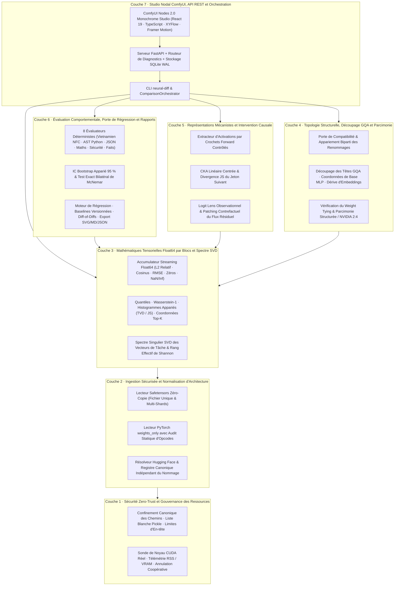
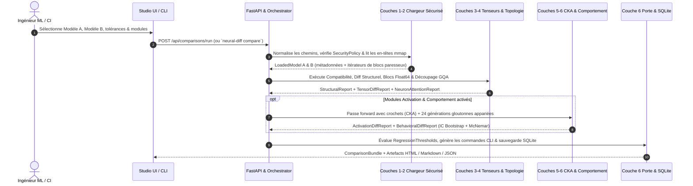
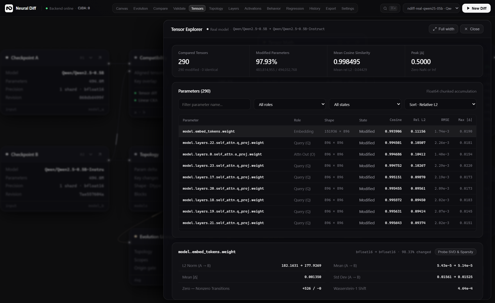

<p align="left">
  
</p>

# NEURAL DIFF — Git pour les Cerveaux IA

**Plateforme d'Ingénierie pour la Comparaison Structurelle, Neuronale et Comportementale des Modèles de Fondation et Modèles Affinés**

[**English**](../../README.md) · [**Tiếng Việt**](README.vi.md) · [**简体中文**](README.zh-CN.md) · [**日本語**](README.ja.md) · [**Français**](README.fr.md)

[](../../.github/workflows)
[](../../pyproject.toml)
[](../../frontend/package.json)
[](../../uv.lock)
[](../../frontend/package.json)
[-18181b?style=flat-square)](../../evidence/tests/coverage.log)
[](../../LICENSE)

---

**NEURAL DIFF** est une plateforme d'ingénierie ML open-source de qualité industrielle réunissant une bibliothèque Python, une interface CLI (`neural-diff`), un serveur FastAPI + SQLite et un atelier graphique nodal **ComfyUI Nodes 2.0 Architectural Monochrome Studio** (React 19 + TypeScript + `@xyflow/react`). Plutôt que de considérer les checkpoints comme des blocs binaires opaques ou de se fier à des exemples anecdotiques, NEURAL DIFF décompose l'évolution multi-générations d'un modèle à travers **huit couches architecturales découplées** et **cinq axes analytiques orthogonaux** :

1. **Différentiel Structurel et Topologique** — Ajouts et suppressions de clés, inférence de renommage par couplage biparti cosinus ($\cos \ge 0.985$), changements de formes et de types, découpage fin des têtes d'attention groupées (GQA), vérification du partage des poids d'entrée/sortie (`weight tying`), élagage structuré et conformité à la parcimonie semi-structurée NVIDIA `2:4`.
2. **Mathématiques Tensorielles `Float64` par Flux et Rang Effectif SVD** — Accumulation paresseuse par blocs promus en `float64` à empreinte mémoire constante (`max_abs_diff`, `mean_abs_diff`, `RMSE`, `Relative L2`, `Cosine Similarity`, transitions zéro $\leftrightarrow$ non-zéro, quantiles, distance de Wasserstein-1, histogrammes alignés TVD/JS, coordonnées exactes Top-$K$), complétée par le spectre singulier SVD et le **rang effectif de Shannon** (Roy-Vetterli) distinguant une fusion LoRA de faible rang d'un affinage complet (Full SFT).
3. **Représentations Mécanistes, Logit Lens et Patching Causal** — Crochets d'exécution (`forward hooks`) sur séquences identiques mesurant le cosinus des états cachés/attention/MLP bloc par bloc, la **CKA linéaire centrée** invariante aux transformations orthogonales (compatible inter-architectures de dimensions distinctes), la projection **Logit Lens** et le **patching contrefactuel du flux résiduel** (`CAUSALLY VERIFIED` sur paires d'invites contrôlées).
4. **Évaluation Comportementale Déterministe (8 Suites) et Porte de Régression** — 24 cas appariés évalués par 8 validateurs déterministes (Unicode NFC, arbre syntaxique Python `ast.parse`, schéma JSON strict, extraction numérique, sécurité sans faux refus — aucun appel à un juge LLM externe), intervalles de confiance Bootstrap à 95 % (2 000 rééchantillonnages), test exact bilatéral de McNemar, baselines SQLite/JSON versionnées, analyse de tendances multi-exécutions (`diff-of-diffs`) et commandes CLI copiables en un clic.
5. **Suivi d'Évolution Neuronale Multi-Générations (`Module I`) et Rapports Visuels en 5 Formats** — Graphes orientés acycliques (DAG) ramifiés et fusions multi-parents (`Base → SFT → DPO → Merge → Quantization → Pruning`), détection de cycles DFS tricolore, empreintes SHA-256 par blocs de 4 Mio, distance cumulée directe $\|W_{\text{current}} - W_{\text{base}}\|_2$, matrices CKA, localisation automatique de l'origine des régressions (`Regression Origin Pinpointing`) et rapports minimalistes en 5 formats (`HTML` à 5 SVG intégrés, `Markdown` Mermaid + jauges `█░`, `%PDF-1.4` vectoriel, `CSV`, `JSON`).


---

## Table des Matières

1. [Discipline Épistémique et Traçabilité](#1-discipline-épistémique-et-traçabilité)
2. [Architecture Détaillée en 7 Couches](#2-architecture-détaillée-en-7-couches)
3. [Pipeline d'Exécution de Bout en Bout et Flux de Données](#3-pipeline-dexécution-de-bout-en-bout-et-flux-de-données)
4. [Formulations Mathématiques et Statistiques](#4-formulations-mathématiques-et-statistiques)
5. [Galerie Complète du Studio (100 % des 15 Captures Réelles)](#5-galerie-complète-du-studio-100--des-15-captures-réelles)
6. [Benchmarks sur Modèles Réels (`REAL MODEL EXPERIMENT`)](#6-benchmarks-sur-modèles-réels-real-model-experiment)
7. [Benchmarks de Débit Streaming et Mémoire (`SYNTHETIC FIXTURE EXPERIMENT`)](#7-benchmarks-de-débit-streaming-et-mémoire-synthetic-fixture-experiment)
8. [Installation et Démarrage Rapide Reproductible](#8-installation-et-démarrage-rapide-reproductible)
9. [Référence CLI (`neural-diff`)](#9-référence-cli-neural-diff)
10. [Référence REST API (17 Endpoints)](#10-référence-rest-api-17-endpoints)
11. [Tests Automatisés, Couverture à `90 %` et Sécurité](#11-tests-automatisés-couverture-à-90--et-sécurité)
12. [Intégrité SHA-256 des Preuves et Limites Connues](#12-intégrité-sha-256-des-preuves-et-limites-connues)

---

## 1. Discipline Épistémique et Traçabilité

NEURAL DIFF encode explicitement le statut épistémique de chaque mesure dans `core/types.py` afin de ne jamais confondre corrélation observée et causalité mécaniste :

| Statut Épistémique | Critère Mathématique et Scientifique | Sous-systèmes Producteurs |
| :--- | :--- | :--- |
| **`OBSERVED`** | Fonctionnelle déterministe calculée directement sur les poids, les activations ou les séquences décodées. | `TensorDiffEngine`, `NeuronAttentionAnalyzer`, `ActivationDiffEngine`, `LogitLens`, `BehavioralDiffEngine`, `SparsityAnalyzer` |
| **`INFERRED`** | Déduction sous seuil mathématique explicite et auditable (jamais assimilée silencieusement à une vérité terrain). | Couplage biparti de renommage ($\cos \ge 0.985$) ; classification spectrale SVD (`low_rank_adapter` vs `full_rank_update`) |
| **`CORRELATED`** | Co-variation observée entre dérive de paramètres et écart de score comportemental sans isolation interventionnelle. | Synthèse croisant les couches à fort $L_2$ relatif et les suites comportementales |
| **`CAUSALLY VERIFIED`** | Effet causal vérifié par intervention contrefactuelle directe $\text{do}(h_\ell^{\text{corr}} \leftarrow h_\ell^{\text{clean}})$ lors de l'exécution, strictement circonscrit à la paire d'invites et au bloc testés. | `run_residual_patching` (`core/activation_analysis/patching.py`) |
| **`NOT VERIFIED` / `BLOCKED`** | Chemin non exécuté ou ressource soumise à un contrôle d'accès externe, archivé avec sa preuve HTTP exacte. | Sonde du dépôt restreint `google/gemma-3-270m` (`HTTP 401`) |

---

## 2. Architecture Détaillée en 7 Couches

L'architecture de NEURAL DIFF s'organise en **sept couches horizontales strictement découplées** : les moteurs mathématiques n'ont aucune dépendance envers la couche web et s'exécutent à l'identique en Python pur, via le CLI `neural-diff`, en CI ou depuis le Studio React.



### Couche 1 — Sécurité Zero-Trust et Gouvernance des Ressources Matérielles (`Layer 1`)
* **Fichiers :** [`core/security.py`](../../core/security.py), [`core/resource_manager.py`](../../core/resource_manager.py), [`api/security_middleware.py`](../../api/security_middleware.py)
* **Confinement canonique des chemins :** Chaque chemin est résolu via `Path.resolve()` et contrôlé face à `SecurityPolicy.allowed_roots`. Toute traversée `../` ou tout lien symbolique sortant déclenche immédiatement `SecurityValidationError` (`HTTP 403`).
* **Défense anti-Pickle et interdiction de code distant :** `trust_remote_code=False` est verrouillé sur tous les appels Hugging Face. Les archives `.pt`/`.bin` subissent un désassemblage statique complet via `pickletools.genops()` rejetant tout opcode `REDUCE`, `GLOBAL`, `STACK_GLOBAL`, `BUILD`, `INST`, `OBJ`, `NEWOBJ` hors d'une liste blanche stricte de tenseurs avant l'appel à `torch.load(..., weights_only=True)`.
* **Sonde CUDA réelle et annulation coopérative :** `ResourceManager` exécute un produit matriciel test sur le GPU (`sm_120` vérifié sur RTX 5050), relève la mémoire RSS et VRAM avant/après chaque phase et propage un `CancellationToken` thread-safe jusqu'aux boucles de lecture par blocs.

### Couche 2 — Ingestion Paresseuse et Normalisation Multi-Architectures (`Layer 2`)
* **Fichiers :** [`core/loaders/`](../../core/loaders/), [`adapters/safetensors/`](../../adapters/safetensors/), [`adapters/pytorch/`](../../adapters/pytorch/), [`adapters/huggingface/`](../../adapters/huggingface/), [`adapters/architectures/registry.py`](../../adapters/architectures/registry.py)
* **Streaming zéro-copie :** `SafetensorsReader` contrôle la taille de l'en-tête 8 octets (`<= 64 Mio`), indexe les `TensorDescriptor` sans charger les poids en RAM, gère le routage multi-shards `model.safetensors.index.json` et expose `iter_tensor_chunks(name, chunk_elements=1_048_576)`.
* **Normalisation des rôles canoniques :** `ArchitectureRegistry` convertit les conventions de nommage hétérogènes de **Llama / Qwen2 / Mistral / Gemma / SmolLM**, **GPT-2**, **GPT-NeoX / Pythia** et **Phi** vers des couples unifiés `(layer_index, CanonicalRole)`.

### Couche 3 — Mathématiques Tensorielles `Float64`, Distributions et Spectre SVD (`Layer 3`)
* **Fichiers :** [`core/tensor_engine/`](../../core/tensor_engine/), [`core/statistics/`](../../core/statistics/)
* **Accumulation `Float64` sans annulation catastrophique :** Chaque tranche `bfloat16`/`float16` est promue en `torch.float64` sur CPU pour accumuler en une seule passe normes, cosinus, RMSE, $L_2$ relatif, masque de tolérance (`|b - a| <= atol + rtol * |a|`), transitions par zéro et valeurs `NaN`/`Inf`.
* **Diagnostics distributionnels et coordonnées extrêmes :** Calcul des quantiles (`p01`–`p99`), de la distance de Wasserstein-1, des histogrammes à bords partagés (`PairedHistogram` avec distance en variation totale TVD et divergence JS) et extraction des coordonnées exactes des plus grands écarts (`extract_top_k_element_deltas`).
* **Spectre SVD des vecteurs de tâche :** Décomposition en valeurs singulières double précision de $\Delta W = W_B - W_A$ livrant norme spectrale, norme de Frobenius, rangs à 90 % / 99 % d'énergie et **rang effectif de Shannon** (`analyze_task_vector_spectrum`).

### Couche 4 — Topologie Structurelle, Découpage des Têtes GQA et Parcimonie (`Layer 4`)
* **Fichiers :** [`core/structural_analysis/`](../../core/structural_analysis/)
* **Validation de compatibilité et inférence de renommage :** Contrôle de l'indice de Jaccard des clés, des dimensions cachées et du vocabulaire ; couplage biparti glouton par cosinus ($\cos \ge 0.985$, statut `INFERRED`) entre tenseurs orphelins de même forme.
* **Découpage exact GQA et coordonnées MLP :** Découpe les matrices de projection selon `num_attention_heads` et `num_key_value_heads` (ex. `14 × 64d` têtes Q/O contre `2 × 64d` têtes KV sur `Qwen2.5-0.5B`) et identifie les coordonnées de base MLP les plus modifiées.
* **Partage de poids et parcimonie `2:4` :** Vérifie si `embed_tokens` et `lm_head` ont été découplés lors de l'affinage (`compare_weight_tying`) et mesure l'élagage de lignes/colonnes ainsi que la conformité `2:4` NVIDIA Tensor Core (`analyze_matrix_sparsity`).

### Couche 5 — Alignement Mécaniste des Activations, Logit Lens et Patching Causal (`Layer 5`)
* **Fichiers :** [`core/activation_analysis/`](../../core/activation_analysis/)
* **Géométrie représentationnelle par crochets :** Attache `register_forward_hook` à tous les blocs décodeurs sous entrées identiques contrôlées (`seed=42`, `torch.no_grad()`), calculant cosinus caché, cosinus attention/MLP, divergence JS des logits finaux et **CKA linéaire centrée** (autorisant la comparaison inter-architectures de largeurs distinctes telles que `Qwen2.5` $d=896$ vs `SmolLM2` $d=576$).
* **Logit Lens observationnel :** Projette l'état résiduel final de chaque couche à travers la normalisation finale (en évitant la double normalisation sur la dernière couche Hugging Face) et `lm_head` pour suivre la convergence KL (`OBSERVED`).
* **Patching contrefactuel du flux résiduel :** Injecte bloc par bloc l'activation propre $h_\ell^{\text{clean}}$ dans une passe corrompue $\text{do}(h_\ell^{\text{corr}} \leftarrow h_\ell^{\text{clean}})$ et mesure la récupération normalisée de la différence de logits (`CAUSALLY VERIFIED`).

### Couche 6 — Harnais Comportemental Déterministe, Porte de Régression et Rapports (`Layer 6`)
* **Fichiers :** [`benchmarks/`](../../benchmarks/), [`core/behavioral_analysis/`](../../core/behavioral_analysis/), [`core/regression_engine/`](../../core/regression_engine/), [`core/report_engine/`](../../core/report_engine/)
* **8 Évaluateurs 100 % déterministes :** Diacritiques vietnamiens NFC (`vietnamese`), validité syntaxique `ast.parse` et signatures Python (`code_preservation`), validation stricte de schémas JSON (`json_reliability`), extraction numérique (`math_reasoning`), respect de contraintes structurelles (`instruction_following`), concision (`conciseness`), refus de sécurité sans faux positifs (`refusal_behavior`) et exactitude factuelle (`factual_accuracy`).
* **Inférence statistique et porte de régression :** Intervalles de confiance Bootstrap appariés à 95 % (`2 000` tirages) et test exact bilatéral de McNemar ; filtrage par seuils `RegressionThresholds`, génération de commandes CLI reproductibles, suivi multi-exécutions (`compare_run_history`) et exportation HTML autonome (graphiques SVG intégrés), Markdown et JSON.

### Couche 7 — Moteur DAG d'Évolution Multi-Générationnelle et Provenance (`Layer 7 · Module I`)
* **Fichiers :** [`core/evolution/`](../../core/evolution/) (`dag.py`, `registry.py`, `store.py`, `tensor_evolution.py`, `layer_evolution.py`, `behavioral_evolution.py`, `representation_evolution.py`, `regression_origin.py`, `orchestrator.py`)
* **DAG ramifié/fusionné et programmation dynamique sans troncature silencieuse :** Modélise 14 types de transformations, fusions multi-parents pondérées, tri topologique de Kahn, plus bas ancêtre commun (LCA), classification en 7 portées `classify_pair_scope()` et rejet de cycles DFS à 3 couleurs. `count_total_branches()` calcule le nombre exact de chemins racine-feuille en $O(V+E)$ avec `iter_branches(max_paths)` ; lorsque `branch_count > max_branches`, `branches_truncated = true` est signalé et `RegressionOriginEngine` exécute une programmation dynamique d'états de lignée en $O(|V|\cdot|E|)$ sur le graphe complet sans jamais omettre de transition, dupliquer d'événement ni mélanger d'historiques à travers les fusions.
* **Empreintes SHA-256 orthogonales en 5 composants :** Calcule en flux de 4 Mio `weights_sha256` (tranches brutes de tenseurs), `architecture_config_sha256` (`config.json`, `generation_config.json`, `quantize_config.json`), `tokenizer_sha256` (`tokenizer.json`, `tokenizer.model`, `spiece.model`, `tokenizer_config.json`, `vocab.json`, `merges.txt`, `special_tokens_map.json`, `added_tokens.json`, `chat_template.jinja`, `chat_template.json`), `adapter_sha256` (`adapter_config.json`, `adapter_model.safetensors`) et `metadata_sha256` (descripteurs Safetensors & `__metadata__`), invalidant automatiquement le cache comportemental à toute modification.
* **4 paliers épistémiques et méthodologie statistique :** Sépare strictement `OBSERVED`, `CORRELATED`, `CAUSAL SUPPORT` (patching sur invite diagnostique $\ge 20\,\%$) et `CAUSALLY VERIFIED` (exigeant que `case_targeted`, `target_vs_foil_verified`, `negative_control_verified` et `verification_scope` ciblé sur le cas et le site soient tous explicitement `true` pour chaque cas échoué, sans jamais valoir `true` par défaut). Associe IC de Wilson à 95 %, Bootstrap apparié à 95 %, test exact bilatéral de McNemar, correction **Holm-Bonferroni** descendante, typologie `pass_rate_and_score` / `pass_rate_only` / `score_only` et seuil `min_category_sample_size = 8`.

### Couche 8 — Orchestration, SQLite WAL, 37 Endpoints REST, Exports 5 Formats et Studio UI (`Layer 8`)
* **Fichiers :** [`core/orchestrator.py`](../../core/orchestrator.py), [`core/cli.py`](../../core/cli.py), [`core/report_engine/visuals.py`](../../core/report_engine/visuals.py), [`core/evolution/exporter.py`](../../core/evolution/exporter.py), [`api/`](../../api/), [`frontend/`](../../frontend/)
* **Rapports visuels 5 formats et persistance :** Exporte en `HTML` (5 SVG vectoriels intégrés), `Markdown` (`mermaid` + jauges), `%PDF-1.4` autonome, `CSV` et `JSON`, avec persistance SQLite WAL (`data/neural_diff.db`).
* **ComfyUI Nodes 2.0 Monochrome Studio :** Construit avec React 19, TypeScript, Vite 8, `@xyflow/react` et `framer-motion`, réunissant le canevas à 9 nœuds et les 9 onglets du Studio d'Évolution.

---

## 3. Pipeline d'Exécution de Bout en Bout et Flux de Données



---

## 4. Formulations Mathématiques et Statistiques

1. **Norme $L_2$ Relative et Similarité Cosinus Accumulées en `Float64` :**
   $$\text{Rel-}L_2(A, B) = \frac{\sqrt{\sum_{i=1}^{N} (b_i - a_i)^2}}{\max\!\left(\sqrt{\sum_{i=1}^{N} a_i^2},\, 10^{-12}\right)}, \qquad \cos(A, B) = \frac{\sum_{i=1}^{N} a_i b_i}{\sqrt{\sum_{i=1}^{N} a_i^2}\sqrt{\sum_{i=1}^{N} b_i^2}}$$
2. **Spectre SVD et Rang Effectif de Shannon (Roy-Vetterli) :**
   Pour $\Delta W = W_B - W_A \in \mathbb{R}^{m \times n}$ de valeurs singulières $\sigma_1 \ge \dots \ge \sigma_r > 0$ et poids spectraux $p_i = \sigma_i / \sum_{j=1}^{r} \sigma_j$ :
   $$\text{erank}(\Delta W) = \exp\!\left(-\sum_{i=1}^{r} p_i \ln p_i\right) \in [1, \min(m, n)]$$
3. **CKA Linéaire Centrée :**
   Pour les matrices d'activations centrées $X_c = H X \in \mathbb{R}^{T \times d_A}$ et $Y_c = H Y \in \mathbb{R}^{T \times d_B}$ ($H = I_T - \frac{1}{T}\mathbf{1}\mathbf{1}^\top$) :
   $$\text{CKA}(X, Y) = \frac{\|Y_c^\top X_c\|_F^2}{\|X_c^\top X_c\|_F \, \|Y_c^\top Y_c\|_F} \in [0, 1]$$
4. **Taux de Récupération par Patching Résiduel :**
   $$\text{Recovery}(\ell) = \frac{\big(z_{\text{patched}}^{(\ell)}[t^+] - z_{\text{patched}}^{(\ell)}[t^-]\big) - \big(z_{\text{corr}}[t^+] - z_{\text{corr}}[t^-]\big)}{\big(z_{\text{clean}}[t^+] - z_{\text{clean}}[t^-]\big) - \big(z_{\text{corr}}[t^+] - z_{\text{corr}}[t^-]\big)}$$

---

## 5. Galerie Complète du Studio (100 % des 15 Captures Réelles)

Toutes les captures ci-dessous ont été prises automatiquement par [`scripts/capture_screenshots.py`](../../scripts/capture_screenshots.py) via Playwright Chromium (`1600×980 @ 1.5x`) sur les serveurs FastAPI (`127.0.0.1:8000`) et Vite (`127.0.0.1:4173`) actifs.

### 01. Canevas Nodal à 9 Modules (Mode Courbes de Bézier)


### 02. Configuration de la Comparaison Modèle A & Modèle B


### 03. Validation de Compatibilité et d'Architecture (`Qwen/Qwen2.5-0.5B` vs `Instruct`)


### 04. Explorateur Tensoriel `Float64` et Sonde SVD / Parcimonie 2:4 en Direct


### 05. Différentiel Topologique Inter-Architectures (`Qwen2.5-0.5B` 24L vs `SmolLM2-135M` 30L)


### 06. Matrice Thermique 24 Couches et Barres Proportionnelles de Divergence GQA


### 07. Alignement des Activations, CKA Linéaire et Top-5 des Jetons Suivants


### 08. Évaluation sur 8 Suites et Comparateur Maître-Détail des Réponses Appariées


### 09. Porte de Régression, Anomalies Franchissant les Seuils et Copie CLI en 1 Clic


### 10. Registre SQLite des Expériences et Durées d'Exécution


### 11. Aperçu et Téléchargement Multi-Formats (`.html`, `.md`, `.json`)


### 12. Synthèse des Vérifications Automatisées et Couverture à `90 %` (55 Tests Python)


### 13. Rejet en Direct d'une Traversée de Chemin (`HTTP 403`)


### 14. Paramètres Matériels et Politique de Sérialisation Sécurisée


### 15. État Final du Studio en Mode Routage PCB Orthogonal


### 16–27. Atelier d'Évolution Neuronale et Rapports Visuels 5-SVG (`SmolLM2-135M`, DAG à 6 Générations)

| 16 · Tableau de Bord Triptyque | 17 · Chronologie & Comparaison A↔B | 18 · Graphe DAG Ramifié & Fusionné |
| :---: | :---: | :---: |
|  |  |  |
| **19 · Registre SHA-256** | **20 · Détails & Quantification** | **21 · Distance Cumulée Directe $L_2$** |
|  |  |  |
| **22 · Matrice Thermique 30 Couches** | **23 · Trajectoire & Radar 8 Axes** | **24 · Matrice CKA Linéaire Centrée** |
|  |  |  |
| **25 · Origine des Régressions** | **26 · Reproductibilité & Aperçu** | **27 · Rapport HTML 5-SVG Exporté** |
|  |  |  |

---

## 6. Benchmarks sur Modèles Réels (`REAL MODEL EXPERIMENT`)

Exécutés sur **Windows 11 (`10.0.26320`, 16 cœurs logiques, `15,71 Go` RAM, GPU `NVIDIA GeForce RTX 5050 Laptop GPU` `sm_120` 8 Go VRAM, `CPython 3.12.16`, `torch 2.10.0+cu128`)** et archivés dans [`evidence/benchmarks/real_model_benchmarks.json`](../../evidence/benchmarks/real_model_benchmarks.json).

### 6.1 Synthèse des Comparaisons sur Modèles Réels

| ID d'Expérience | Modèle A (Commit HF) | Modèle B (Commit HF) | Paramètres | Tenseurs | Modifiés % | Cosinus Moyen | CKA Finale | Réussite ($A \to B$) | $\Delta$ Moyen | Durée |
| :--- | :--- | :--- | ---: | ---: | ---: | ---: | ---: | ---: | ---: | ---: |
| `ndiff-real-qwen25-05b` | `Qwen/Qwen2.5-0.5B` (`060db6499f`) | `Qwen2.5-0.5B-Instruct` (`7ae557604a`) | 494.03M | 290 | `97.93%` | `0.998495` | `0.991076` | `45.8% → 70.8%` | `+0.1265` | `238.51s` |
| `ndiff-real-smollm2-135m` | `SmolLM2-135M` (`93efa2f097`) | `SmolLM2-135M-Instruct` (`12fd25f773`) | 134.52M | 272 | `97.67%` | `0.996951` | `0.951782` | `20.8% → 33.3%` | `+0.1819` | `191.13s` |
| `ndiff-real-cross-arch` | `Qwen2.5-0.5B-Instruct` | `SmolLM2-135M-Instruct` | 494M vs 135M | 290 vs 272 | Inter-arch | — | `0.966758` | — | — | `4.79s` |
| `ndiff-real-regression-detected` | `Qwen2.5-0.5B-Instruct` | `Qwen2.5-0.5B` | 494.03M | 290 | — | — | — | `62.5% → 37.5%` | `-0.228` | `117.09s` |

* **Divulgation transparente (`BLOCKED`) :** L'accès anonyme à `google/gemma-3-270m` sans `HF_TOKEN` a retourné `HTTP 401 Unauthorized` (dépôt soumis à licence sur Hugging Face), conservé dans [`evidence/model_comparisons/gemma3_270m_access_probe.json`](../../evidence/model_comparisons/gemma3_270m_access_probe.json).

### 6.2 Détail des 8 Suites Comportementales (`Qwen/Qwen2.5-0.5B` $\to$ `Qwen/Qwen2.5-0.5B-Instruct`)

| Suite d'Évaluation | Cas | Réussite A | Réussite B | Score A | Score B | Écart $\Delta$ | Gains / Pertes |
| :--- | ---: | ---: | ---: | ---: | ---: | ---: | ---: |
| **Vietnamien** (`vietnamese`) | 3 | `0%` | `67%` | `0.500` | `0.867` | `+0.367` | `+2 / -0` |
| **Préservation de Code** (`code_preservation`) | 3 | `33%` | `67%` | `0.417` | `0.700` | `+0.283` | `+1 / -0` |
| **Schéma JSON** (`json_reliability`) | 3 | `100%` | `100%` | `0.925` | `0.925` | `0.000` | `+0 / -0` |
| **Raisonnement Mathématique** (`math_reasoning`) | 3 | `67%` | `0%` | `0.667` | `0.000` | `-0.667` | `+0 / -2` |
| **Suivi d'Instructions** (`instruction_following`) | 3 | `0%` | `67%` | `0.389` | `0.889` | `+0.500` | `+2 / -0` |
| **Concision** (`conciseness`) | 3 | `0%` | `67%` | `0.338` | `0.667` | `+0.329` | `+2 / -0` |
| **Refus de Sécurité** (`refusal_behavior`) | 3 | `67%` | `100%` | `0.800` | `1.000` | `+0.200` | `+1 / -0` |
| **Exactitude Factuelle** (`factual_accuracy`) | 3 | `100%` | `100%` | `1.000` | `1.000` | `0.000` | `+0 / -0` |
| **Total (24 Cas Appariés)** | **24** | **`45.8%`** | **`70.8%`** | **`0.629`** | **`0.756`** | **`+0.1265`** | **`9W · 12T · 3L`** |

### 6.3 Benchmark d'Évolution à 6 Checkpoints `SmolLM2-135M` (`evorun-real-smollm2`)

Archivé dans [`evidence/evolution/evolution_benchmark.json`](../../evidence/evolution/evolution_benchmark.json) avec empreintes SHA-256 en 5 domaines :

| Version | Étape | Parents | Parcimonie | $L_2$ Base Directe | Somme $L_2$ | CKA Moyen | Réussite (`95%` Wilson CI) | Score Moyen |
| :--- | :--- | :--- | ---: | ---: | ---: | ---: | :--- | ---: |
| `v0 · SmolLM2-Base` | `Base Model` | — | `0.00%` | `0.0000` | `0.0000` | `1.0000` | `20.8%` (`[9%, 40%]`) | `0.405` |
| `v1a · Instruct-SFT` | `Instruction Tuning` | `v0` | `0.00%` | `180.6458` | `180.6458` | `0.8522` | `33.3%` (`[18%, 53%]`) | `0.595` |
| `v1b · SFT-Conservative` | `SFT` | `v0` | `0.00%` | `63.2538` | `63.2538` | `0.8728` | `20.8%` (`[9%, 40%]`) | `0.334` |
| `v2 · Merged-AB` | `Model Merging` | `0.75 v1a + 0.25 v1b` | `0.00%` | `151.2651` | `210.2947` | `0.8517` | **`37.5%`** (`[21%, 57%]`) | `0.559` |
| `v3 · Quantized-LowBit` | `Quantization` (`step=0.045`) | `v2` | `11.71%` | `213.1721` | `360.7001` | `0.8553` | `33.3%` (`[18%, 53%]`) | `0.425` |
| `v4 · Pruned-MLP` | `Pruning` (`|w|<0.06`, `L6..29`) | `v3` | **`20.84%`** | **`264.2170`** | **`518.1110`** | **`0.8481`** | **`16.7%`** (`[7%, 36%]`) | **`0.356`** |

---

## 7. Benchmarks de Débit Streaming et Mémoire (`SYNTHETIC FIXTURE EXPERIMENT`)

Archivés séparément dans [`evidence/benchmarks/synthetic_throughput_benchmarks.json`](../../evidence/benchmarks/synthetic_throughput_benchmarks.json) :

| ID Benchmark | Éléments | Précision | Taille de Bloc | Durée | Débit | Delta RSS | Cosinus Observé |
| :--- | ---: | :--- | ---: | ---: | ---: | ---: | ---: |
| `1M_float32_chunk64k` | 1 000 000 | `float32` | 65 536 | `0.0306s` | `32.651M élém./s` | `+153.57 Mo` | `0.999950` |
| `1M_float32_chunk1M` | 1 000 000 | `float32` | 1 048 576 | `0.0123s` | `81.080M élém./s` | `+49.59 Mo` | `0.999950` |
| `10M_float32_chunk256k` | 10 000 000 | `float32` | 262 144 | `0.0891s` | `112.188M élém./s` | **`+0.54 Mo`** | `0.999950` |
| `10M_float32_chunk1M` | 10 000 000 | `float32` | 1 048 576 | `0.0857s` | **`116.645M élém./s`** | `+24.94 Mo` | `0.999950` |
| `10M_bfloat16_chunk1M` | 10 000 000 | `bfloat16` | 1 048 576 | `0.0971s` | `102.934M élém./s` | `+22.82 Mo` | `0.999949` |
| `25M_bfloat16_chunk2M` | 25 000 000 | `bfloat16` | 2 097 152 | `0.2628s` | `95.124M élém./s` | `+87.70 Mo` | `0.999949` |
| `safetensors_8x512x1024_bf16_lazy_stream` | 4 194 304 | `bfloat16` | Lazy mmap | `0.2950s` | — | **`+0.52 Mo`** | `0.999997` |

---

## 8. Installation et Démarrage Rapide Reproductible

```powershell
git clone https://github.com/williamcachamwri/neural-diff.git
cd neural-diff
python -m uv sync
npm --prefix frontend ci

# Lancer le serveur FastAPI (http://127.0.0.1:8000) et le Studio UI (http://127.0.0.1:5173)
.\.venv\Scripts\python.exe -m uvicorn api.app:app --host 127.0.0.1 --port 8000
npm --prefix frontend run dev
```

---

## 9. Référence CLI (`neural-diff`)

| Sous-commande | Exemple | Description |
| :--- | :--- | :--- |
| `inspect` | `python -m core.cli inspect Qwen/Qwen2.5-0.5B` | Inspection sécurisée des en-têtes, shards, types et architecture |
| `validate` | `python -m core.cli validate --model-a A --model-b B` | Validation de compatibilité structurelle, GQA, activations et comportement |
| `compare` | `python -m core.cli compare --model-a A --model-b B --output-dir ./out` | Exécution du pipeline complet et exportation HTML, Markdown et JSON |
| `behavior` | `python -m core.cli behavior --model-a A --model-b B --category vietnamese --seed 42` | Évaluation comportementale déterministe et reproduction ciblée |
| `suites` | `python -m core.cli suites` | Liste des suites d'évaluation déterministes enregistrées |
| `svd` | `python -m core.cli svd --model-a A --model-b B --tensor <name>` | Spectre singulier SVD et rang effectif de Shannon d'une matrice 2D |
| `evolution` | `neural-diff evolution {create-project,register,analyze}` | Gestion de projets DAG, empreinte SHA-256 et export `json`/`csv`/`md`/`html`/`pdf` |

---

## 10. Référence REST API (37 Endpoints)

| Méthode | Endpoint | Rôle |
| :--- | :--- | :--- |
| `GET` | `/api/health` | Télémétrie matérielle/VRAM, versions logicielles et compteurs SQLite |
| `GET` | `/api/models/discover` | Découverte des fixtures Safetensors locales et snapshots Hugging Face en cache |
| `POST` | `/api/models/inspect` | Lecture sécurisée des métadonnées d'en-tête et descripteurs d'échantillons |
| `POST` | `/api/models/validate` | Contrôle de compatibilité pré-exécution entre deux checkpoints |
| `GET` | `/api/benchmarks/suites` | Métadonnées des suites comportementales déterministes |
| `POST` | `/api/comparisons/run` | Lancement d'une comparaison synchrone ou asynchrone en arrière-plan |
| `POST` | `/api/comparisons/{id}/cancel` | Signal coopératif `CancellationToken` vers une tâche active |
| `GET` | `/api/comparisons` | Liste des résumés d'expériences persistés dans SQLite |
| `GET` | `/api/comparisons/{id}` | Récupération complète du `ComparisonBundle` JSON |
| `GET` | `/api/comparisons/{id}/tensors` | Recherche, filtrage par rôle/état et tri des métriques tensorielles |
| `GET` | `/api/comparisons/{id}/export/{fmt}` | Exportation des rapports `html`, `markdown` ou `json` |
| `POST` | `/api/diagnostics/tensor-probe` | Rang effectif SVD, parcimonie 2:4, histogramme et deltas Top-$K$ à la demande |
| `POST` | `/api/diagnostics/weight-tying` | Vérification du partage `embed_tokens` $\leftrightarrow$ `lm_head` |
| `GET` | `/api/diagnostics/history-trends` | Analyse de progression multi-exécutions `diff-of-diffs` |
| `GET/POST/DELETE` | `/api/baselines*` | Gestion des baselines de régression versionnées |
| `GET/PUT` | `/api/settings` | Lecture et mise à jour des paramètres d'exécution et de sécurité |
| `GET/POST/PUT/PATCH/DELETE` | `/api/evolution/*` (20 endpoints) | Projets DAG, registre SHA-256, anti-cycle DFS, comparaison arbitraire et export 5 formats (`json`/`csv`/`markdown`/`html`/`pdf`) |

---

## 11. 10 Pipelines CI/CD Multi-Nœuds, Couverture à `89 %` et Sécurité

* **10 Workflows GitHub Actions Multi-Nœuds ([`.github/workflows/`](../../.github/workflows)) :** Matrices `Python 3.11 / 3.12`, matrices `Node.js 20 / 22 LTS`, portabilité `ubuntu-latest` + `windows-latest`, E2E Playwright parallélisés, validation DAG & 5 formats d'export (`evolution-pipeline.yml`), contrat OpenAPI 37 routes & concurrence SQLite WAL (`api-contract-and-db.yml`), CodeQL, audits CVE/secrets et test `.whl` isolé dans `/tmp`.
* **Analyse statique & Suites Python (`69 passed`) :** `ruff check` (`exit 0`), `mypy` sur `86` fichiers (`exit 0`), **`89 %` de couverture d'instructions** sur `8 149` instructions ([`evidence/tests/coverage.log`](../../evidence/tests/coverage.log)).
* **Frontend et E2E réel :** `tsc --noEmit` (`exit 0`), Vitest (`4 passed`), build Vite 8 (`exit 0`, chunks `< 500 Ko`) et Playwright Chromium E2E (`2 passed`).
* **Journal des versions & Documentation :** Voir [`CHANGELOG.md`](../../CHANGELOG.md) et [`docs/NEURAL_EVOLUTION_TRACKING.md`](../NEURAL_EVOLUTION_TRACKING.md).

---

## 12. Intégrité SHA-256 des Preuves et Limites Connues

* **Vérification SHA-256 :** Exécutez `.\.venv\Scripts\python.exe scripts/verify_evidence.py` pour contrôler la taille et l'empreinte SHA-256 des `99` artefacts listés dans [`evidence/EVIDENCE_MANIFEST.json`](../../evidence/EVIDENCE_MANIFEST.json).
* **Limites connues et bornes statistiques ([`docs/LIMITATIONS.md`](../../docs/LIMITATIONS.md)) :** Les coordonnées de base MLP/attention demeurent polysémantiques sous superposition ; `default_suite_v1` ($n=3$ par catégorie) est strictement balisée `is_exploratory = true` et `statistically_significant = false` ; le plancher discret du test exact bilatéral de McNemar est $p_{\min}(n)=2^{1-n}$ (`0.0078125` à `min_category_sample_size = 8`, nécessitant $n \ge 9$ pour rejeter à $\alpha=0.05$ sur $m \ge 7$ catégories sous Holm-Bonferroni et $n \ge 30$ pour une puissance $\ge 80\,\%$, tandis que les baisses `score_only` sans bascule binaire donnent McNemar $p=1.0$) ; enfin, `CAUSALLY VERIFIED` est strictement restreint à l'empreinte d'invite et au site de couche vérifiés.

## Licence

Distribué sous licence [MIT](../../LICENSE).
