# NEURAL DIFF — Git pour les Cerveaux IA

**Comparaison Structurelle, Neuronale et Comportementale pour Modèles de Fondation et Modèles Affinés**

[**English**](../../README.md) · [**Tiếng Việt**](README.vi.md) · [**简体中文**](README.zh-CN.md) · [**日本語**](README.ja.md) · [**Français**](README.fr.md)

---

**NEURAL DIFF** est un atelier d'ingénierie ML complet regroupant une bibliothèque Python, une interface en ligne de commande (`neural-diff`), un serveur FastAPI + SQLite et une interface graphique nodale **ComfyUI Nodes 2.0 Monochrome Studio** (React 19 + TypeScript + `@xyflow/react`). Au lieu de traiter les mises à jour de poids comme des boîtes noires opaques, NEURAL DIFF décompose l'évolution entre deux checkpoints selon quatre axes orthogonaux :

1. **Différentiel Structurel et Topologique** — Détection des tenseurs ajoutés/supprimés, inférence de renommage par similarité cosinus ($\cos \ge 0.985$), changements de dimensions et de types, découpage des têtes d'attention groupées (GQA), vérification du partage de poids (`weight tying`) et analyse de parcimonie semi-structurée NVIDIA `2:4`.
2. **Mathématiques Tensorielles `Float64` par Flux et Rang Effectif SVD** — Accumulation paresseuse par blocs en `float64` (norme $L_2$ relative, cosinus, RMSE, distance de Wasserstein-1, TVD, Jensen-Shannon) et calcul du rang effectif de Shannon sur le spectre singulier SVD des vecteurs de tâche pour distinguer une adaptation LoRA de faible rang d'un affinage complet (Full SFT).
3. **Interprétabilité Mécaniste, CKA Linéaire et Patching Causal** — Crochets d'exécution (`forward hooks`) sur entrées contrôlées mesurant la similarité cosinus cachée, la **CKA linéaire** invariante aux transformations orthogonales, la projection **Logit Lens** et le **patching contrefactuel du flux résiduel** (`CAUSALLY VERIFIED` sur paires d'invites contrôlées).
4. **Évaluation Comportementale Déterministe (8 Domaines) et Porte de Régression** — 24 cas appariés sans juge LLM externe, intervalles de confiance Bootstrap à 95 %, test exact bilatéral de McNemar, références versionnées SQLite/JSON, suivi multi-exécutions (`diff-of-diffs`) et commandes CLI de reproduction en un clic.

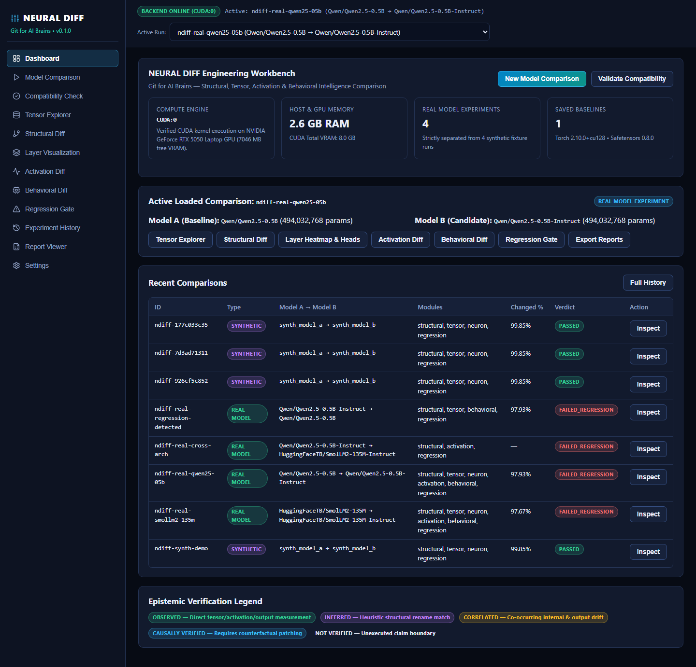

---

## 1. Discipline Épistémique

| Statut Épistémique | Définition Technique | Modules Producteurs |
| :--- | :--- | :--- |
| **`OBSERVED`** | Mesure déterministe calculée directement à partir des tenseurs, activations ou logits de sortie. | `TensorDiffEngine`, `ActivationDiffEngine`, `LogitLens`, `BehavioralDiffEngine`, `SparsityAnalyzer` |
| **`INFERRED`** | Déduction structurelle ou spectrale fondée sur des seuils explicites (jamais confondue avec une vérité absolue). | Appariement de renommage ($\cos \ge 0.985$), classification SVD LoRA vs Full SFT |
| **`CORRELATED`** | Co-occurrence observée entre dérive de paramètres et écart comportemental sans isolation contrefactuelle. | Croisement des couches à fort $L_2$ relatif et des scores par domaine |
| **`CAUSALLY VERIFIED`** | Effet vérifié par intervention contrefactuelle directe $\text{do}(h_\ell \leftarrow h_\ell^{\text{clean}})$ sur une paire d'entrées et un site précis. | `run_residual_patching` (`core/activation_analysis/patching.py`) |
| **`BLOCKED`** | Opération bloquée par une contrainte externe réelle avec conservation intégrale de la preuve d'erreur. | Sonde du dépôt restreint `google/gemma-3-270m` (`HTTP 401`) |

Chaque expérience distingue strictement **`REAL MODEL EXPERIMENT`** (modèles publics avec hachages de révision Hugging Face) et **`SYNTHETIC FIXTURE EXPERIMENT`** (fixtures de test et micro-benchmarks de débit).

---

## 2. Galerie Complète de l'Application (100 % des 15 Captures Réelles)

Les 15 captures PNG ci-dessous ont été générées automatiquement par [`scripts/capture_screenshots.py`](../../scripts/capture_screenshots.py) via Playwright Chromium sans tête (`1600×980 @ 1.5x`) connecté aux serveurs FastAPI (`127.0.0.1:8000`) et Vite (`127.0.0.1:4173`) en cours d'exécution.

### 01. Canevas Nodal à 9 Modules (Câblage Courbes de Bézier)


### 02. Configuration de la Comparaison Modèle A vs Modèle B
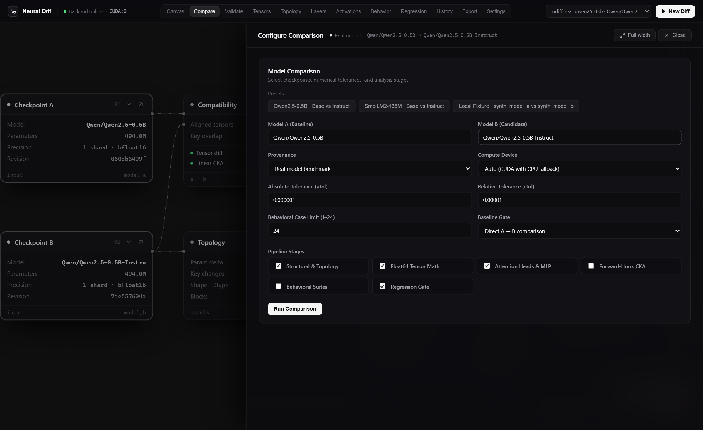

### 03. Validation de Compatibilité et Métadonnées d'Architecture (`Qwen/Qwen2.5-0.5B` vs `Instruct`)
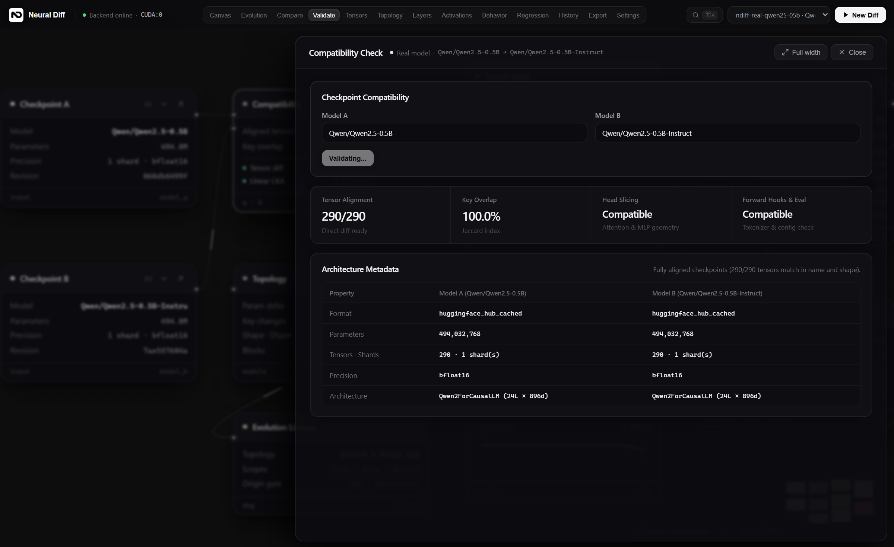

### 04. Explorateur Tensoriel `Float64` et Sonde SVD / Parcimonie à la Demande


### 05. Différentiel Topologique Inter-Architectures (`Qwen2.5-0.5B` 24 Couches vs `SmolLM2-135M` 30 Couches)
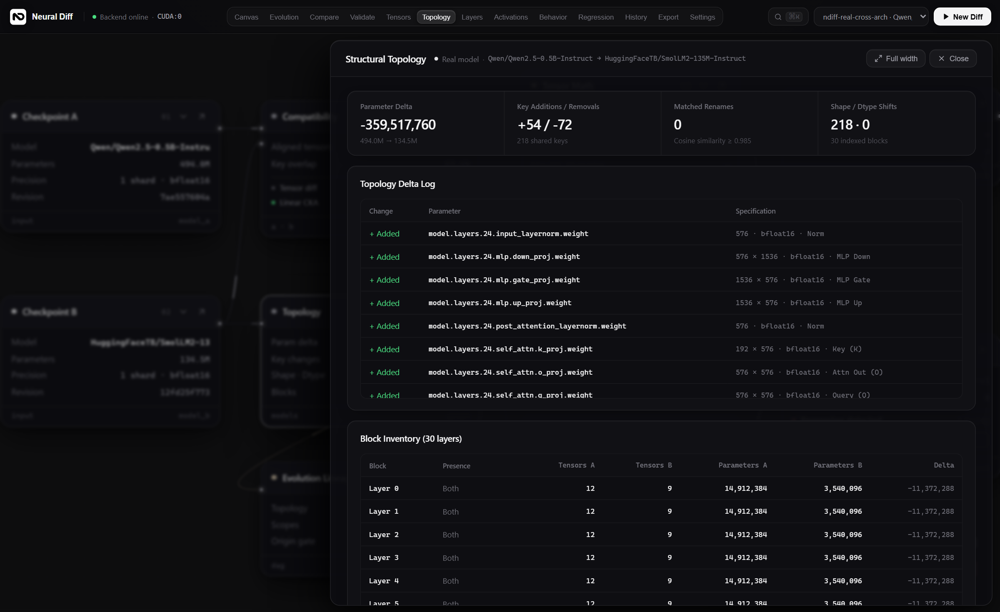

### 06. Carte Thermique des 24 Couches et Barres de Divergence par Tête d'Attention GQA
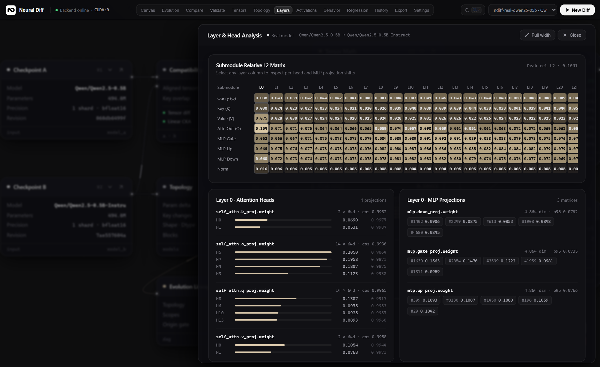

### 07. Alignement des Activations, CKA Linéaire et Probabilités du Jeton Suivant
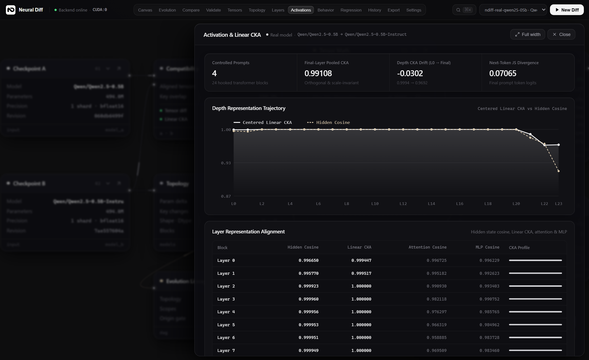

### 08. Évaluation Comportementale sur 8 Suites et Comparateur Maître-Détail


### 09. Porte de Régression, Anomalies Détectées et Commandes CLI Copiables
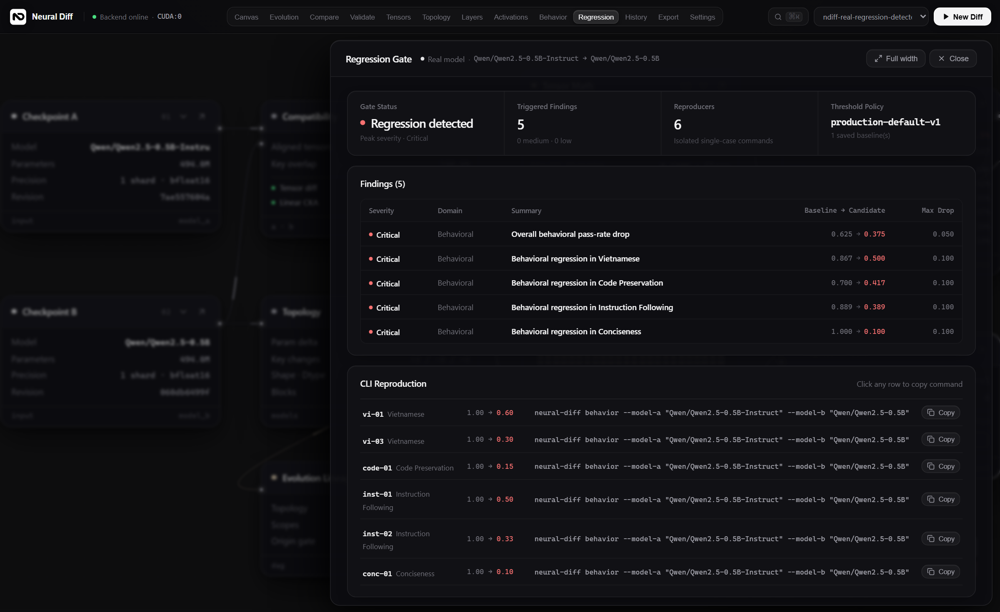

### 10. Registre SQLite des Expériences et Télémétrie d'Exécution
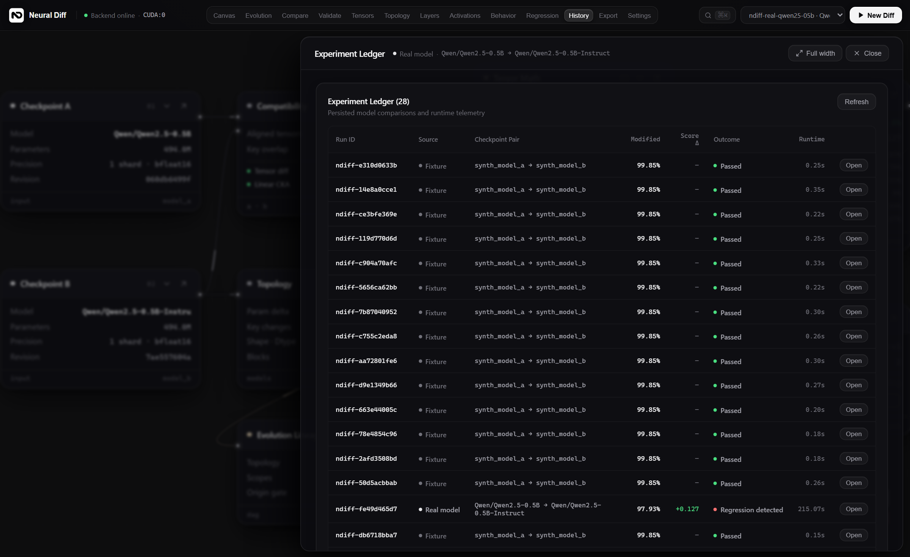

### 11. Aperçu et Exportation Multi-Formats (`.html` autonome, `.md`, `.json`)
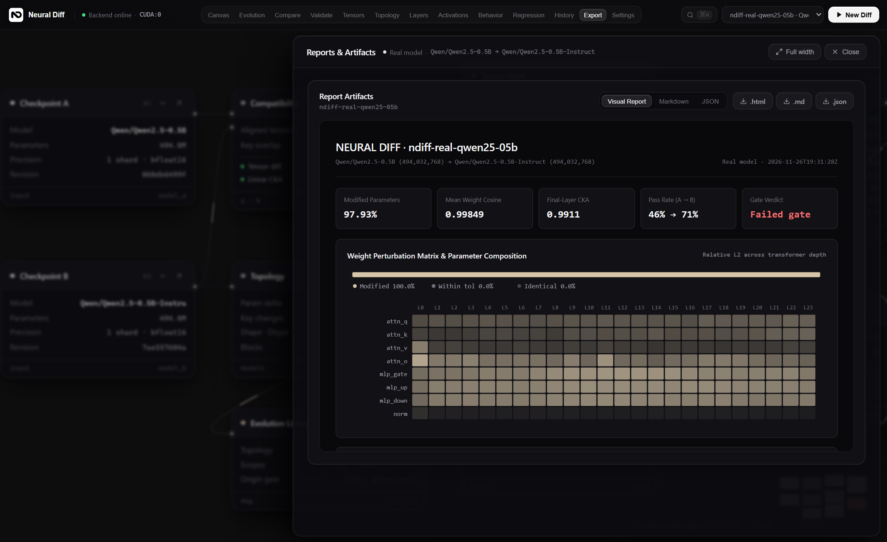

### 12. Synthèse des Tests Automatisés et Couverture de Code (55 Tests Python · 90 % de Couverture)
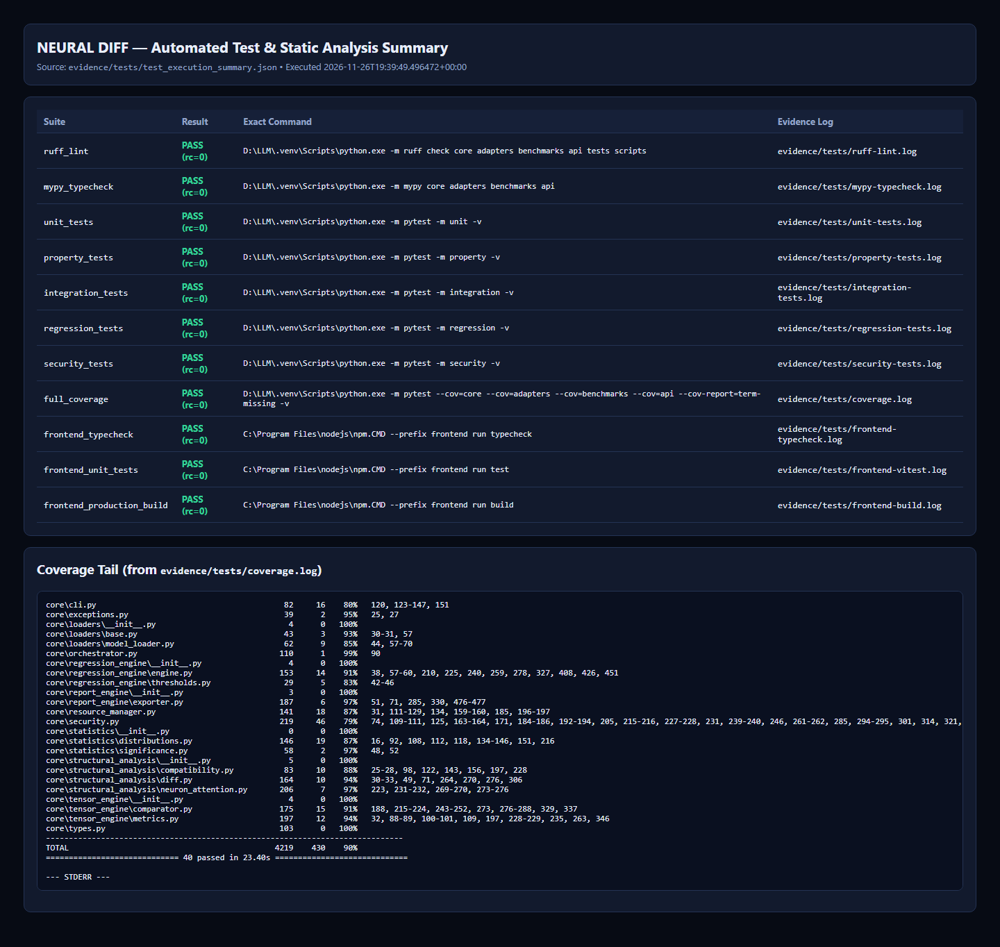

### 13. Rejet de Traversée de Répertoire et Sécurité API (`HTTP 403`)
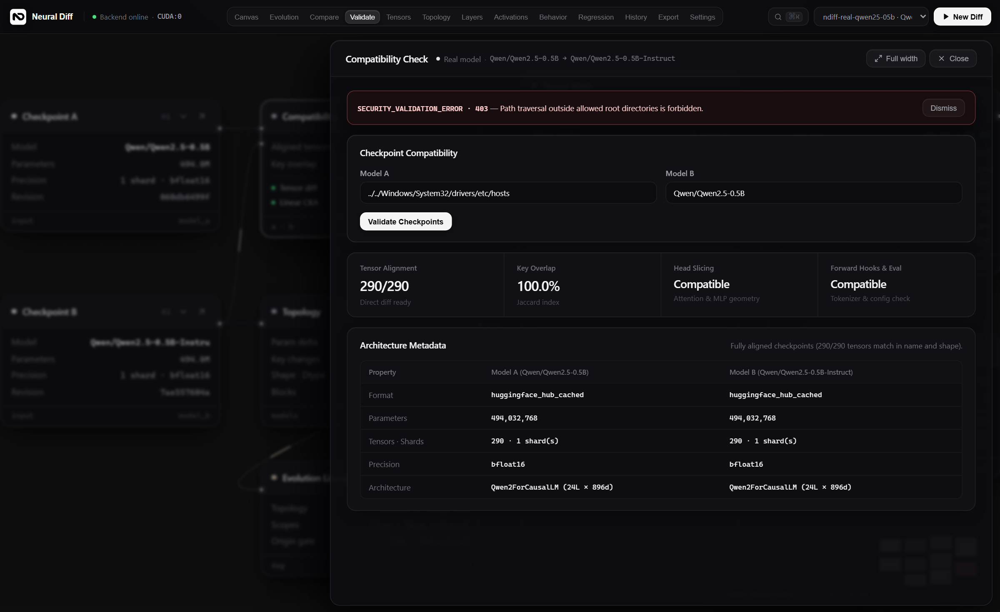

### 14. Paramètres d'Exécution et Politique de Sérialisation Sécurisée
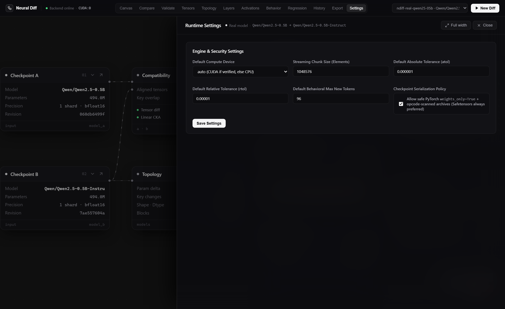

### 15. État Final du Studio en Mode Routage PCB Orthogonal
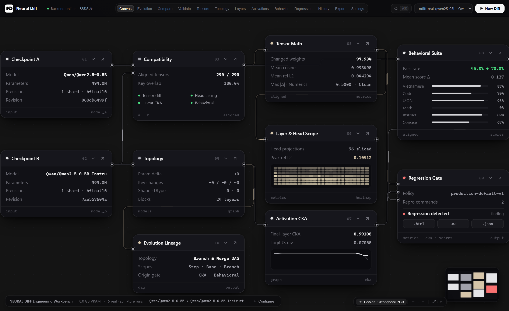

---

## 3. Résultats Complets des Benchmarks Réels

Exécutés sur **Windows 11 (`10.0.26320`, 16 cœurs logiques, `15,71 Go` RAM, GPU `NVIDIA GeForce RTX 5050 Laptop GPU` `sm_120` 8 Go VRAM, `CPython 3.12.16`, `PyTorch 2.10.0+cu128`)** et archivés dans [`evidence/benchmarks/real_model_benchmarks.json`](../../evidence/benchmarks/real_model_benchmarks.json) et [`evidence/benchmarks/synthetic_throughput_benchmarks.json`](../../evidence/benchmarks/synthetic_throughput_benchmarks.json).

### 3.1 Comparaisons sur Modèles Réels (`REAL MODEL EXPERIMENT`)

| ID d'Expérience | Modèle A (Révision) | Modèle B (Révision) | Paramètres | Tenseurs | Modifiés % | Cosinus Moyen | CKA Finale | Taux de Réussite ($A \to B$) | $\Delta$ Moyen | Durée |
| :--- | :--- | :--- | ---: | ---: | ---: | ---: | ---: | ---: | ---: | ---: |
| `ndiff-real-qwen25-05b` | `Qwen/Qwen2.5-0.5B` (`060db6499f`) | `Qwen2.5-0.5B-Instruct` (`7ae557604a`) | 494.03M | 290 | `97.93%` | `0.998495` | `0.991076` | `45.8% → 70.8%` | `+0.1265` | `238.51s` |
| `ndiff-real-smollm2-135m` | `SmolLM2-135M` (`93efa2f097`) | `SmolLM2-135M-Instruct` (`12fd25f773`) | 134.52M | 272 | `97.67%` | `0.996951` | `0.951782` | `20.8% → 33.3%` | `+0.1819` | `191.13s` |
| `ndiff-real-cross-arch` | `Qwen2.5-0.5B-Instruct` | `SmolLM2-135M-Instruct` | 494M vs 135M | 290 vs 272 | Inter-arch | — | `0.966758` | — | — | `4.79s` |
| `ndiff-real-regression-detected` | `Qwen2.5-0.5B-Instruct` | `Qwen2.5-0.5B` | 494.03M | 290 | — | — | — | `62.5% → 37.5%` | `-0.228` | `117.09s` |

* **Divulgation transparente (`BLOCKED`) :** La sonde anonyme de `google/gemma-3-270m` sans jeton `HF_TOKEN` a renvoyé `HTTP 401 Unauthorized` (dépôt à accès restreint), documenté dans [`evidence/model_comparisons/gemma3_270m_access_probe.json`](../../evidence/model_comparisons/gemma3_270m_access_probe.json).

### 3.2 Détail des 8 Domaines Comportementaux (`Qwen/Qwen2.5-0.5B` $\to$ `Qwen/Qwen2.5-0.5B-Instruct`)

| Domaine | Cas | Réussite A | Réussite B | Score A | Score B | Écart $\Delta$ | Gains / Pertes |
| :--- | ---: | ---: | ---: | ---: | ---: | ---: | ---: |
| **Vietnamien** (`vietnamese`) | 3 | `0%` | `67%` | `0.500` | `0.867` | `+0.367` | `+2 / -0` |
| **Préservation de Code** (`code_preservation`) | 3 | `33%` | `67%` | `0.417` | `0.700` | `+0.283` | `+1 / -0` |
| **Schéma JSON** (`json_reliability`) | 3 | `100%` | `100%` | `0.925` | `0.925` | `0.000` | `+0 / -0` |
| **Raisonnement Mathématique** (`math_reasoning`) | 3 | `67%` | `0%` | `0.667` | `0.000` | `-0.667` | `+0 / -2` |
| **Suivi d'Instructions** (`instruction_following`) | 3 | `0%` | `67%` | `0.389` | `0.889` | `+0.500` | `+2 / -0` |
| **Concision** (`conciseness`) | 3 | `0%` | `67%` | `0.338` | `0.667` | `+0.329` | `+2 / -0` |
| **Refus de Sécurité** (`refusal_behavior`) | 3 | `67%` | `100%` | `0.800` | `1.000` | `+0.200` | `+1 / -0` |
| **Exactitude Factuelle** (`factual_accuracy`) | 3 | `100%` | `100%` | `1.000` | `1.000` | `0.000` | `+0 / -0` |

### 3.3 Débit de Streaming par Blocs et Empreinte Mémoire (`SYNTHETIC FIXTURE EXPERIMENT`)

| ID Benchmark | Éléments | Type Source | Taille de Bloc | Durée | Débit (M élém./s) | Delta RSS |
| :--- | ---: | :--- | ---: | ---: | ---: | ---: |
| `1M_float32_chunk1M` | 1 000 000 | `float32` | 1 048 576 | `0.0123s` | `81.080M/s` | `+49.59 Mo` |
| `10M_float32_chunk256k` | 10 000 000 | `float32` | 262 144 | `0.0891s` | `112.188M/s` | **`+0.54 Mo`** |
| `10M_float32_chunk1M` | 10 000 000 | `float32` | 1 048 576 | `0.0857s` | **`116.645M/s`** | `+24.94 Mo` |
| `10M_bfloat16_chunk1M` | 10 000 000 | `bfloat16` | 1 048 576 | `0.0971s` | `102.934M/s` | `+22.82 Mo` |
| `25M_bfloat16_chunk2M` | 25 000 000 | `bfloat16` | 2 097 152 | `0.2628s` | `95.124M/s` | `+87.70 Mo` |
| `safetensors_lazy_stream` | 4 194 304 | `bfloat16` | Lazy mmap | `0.2950s` | — | **`+0.52 Mo`** |

---

## 4. Installation et Exécution Reproductible

```powershell
cd d:\LLM
python -m uv sync
npm --prefix frontend ci

# Démarrer le backend FastAPI et le Studio React
.\.venv\Scripts\python.exe -m uvicorn api.app:app --host 127.0.0.1 --port 8000
npm --prefix frontend run dev

# Exécuter l'ensemble des tests et vérifier l'intégrité SHA-256 des preuves
.\.venv\Scripts\python.exe scripts/run_all_tests.py
.\.venv\Scripts\python.exe scripts/verify_evidence.py
```

## Licence

Distribué sous licence [MIT](../../LICENSE).
