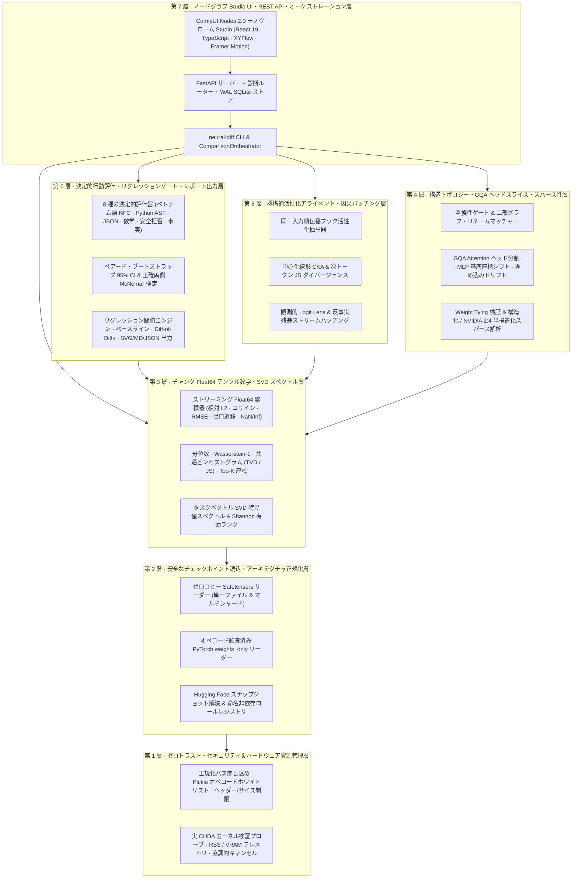
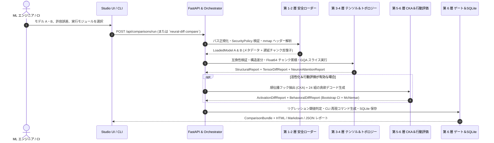
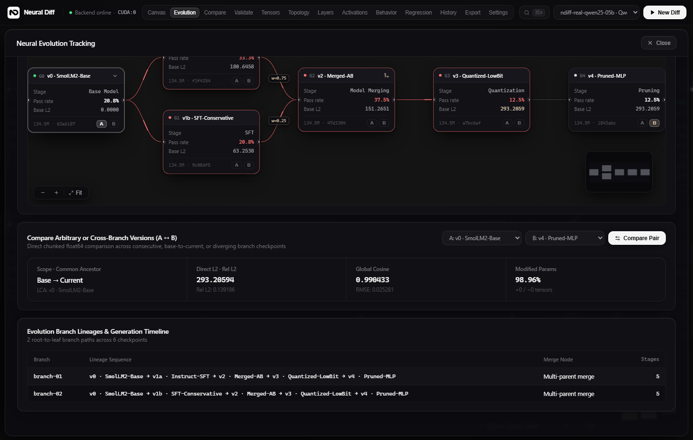
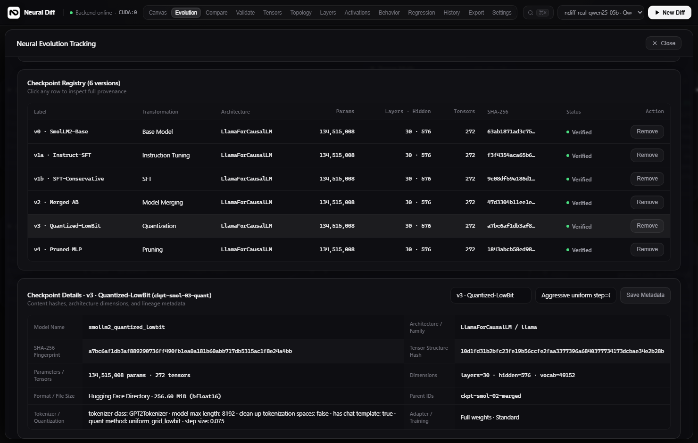

<p align="left">
  
</p>

# NEURAL DIFF — AIモデルのためのGit

**事前学習済み・ファインチューニング済み基盤モデルの構造・内部表現・決定的行動比較エンジニアリング基盤**

[**English**](../../README.md) · [**Tiếng Việt**](README.vi.md) · [**简体中文**](README.zh-CN.md) · [**日本語**](README.ja.md) · [**Français**](README.fr.md)

[](../../.github/workflows)
[](../../pyproject.toml)
[](../../frontend/package.json)
[](../../uv.lock)
[](../../frontend/package.json)
[-18181b?style=flat-square)](../../evidence/tests/coverage.log)
[](../../LICENSE)

---

**NEURAL DIFF** は、ニューラルネットワークのチェックポイント間および多世代ライフサイクルにわたる進化を数学的厳密さで検査・比較・検証・リグレッションゲート管理するためのプロダクション品質オープンソース ML エンジニアリング基盤です。Python ライブラリ、CLI（`neural-diff`）、FastAPI + SQLite バックエンド、および **ComfyUI Nodes 2.0 モノクローム・スタジオ**（React 19 + TypeScript + `@xyflow/react`）を備え、**疎結合な 8 層システムアーキテクチャ** と **5 つの直交解析軸** によってモデル更新を分解します：

1. **構造・トポロジー差分（Structural & Topology Diff）** — テンソルキーの追加・削除、二部グラフ・コサインマッチング（$\cos \ge 0.985$）によるリネーム推論、形状・データ型のシフト、GQA（Grouped-Query Attention）ヘッド単位スライス、入出力埋め込みの重み共有（Weight Tying）検証、構造化プルーニングおよび NVIDIA `2:4` 半構造化スパース性適合率。
2. **Float64 チャンクストリーミング数値解析・SVD スペクトル有効ランク** — 定数メモリオーバーヘッドでチャンク単位に `float64` 昇格して累積する精密演算（`max_abs_diff`、`mean_abs_diff`、`RMSE`、`Relative L2`、`Cosine Similarity`、ゼロ交差遷移、分位数、Wasserstein-1 距離、共通ビン TVD/JS ヒストグラム、Top-$K$ 多次元座標特定）、および特異値スペクトルの Roy-Vetterli **Shannon 有効ランク** による低ランク LoRA 結合とフルランク SFT 更新の判別。
3. **機構的解釈可能性・Logit Lens・反事実活性化パッチング** — 同一トークン列に対する順伝播フックでブロックごとの隠れ状態/Attention/MLP コサイン、直交変換不変な **中心化線形 CKA**（異種アーキテクチャ間の異なる隠れ次元比較に対応）、観測的 **Logit Lens** 語彙投影、および反事実 **残差ストリーム活性化パッチング（Residual-Stream Activation Patching）**（対象プロンプト対において `CAUSALLY VERIFIED` を達成）を実行。
4. **8 領域の決定的行動評価・リグレッションゲート** — 外部 LLM ジャッジを一切呼ばない 8 種の決定的評価器（Unicode NFC、Python `ast.parse` 構文木、厳密 JSON スキーマ、数値抽出、安全拒否など計 24 対テストケース）、2,000 回リサンプリングのペアード・ブートストラップ 95% 信頼区間、正確両側 McNemar 検定、バージョン管理ベースライン、複数実行推移解析（`diff-of-diffs`）、およびワンクリックコピー対応 CLI 再現コマンド。
5. **多世代ニューラル進化追跡（`Module I`）＆ミニマリスト 5 形式ビジュアルレポート** — 分岐・複数親モデル統合 DAG（`Base → SFT → DPO → Merge → Quantization → Pruning`）、3 色 DFS 循環検出、4 MiB ストリーミング SHA-256 指紋＆PEFT LoRA 検出、直接累積距離 $\|W_{\text{current}} - W_{\text{base}}\|_2$、世代横断 CKA 行列、劣化起点自動特定（`Regression Origin Pinpointing`）、および 5 種の SVG 埋め込み `HTML`・Mermaid＋`█░`ゲージ付き `Markdown`・純 Python ベクタ `%PDF-1.4`・`CSV`・厳密 `JSON` レポート出力。


---

## 目次

1. [認識論的規律とデータ来歴管理](#1-認識論的規律とデータ来歴管理)
2. [7 層システムアーキテクチャ詳細解説](#2-7-層システムアーキテクチャ詳細解説)
3. [エンドツーエンド実行パイプラインとデータフロー](#3-エンドツーエンド実行パイプラインとデータフロー)
4. [数学的・統計的定式化](#4-数学的統計的定式化)
5. [全画面ライブスクリーンショット集（全 15 枚・100% 実機撮影）](#5-全画面ライブスクリーンショット集全-15-枚100-実機撮影)
6. [公開実モデルベンチマーク（`REAL MODEL EXPERIMENT`）](#6-公開実モデルベンチマークreal-model-experiment)
7. [チャンクストリーミング性能・メモリベンチマーク（`SYNTHETIC FIXTURE EXPERIMENT`）](#7-チャンクストリーミング性能メモリベンチマークsynthetic-fixture-experiment)
8. [インストールと再現可能なクイックスタート](#8-インストールと再現可能なクイックスタート)
9. [CLI リファレンス（`neural-diff`）](#9-cli-リファレンスneural-diff)
10. [REST API リファレンス（全 17 エンドポイント）](#10-rest-api-リファレンス全-17-エンドポイント)
11. [自動テスト・`90%` カバレッジ・セキュリティ監査](#11-自動テスト90-カバレッジセキュリティ監査)
12. [SHA-256 証跡整合性と既知の技術的制約](#12-sha-256-証跡整合性と既知の技術的制約)

---

## 1. 認識論的規律とデータ来歴管理

NEURAL DIFF はドメイン型（`core/types.py`）および全レポート形式に明示的な認識論ラベルを付与し、観測上の相関と因果的メカニズムを決して混同しません：

| 認識論ステータス | 数学的・科学的定義 | 生成サブシステム |
| :--- | :--- | :--- |
| **`OBSERVED`** | チェックポイント重み、順伝播フック活性化、または貪欲デコード出力から直接計算された決定的観測値。 | `TensorDiffEngine`、`NeuronAttentionAnalyzer`、`ActivationDiffEngine`、`LogitLens`、`BehavioralDiffEngine`、`SparsityAnalyzer` |
| **`INFERRED`** | 監査可能な明示的閾値に基づく構造・スペクトル推論（無断で真値と同一視しない）。 | 同一形状テンソルの二部グラフ・リネーム推論（$\cos \ge 0.985$）、SVD 更新レジーム分類 |
| **`CORRELATED`** | 反事実介入による分離を行っていない、パラメータ変動と行動スコア変化の共起関係。 | 相対 $L_2$ 上位層と行動スイート変動の横断サマリー |
| **`CAUSALLY VERIFIED`** | 順伝播中の直接的な反事実介入 $\text{do}(h_\ell^{\text{corr}} \leftarrow h_\ell^{\text{clean}})$ により検証された因果回復効果（対象プロンプト対・サイトに限定）。 | `run_residual_patching`（`core/activation_analysis/patching.py`） |
| **`NOT VERIFIED` / `BLOCKED`** | 未実行経路または外部認可ゲートにより遮断された対象（HTTP/実行ログ証跡をそのまま保持）。 | `google/gemma-3-270m` ゲート付きリポジトリ検証（`HTTP 401`） |

---

## 2. 7 層システムアーキテクチャ詳細解説

NEURAL DIFF は Web フレームワークへの依存を持たないコア数学エンジンを中心に、**疎結合な 7 つの水平レイヤー** で構成されています。



### 第 1 層 — ゼロトラスト・セキュリティ＆ハードウェア資源管理層（Layer 1）
* **実装ファイル：** [`core/security.py`](../../core/security.py)、[`core/resource_manager.py`](../../core/resource_manager.py)、[`api/security_middleware.py`](../../api/security_middleware.py)
* **ルートパス閉じ込め：** すべてのローカルパスを `Path.resolve()` で正規化し、`SecurityPolicy.allowed_roots` 内であることを強制検証します。`../` によるパストラバーサルや外部を指すシンボリックリンクは即座に `SecurityValidationError`（`HTTP 403`）を送出します。
* **Pickle 逆アセンブル検査＆リモートコード禁止：** Hugging Face 呼び出しはすべて `trust_remote_code=False` に固定。`.pt`/`.bin` ファイルは `torch.load(..., weights_only=True)` の前に `pickletools.genops()` で全ストリームを静的スキャンし、許可されたテンソルストレージ以外の `REDUCE`・`GLOBAL`・`STACK_GLOBAL`・`BUILD` 等の危険オペコードを拒否します。
* **実機 CUDA 検証＆協調的キャンセル：** `ResourceManager` は起動時に実際の GPU 行列積を実行して `sm_120` カーネル動作を確認し、各ステージ前後の RSS / VRAM を計測するとともに、スレッドセーフな `CancellationToken` をチャンクループまで伝播します。

### 第 2 層 — 安全なチェックポイント読込・アーキテクチャ正規化層（Layer 2）
* **実装ファイル：** [`core/loaders/`](../../core/loaders/)、[`adapters/safetensors/`](../../adapters/safetensors/)、[`adapters/pytorch/`](../../adapters/pytorch/)、[`adapters/huggingface/`](../../adapters/huggingface/)、[`adapters/architectures/registry.py`](../../adapters/architectures/registry.py)
* **ゼロコピー遅延ストリーミング：** `SafetensorsReader` は 8 バイトのヘッダー長（最大 `64 MiB`）を検証し、重み本体をメモリ展開せずに `TensorDescriptor` 辞書を構築。マルチシャード `model.safetensors.index.json` に対応し、`iter_tensor_chunks(name, chunk_elements=1_048_576)` で 1D スライスを順次供給します。
* **命名規則に依存しない正規化ロール：** `ArchitectureRegistry` が **Llama / Qwen2 / Mistral / Gemma / SmolLM**、**GPT-2**、**GPT-NeoX / Pythia**、**Phi** の異なるパラメータ命名体系を共通の `(layer_index, CanonicalRole)` に正規化します。

### 第 3 層 — チャンク Float64 テンソル数学・統計分布・SVD スペクトル層（Layer 3）
* **実装ファイル：** [`core/tensor_engine/`](../../core/tensor_engine/)、[`core/statistics/`](../../core/statistics/)
* **桁落ちを防ぐ Float64 チャンク累積：** 数億要素の `bfloat16`/`float16` テンソルを `float32` で内積累積すると深刻な丸め誤差が生じます。本層は各チャンクを CPU `torch.float64` に昇格し、1 パスで厳密なノルム、コサイン類似度、RMSE、相対 $L_2$、許容誤差判定（`|b - a| <= atol + rtol * |a|`）、ゼロ遷移および `NaN`/`Inf` 数を算出します。
* **分布シフトとピーク座標特定：** 分位数（`p01`–`p99`）、1D Wasserstein-1 距離、共通ビンヒストグラム（`PairedHistogram`）の全変動距離（TVD）・JS ダイバージェンス、および最大 $|\Delta w|$ の多次元インデックス特定（`extract_top_k_element_deltas`）を実行します。
* **タスクベクトル SVD 解析：** 2 次元重み差分 $\Delta W = W_B - W_A$ の特異値からスペクトルノルム、Frobenius ノルム、90%/99% エネルギーランク、**Shannon 有効ランク**（`analyze_task_vector_spectrum`）を算出します。

### 第 4 層 — 構造トポロジー・GQA ヘッドスライス・ハードウェアスパース性層（Layer 4）
* **実装ファイル：** [`core/structural_analysis/`](../../core/structural_analysis/)
* **互換性検証＆リネーム推論：** キー集合の Jaccard 重複率、隠れ次元、ヘッド数、トークナイザ語彙を検証し、未一致の同形状テンソル間で二部グラフ・コサインマッチング（$\cos \ge 0.985$、`INFERRED`）を行います。
* **GQA 対応 Attention ヘッド＆MLP 基底解析：** `num_attention_heads` と `num_key_value_heads` に基づき投影行列をヘッド境界で正確に分割（例：`Qwen2.5-0.5B` の `14 × 64d` Q/O ヘッドと `2 × 64d` KV ヘッド）し、最も乖離したヘッドおよび MLP 中間基底インデックスを特定します。
* **Weight Tying＆NVIDIA `2:4` スパース性：** 微調整前後の `embed_tokens` と `lm_head` の共有状態変化（`compare_weight_tying`）および構造化行列プルーニング率・Tensor Core `2:4` 半構造化スパース適合率（`analyze_matrix_sparsity`）を計測します。

### 第 5 層 — 機構的活性化アライメント・Logit Lens・反事実パッチング層（Layer 5）
* **実装ファイル：** [`core/activation_analysis/`](../../core/activation_analysis/)
* **順伝播フック表現幾何：** 制御された同一プロンプト（`seed=42`、`torch.no_grad()`）で全デコーダブロックに `register_forward_hook` を装着し、隠れ状態コサイン、Attention/MLP コサイン、次トークン確率 JS ダイバージェンス、および異種隠れ次元間（`Qwen2.5` $d=896$ vs `SmolLM2` $d=576$ 等）でも比較可能な **中心化線形 CKA** を計算します。
* **観測的 Logit Lens：** 各ブロックの最終トークン残差状態を最終正規化層（Hugging Face 最終層の二重正規化を回避）と `lm_head` に通し、最終出力分布への KL 収束を測定します（`OBSERVED`）。
* **反事実残差ストリームパッチング：** クリーン実行の層出力をキャッシュし、破損入力の順伝播へ 1 層ずつ介入 $\text{do}(h_\ell^{\text{corr}} \leftarrow h_\ell^{\text{clean}})$ して目的トークン対のロジット差回復率を測定します（`CAUSALLY VERIFIED`）。

### 第 6 層 — 8 領域の決定的行動評価・リグレッションゲート・レポート層（Layer 6）
* **実装ファイル：** [`benchmarks/`](../../benchmarks/)、[`core/behavioral_analysis/`](../../core/behavioral_analysis/)、[`core/regression_engine/`](../../core/regression_engine/)、[`core/report_engine/`](../../core/report_engine/)
* **8 種の完全決定的評価器：** ベトナム語 NFC 声調検査（`vietnamese`）、Python `ast.parse` 構文・関数シグネチャ検証（`code_preservation`）、厳密 JSON スキーマ検査（`json_reliability`）、最終行数値抽出（`math_reasoning`）、構造制約追従（`instruction_following`）、語数・文数簡潔性（`conciseness`）、有害拒否と無害誤拒否防止（`refusal_behavior`）、事実一致検証（`factual_accuracy`）。
* **統計検定＆リグレッションゲート：** ペアード・ブートストラップ 95% CI（2,000 回）と正確両側 McNemar $p$ 値を算出し、ポリシー閾値に基づく重大度判定、CLI 再現コマンド生成、複数実行推移比較（`compare_run_history`）、およびインライン SVG チャート付きスタンドアロン HTML / Markdown / JSON レポート出力を行います。

### 第 7 層 — オーケストレーション・SQLite WAL 永続化・REST API・Studio UI 層（Layer 7）
* **実装ファイル：** [`core/orchestrator.py`](../../core/orchestrator.py)、[`core/cli.py`](../../core/cli.py)、[`api/`](../../api/)、[`frontend/`](../../frontend/)
* **バックエンド＆永続化：** `ComparisonOrchestrator` がステージ進行通知と VRAM 解放を管理し、`ExperimentStore` が WAL モード SQLite（`data/neural_diff.db`）に全実験・ベースライン・設定を永続化します。
* **ComfyUI Nodes 2.0 モノクローム Studio：** React 19、TypeScript、Vite 8（ベンダーチャンク分割）、`@xyflow/react`、`framer-motion` で構築。単一トップバーに全 12 ビューを統合し、Bezier 曲線／直交 PCB 配線を切り替え可能な 9 ノード DAG、GQA ヘッド乖離バー、マスター・ディテール形式の行動比較ワークベンチ、オンデマンド SVD プローブを提供します。

---

## 3. エンドツーエンド実行パイプラインとデータフロー



---

## 4. 数学的・統計的定式化

1. **チャンク Float64 相対 $L_2$ ノルム＆コサイン類似度：**
   $$\text{Rel-}L_2(A, B) = \frac{\sqrt{\sum_{i=1}^{N} (b_i - a_i)^2}}{\max\!\left(\sqrt{\sum_{i=1}^{N} a_i^2},\, 10^{-12}\right)}, \qquad \cos(A, B) = \frac{\sum_{i=1}^{N} a_i b_i}{\sqrt{\sum_{i=1}^{N} a_i^2}\sqrt{\sum_{i=1}^{N} b_i^2}}$$
2. **タスクベクトル特異値スペクトル＆Shannon 有効ランク：**
   $\Delta W = W_B - W_A \in \mathbb{R}^{m \times n}$ の特異値 $\sigma_1 \ge \dots \ge \sigma_r > 0$ と正規化重み $p_i = \sigma_i / \sum_{j=1}^{r} \sigma_j$ に対し：
   $$\text{erank}(\Delta W) = \exp\!\left(-\sum_{i=1}^{r} p_i \ln p_i\right) \in [1, \min(m, n)]$$
3. **中心化線形 CKA：**
   中心化活性化行列 $X_c = H X \in \mathbb{R}^{T \times d_A}$、$Y_c = H Y \in \mathbb{R}^{T \times d_B}$（$H = I_T - \frac{1}{T}\mathbf{1}\mathbf{1}^\top$）に対し：
   $$\text{CKA}(X, Y) = \frac{\|Y_c^\top X_c\|_F^2}{\|X_c^\top X_c\|_F \, \|Y_c^\top Y_c\|_F} \in [0, 1]$$
4. **残差パッチング回復率：**
   $$\text{Recovery}(\ell) = \frac{\big(z_{\text{patched}}^{(\ell)}[t^+] - z_{\text{patched}}^{(\ell)}[t^-]\big) - \big(z_{\text{corr}}[t^+] - z_{\text{corr}}[t^-]\big)}{\big(z_{\text{clean}}[t^+] - z_{\text{clean}}[t^-]\big) - \big(z_{\text{corr}}[t^+] - z_{\text{corr}}[t^-]\big)}$$

---

## 5. 全画面ライブスクリーンショット集（全 15 枚・100% 実機撮影）

全 15 枚の PNG は [`scripts/capture_screenshots.py`](../../scripts/capture_screenshots.py) により稼働中の FastAPI（`127.0.0.1:8000`）および Vite（`127.0.0.1:4173`）に対してヘッドレス Playwright Chromium（`1600×980 @ 1.5x`）から自動撮影されました。

### 01. 9 ノード・ワークフローグラフ（Bezier 配線モード）


### 02. モデル A / B 比較設定・パイプライン選択


### 03. チェックポイント互換性・アーキテクチャ検証（`Qwen/Qwen2.5-0.5B` vs `Instruct`）


### 04. Float64 テンソルエクスプローラー＆ライブ SVD・2:4 スパース性プローブ


### 05. 異種アーキテクチャ間トポロジー差分（`Qwen2.5-0.5B` 24 層 vs `SmolLM2-135M` 30 層）


### 06. 24 層サブモジュール相対 $L_2$ 行列＆GQA ヘッド乖離バー


### 07. 順伝播活性化アライメント・線形 CKA・次トークン Top-5 確率バー


### 08. 8 領域の行動評価＆マスター・ディテール応答比較ワークベンチ


### 09. リグレッションゲート判定・違反項目一覧＆ワンクリック CLI コピー


### 10. SQLite 実験台帳＆実行時間監査


### 11. マルチフォーマットレポートプレビュー＆ダウンロード（`.html` / `.md` / `.json`）


### 12. 自動テスト＆`90%` ステートメントカバレッジ台帳（Python 55 テスト）


### 13. パストラバーサル遮断・セキュリティエラー表示（`HTTP 403`）


### 14. ランタイム計算バックエンド＆安全なシリアライズ設定


### 15. 直交 PCB 配線モードにおける最終スタジオ状態


### 16–27. 多世代ニューラル進化スタジオ＆5-SVG ビジュアルレポート全画面キャプチャ（`SmolLM2-135M` 6 世代 DAG）

| 16 · 進化 3 チャート・ダッシュボード | 17 · 分岐系譜＆任意ペア比較 | 18 · 分岐・マージ対話型 DAG |
| :---: | :---: | :---: |
|  |  |  |
| **19 · SHA-256 チェックポイント台帳** | **20 · 量子化メタデータ詳細** | **21 · 直接累積 $L_2$ 軌跡比較** |
|  |  |  |
| **22 · 30 層重み進化ヒートマップ** | **23 · 行動推移＆8 軸レーダー** | **24 · 中心化線形 CKA 行列** |
|  |  |  |
| **25 · 劣化起点の自動特定** | **26 · 再現性台帳＆ライブプレビュー** | **27 · 出力された単体 5-SVG HTML レポート** |
|  |  |  |

---

## 6. 公開実モデルベンチマーク（`REAL MODEL EXPERIMENT`）

検証実機：**Windows 11 (`10.0.26320`, 16 論理 CPU, `15.71 GB` RAM, `NVIDIA GeForce RTX 5050 Laptop GPU` `sm_120` 8 GB VRAM, `CPython 3.12.16`, `torch 2.10.0+cu128`)**（[`evidence/benchmarks/real_model_benchmarks.json`](../../evidence/benchmarks/real_model_benchmarks.json)）。

### 6.1 公開実モデル比較実験サマリー

| 比較 ID | モデル A（HF Commit） | モデル B（HF Commit） | パラメータ | テンソル数 | 変更率 | 平均コサイン | 最終層 CKA | 合格率 ($A \to B$) | 平均スコア差 $\Delta$ | 実行時間 |
| :--- | :--- | :--- | ---: | ---: | ---: | ---: | ---: | ---: | ---: | ---: |
| `ndiff-real-qwen25-05b` | `Qwen/Qwen2.5-0.5B` (`060db6499f`) | `Qwen2.5-0.5B-Instruct` (`7ae557604a`) | 494.03M | 290 | `97.93%` | `0.998495` | `0.991076` | `45.8% → 70.8%` | `+0.1265` | `238.51s` |
| `ndiff-real-smollm2-135m` | `SmolLM2-135M` (`93efa2f097`) | `SmolLM2-135M-Instruct` (`12fd25f773`) | 134.52M | 272 | `97.67%` | `0.996951` | `0.951782` | `20.8% → 33.3%` | `+0.1819` | `191.13s` |
| `ndiff-real-cross-arch` | `Qwen2.5-0.5B-Instruct` | `SmolLM2-135M-Instruct` | 494M vs 135M | 290 vs 272 | 異種間 | — | `0.966758` | — | — | `4.79s` |
| `ndiff-real-regression-detected` | `Qwen2.5-0.5B-Instruct` | `Qwen2.5-0.5B` | 494.03M | 290 | — | — | — | `62.5% → 37.5%` | `-0.228` | `117.09s` |

* **ゲート付きリポジトリ開示（`BLOCKED`）：** `HF_TOKEN` なしでの `google/gemma-3-270m` 検証は `HTTP 401 Unauthorized` を返し、[`evidence/model_comparisons/gemma3_270m_access_probe.json`](../../evidence/model_comparisons/gemma3_270m_access_probe.json) に保存されています。

### 6.2 8 領域スコア内訳（`Qwen/Qwen2.5-0.5B` $\to$ `Qwen/Qwen2.5-0.5B-Instruct`）

| 評価スイート | 問題数 | A 合格率 | B 合格率 | A 平均 | B 平均 | 差分 $\Delta$ | 改善 / 悪化 |
| :--- | ---: | ---: | ---: | ---: | ---: | ---: | ---: |
| **ベトナム語品質** (`vietnamese`) | 3 | `0%` | `67%` | `0.500` | `0.867` | `+0.367` | `+2 / -0` |
| **コード保持** (`code_preservation`) | 3 | `33%` | `67%` | `0.417` | `0.700` | `+0.283` | `+1 / -0` |
| **JSON スキーマ** (`json_reliability`) | 3 | `100%` | `100%` | `0.925` | `0.925` | `0.000` | `+0 / -0` |
| **数学的推論** (`math_reasoning`) | 3 | `67%` | `0%` | `0.667` | `0.000` | `-0.667` | `+0 / -2` |
| **指示追従** (`instruction_following`) | 3 | `0%` | `67%` | `0.389` | `0.889` | `+0.500` | `+2 / -0` |
| **簡潔性** (`conciseness`) | 3 | `0%` | `67%` | `0.338` | `0.667` | `+0.329` | `+2 / -0` |
| **安全拒否** (`refusal_behavior`) | 3 | `67%` | `100%` | `0.800` | `1.000` | `+0.200` | `+1 / -0` |
| **事実正確性** (`factual_accuracy`) | 3 | `100%` | `100%` | `1.000` | `1.000` | `0.000` | `+0 / -0` |
| **合計（24 組ペア）** | **24** | **`45.8%`** | **`70.8%`** | **`0.629`** | **`0.756`** | **`+0.1265`** | **`9W · 12T · 3L`** |

---

## 7. チャンクストリーミング性能・メモリベンチマーク（`SYNTHETIC FIXTURE EXPERIMENT`）

[`evidence/benchmarks/synthetic_throughput_benchmarks.json`](../../evidence/benchmarks/synthetic_throughput_benchmarks.json) に記録：

| ベンチマーク ID | 要素数 | 元精度 | チャンク長 | 実行時間 | スループット | RSS 増分 | 観測コサイン |
| :--- | ---: | :--- | ---: | ---: | ---: | ---: | ---: |
| `1M_float32_chunk64k` | 1,000,000 | `float32` | 65,536 | `0.0306s` | `32.651M 要素/秒` | `+153.57 MB` | `0.999950` |
| `1M_float32_chunk1M` | 1,000,000 | `float32` | 1,048,576 | `0.0123s` | `81.080M 要素/秒` | `+49.59 MB` | `0.999950` |
| `10M_float32_chunk256k` | 10,000,000 | `float32` | 262,144 | `0.0891s` | `112.188M 要素/秒` | **`+0.54 MB`** | `0.999950` |
| `10M_float32_chunk1M` | 10,000,000 | `float32` | 1,048,576 | `0.0857s` | **`116.645M 要素/秒`** | `+24.94 MB` | `0.999950` |
| `10M_bfloat16_chunk1M` | 10,000,000 | `bfloat16` | 1,048,576 | `0.0971s` | `102.934M 要素/秒` | `+22.82 MB` | `0.999949` |
| `25M_bfloat16_chunk2M` | 25,000,000 | `bfloat16` | 2,097,152 | `0.2628s` | `95.124M 要素/秒` | `+87.70 MB` | `0.999949` |
| `safetensors_8x512x1024_bf16_lazy_stream` | 4,194,304 | `bfloat16` | Lazy mmap | `0.2950s` | — | **`+0.52 MB`** | `0.999997` |

---

## 8. インストールと再現可能なクイックスタート

```powershell
git clone https://github.com/williamcachamwri/neural-diff.git
cd neural-diff
python -m uv sync
npm --prefix frontend ci

# FastAPI バックエンド (http://127.0.0.1:8000) と Studio UI (http://127.0.0.1:5173) の起動
.\.venv\Scripts\python.exe -m uvicorn api.app:app --host 127.0.0.1 --port 8000
npm --prefix frontend run dev
```

---

## 9. CLI リファレンス（`neural-diff`）

| サブコマンド | 実行例 | 説明 |
| :--- | :--- | :--- |
| `inspect` | `python -m core.cli inspect Qwen/Qwen2.5-0.5B` | ヘッダーのみの安全なメタデータ・シャード数・型・構造検査 |
| `validate` | `python -m core.cli validate --model-a A --model-b B` | 構造・GQA ヘッド・活性化・行動評価の互換性検証 |
| `compare` | `python -m core.cli compare --model-a A --model-b B --output-dir ./out` | 選択モジュールを実行し HTML / Markdown / JSON レポートを出力 |
| `behavior` | `python -m core.cli behavior --model-a A --model-b B --category vietnamese --seed 42` | 決定的行動評価の実行および単一カテゴリの再現検証 |
| `suites` | `python -m core.cli suites` | 登録済み決定的ベンチマークスイート一覧の表示 |
| `svd` | `python -m core.cli svd --model-a A --model-b B --tensor <name>` | 2 次元重み差分の SVD 特異値スペクトルと Shannon 有効ランク算出 |
| `evolution` | `neural-diff evolution {create-project,register,analyze}` | 多世代進化 DAG プロジェクト管理・SHA-256 登録・`json`/`csv`/`md`/`html`/`pdf` 5 形式出力 |

---

## 10. REST API リファレンス（全 37 エンドポイント）

| メソッド | エンドポイント | 役割 |
| :--- | :--- | :--- |
| `GET` | `/api/health` | ハードウェア/VRAM テレメトリ、ライブラリバージョン、台帳件数 |
| `GET` | `/api/models/discover` | ローカル Safetensors フィクスチャとキャッシュ済み HF モデルの検出 |
| `POST` | `/api/models/inspect` | 安全なヘッダーメタデータとサンプルテンソル記述子の取得 |
| `POST` | `/api/models/validate` | 2 モデル間の互換性プリフライト検証 |
| `GET` | `/api/benchmarks/suites` | 決定的行動スイートのメタデータ取得 |
| `POST` | `/api/comparisons/run` | 同期またはバックグラウンド非同期比較ジョブの実行 |
| `POST` | `/api/comparisons/{id}/cancel` | 実行中ジョブへの協調的 `CancellationToken` 送信 |
| `GET` | `/api/comparisons` | SQLite 保存済み比較サマリー一覧 |
| `GET` | `/api/comparisons/{id}` | 完全な `ComparisonBundle` JSON の取得 |
| `GET` | `/api/comparisons/{id}/tensors` | テンソル差分レコードの検索・ロール/状態フィルタ・ソート |
| `GET` | `/api/comparisons/{id}/export/{fmt}` | `html`・`markdown`・`json` レポートのエクスポート |
| `POST` | `/api/diagnostics/tensor-probe` | SVD 有効ランク・2:4 スパース性・ヒストグラム・Top-$K$ 差分の即時解析 |
| `POST` | `/api/diagnostics/weight-tying` | `embed_tokens` $\leftrightarrow$ `lm_head` 重み共有状態の比較 |
| `GET` | `/api/diagnostics/history-trends` | 複数実行にわたる `diff-of-diffs` カテゴリ推移解析 |
| `GET/POST/DELETE` | `/api/baselines*` | バージョン管理されたリグレッションベースラインの操作 |
| `GET/PUT` | `/api/settings` | ランタイムおよびシリアライズ安全ポリシーの取得・更新 |
| `GET/POST/PUT/PATCH/DELETE` | `/api/evolution/*`（20 エンドポイント） | 進化 DAG 管理、SHA-256 登録、3 色 DFS 循環防止、任意ペア比較、5 形式（`json`/`csv`/`markdown`/`html`/`pdf`）出力 |

---

## 11. 10 系統マルチノード CI/CD・`89%` カバレッジ・セキュリティ監査

* **10 系統マルチノード GitHub Actions（[`.github/workflows/`](../../.github/workflows)）：** `Python 3.11 / 3.12` マトリクス、`Node.js 20 / 22 LTS` マトリクス、`ubuntu-latest` + `windows-latest` 移植性検証、Playwright 並列シャーディング E2E、進化 DAG ＆ 5 形式レポート検証（`evolution-pipeline.yml`）、37 エンドポイント OpenAPI ＆ SQLite WAL 並行性検証（`api-contract-and-db.yml`）、CodeQL、CVE/シークレット監査、クリーンルーム `.whl` スモークテストを実行。
* **静的解析＆Python テスト（`64 passed`）：** `ruff check`（`exit 0`）、全 `86` ファイルの `mypy` 型検査（`exit 0`）、ステートメントカバレッジ **`89%`**（`7,590` 文、[`evidence/tests/coverage.log`](../../evidence/tests/coverage.log)）。
* **フロントエンド＆E2E：** `tsc --noEmit`（`exit 0`）、Vitest（`4 passed`）、Vite 8 ビルド（`exit 0`、全 JS チャンク `< 500 KB`）、Playwright Chromium E2E（`2 passed`）。
* **変更履歴＆技術ガイド：** [`CHANGELOG.md`](../../CHANGELOG.md) および [`docs/NEURAL_EVOLUTION_TRACKING.md`](../NEURAL_EVOLUTION_TRACKING.md) を参照。

---

## 12. SHA-256 証跡整合性と既知の技術的制約

* **SHA-256 検証：** `.\.venv\Scripts\python.exe scripts/verify_evidence.py` により [`evidence/EVIDENCE_MANIFEST.json`](../../evidence/EVIDENCE_MANIFEST.json) 内の全 `73` ファイルのサイズと SHA-256 ダイジェストを検証可能。
* **既知の制約（[`docs/LIMITATIONS.md`](../../docs/LIMITATIONS.md)）：** 基底座標シフトは重ね合わせの下で多義的であり、`default_suite_v1` はローカル実行時間とのバランスから 24 問で構成されています。また `run_residual_patching` の因果検証は検証したプロンプト対とブロック位置に厳密にスコープされます。

## ライセンス

[MIT License](../../LICENSE) の下で公開されています。
