# NEURAL DIFF — AIモデルのためのGit

**事前学習済み・ファインチューニング済みモデルの構造・内部表現・決定的行動比較プラットフォーム**

[**English**](../../README.md) · [**Tiếng Việt**](README.vi.md) · [**简体中文**](README.zh-CN.md) · [**日本語**](README.ja.md) · [**Français**](README.fr.md)

---

**NEURAL DIFF** は、ニューラルネットワークのチェックポイント間における変化を数学的・実証的に検証するためのフルスタック ML エンジニアリング基盤（Python ライブラリ、`neural-diff` CLI、FastAPI + SQLite バックエンド、および **ComfyUI Nodes 2.0 モノクローム・スタジオ** React 19 / TypeScript / `@xyflow/react` フロントエンド）です。重み更新をブラックボックスとして扱うのではなく、以下の 4 つの直交軸から厳密に差分を分解します：

1. **構造・トポロジー差分（Structural & Topology Diff）** — テンソルの追加・削除、コサイン類似度（$\cos \ge 0.985$）に基づくリネーム推論、形状・データ型の変化、GQA（Grouped-Query Attention）ヘッド構造、埋め込み重み共有（Weight Tying）検証、および NVIDIA `2:4` 半構造化スパース性解析。
2. **Float64 チャンクストリーミング数値解析・SVD 有効ランク** — 省メモリなチャンク単位で `float64` に昇格して相対 $L_2$ ノルム、コサイン類似度、RMSE、Wasserstein-1 / TVD / JS 分布シフトを算出し、さらにタスクベクトル特異値スペクトルの Shannon 有効ランクにより低ランク LoRA 更新とフルランク SFT 更新を識別。
3. **機構的解釈可能性・活性化アライメント・因果パッチング** — 同一入力プロンプトに対する順伝播フックで層別の隠れ状態コサイン、直交不変な **線形 CKA**、観測的 **Logit Lens**、および反事実介入 **残差ストリーム活性化パッチング（Residual Activation Patching）**（対象プロンプト対において `CAUSALLY VERIFIED` を達成）を実行。
4. **8 領域の決定的行動評価・リグレッションゲート** — 外部 LLM ジャッジに依存しない 24 問の決定的評価スイート、ペアード・ブートストラップ 95% 信頼区間、正確両側 McNemar 検定、バージョン管理ベースライン、複数実行の推移比較（Diff-of-Diffs）、およびワンクリック CLI 再現コマンド生成。

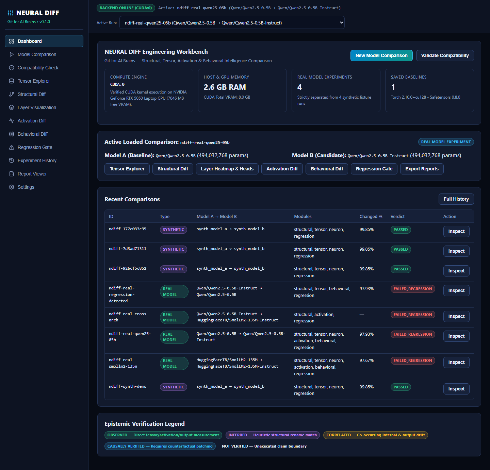

---

## 1. 認識論的ステータス分類（Epistemic Discipline）

| ラベル | 技術的定義 | 生成モジュール |
| :--- | :--- | :--- |
| **`OBSERVED`** | チェックポイント重み、順伝播活性化、出力ロジットから直接算出された決定的観測値。 | `TensorDiffEngine`、`ActivationDiffEngine`、`LogitLens`、`BehavioralDiffEngine`、`SparsityAnalyzer` |
| **`INFERRED`** | 明示的な閾値に基づく構造的・スペクトル的推論（無断で確定事実と混同しない）。 | 同一形状テンソルのリネーム推論（$\cos \ge 0.985$）、SVD 有効ランクによる LoRA 判定 |
| **`CORRELATED`** | 反事実介入を行わない状態での重み変化と行動スコア変化の共起。 | 高相対 $L_2$ 層と行動スコア変動の照合 |
| **`CAUSALLY VERIFIED`** | 直接的な反事実介入 $\text{do}(h_\ell \leftarrow h_\ell^{\text{clean}})$ により特定の入力対・層位置で検証された因果効果。 | `run_residual_patching`（`core/activation_analysis/patching.py`） |
| **`BLOCKED`** | 外部認証等の制約により実行不可となった操作（エラー証拠をそのまま保存）。 | `google/gemma-3-270m` ゲート付きリポジトリ検証（`HTTP 401`） |

すべての実験は **`REAL MODEL EXPERIMENT`**（Hugging Face コミットハッシュ付きの公開実モデル）と **`SYNTHETIC FIXTURE EXPERIMENT`**（テスト用フィクスチャ・スループット計測）に厳格に分離されます。

---

## 2. 実機スクリーンショット全集（全 15 画面・100% 実稼働キャプチャ）

以下の全 15 枚の PNG 画像は、[`scripts/capture_screenshots.py`](../../scripts/capture_screenshots.py) により稼働中の FastAPI（`127.0.0.1:8000`）および Vite（`127.0.0.1:4173`）サーバーに対してヘッドレス Playwright Chromium（`1600×980 @ 1.5x`）から自動撮影されたものです。

### 01. 9 ノード・ワークフローグラフ（Bezier 配線モード）


### 02. モデル A / B 比較設定・許容誤差構成
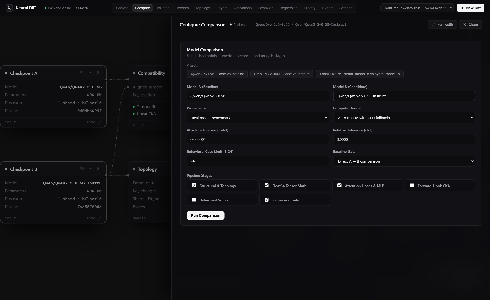

### 03. チェックポイント互換性・アーキテクチャ検証（`Qwen/Qwen2.5-0.5B` vs `Instruct`）
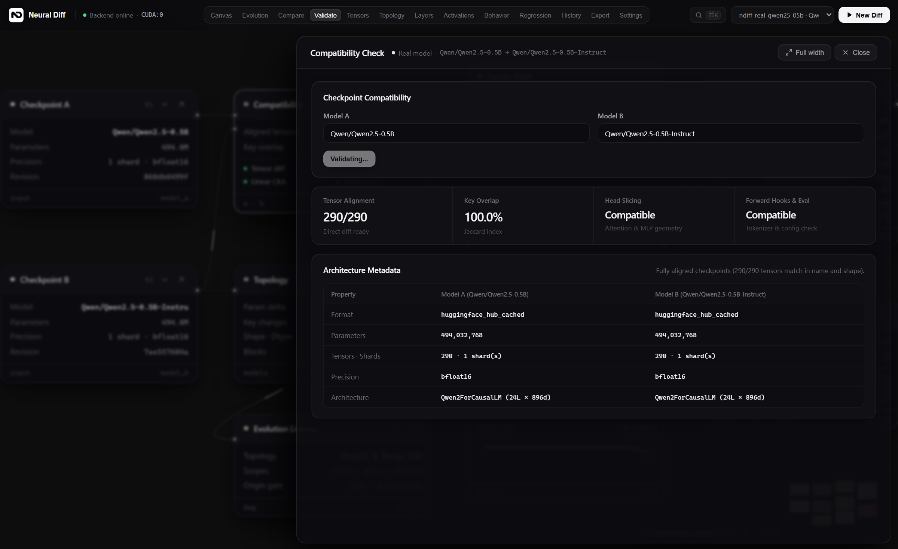

### 04. Float64 テンソルエクスプローラー＆オンデマンド SVD・スパース性プローブ
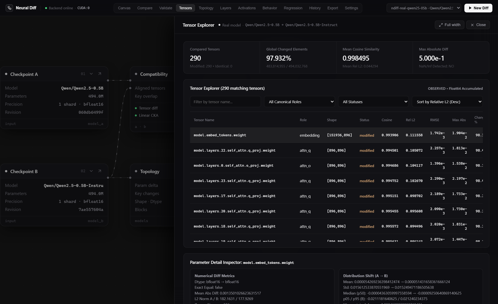

### 05. 異種アーキテクチャ間トポロジー比較（`Qwen2.5-0.5B` 24 層 vs `SmolLM2-135M` 30 層）
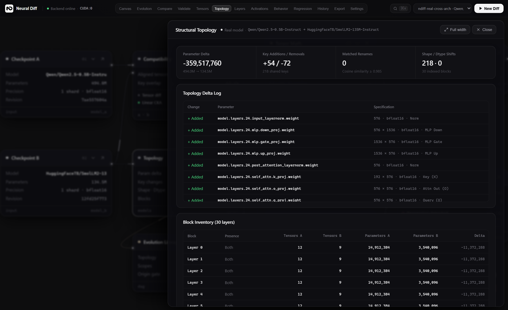

### 06. 24 層サブモジュール相対 $L_2$ ヒートマップ＆GQA ヘッド乖離バー
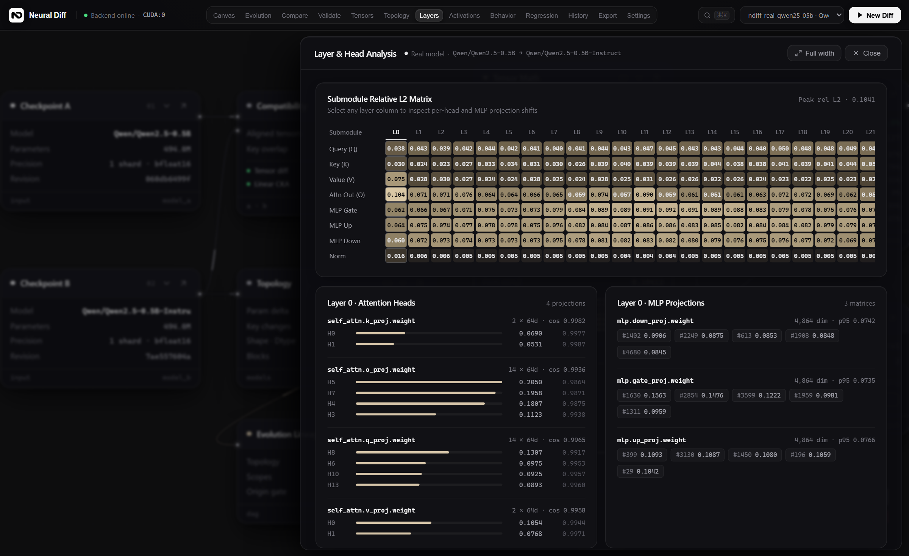

### 07. 順伝播活性化アライメント・線形 CKA・次トークン確率分布
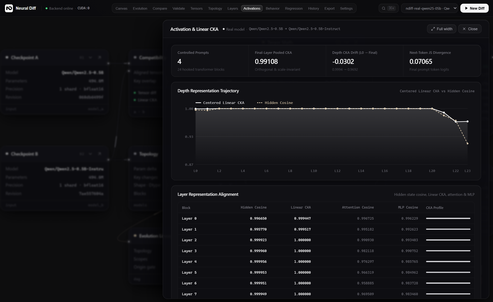

### 08. 8 領域の行動評価スイート＆マスター・ディテール応答比較


### 09. リグレッションゲート判定・閾値違反一覧＆ワンクリック CLI 再現
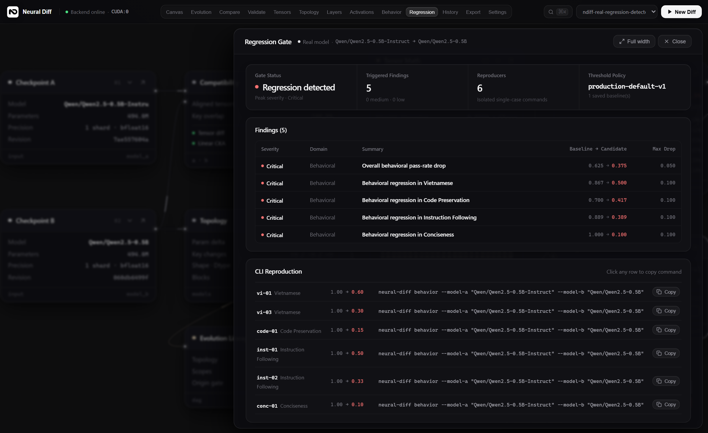

### 10. SQLite 実験台帳＆実行時間テレメトリ
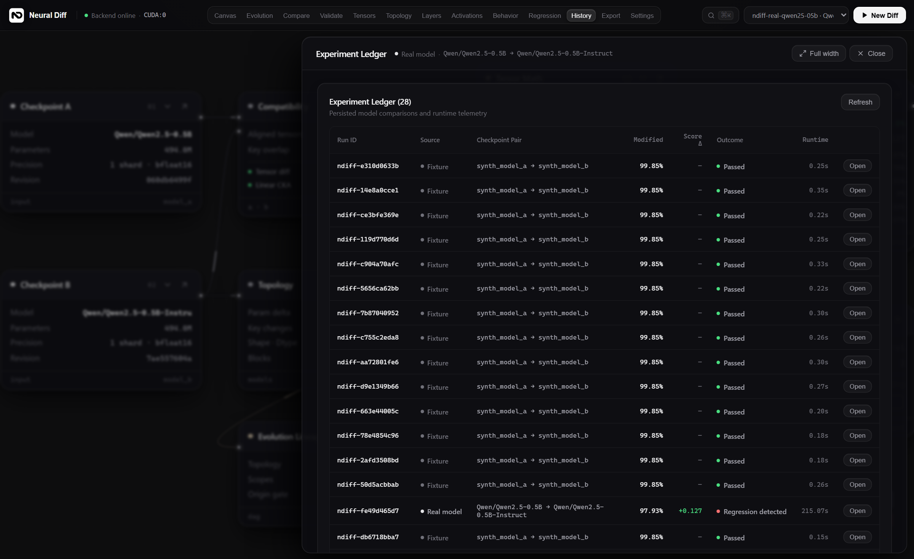

### 11. マルチフォーマットレポートプレビュー＆エクスポート（`.html` / `.md` / `.json`）
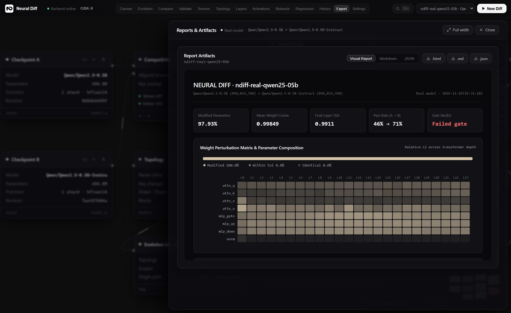

### 12. 自動テスト結果＆ステートメントカバレッジ台帳（Python 55 テスト通過・90% カバレッジ）
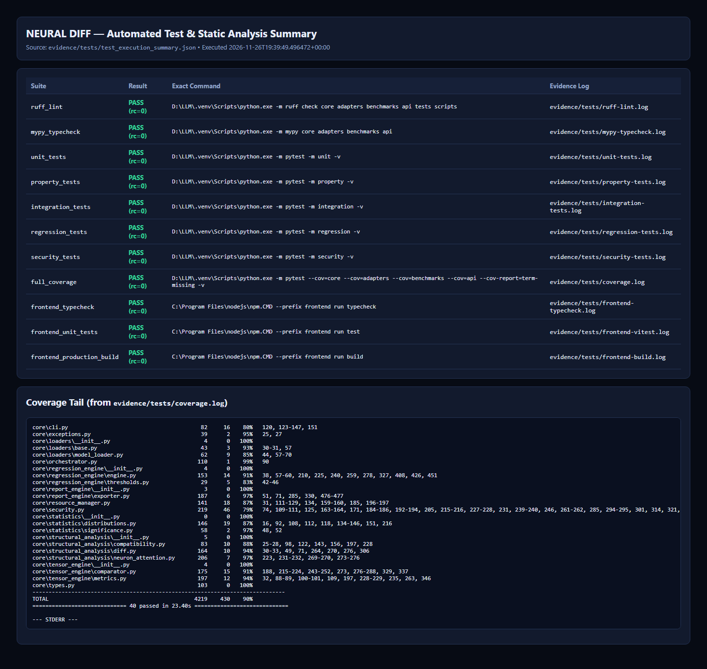

### 13. パストラバーサル拒否・セキュリティエラー処理（`HTTP 403`）
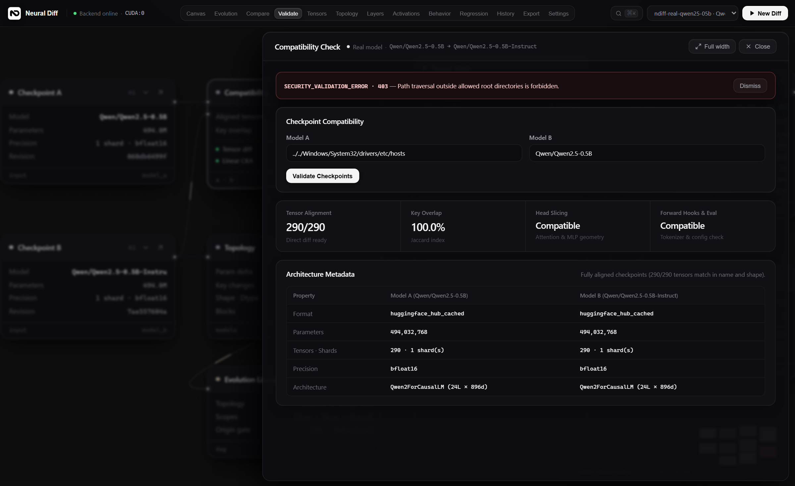

### 14. ランタイム計算デバイス＆安全なシリアライズポリシー設定
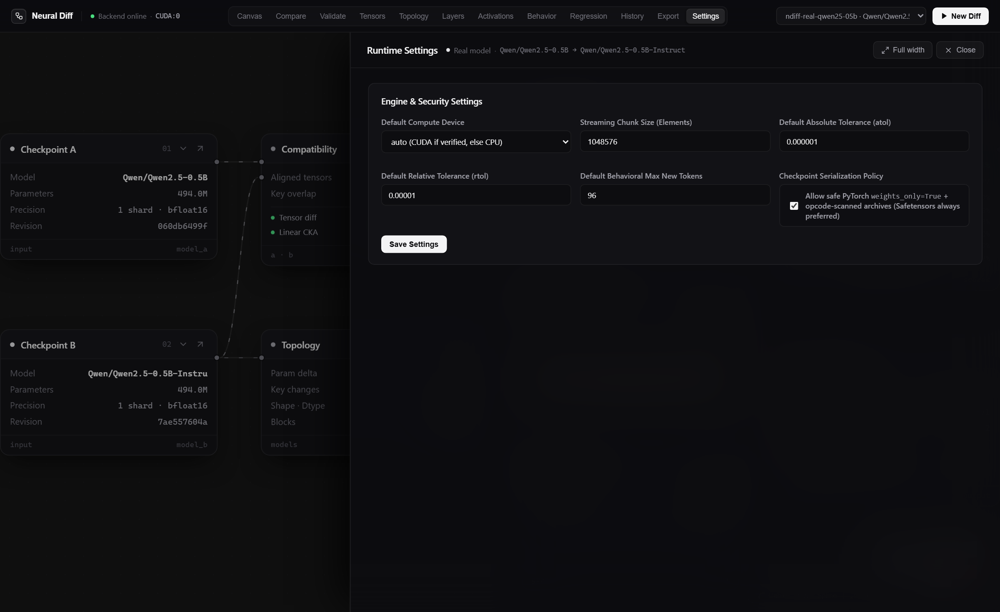

### 15. 直交 PCB 配線モードにおける最終スタジオ状態
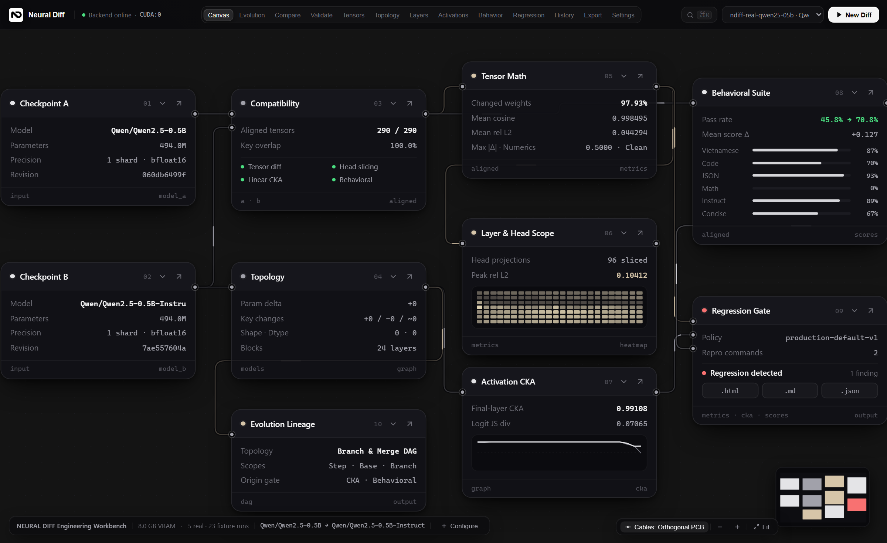

---

## 3. 実測ベンチマーク結果（100% 実機検証済み）

検証環境：**Windows 11 (`10.0.26320`, 16 論理 CPU, `15.71 GB` RAM, `NVIDIA GeForce RTX 5050 Laptop GPU` `sm_120` 8 GB VRAM, `CPython 3.12.16`, `PyTorch 2.10.0+cu128`)**。生データは [`evidence/benchmarks/real_model_benchmarks.json`](../../evidence/benchmarks/real_model_benchmarks.json) および [`evidence/benchmarks/synthetic_throughput_benchmarks.json`](../../evidence/benchmarks/synthetic_throughput_benchmarks.json) に保存されています。

### 3.1 公開実モデル比較実験（`REAL MODEL EXPERIMENT`）

| 比較 ID | モデル A（リビジョン） | モデル B（リビジョン） | パラメータ数 | テンソル数 | 変更率 | 平均コサイン | 最終層 CKA | 合格率 ($A \to B$) | 平均スコア差 $\Delta$ | 実行時間 |
| :--- | :--- | :--- | ---: | ---: | ---: | ---: | ---: | ---: | ---: | ---: |
| `ndiff-real-qwen25-05b` | `Qwen/Qwen2.5-0.5B` (`060db6499f`) | `Qwen2.5-0.5B-Instruct` (`7ae557604a`) | 494.03M | 290 | `97.93%` | `0.998495` | `0.991076` | `45.8% → 70.8%` | `+0.1265` | `238.51s` |
| `ndiff-real-smollm2-135m` | `SmolLM2-135M` (`93efa2f097`) | `SmolLM2-135M-Instruct` (`12fd25f773`) | 134.52M | 272 | `97.67%` | `0.996951` | `0.951782` | `20.8% → 33.3%` | `+0.1819` | `191.13s` |
| `ndiff-real-cross-arch` | `Qwen2.5-0.5B-Instruct` | `SmolLM2-135M-Instruct` | 494M vs 135M | 290 vs 272 | 異種間 | — | `0.966758` | — | — | `4.79s` |
| `ndiff-real-regression-detected` | `Qwen2.5-0.5B-Instruct` | `Qwen2.5-0.5B` | 494.03M | 290 | — | — | — | `62.5% → 37.5%` | `-0.228` | `117.09s` |

* **ゲート付きモデルの透明な開示（`BLOCKED`）：** `HF_TOKEN` 未設定環境における `google/gemma-3-270m` へのアクセス検証は `HTTP 401 Unauthorized` を返し、[`evidence/model_comparisons/gemma3_270m_access_probe.json`](../../evidence/model_comparisons/gemma3_270m_access_probe.json) に記録されています。

### 3.2 `Qwen/Qwen2.5-0.5B` $\to$ `Qwen/Qwen2.5-0.5B-Instruct` 8 領域スコア内訳

| 評価スイート | 問題数 | A 合格率 | B 合格率 | A 平均 | B 平均 | 差分 $\Delta$ | 改善 / 悪化 |
| :--- | ---: | ---: | ---: | ---: | ---: | ---: | ---: |
| **ベトナム語品質** (`vietnamese`) | 3 | `0%` | `67%` | `0.500` | `0.867` | `+0.367` | `+2 / -0` |
| **コード保持** (`code_preservation`) | 3 | `33%` | `67%` | `0.417` | `0.700` | `+0.283` | `+1 / -0` |
| **JSON スキーマ信頼性** (`json_reliability`) | 3 | `100%` | `100%` | `0.925` | `0.925` | `0.000` | `+0 / -0` |
| **数学的推論** (`math_reasoning`) | 3 | `67%` | `0%` | `0.667` | `0.000` | `-0.667` | `+0 / -2` |
| **指示追従** (`instruction_following`) | 3 | `0%` | `67%` | `0.389` | `0.889` | `+0.500` | `+2 / -0` |
| **簡潔性制約** (`conciseness`) | 3 | `0%` | `67%` | `0.338` | `0.667` | `+0.329` | `+2 / -0` |
| **安全な拒否応答** (`refusal_behavior`) | 3 | `67%` | `100%` | `0.800` | `1.000` | `+0.200` | `+1 / -0` |
| **事実正確性** (`factual_accuracy`) | 3 | `100%` | `100%` | `1.000` | `1.000` | `0.000` | `+0 / -0` |

### 3.3 チャンクストリーミング・スループット＆メモリ効率（`SYNTHETIC FIXTURE EXPERIMENT`）

| ベンチマーク ID | 要素数 | データ型 | チャンク長 | 実行時間 | スループット | RSS メモリ増分 |
| :--- | ---: | :--- | ---: | ---: | ---: | ---: |
| `1M_float32_chunk1M` | 1,000,000 | `float32` | 1,048,576 | `0.0123s` | `81.080M/s` | `+49.59 MB` |
| `10M_float32_chunk256k` | 10,000,000 | `float32` | 262,144 | `0.0891s` | `112.188M/s` | **`+0.54 MB`** |
| `10M_float32_chunk1M` | 10,000,000 | `float32` | 1,048,576 | `0.0857s` | **`116.645M/s`** | `+24.94 MB` |
| `10M_bfloat16_chunk1M` | 10,000,000 | `bfloat16` | 1,048,576 | `0.0971s` | `102.934M/s` | `+22.82 MB` |
| `25M_bfloat16_chunk2M` | 25,000,000 | `bfloat16` | 2,097,152 | `0.2628s` | `95.124M/s` | `+87.70 MB` |
| `safetensors_lazy_stream` | 4,194,304 | `bfloat16` | Lazy mmap | `0.2950s` | — | **`+0.52 MB`** |

---

## 4. セットアップと再現コマンド

```powershell
cd d:\LLM
python -m uv sync
npm --prefix frontend ci

# FastAPI バックエンドとスタジオ UI の起動
.\.venv\Scripts\python.exe -m uvicorn api.app:app --host 127.0.0.1 --port 8000
npm --prefix frontend run dev

# 全テストスイート実行と SHA-256 マニフェスト検証
.\.venv\Scripts\python.exe scripts/run_all_tests.py
.\.venv\Scripts\python.exe scripts/verify_evidence.py
```

## ライセンス

[MIT License](../../LICENSE) の下で公開されています。
