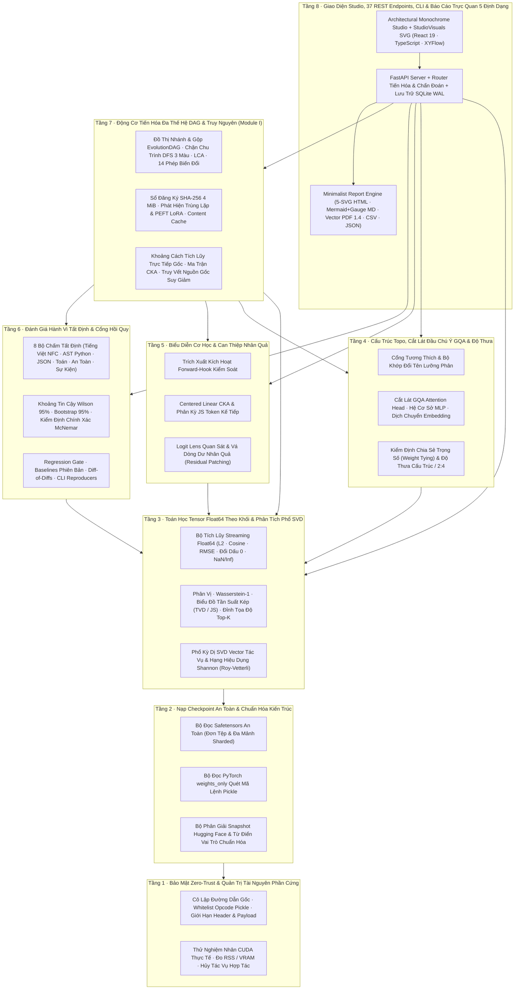
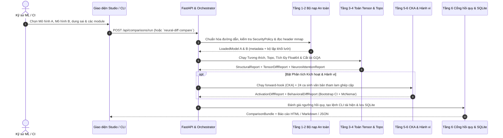
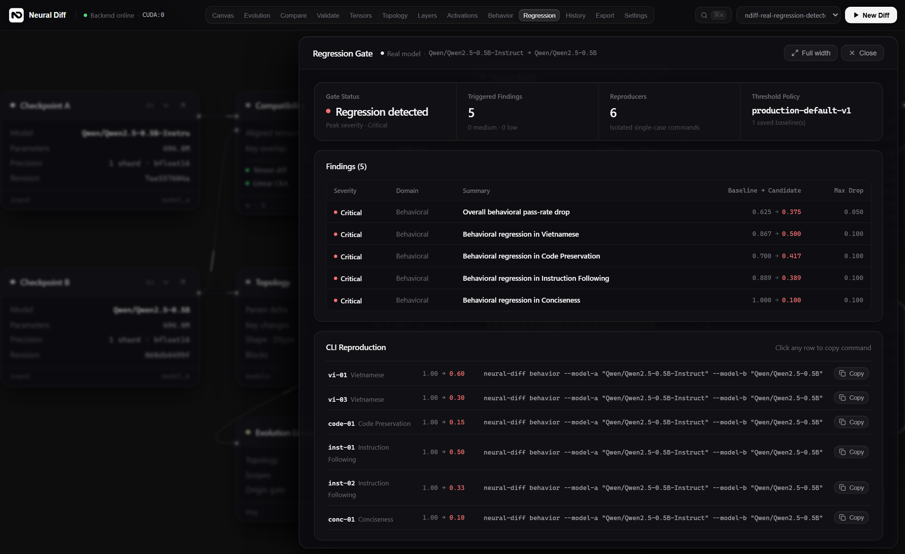
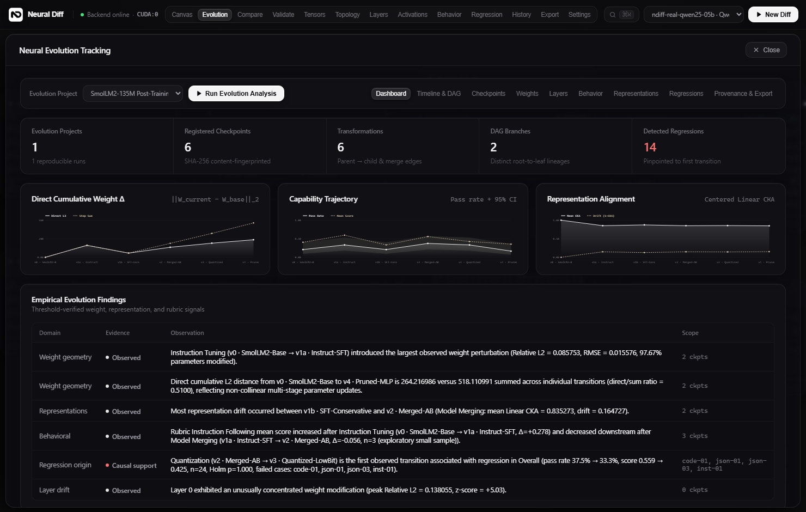
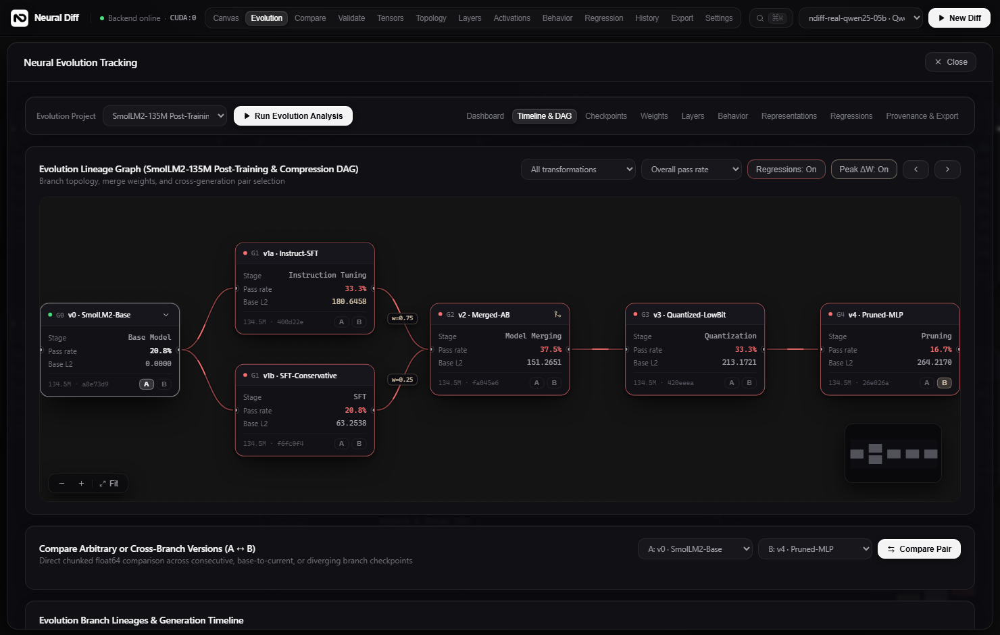
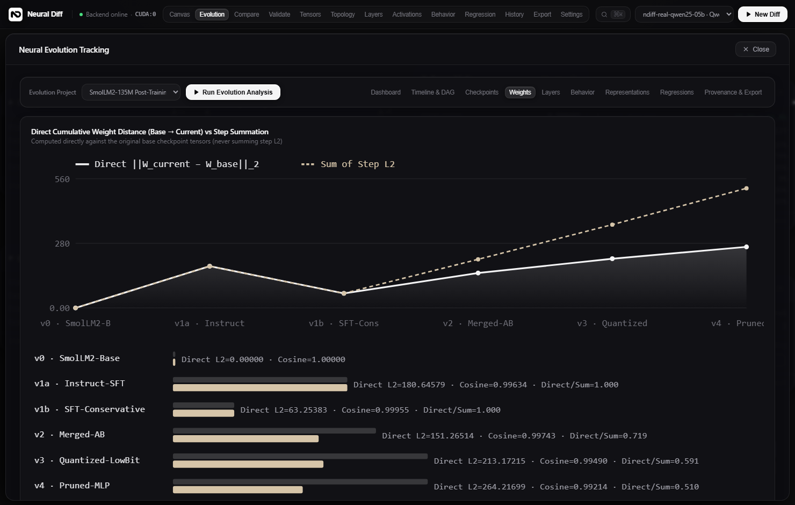
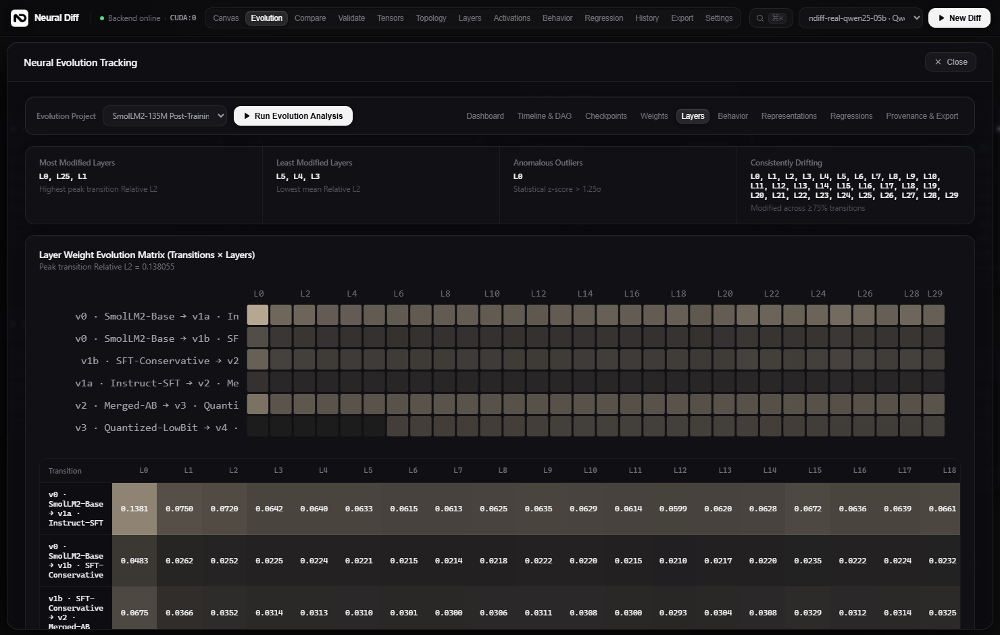
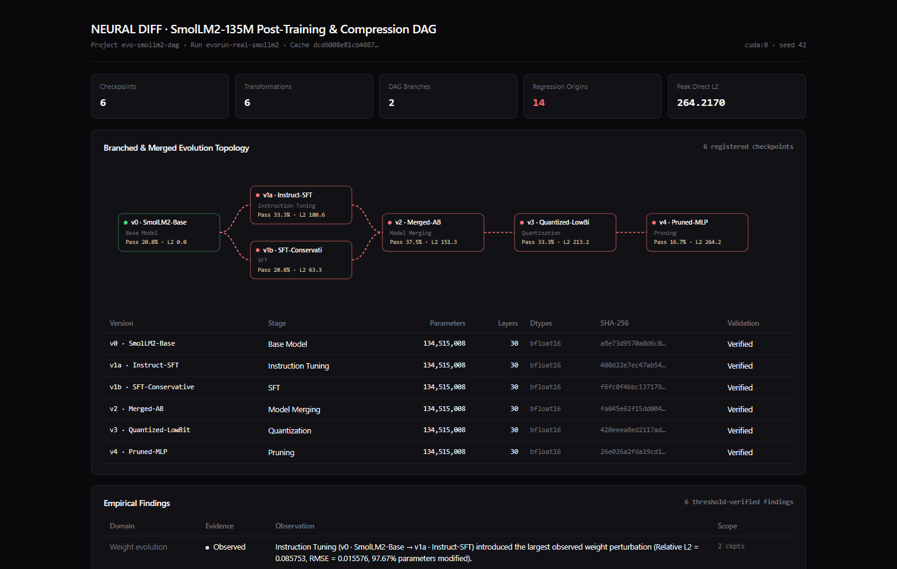

<p align="left">
  
</p>

# NEURAL DIFF — Git cho Bộ Não AI

**Nền Tảng So Sánh Cấu Trúc, Biểu Diễn Nơ-ron & Hành Vi Tất Định Cho Các Mô Hình Nền Tảng và Tinh Chỉnh**

[**English**](../../README.md) · [**Tiếng Việt**](README.vi.md) · [**简体中文**](README.zh-CN.md) · [**日本語**](README.ja.md) · [**Français**](README.fr.md)

[](../../.github/workflows)
[](../../pyproject.toml)
[](../../frontend/package.json)
[](../../uv.lock)
[](../../frontend/package.json)
[-18181b?style=flat-square)](../../evidence/tests/coverage.log)
[](../../LICENSE)

---

**NEURAL DIFF** là nền tảng kỹ thuật ML mã nguồn mở cấp độ sản xuất gồm thư viện Python, công cụ dòng lệnh (`neural-diff`), hệ thống backend FastAPI + SQLite và không gian làm việc đồ thị **ComfyUI Nodes 2.0 Architectural Monochrome Studio** (React 19 + TypeScript + `@xyflow/react`). Thay vì xem các bản cập nhật trọng số như những khối nhị phân hộp đen hoặc đánh giá cảm tính qua vài câu thử rời rạc, NEURAL DIFF phân rã sự tiến hóa của mô hình qua **8 tầng kiến trúc độc lập** và **5 trục phân tích trực giao**:

1. **So Sánh Cấu Trúc & Topo (`Structural & Topology Diff`)** — Phát hiện khóa tensor thêm/xóa, suy luận đổi tên bằng ghép cặp lưỡng phân cosine ($\cos \ge 0.985$), thay đổi kích thước/kiểu dữ liệu, cắt lát từng đầu chú ý Grouped-Query Attention (GQA), kiểm tra ràng buộc trọng số đầu vào/đầu ra (`weight tying`), tỉa kênh có cấu trúc và độ tuân thủ thưa bán cấu trúc NVIDIA `2:4`.
2. **Toán Học Tensor Tích Lũy `Float64` Theo Khối & Hạng Hiệu Dụng Phổ SVD** — Đọc lười theo từng khối (`chunked streaming`) ép kiểu lên `float64` với chi phí bộ nhớ hằng số (`max_abs_diff`, `mean_abs_diff`, `RMSE`, `Relative L2`, `Cosine Similarity`, chuyển trạng thái `0 ↔ ≠0`, phân vị, khoảng cách Wasserstein-1, biểu đồ tần suất ghép cặp TVD/JS, giải mã tọa độ đa chiều đỉnh $|\Delta w|$) kết hợp phân tích phổ giá trị kỳ dị SVD & hạng hiệu dụng Shannon (Roy-Vetterli) để phân biệt bản gộp LoRA hạng thấp với SFT toàn hạng.
3. **Cơ Học Giải Thích Biểu Diễn, Logit Lens & Vá Kích Hoạt Nhân Quả** — Gắn forward hook tất định trên cùng chuỗi token đầu vào để đo cosine trạng thái ẩn/attention/MLP từng tầng, **Centered Linear CKA** bất biến phép quay trực giao (hỗ trợ so sánh liên kiến trúc khác chiều ẩn), phép chiếu từ vựng **Logit Lens** và **Vá Dòng Dư Phản Thực Tế (`Residual-Stream Activation Patching`)** đạt mức xác minh nhân quả `CAUSALLY VERIFIED`.
4. **Đánh Giá Hành Vi Tất Định 8 Miền & Cổng Chặn Hồi Quy (`Regression Gate`)** — 24 ca kiểm thử ghép cặp chấm điểm bằng 8 bộ đánh giá tất định (Unicode NFC, cây cú pháp AST Python, lược đồ JSON, toán học, từ chối an toàn... hoàn toàn không dùng LLM chấm điểm), khoảng tin cậy Bootstrap 95% (2.000 lần lấy mẫu lại), kiểm định chính xác McNemar hai phía, quản lý baseline SQLite/JSON, phân tích xu hướng đa phiên `diff-of-diffs` và lệnh CLI tái hiện lỗi sao chép 1 chạm.
5. **Theo Dõi Tiến Hóa Đa Thế Hệ (`Module I`) & Hệ Thống Báo Cáo Trực Quan 5 Định Dạng** — Quản lý đồ thị có hướng không chu trình phân nhánh & hợp nhất đa cha (`Base → SFT → DPO → Merge → Quantization → Pruning`), kiểm tra chu trình DFS 3 màu, định danh SHA-256 từng khối 4 MiB, khoảng cách trọng số tích lũy trực tiếp $\|W_{\text{current}} - W_{\text{base}}\|_2$, ma trận CKA đa thế hệ, tự động chỉ đích danh bước chuyển gây suy giảm (`Regression Origin Pinpointing`) và xuất báo cáo tối giản 5 định dạng (`HTML` nhúng 5 biểu đồ SVG, `Markdown` sơ đồ Mermaid + thanh đo `█░`, `%PDF-1.4` đồ họa vector, `CSV`, `JSON`).


---

## Mục Lục

1. [Kỷ Luật Nhận Thức Luận & Nguồn Gốc Dữ Liệu](#1-kỷ-luật-nhận-thức-luận--nguồn-gốc-dữ-liệu)
2. [Đặc Tả Chuyên Sâu 8 Tầng Kiến Trúc Hệ Thống](#2-đặc-tả-chuyên-sâu-8-tầng-kiến-trúc-hệ-thống)
3. [Luồng Thực Thi & Chuỗi Xử Lý Dữ Liệu Đầu-Cuối](#3-luồng-thực-thi--chuỗi-xử-lý-dữ-liệu-đầu-cuối)
4. [Nền Tảng Công Thức Toán Học & Thống Kê](#4-nền-tảng-công-thức-toán-học--thống-kê)
5. [Trọn Bộ 27 Ảnh Chụp Giao Diện & Báo Cáo Thực Tế (100% Live Capture)](#5-trọn-bộ-27-ảnh-chụp-giao-diện--báo-cáo-thực-tế-100-live-capture)
6. [Benchmark Mô Hình Thực & Đồ Thị Tiến Hóa DAG (`REAL MODEL EXPERIMENT`)](#6-benchmark-mô-hình-thực--đồ-thị-tiến-hóa-dag-real-model-experiment)
7. [Benchmark Băng Thông Streaming & Bộ Nhớ (`SYNTHETIC FIXTURE EXPERIMENT`)](#7-benchmark-băng-thông-streaming--bộ-nhớ-synthetic-fixture-experiment)
8. [Hướng Dẫn Cài Đặt & Khởi Chạy Tái Lập](#8-hướng-dẫn-cài-đặt--khởi-chạy-tái-lập)
9. [Tham Chiếu Công Cụ Dòng Lệnh (`neural-diff`)](#9-tham-chiếu-công-cụ-dòng-lệnh-neural-diff)
10. [Tham Chiếu Hệ Thống REST API (37 Endpoint)](#10-tham-chiếu-hệ-thống-rest-api-37-endpoint)
11. [Kiến Trúc CI/CD Đa Node, Kiểm Thử (`89%` Độ Phủ) & Kiểm Toán Bảo Mật](#11-kiến-trúc-cicd-đa-node-kiểm-thử-89-độ-phủ--kiểm-toán-bảo-mật)
12. [Toàn Vẹn Bằng Chứng SHA-256 & Giới Hạn Kỹ Thuật](#12-toàn-vẹn-bằng-chứng-sha-256--giới-hạn-kỹ-thuật)

---

## 1. Kỷ Luật Nhận Thức Luận & Nguồn Gốc Dữ Liệu

NEURAL DIFF định nghĩa tường minh các nhãn nhận thức luận ngay trong kiểu dữ liệu lõi (`core/types.py`) để không bao giờ đánh đồng tương quan quan sát với cơ chế nhân quả:

| Nhãn Nhận Thức Luận | Tiêu Chuẩn Toán Học & Khoa Học | Các Phân Hệ Sản Sinh |
| :--- | :--- | :--- |
| **`OBSERVED`** | Hàm tất định tính trực tiếp từ trọng số checkpoint, kích hoạt forward-hook hoặc chuỗi token giải mã tham lam. | `TensorDiffEngine`, `NeuronAttentionAnalyzer`, `ActivationDiffEngine`, `LogitLens`, `BehavioralDiffEngine`, `SparsityAnalyzer` |
| **`INFERRED`** | Suy diễn dựa trên ngưỡng toán học tường minh, có thể kiểm toán (không ngầm coi là chân lý tuyệt đối). | Ghép cặp đổi tên tensor cùng shape ($\cos \ge 0.985$); phân loại chế độ cập nhật SVD (`low_rank_adapter` vs `full_rank_update`) |
| **`CORRELATED`** | Độ lệch trọng số và biến thiên điểm hành vi xuất hiện đồng thời trên cùng cặp mô hình khi chưa tách biệt bằng can thiệp. | Liên kết tầng có Relative $L_2$ đỉnh với biến thiên điểm miền hành vi |
| **`CAUSALLY VERIFIED`** | Được chứng minh thông qua can thiệp phản thực tế trực tiếp $\text{do}(h_\ell^{\text{corr}} \leftarrow h_\ell^{\text{clean}})$ trong quá trình lan truyền tiến, giới hạn chặt trong cặp prompt và vị trí được thử. | `run_residual_patching` (`core/activation_analysis/patching.py`) |
| **`NOT VERIFIED` / `BLOCKED`** | Luồng chưa chạy hoặc bị chặn bởi cổng xác thực bên ngoài, giữ nguyên bằng chứng HTTP/log gốc. | Probe kho có cổng cấp phép `google/gemma-3-270m` (`HTTP 401`) |

---

## 2. Đặc Tả Chuyên Sâu 8 Tầng Kiến Trúc Hệ Thống

Kiến trúc của NEURAL DIFF được chia thành **8 tầng ngang tách rời hoàn toàn**, đảm bảo các động cơ toán học và đồ thị tiến hóa ở tầng lõi không phụ thuộc vào web framework và vận hành đồng nhất trên thư viện Python, CLI, CI hoặc giao diện Studio.



### Tầng 1 — Bảo Mật Zero-Trust & Quản Trị Tài Nguyên Phần Cứng (`Layer 1`)
* **Mã nguồn:** [`core/security.py`](../../core/security.py), [`core/resource_manager.py`](../../core/resource_manager.py), [`api/security_middleware.py`](../../api/security_middleware.py)
* **Cô lập đường dẫn gốc (`Root Confinement`):** Mọi đường dẫn đầu vào đều được chuẩn hóa qua `Path.resolve()` và đối chiếu với danh sách gốc cho phép (`allowed_roots`: thư mục dự án, bộ nhớ đệm Hugging Face hợp lệ và thư mục lưu trữ). Mọi nỗ lực thoát thư mục (`../`) hoặc symlink trỏ ra ngoài đều bị chặn tức thì với lỗi `SecurityValidationError` (`HTTP 403`).
* **Phòng vệ mã thực thi từ xa & Pickle:** Cờ `trust_remote_code=False` được khóa cứng trên toàn bộ lệnh gọi Hugging Face. Với các tệp `.pt`/`.bin`, hệ thống phân rã luồng bytecode bằng `pickletools.genops()` trước khi nạp, từ chối mọi opcode nguy hiểm (`REDUCE`, `GLOBAL`, `STACK_GLOBAL`, `BUILD`, `INST`, `OBJ`, `NEWOBJ`) nằm ngoài danh sách trắng lưu trữ tensor cơ bản, sau đó mới gọi `torch.load(..., weights_only=True)`.
* **Kiểm định phần cứng & hủy hợp tác:** `ResourceManager` thực thi phép nhân ma trận thử nghiệm trực tiếp trên GPU để xác nhận kiến trúc `sm_120` hoạt động thực sự, đo đạc RAM (RSS) và VRAM trước/sau từng pha, đồng thời truyền tín hiệu `CancellationToken` xuống tận vòng lặp đọc khối tensor.

### Tầng 2 — Nạp Checkpoint Lười & Chuẩn Hóa Kiến Trúc Đa Họ Mô Hình (`Layer 2`)
* **Mã nguồn:** [`core/loaders/`](../../core/loaders/), [`adapters/safetensors/`](../../adapters/safetensors/), [`adapters/pytorch/`](../../adapters/pytorch/), [`adapters/huggingface/`](../../adapters/huggingface/), [`adapters/architectures/registry.py`](../../adapters/architectures/registry.py)
* **Ánh xạ bộ nhớ Zero-Copy (`Safetensors`):** Kiểm tra kích thước header 8-byte (`<= 64 MiB`), trích xuất danh mục `TensorDescriptor` từ tệp đơn hoặc tệp chỉ mục đa mảnh `model.safetensors.index.json` mà không nạp toàn bộ trọng số vào RAM, cung cấp bộ lặp `iter_tensor_chunks(name, chunk_elements=1_048_576)`.
* **Chuẩn hóa vai trò không phụ thuộc cách đặt tên:** `ArchitectureRegistry` ánh xạ tên tham số khác biệt giữa **Llama / Qwen2 / Mistral / Gemma / SmolLM** (`model.layers.{i}.self_attn.{q,k,v,o}_proj`), **GPT-2** (`transformer.h.{i}.attn.c_attn`), **GPT-NeoX / Pythia** (`gpt_neox.layers.{i}`) và **Phi** về bộ tọa độ chuẩn `(layer_index, CanonicalRole)`.

### Tầng 3 — Toán Học Tensor `Float64` Streaming, Phân Phối & Phổ Kỳ Dị SVD (`Layer 3`)
* **Mã nguồn:** [`core/tensor_engine/`](../../core/tensor_engine/), [`core/statistics/`](../../core/statistics/)
* **Tích lũy chính xác `Float64`:** Trọng số `bfloat16`/`float16` hàng trăm triệu phần tử dễ gặp sai số triệt tiêu nếu tính tích vô hướng ở `float32`. NEURAL DIFF nâng từng khối đọc lên `torch.float64`, tích lũy một lượt $\sum a_i^2$, $\sum b_i^2$, $\sum a_i b_i$, $\sum |b_i - a_i|$, $\sum (b_i - a_i)^2$, tỷ lệ vượt ngưỡng dung sai `|b - a| <= atol + rtol * |a|`, số lần đổi trạng thái `0 ↔ ≠0` và số phần tử `NaN`/`Inf`.
* **Thống kê dịch chuyển phân phối & tọa độ đỉnh:** Tính phân vị thực nghiệm (`p01`–`p99`), khoảng cách Wasserstein-1, biểu đồ mật độ chung bin (`PairedHistogram`) kèm khoảng cách biến thiên toàn phần (TVD) và phân kỳ Jensen-Shannon, cùng hàm giải mã tọa độ đa chiều chính xác `extract_top_k_element_deltas`.
* **Phân tích phổ SVD Vector Tác Vụ:** Phân rã ma trận hiệu $\Delta W = W_B - W_A$ bằng `torch.linalg.svdvals` ở độ chính xác kép để trích xuất chuẩn phổ, chuẩn Frobenius, hạng tích lũy 90%/99% năng lượng và **Hạng Hiệu Dụng Shannon** giúp nhận diện cập nhật LoRA hạng thấp so với tinh chỉnh toàn hạng.

### Tầng 4 — Cấu Trúc Topo, Cắt Lát Đầu Chú Ý GQA & Độ Thưa Phần Cứng (`Layer 4`)
* **Mã nguồn:** [`core/structural_analysis/`](../../core/structural_analysis/)
* **Kiểm tra tương thích & suy luận đổi tên:** Đánh giá độ chồng lấp Jaccard tập khóa, chiều ẩn, cấu hình đầu chú ý và từ vựng tokenizer; thực hiện ghép cặp lưỡng phân tham lam theo cosine ($\cos \ge 0.985$) trên các tensor chưa khớp cùng kích thước để phát hiện đổi tên khóa (`INFERRED`).
* **Cắt lát chính xác theo kiến trúc GQA:** Tách ma trận chiếu chú ý dựa trên `num_attention_heads` và `num_key_value_heads` thực tế (ví dụ trên `Qwen2.5-0.5B`: `14` đầu Query/Output × `64d` và `2` đầu Key/Value × `64d`), định vị chính xác đầu chú ý nào phân kỳ mạnh nhất ở từng tầng, đồng thời xếp hạng các chỉ số cơ sở MLP dịch chuyển lớn nhất.
* **Kiểm định chia sẻ trọng số & độ thưa `2:4`:** Phát hiện hiện tượng tách rời ngoài ý muốn giữa `embed_tokens` và `lm_head` sau khi tinh chỉnh (`compare_weight_tying`), đồng thời đo tỷ lệ hàng/cột bị tỉa bằng 0 và mức độ tuân thủ chuẩn thưa bán cấu trúc `2:4` trên nhân Tensor Core NVIDIA (`analyze_matrix_sparsity`).

### Tầng 5 — Căn Chỉnh Kích Hoạt Cơ Học, Logit Lens & Vá Dòng Dư Nhân Quả (`Layer 5`)
* **Mã nguồn:** [`core/activation_analysis/`](../../core/activation_analysis/)
* **Hình học biểu diễn qua Forward-Hook:** Đăng ký hook trên toàn bộ khối giải mã Transformer với đầu vào đồng nhất (`seed=42`, `torch.no_grad()`), đo cosine trạng thái ẩn, cosine đầu ra Attention/MLP, phân kỳ JS xác suất từ kế tiếp và **Centered Linear CKA** (cho phép so sánh trực tiếp hai kiến trúc khác số chiều ẩn như `Qwen2.5` $d=896$ và `SmolLM2` $d=576$).
* **Logit Lens quan sát:** Chiếu trạng thái dòng dư vị trí cuối của từng tầng qua chuẩn hóa cuối (tránh chuẩn hóa kép ở tầng cuối của Hugging Face) và `lm_head` để đo độ hội tụ phân kỳ KL về phân phối đầu ra cuối cùng (`OBSERVED`).
* **Vá kích hoạt phản thực tế (`Residual Patching`):** Lưu kích hoạt từ câu sạch, can thiệp thay thế từng khối một vào luồng suy luận của câu nhiễu $\text{do}(h_\ell^{\text{corr}} \leftarrow h_\ell^{\text{clean}})$ và đo tỷ lệ phục hồi hiệu số logit mục tiêu (`CAUSALLY VERIFIED`).

### Tầng 6 — Bộ Đánh Giá Hành Vi Tất Định 8 Miền, Cổng Hồi Quy & Báo Cáo (`Layer 6`)
* **Mã nguồn:** [`benchmarks/`](../../benchmarks/), [`core/behavioral_analysis/`](../../core/behavioral_analysis/), [`core/regression_engine/`](../../core/regression_engine/), [`core/report_engine/`](../../core/report_engine/)
* **8 Bộ chấm điểm tất định 100% (Không gọi LLM bên ngoài):** Kiểm tra dấu thanh tiếng Việt chuẩn NFC (`vietnamese`), phân tích cú pháp cây `ast.parse` Python (`code_preservation`), kiểm định lược đồ JSON nghiêm ngặt (`json_reliability`), trích xuất đáp số toán học (`math_reasoning`), ràng buộc cấu trúc câu lệnh (`instruction_following`), giới hạn độ dài súc tích (`conciseness`), từ chối an toàn không từ chối nhầm (`refusal_behavior`) và đối chiếu sự kiện chuẩn (`factual_accuracy`).
* **Kiểm định thống kê & cổng chặn hồi quy:** Tính khoảng tin cậy Bootstrap ghép cặp 95% (`2.000` mẫu) và kiểm định chính xác McNemar hai phía; đối chiếu chính sách ngưỡng `RegressionThresholds`, sinh câu lệnh CLI tái hiện từng ca suy giảm, phân tích xu hướng qua nhiều phiên chạy (`compare_run_history`) và xuất báo cáo HTML (biểu đồ SVG nhúng nội tuyến), Markdown, JSON.

### Tầng 7 — Động Cơ Tiến Hóa Đa Thế Hệ DAG & Truy Nguyên (`Layer 7 · Module I`)
* **Mã nguồn:** [`core/evolution/`](../../core/evolution/) (`dag.py`, `registry.py`, `store.py`, `tensor_evolution.py`, `layer_evolution.py`, `behavioral_evolution.py`, `representation_evolution.py`, `regression_origin.py`, `orchestrator.py`)
* **Đồ thị DAG phân nhánh, gộp mô hình & DP không sót nhánh:** Hỗ trợ 14 phép biến đổi (`Base Model`, `SFT`, `DPO`, `RLHF`, `LoRA`, `QLoRA`, `Model Merging`, `Quantization`, `Pruning`, `Distillation`...), đa cha có trọng số gộp, sắp xếp topo Kahn, LCA, phân loại 7 quan hệ `classify_pair_scope()` và chặn chu trình DFS 3 màu. Hàm `count_total_branches()` đếm chính xác tổng đường đi gốc-lá trong $O(V+E)$ kết hợp `iter_branches(max_paths)`; khi `branch_count > max_branches`, cờ `branches_truncated = true` được gắn rõ ràng và `RegressionOriginEngine` chạy quy hoạch động trạng thái dòng dõi toàn đồ thị $O(|V|\cdot|E|)$ đảm bảo không bỏ sót cạnh, không nhân đôi sự kiện và không trộn lẫn lịch sử qua điểm gộp.
* **Dấu vân tay SHA-256 trực giao 5 thành phần:** Băm luồng 4 MiB độc lập trên 5 miền — `weights_sha256` (dữ liệu trọng số thuần), `architecture_config_sha256` (`config.json`, `generation_config.json`, `quantize_config.json`), `tokenizer_sha256` (`tokenizer.json`, `tokenizer.model`, `spiece.model`, `tokenizer_config.json`, `vocab.json`, `merges.txt`, `special_tokens_map.json`, `added_tokens.json`, `chat_template.jinja`, `chat_template.json`), `adapter_sha256` (`adapter_config.json`, `adapter_model.safetensors`) và `metadata_sha256` (header mô tả tensor & `__metadata__`) — tự động vô hiệu hóa bộ nhớ đệm hành vi khi bất kỳ thành phần nào thay đổi.
* **4 tầng nhận thức luận nhân quả & Thống kê chặt chẽ:** Tách biệt `OBSERVED`, `CORRELATED`, `CAUSAL SUPPORT` (vá kích hoạt câu chẩn đoán $\ge 20\%$) và `CAUSALLY VERIFIED` (bắt buộc cả 4 điều kiện `case_targeted`, `target_vs_foil_verified`, `negative_control_verified`, `verification_scope` đều tường minh `true` cho mọi ca lỗi của sự kiện; dữ liệu khuyết không bao giờ mặc định `true`). Kết hợp Wilson CI 95%, Bootstrap CI 95%, McNemar hai phía chính xác, hiệu chỉnh bậc thang **Holm-Bonferroni**, phân loại `pass_rate_and_score` / `pass_rate_only` / `score_only` và ngưỡng mẫu `min_category_sample_size = 8`.

### Tầng 8 — Giao Diện Studio, 37 REST Endpoints, CLI & Báo Cáo Trực Quan 5 Định Dạng (`Layer 8`)
* **Mã nguồn:** [`core/report_engine/visuals.py`](../../core/report_engine/visuals.py), [`core/report_engine/exporter.py`](../../core/report_engine/exporter.py), [`core/evolution/exporter.py`](../../core/evolution/exporter.py), [`core/evolution/pdf_writer.py`](../../core/evolution/pdf_writer.py), [`api/`](../../api/), [`frontend/src/`](../../frontend/src/)
* **Xuất báo cáo tối giản giàu visual (Zero AI Slop):** Xuất `HTML` nhúng **5 biểu đồ SVG dữ liệu thực**, `Markdown` kèm sơ đồ `mermaid` và thanh đo `█░`, `%PDF-1.4` thuần Python kèm biểu đồ cột & đường gấp khúc vector, `CSV` đa phân vùng và `JSON` chuẩn RFC-8259.
* **Architectural Monochrome Studio:** Tích hợp bộ biểu đồ SVG tương tác [`StudioVisuals.tsx`](../../frontend/src/components/charts/StudioVisuals.tsx) (`DualTrajectoryChart`, `PolarRadarChart`, `PixelMatrixHeatmap`, `DivergingDeltaBars`) trên toàn bộ không gian làm việc đôi và không gian 9 phân hệ **Neural Evolution Studio**.

---

## 3. Luồng Thực Thi & Chuỗi Xử Lý Dữ Liệu Đầu-Cuối



---

## 4. Nền Tảng Công Thức Toán Học & Thống Kê

1. **Chuẩn $L_2$ Tương Đối & Độ Tương Đồng Cosine Tích Lũy `Float64`:**
   $$\text{Rel-}L_2(A, B) = \frac{\sqrt{\sum_{i=1}^{N} (b_i - a_i)^2}}{\max\!\left(\sqrt{\sum_{i=1}^{N} a_i^2},\, 10^{-12}\right)}, \qquad \cos(A, B) = \frac{\sum_{i=1}^{N} a_i b_i}{\sqrt{\sum_{i=1}^{N} a_i^2}\sqrt{\sum_{i=1}^{N} b_i^2}}$$
2. **Phổ SVD Vector Tác Vụ & Hạng Hiệu Dụng Shannon (Roy-Vetterli):**
   Với $\Delta W = W_B - W_A \in \mathbb{R}^{m \times n}$ có các giá trị kỳ dị $\sigma_1 \ge \dots \ge \sigma_r > 0$ và trọng số phổ chuẩn hóa $p_i = \sigma_i / \sum_{j=1}^{r} \sigma_j$:
   $$\text{erank}(\Delta W) = \exp\!\left(-\sum_{i=1}^{r} p_i \ln p_i\right) \in [1, \min(m, n)]$$
3. **Centered Linear CKA (Bất Biến Phép Quay Trực Giao & Tỷ Lệ Đẳng Hướng):**
   Với hai ma trận kích hoạt đã quy tâm $X_c = H X \in \mathbb{R}^{T \times d_A}$ và $Y_c = H Y \in \mathbb{R}^{T \times d_B}$ ($H = I_T - \frac{1}{T}\mathbf{1}\mathbf{1}^\top$):
   $$\text{CKA}(X, Y) = \frac{\|Y_c^\top X_c\|_F^2}{\|X_c^\top X_c\|_F \, \|Y_c^\top Y_c\|_F} \in [0, 1]$$
4. **Hệ Số Phục Hồi Nhân Quả Khi Vá Dòng Dư (`Residual Patching Recovery`):**
   $$\text{Recovery}(\ell) = \frac{\big(z_{\text{patched}}^{(\ell)}[t^+] - z_{\text{patched}}^{(\ell)}[t^-]\big) - \big(z_{\text{corr}}[t^+] - z_{\text{corr}}[t^-]\big)}{\big(z_{\text{clean}}[t^+] - z_{\text{clean}}[t^-]\big) - \big(z_{\text{corr}}[t^+] - z_{\text{corr}}[t^-]\big)}$$

---

## 5. Trọn Bộ 27 Ảnh Chụp Giao Diện & Báo Cáo Thực Tế (100% Live Capture)

Toàn bộ 27 ảnh chụp dưới đây (`01`..`27`) được ghi lại tự động bằng Playwright Chromium trên máy chủ FastAPI (`127.0.0.1:8000`) và Vite (`127.0.0.1:4173`) thực tế qua [`scripts/capture_screenshots.py`](../../scripts/capture_screenshots.py) và [`scripts/capture_evolution_evidence.py`](../../scripts/capture_evolution_evidence.py).

### Phần A — Không Gian So Sánh Đôi (`01`..`15`)

#### 01. Đồ Thị Quy Trình 9 Node Tương Tác (Chế Độ Dây Bezier Spline)


#### 02. Thiết Lập So Sánh Mô Hình A & Mô Hình B


#### 03. Kiểm Định Tương Thích & Siêu Dữ Liệu Kiến Trúc (`Qwen/Qwen2.5-0.5B` vs `Instruct`)


#### 04. Trình Khám Phá Tensor `Float64` & Thăm Dò Phổ SVD / Độ Thưa 2:4 Trực Tiếp


#### 05. So Sánh Topo Liên Kiến Trúc (`Qwen2.5-0.5B` 24 Tầng vs `SmolLM2-135M` 30 Tầng)


#### 06. Ma Trận Nhiệt 24 Tầng & Thanh Phân Kỳ Tỷ Lệ Từng Đầu Chú Ý GQA


#### 07. Quỹ Đạo Biểu Diễn Theo Chiều Sâu (Linear CKA vs Hidden Cosine) & Top-5 Token


#### 08. Đa Giác Năng Lực Radar 8 Trục, Biểu Đồ Độ Lệch & So Sánh Phản Hồi Ghép Cặp


#### 09. Cổng Chặn Hồi Quy, Bảng Phát Hiện Vượt Ngưỡng & Sao Chép Lệnh CLI 1 Chạm


#### 10. Sổ Cái Lịch Sử Thí Nghiệm SQLite & Thời Gian Chạy Thực Tế


#### 11. Xem Trước Trực Tiếp Báo Cáo Trực Quan HTML Tối Giản (`.html`, `.md`, `.json`)


#### 12. Sổ Cái Kiểm Thử Tự Động & Độ Bao Phủ Câu Lệnh `89%` (69 Test Python)


#### 13. Chặn Tấn Công Leo Thang Đường Dẫn Trực Tiếp (`HTTP 403`)


#### 14. Cấu Hình Thiết Bị Tính Toán & Chính Sách Nạp An Toàn


#### 15. Trạng Thái Hoàn Thiện Với Chế Độ Đi Dây Mạch In Vuông Góc (`Orthogonal PCB`)


### Phần B — Không Gian Tiến Hóa Đa Thế Hệ & Báo Cáo Trực Quan (`16`..`27`)

#### 16. Bảng Điều Khiển Tiến Hóa — Bộ 3 Biểu Đồ Quỹ Đạo & Phát Hiện Thực Nghiệm


#### 17. Dòng Thời Gian Nhánh & Bộ So Sánh Cặp Phiên Bản Bất Kỳ Trực Tiếp (`A ↔ B`)


#### 18. Đồ Thị Tiến Hóa Phân Nhánh & Hợp Nhất Tương Tác (`SmolLM2-135M` 6 Thế Hệ)


#### 19. Sổ Đăng Ký Checkpoint Kèm Dấu Vân Tay Nội Dung SHA-256


#### 20. Trình Kiểm Tra Chi Tiết Nguồn Gốc & Lượng Tử Hóa (`v3 · Quantized-LowBit`)


#### 21. Khoảng Cách Trọng Số Tích Lũy Trực Tiếp (`||W_current − W_base||_2`) So Với Tổng Từng Bước


#### 22. Ma Trận Nhiệt Biến Thiên Trọng Số Theo 30 Tầng Decoder


#### 23. Quỹ Đạo Hành Vi Đa Thế Hệ (`95%` Wilson CI) & Đa Giác Năng Lực Radar 8 Miền


#### 24. Ma Trận Tiến Hóa Biểu Diễn (`Centered Linear CKA` So Với Mô Hình Gốc)


#### 25. Tự Động Chỉ Đích Danh Bước Chuyển Gây Suy Giảm (`Quantization`)


#### 26. Sổ Cái Tái Lập SHA-256 & Xem Trước Trực Tiếp Báo Cáo Đa Định Dạng


#### 27. Báo Cáo HTML Độc Lập 5 Biểu Đồ SVG Xuất Từ `evorun-real-smollm2`


---

## 6. Benchmark Mô Hình Thực & Đồ Thị Tiến Hóa DAG (`REAL MODEL EXPERIMENT`)

Thực thi trên **Windows 11 (`10.0.26320`, 16 luồng CPU, `15.71 GB` RAM, `NVIDIA GeForce RTX 5050 Laptop GPU` `sm_120` 8 GB VRAM, `CPython 3.12.16`, `torch 2.10.0+cu128`)** qua [`scripts/run_benchmarks.py`](../../scripts/run_benchmarks.py) và lưu trữ tại [`evidence/benchmarks/real_model_benchmarks.json`](../../evidence/benchmarks/real_model_benchmarks.json).

### 6.1 Bảng Tổng Hợp Các Phiên So Sánh Mô Hình Thực

| Mã Phiên | Mô Hình A (HF Commit) | Mô Hình B (HF Commit) | Tham Số | Số Tensor | Tỷ Lệ Đổi | Cosine TB | CKA Tầng Cuối | Tỷ Lệ Đạt ($A \to B$) | Điểm $\Delta$ | Thời Gian |
| :--- | :--- | :--- | ---: | ---: | ---: | ---: | ---: | ---: | ---: | ---: |
| `ndiff-real-qwen25-05b` | `Qwen/Qwen2.5-0.5B` (`060db6499f`) | `Qwen2.5-0.5B-Instruct` (`7ae557604a`) | 494.03M | 290 | `97.93%` | `0.998495` | `0.991076` | `45.8% → 70.8%` | `+0.1265` | `238.51s` |
| `ndiff-real-smollm2-135m` | `SmolLM2-135M` (`93efa2f097`) | `SmolLM2-135M-Instruct` (`12fd25f773`) | 134.52M | 272 | `97.67%` | `0.996951` | `0.951782` | `20.8% → 33.3%` | `+0.1819` | `191.13s` |
| `ndiff-real-cross-arch` | `Qwen2.5-0.5B-Instruct` | `SmolLM2-135M-Instruct` | 494M vs 135M | 290 vs 272 | Liên kiến trúc | — | `0.966758` | — | — | `4.79s` |
| `ndiff-real-regression-detected` | `Qwen2.5-0.5B-Instruct` | `Qwen2.5-0.5B` | 494.03M | 290 | — | — | — | `62.5% → 37.5%` | `-0.228` | `117.09s` |

* **Công bố minh bạch trạng thái `BLOCKED`:** Thăm dò ẩn danh kho `google/gemma-3-270m` khi chưa cung cấp `HF_TOKEN` trả về `HTTP 401 Unauthorized` (kho yêu cầu chấp thuận giấy phép), lưu nguyên trạng tại [`evidence/model_comparisons/gemma3_270m_access_probe.json`](../../evidence/model_comparisons/gemma3_270m_access_probe.json).

### 6.2 Phân Rã Chi Tiết 8 Miền Hành Vi (`Qwen/Qwen2.5-0.5B` $\to$ `Qwen/Qwen2.5-0.5B-Instruct`)

| Miền Đánh Giá | Số Ca | Tỷ Lệ Đạt A | Tỷ Lệ Đạt B | Điểm TB A | Điểm TB B | Độ Lệch $\Delta$ | Thắng / Thua |
| :--- | ---: | ---: | ---: | ---: | ---: | ---: | ---: |
| **Tiếng Việt** (`vietnamese`) | 3 | `0%` | `67%` | `0.500` | `0.867` | `+0.367` | `+2 / -0` |
| **Bảo Toàn Mã Nguồn** (`code_preservation`) | 3 | `33%` | `67%` | `0.417` | `0.700` | `+0.283` | `+1 / -0` |
| **Lược Đồ JSON** (`json_reliability`) | 3 | `100%` | `100%` | `0.925` | `0.925` | `0.000` | `+0 / -0` |
| **Suy Luận Toán Học** (`math_reasoning`) | 3 | `67%` | `0%` | `0.667` | `0.000` | `-0.667` | `+0 / -2` |
| **Tuân Thủ Chỉ Dẫn** (`instruction_following`) | 3 | `0%` | `67%` | `0.389` | `0.889` | `+0.500` | `+2 / -0` |
| **Độ Súc Tích** (`conciseness`) | 3 | `0%` | `67%` | `0.338` | `0.667` | `+0.329` | `+2 / -0` |
| **Từ Chối An Toàn** (`refusal_behavior`) | 3 | `67%` | `100%` | `0.800` | `1.000` | `+0.200` | `+1 / -0` |
| **Độ Chính Xác Sự Kiện** (`factual_accuracy`) | 3 | `100%` | `100%` | `1.000` | `1.000` | `0.000` | `+0 / -0` |
| **Tổng Cộng (24 Ca Ghép Cặp)** | **24** | **`45.8%`** | **`70.8%`** | **`0.629`** | **`0.756`** | **`+0.1265`** | **`9W · 12T · 3L`** |

### 6.3 Benchmark Chuỗi Tiến Hóa 6 Checkpoint `SmolLM2-135M` (`evorun-real-smollm2`)

Lưu trữ tại [`evidence/evolution/evolution_benchmark.json`](../../evidence/evolution/evolution_benchmark.json) và 5 định dạng báo cáo tại [`evidence/evolution/exports/`](../../evidence/evolution/exports/):

| Phiên Bản | Giai Đoạn | Cha | Độ Thưa | Chuẩn $L_2$ Gốc Trực Tiếp | Tổng $L_2$ Từng Bước | CKA TB So Với Gốc | Tỷ Lệ Đạt (`95%` Wilson CI) | Điểm TB |
| :--- | :--- | :--- | ---: | ---: | ---: | ---: | :--- | ---: |
| `v0 · SmolLM2-Base` | `Base Model` | — | `0.00%` | `0.0000` | `0.0000` | `1.0000` | `20.8%` (`[9%, 40%]`) | `0.405` |
| `v1a · Instruct-SFT` | `Instruction Tuning` | `v0` | `0.00%` | `180.6458` | `180.6458` | `0.8522` | `33.3%` (`[18%, 53%]`) | `0.595` |
| `v1b · SFT-Conservative` | `SFT` | `v0` | `0.00%` | `63.2538` | `63.2538` | `0.8728` | `20.8%` (`[9%, 40%]`) | `0.334` |
| `v2 · Merged-AB` | `Model Merging` | `0.75 v1a + 0.25 v1b` | `0.00%` | `151.2651` | `210.2947` | `0.8517` | **`37.5%`** (`[21%, 57%]`) | `0.559` |
| `v3 · Quantized-LowBit` | `Quantization` (`step=0.045`) | `v2` | `11.71%` | `213.1721` | `360.7001` | `0.8553` | `33.3%` (`[18%, 53%]`) | `0.425` |
| `v4 · Pruned-MLP` | `Pruning` (`|w|<0.06`, `L6..29`) | `v3` | **`20.84%`** | **`264.2170`** | **`518.1110`** | **`0.8481`** | **`16.7%`** (`[7%, 36%]`) | **`0.356`** |

---

## 7. Benchmark Băng Thông Streaming & Bộ Nhớ (`SYNTHETIC FIXTURE EXPERIMENT`)

Lưu trữ tách biệt tại [`evidence/benchmarks/synthetic_throughput_benchmarks.json`](../../evidence/benchmarks/synthetic_throughput_benchmarks.json):

| Mã Benchmark | Số Phần Tử | Kiểu Nguồn | Kích Thước Khối | Thời Gian | Tốc Độ Xử Lý | Độ Tăng RSS | Cosine Quan Sát |
| :--- | ---: | :--- | ---: | ---: | ---: | ---: | ---: |
| `1M_float32_chunk64k` | 1,000,000 | `float32` | 65,536 | `0.0306s` | `32.651M phần tử/s` | `+153.57 MB` | `0.999950` |
| `1M_float32_chunk1M` | 1,000,000 | `float32` | 1,048,576 | `0.0123s` | `81.080M phần tử/s` | `+49.59 MB` | `0.999950` |
| `10M_float32_chunk256k` | 10,000,000 | `float32` | 262,144 | `0.0891s` | `112.188M phần tử/s` | **`+0.54 MB`** | `0.999950` |
| `10M_float32_chunk1M` | 10,000,000 | `float32` | 1,048,576 | `0.0857s` | **`116.645M phần tử/s`** | `+24.94 MB` | `0.999950` |
| `10M_bfloat16_chunk1M` | 10,000,000 | `bfloat16` | 1,048,576 | `0.0971s` | `102.934M phần tử/s` | `+22.82 MB` | `0.999949` |
| `25M_bfloat16_chunk2M` | 25,000,000 | `bfloat16` | 2,097,152 | `0.2628s` | `95.124M phần tử/s` | `+87.70 MB` | `0.999949` |
| `safetensors_8x512x1024_bf16_lazy_stream` | 4,194,304 | `bfloat16` | Lazy mmap | `0.2950s` | — | **`+0.52 MB`** | `0.999997` |

---

## 8. Hướng Dẫn Cài Đặt & Khởi Chạy Tái Lập

```powershell
# 1. Sao chép kho mã nguồn & đồng bộ môi trường từ lockfile
git clone https://github.com/williamcachamwri/neural-diff.git
cd neural-diff
python -m uv sync
npm --prefix frontend ci

# 2. Khởi chạy Backend FastAPI (http://127.0.0.1:8000) & Giao diện Studio (http://127.0.0.1:5173)
.\.venv\Scripts\python.exe -m uvicorn api.app:app --host 127.0.0.1 --port 8000
npm --prefix frontend run dev
```

---

## 9. Tham Chiếu Công Cụ Dòng Lệnh (`neural-diff`)

| Lệnh Con | Ví Dụ Sử Dụng | Chức Năng |
| :--- | :--- | :--- |
| `inspect` | `python -m core.cli inspect Qwen/Qwen2.5-0.5B` | Đọc an toàn header metadata, số mảnh shard, kiểu dữ liệu và kiến trúc |
| `validate` | `python -m core.cli validate --model-a A --model-b B` | Kiểm tra tương thích cấu trúc, đầu chú ý GQA, kích hoạt và hành vi |
| `compare` | `python -m core.cli compare --model-a A --model-b B --output-dir ./out` | Chạy các tầng phân tích được chọn và xuất báo cáo HTML, Markdown, JSON |
| `behavior` | `python -m core.cli behavior --model-a A --model-b B --category vietnamese --seed 42` | Chạy đánh giá hành vi tất định & tái hiện lỗi theo miền cụ thể |
| `suites` | `python -m core.cli suites` | Liệt kê danh sách các bộ kiểm thử hành vi tất định đã đăng ký |
| `svd` | `python -m core.cli svd --model-a A --model-b B --tensor <name>` | Phân tích phổ kỳ dị SVD và hạng hiệu dụng Shannon của ma trận trọng số 2D |
| `evolution create-project` | `neural-diff evolution create-project --name "SmolLM2 DAG"` | Khởi tạo dự án theo dõi tiến hóa đa thế hệ độc lập |
| `evolution register` | `neural-diff evolution register --project-id <id> --source <path> --parents <ids> --transformation SFT` | Định danh SHA-256, kiểm tra chu trình DAG và đăng ký checkpoint |
| `evolution analyze` | `neural-diff evolution analyze --project-id <id> --output-dir ./evo_out` | Chạy phân tích tiến hóa toàn diện và xuất 5 định dạng `json`/`csv`/`md`/`html`/`pdf` |

---

## 10. Tham Chiếu Hệ Thống REST API (37 Endpoint)

| Phương Thức | Đường Dẫn Endpoint | Tầng / Chức Năng |
| :--- | :--- | :--- |
| `GET` | `/api/health` | Đo lường phần cứng/VRAM, phiên bản thư viện và thống kê sổ cái |
| `GET` | `/api/models/discover` | Quét các mô hình Safetensors nội bộ và bản lưu Hugging Face trên máy |
| `POST` | `/api/models/inspect` | Đọc siêu dữ liệu header an toàn & mẫu descriptor tensor |
| `POST` | `/api/models/validate` | Kiểm tra tương thích tiền chạy giữa hai checkpoint |
| `GET` | `/api/benchmarks/suites` | Trả về thông tin bộ đề đánh giá hành vi tất định |
| `POST` | `/api/comparisons/run` | Khởi chạy tác vụ so sánh đồng bộ hoặc chạy nền bất đồng bộ |
| `POST` | `/api/comparisons/{id}/cancel` | Kích hoạt `CancellationToken` dừng an toàn tác vụ đang chạy |
| `GET` | `/api/comparisons` | Liệt kê danh sách phiên chạy lưu trong SQLite |
| `GET` | `/api/comparisons/{id}` | Truy xuất toàn bộ gói kết quả `ComparisonBundle` |
| `GET` | `/api/comparisons/{id}/tensors` | Tìm kiếm, lọc theo vai trò/trạng thái và sắp xếp chỉ số tensor |
| `GET` | `/api/comparisons/{id}/export/{fmt}` | Tải xuống báo cáo định dạng `html`, `markdown` hoặc `json` |
| `POST` | `/api/diagnostics/tensor-probe` | Thăm dò trực tiếp hạng hiệu dụng SVD, độ thưa 2:4, histogram & đỉnh $|\Delta|$ |
| `POST` | `/api/diagnostics/weight-tying` | Kiểm định trạng thái chia sẻ trọng số `embed_tokens` $\leftrightarrow$ `lm_head` |
| `GET` | `/api/diagnostics/history-trends` | Phân tích xu hướng đa phiên chạy `diff-of-diffs` |
| `GET/POST/DELETE` | `/api/baselines*` | Quản lý danh sách baseline hồi quy có phiên bản |
| `GET/PUT` | `/api/settings` | Đọc và lưu cấu hình thiết bị, dung sai và chính sách bảo mật |
| `GET/POST/PUT/DELETE` | `/api/evolution/projects*` | Quản lý vòng đời dự án tiến hóa DAG đa thế hệ |
| `POST/GET/PATCH/DELETE` | `/api/evolution/projects/{id}/checkpoints*` | Đăng ký checkpoint SHA-256, phát hiện trùng lặp/PEFT LoRA, đổi tên, xóa |
| `POST/DELETE` | `/api/evolution/projects/{id}/relationships*` | Tạo/xóa cạnh cha-con & gộp mô hình kèm chặn chu trình DFS 3 màu |
| `GET/POST` | `/api/evolution/projects/{id}/{graph,compare,analyze,runs,regressions}` | Truy vấn đồ thị DAG, so sánh cặp bất kỳ, chạy phân tích tiến hóa & truy vết suy giảm |
| `GET` | `/api/evolution/runs/{run_id}/export/{json,csv,markdown,html,pdf}` | Xuất báo cáo 5 định dạng (`JSON`, `CSV`, `Mermaid-MD`, `5-SVG HTML`, `%PDF-1.4`) |

---

## 11. Kiến Trúc CI/CD Đa Node, Kiểm Thử (`89%` Độ Phủ) & Kiểm Toán Bảo Mật

* **10 Quy Trình GitHub Actions Đa Node ([`.github/workflows/`](../../.github/workflows)):** Bao gồm ma trận `Python 3.11 / 3.12`, ma trận `Node.js 20 / 22 LTS`, kiểm chứng chéo `ubuntu-latest` + `windows-latest` (kiểm định an toàn mmap Safetensors & khóa SQLite WAL trên Windows), phân mảnh song song Playwright E2E (`e2e.spec.ts` $\parallel$ `evolution.e2e.spec.ts`), quy trình kiểm định đồ thị tiến hóa & 5 định dạng báo cáo (`evolution-pipeline.yml`), cổng kiểm tra hợp đồng 37 REST OpenAPI & đồng thời SQLite (`api-contract-and-db.yml`), CodeQL, quét CVE/bí mật, kiểm chứng toán học Hypothesis và cài đặt sạch `.whl` tại `/tmp`.
* **Phân tích tĩnh & Kiểm thử Python (`69 passed`):** `ruff check` (`exit 0`), `mypy` trên `86` tệp nguồn (`exit 0`), đạt **`89%` độ bao phủ câu lệnh** trên `8,149` dòng lệnh ([`evidence/tests/coverage.log`](../../evidence/tests/coverage.log)).
* **Frontend & E2E thực tế:** `tsc --noEmit` (`exit 0`), Vitest (`4 passed`), Vite 8 build (`exit 0`, mọi JS chunk `< 500 KB`) và Playwright Chromium E2E (`2 passed`, `exit 0`).
* **Kiểm toán lỗ hổng & bí mật:** `pip-audit` (`0` lỗ hổng), `npm audit` (`0` lỗ hổng) và trình quét khóa bí mật (`0` phát hiện).

---

## 12. Toàn Vẹn Bằng Chứng SHA-256 & Giới Hạn Kỹ Thuật

* **Xác minh SHA-256 (`99` tệp bằng chứng) & Nhật ký thay đổi:** Chạy `.\.venv\Scripts\python.exe scripts/verify_evidence.py` để đối chiếu toàn bộ `99` tệp bằng chứng trong [`evidence/EVIDENCE_MANIFEST.json`](../../evidence/EVIDENCE_MANIFEST.json); lịch sử phát hành chi tiết xem tại [`CHANGELOG.md`](../../CHANGELOG.md) và [`docs/NEURAL_EVOLUTION_TRACKING.md`](../NEURAL_EVOLUTION_TRACKING.md).
* **Giới hạn kỹ thuật & thống kê ([`docs/LIMITATIONS.md`](../../docs/LIMITATIONS.md)):** Các chỉ số tọa độ cơ sở MLP/head mang tính đa nghĩa dưới hiện tượng chồng chập; bộ `default_suite_v1` gồm 24 câu ($n=3$/miền, được gắn cờ `is_exploratory = true` và `statistically_significant = false`); kiểm định nhị thức McNemar hai phía có sàn rời rạc $p_{\min}(n) = 2^{1-n}$ ($0.0078125$ tại `min_category_sample_size = 8`, cần $n \ge 9$ để bác bỏ ở $\alpha=0.05$ khi hiệu chỉnh Holm-Bonferroni trên $m \ge 7$ miền và cần $n \ge 30$ để đạt lực thống kê $\ge 80\%$, đồng thời suy giảm `score_only` không đảo nhãn đỗ/trượt có McNemar $p=1.0$); và nhãn `CAUSALLY VERIFIED` chỉ áp dụng nghiêm ngặt cho câu lệnh và tầng can thiệp đã kiểm chứng.

## Giấy Phép

Phát hành theo giấy phép [MIT License](../../LICENSE).
