# NEURAL DIFF — Git cho Bộ Não AI

**So Sánh Cấu Trúc, Biểu Diễn Nơ-ron & Hành Vi Cho Các Mô Hình Ngôn Ngữ Tiền Huấn Luyện và Tinh Chỉnh**

[**English**](../../README.md) · [**Tiếng Việt**](README.vi.md) · [**简体中文**](README.zh-CN.md) · [**日本語**](README.ja.md) · [**Français**](README.fr.md)

---

**NEURAL DIFF** là hệ thống kỹ thuật ML toàn diện gồm thư viện Python, công cụ dòng lệnh (`neural-diff`), backend FastAPI + SQLite và giao diện đồ thị **ComfyUI Nodes 2.0 Monochrome Studio** (React 19 + TypeScript + `@xyflow/react`). Thay vì xem các bản cập nhật trọng số như những khối nhị phân hộp đen hoặc đánh giá cảm tính, NEURAL DIFF phân rã sự thay đổi giữa hai checkpoint qua 4 tầng độc lập:

1. **So Sánh Cấu Trúc & Topo (`Structural & Topology Diff`)** — Phát hiện tensor thêm/xóa, suy luận đổi tên theo độ tương đồng cosine ($\cos \ge 0.985$), lệch kích thước/kiểu dữ liệu, cấu trúc Grouped-Query Attention (GQA), kiểm tra chia sẻ trọng số (`weight tying`) và độ thưa cấu trúc NVIDIA `2:4`.
2. **Toán Học Tensor Tích Lũy `Float64` & Hạng Hiệu Dụng Phổ SVD** — Đọc theo từng khối (`chunked streaming`) ép kiểu lên `float64` để tính chuẩn $L_2$ tương đối, cosine similarity, RMSE, dịch chuyển phân phối (Wasserstein-1, TVD, Jensen-Shannon) và hạng hiệu dụng Shannon từ phổ giá trị kỳ dị SVD nhằm phân biệt cập nhật LoRA hạng thấp với SFT toàn hạng.
3. **Phân Tích Kích Hoạt Cơ Học & Can Thiệp Nhân Quả** — Gắn forward hook trên cùng tập prompt kiểm soát để đo cosine trạng thái ẩn, **Linear CKA** bất biến trực giao, chiếu từ vựng theo tầng (**Logit Lens**) và vá dòng dư phản thực tế (**Residual-Stream Activation Patching** đạt mức `CAUSALLY VERIFIED` trên cặp câu đối chứng).
4. **Đánh Giá Hành Vi Tất Định 8 Miền & Cổng Chặn Hồi Quy (`Regression Gate`)** — 24 bài kiểm thử tất định (không phụ thuộc LLM chấm điểm) kèm khoảng tin cậy Bootstrap 95%, kiểm định McNemar hai phía, quản lý baseline có phiên bản, phân tích xu hướng nhiều lần chạy (`diff-of-diffs`) và lệnh CLI tái hiện lỗi một chạm.

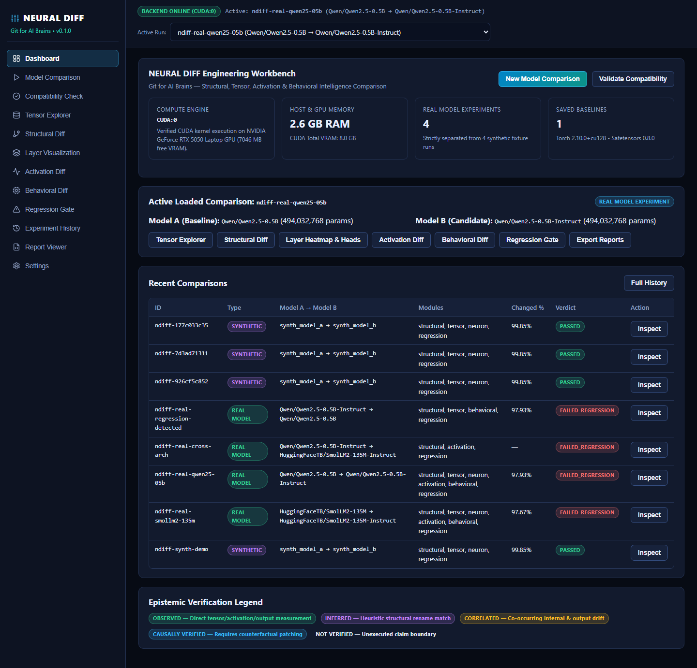

---

## 1. Phân Loại Nhận Thức Luận Nghiêm Ngặt (`Epistemic Discipline`)

| Nhãn Phân Loại | Ý Nghĩa Kỹ Thuật | Module Sinh Kết Quả |
| :--- | :--- | :--- |
| **`OBSERVED`** | Phép đo tất định tính trực tiếp từ trọng số checkpoint, vector kích hoạt hoặc xác suất đầu ra. | `TensorDiffEngine`, `ActivationDiffEngine`, `LogitLens`, `BehavioralDiffEngine`, `SparsityAnalyzer` |
| **`INFERRED`** | Suy luận cấu trúc hoặc phổ kỳ dị dựa trên ngưỡng tường minh (không đánh đồng với chân lý tuyệt đối). | Khớp đổi tên tensor cùng shape ($\cos \ge 0.985$), phân loại LoRA so với Full SFT bằng SVD |
| **`CORRELATED`** | Tương quan đồng biến giữa độ lệch trọng số và điểm hành vi khi chưa thực hiện can thiệp nhân quả. | Đối chiếu tầng có Relative $L_2$ cao với miền hành vi thay đổi |
| **`CAUSALLY VERIFIED`** | Xác minh bằng can thiệp phản thực tế trực tiếp $\text{do}(h_\ell \leftarrow h_\ell^{\text{clean}})$ trên cặp prompt và vị trí xác định. | `run_residual_patching` (`core/activation_analysis/patching.py`) |
| **`BLOCKED`** | Tác vụ bị chặn bởi điều kiện môi trường thực tế, lưu nguyên bằng chứng mã lỗi. | Probe kho có cổng cấp phép `google/gemma-3-270m` (`HTTP 401`) |

Mọi phiên chạy đều được tách biệt rõ giữa **`REAL MODEL EXPERIMENT`** (mô hình thực tế kèm mã commit Hugging Face) và **`SYNTHETIC FIXTURE EXPERIMENT`** (dữ liệu giả lập kiểm thử/đo băng thông).

---

## 2. Bộ Sưu Tập Đầy Đủ 15 Ảnh Chụp Giao Diện Thực Tế

Toàn bộ 15 ảnh PNG dưới đây được chụp tự động bằng trình duyệt Chromium không đầu (Playwright `1600×980 @ 1.5x`) kết nối trực tiếp tới FastAPI (`127.0.0.1:8000`) và Vite (`127.0.0.1:4173`) qua [`scripts/capture_screenshots.py`](../../scripts/capture_screenshots.py).

### 01. Đồ Thị Quy Trình 9 Node (Chế Độ Dây Bezier Spline)


### 02. Cấu Hình Cặp Mô Hình & Tham Số Dung Sai
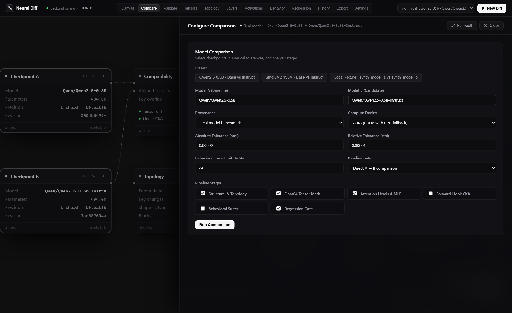

### 03. Kiểm Tra Tương Thích Kiến Trúc (`Qwen/Qwen2.5-0.5B` vs `Instruct`)
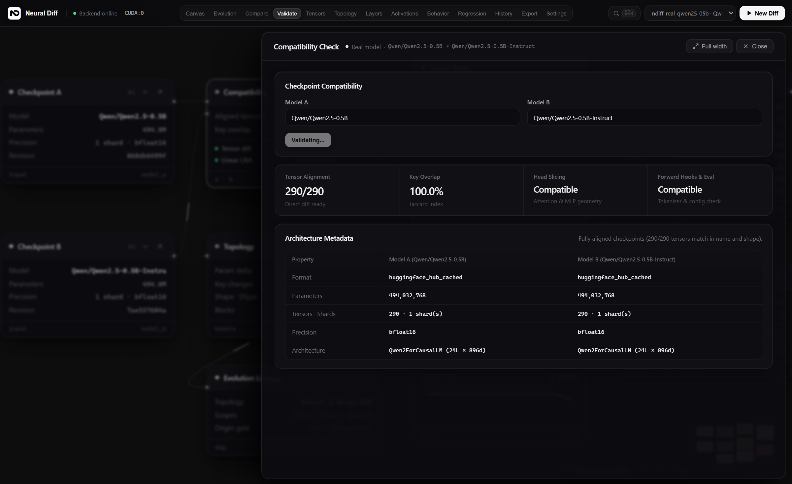

### 04. Trình Khám Phá Tensor `Float64` & Chẩn Đoán Phổ SVD / Độ Thưa 2:4
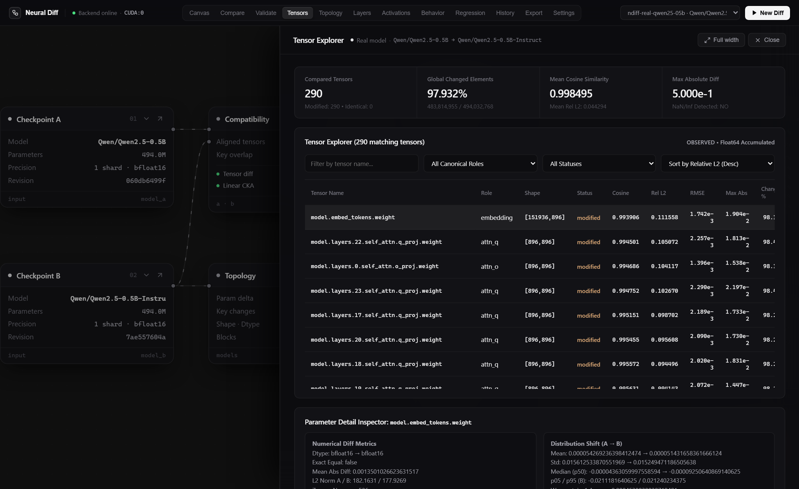

### 05. So Sánh Topo Liên Kiến Trúc (`Qwen2.5-0.5B` 24 Tầng vs `SmolLM2-135M` 30 Tầng)
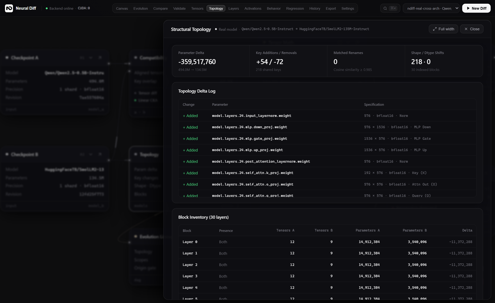

### 06. Bản Đồ Nhiệt 24 Tầng & Thanh Phân Kỳ Từng Đầu Chú Ý (GQA Heads)
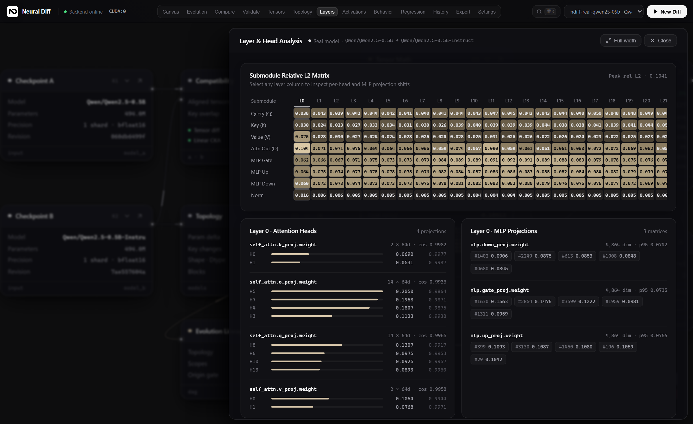

### 07. Căn Chỉnh Kích Hoạt Forward-Hook, Linear CKA & Phân Phối Token Kế Tiếp
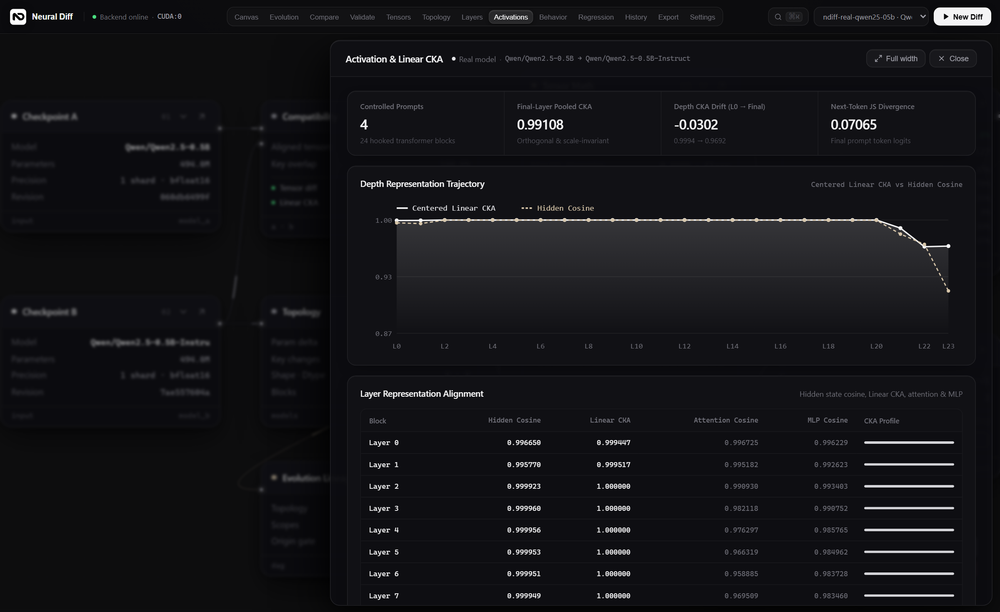

### 08. Đánh Giá Hành Vi 8 Miền & Không Gian So Sánh Cặp Phản Hồi Master-Detail


### 09. Cổng Chặn Hồi Quy (`Regression Gate`) & Sao Chép Lệnh CLI Tái Hiện Lỗi


### 10. Sổ Cái Lịch Sử Thí Nghiệm & Đo Lường Thời Gian Thực Thi
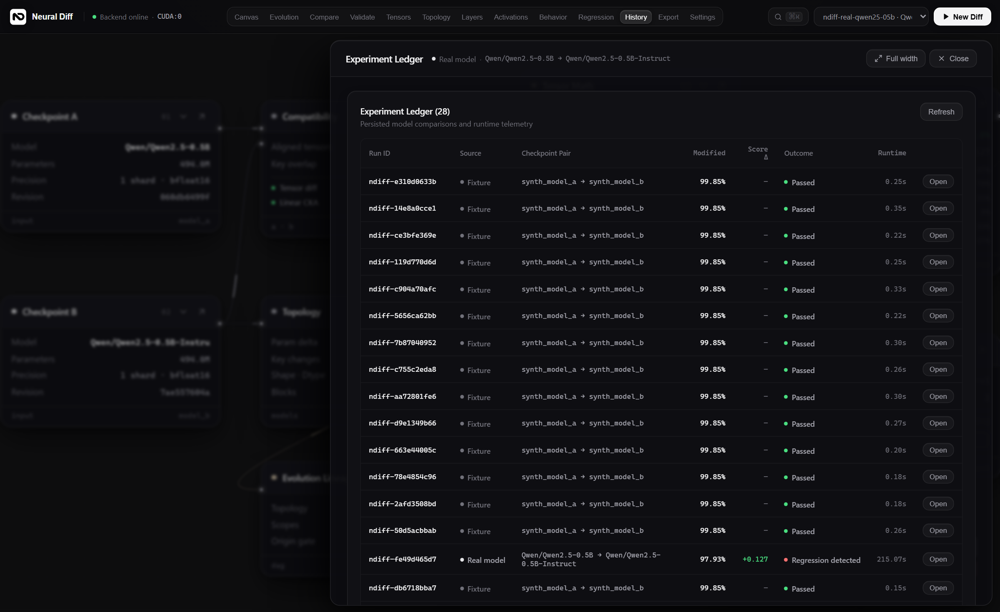

### 11. Xem Trước & Xuất Báo Cáo Đa Định Dạng (`.html`, `.md`, `.json`)
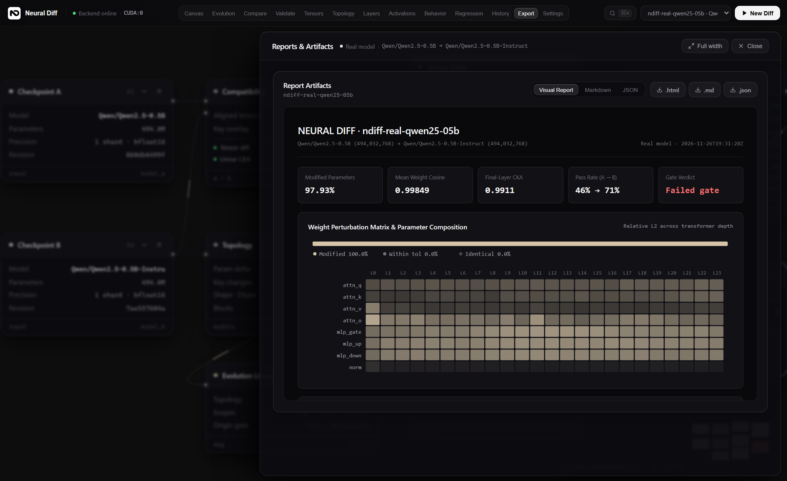

### 12. Bảng Tổng Hợp Kiểm Thử Tự Động & Độ Bao Phủ Mã Nguồn
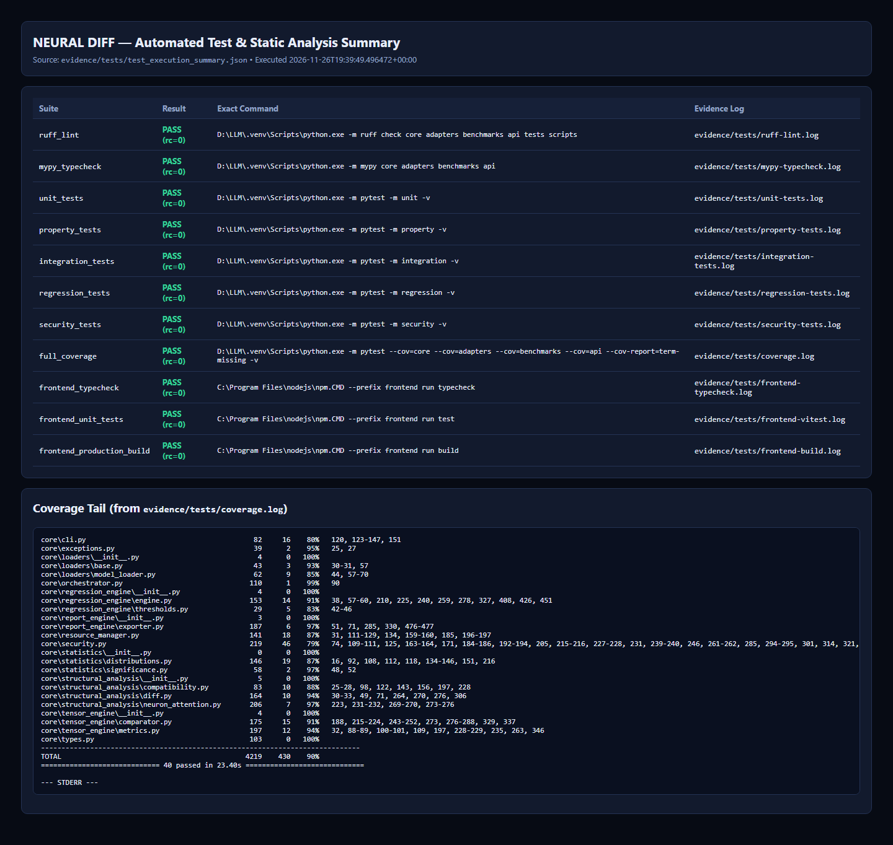

### 13. Xử Lý Lỗi Bảo Mật Chống Leo Thang Đường Dẫn (`HTTP 403`)
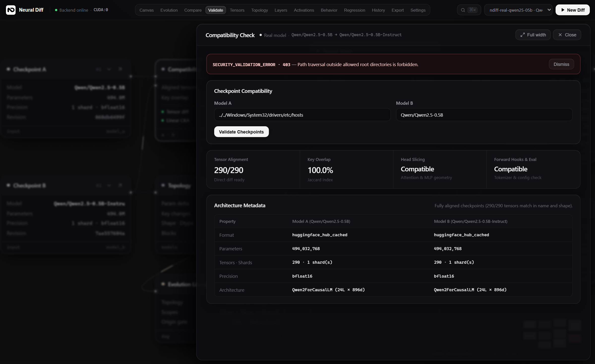

### 14. Cấu Hình Thiết Bị Tính Toán & Chính Sách Nạp Checkpoint An Toàn
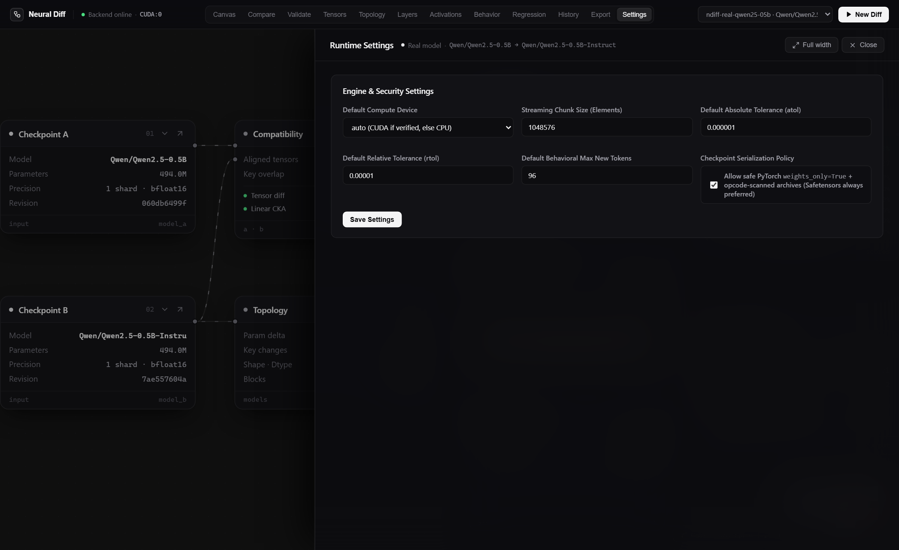

### 15. Trạng Thái Hoàn Thiện Với Chế Độ Đi Dây Mạch In Vuông Góc (`Orthogonal PCB`)
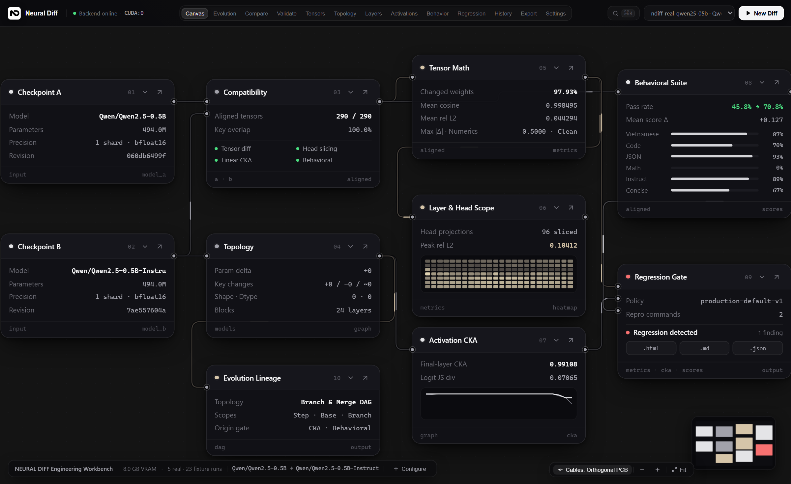

---

## 3. Kết Quả Benchmark Thực Tế Đầy Đủ

Thực thi trực tiếp trên máy trạm **Windows 11 (`10.0.26320`, 16 luồng CPU, `15.71 GB` RAM, GPU `NVIDIA GeForce RTX 5050 Laptop GPU` `sm_120` 8 GB VRAM, `PyTorch 2.10.0+cu128`)** và lưu tại [`evidence/benchmarks/real_model_benchmarks.json`](../../evidence/benchmarks/real_model_benchmarks.json):

### 3.1 Kết Quả Trên Các Mô Hình Thực (`REAL MODEL EXPERIMENT`)

| Mã Phiên | Mô Hình A (Commit) | Mô Hình B (Commit) | Tham Số | Số Tensor | Tỷ Lệ Đổi | Cosine TB | CKA Tầng Cuối | Tỷ Lệ Đạt ($A \to B$) | Điểm $\Delta$ | Thời Gian |
| :--- | :--- | :--- | ---: | ---: | ---: | ---: | ---: | ---: | ---: | ---: |
| `ndiff-real-qwen25-05b` | `Qwen/Qwen2.5-0.5B` (`060db6499f`) | `Qwen2.5-0.5B-Instruct` (`7ae557604a`) | 494.03M | 290 | `97.93%` | `0.998495` | `0.991076` | `45.8% → 70.8%` | `+0.1265` | `238.51s` |
| `ndiff-real-smollm2-135m` | `SmolLM2-135M` (`93efa2f097`) | `SmolLM2-135M-Instruct` (`12fd25f773`) | 134.52M | 272 | `97.67%` | `0.996951` | `0.951782` | `20.8% → 33.3%` | `+0.1819` | `191.13s` |
| `ndiff-real-cross-arch` | `Qwen2.5-0.5B-Instruct` | `SmolLM2-135M-Instruct` | 494M vs 135M | 290 vs 272 | Liên kiến trúc | — | `0.966758` | — | — | `4.79s` |
| `ndiff-real-regression-detected` | `Qwen2.5-0.5B-Instruct` | `Qwen2.5-0.5B` | 494.03M | 290 | — | — | — | `62.5% → 37.5%` | `-0.228` | `117.09s` |

* **Ghi nhận trạng thái `BLOCKED` trung thực:** Kho `google/gemma-3-270m` yêu cầu xác thực giấy phép trên Hugging Face (`HTTP 401 Unauthorized` khi không có `HF_TOKEN`), được ghi nhận nguyên vẹn tại [`evidence/model_comparisons/gemma3_270m_access_probe.json`](../../evidence/model_comparisons/gemma3_270m_access_probe.json).

### 3.2 Chi Tiết 8 Miền Hành Vi (`Qwen/Qwen2.5-0.5B` $\to$ `Qwen/Qwen2.5-0.5B-Instruct`)

| Miền Đánh Giá | Số Ca | Tỷ Lệ Đạt A | Tỷ Lệ Đạt B | Điểm TB A | Điểm TB B | Độ Lệch $\Delta$ | Thắng / Thua |
| :--- | ---: | ---: | ---: | ---: | ---: | ---: | ---: |
| **Tiếng Việt** (`vietnamese`) | 3 | `0%` | `67%` | `0.500` | `0.867` | `+0.367` | `+2 / -0` |
| **Bảo Toàn Mã Nguồn** (`code_preservation`) | 3 | `33%` | `67%` | `0.417` | `0.700` | `+0.283` | `+1 / -0` |
| **Định Dạng JSON** (`json_reliability`) | 3 | `100%` | `100%` | `0.925` | `0.925` | `0.000` | `+0 / -0` |
| **Suy Luận Toán Học** (`math_reasoning`) | 3 | `67%` | `0%` | `0.667` | `0.000` | `-0.667` | `+0 / -2` |
| **Tuân Thủ Chỉ Dẫn** (`instruction_following`) | 3 | `0%` | `67%` | `0.389` | `0.889` | `+0.500` | `+2 / -0` |
| **Độ Súc Tích** (`conciseness`) | 3 | `0%` | `67%` | `0.338` | `0.667` | `+0.329` | `+2 / -0` |
| **Từ Chối An Toàn** (`refusal_behavior`) | 3 | `67%` | `100%` | `0.800` | `1.000` | `+0.200` | `+1 / -0` |
| **Độ Chính Xác Sự Kiện** (`factual_accuracy`) | 3 | `100%` | `100%` | `1.000` | `1.000` | `0.000` | `+0 / -0` |

### 3.3 Băng Thông Xử Lý Tensor Theo Khối (`SYNTHETIC FIXTURE EXPERIMENT`)

| Mã Benchmark | Số Phần Tử | Kiểu Nguồn | Kích Thước Khối | Thời Gian | Tốc Độ (Triệu phần tử/giây) | Tăng Trưởng RAM (RSS) |
| :--- | ---: | :--- | ---: | ---: | ---: | ---: |
| `1M_float32_chunk1M` | 1,000,000 | `float32` | 1,048,576 | `0.0123s` | `81.080M/s` | `+49.59 MB` |
| `10M_float32_chunk256k` | 10,000,000 | `float32` | 262,144 | `0.0891s` | `112.188M/s` | **`+0.54 MB`** |
| `10M_float32_chunk1M` | 10,000,000 | `float32` | 1,048,576 | `0.0857s` | **`116.645M/s`** | `+24.94 MB` |
| `10M_bfloat16_chunk1M` | 10,000,000 | `bfloat16` | 1,048,576 | `0.0971s` | `102.934M/s` | `+22.82 MB` |
| `25M_bfloat16_chunk2M` | 25,000,000 | `bfloat16` | 2,097,152 | `0.2628s` | `95.124M/s` | `+87.70 MB` |
| `safetensors_lazy_stream` | 4,194,304 | `bfloat16` | Lazy mmap | `0.2950s` | — | **`+0.52 MB`** |

---

## 4. Cài Đặt, Khởi Chạy & Xác Minh Bằng Chứng

```powershell
# 1. Cài đặt môi trường Python và Frontend từ lockfile
cd d:\LLM
python -m uv sync
npm --prefix frontend ci

# 2. Khởi chạy Backend FastAPI và Giao diện Studio
.\.venv\Scripts\python.exe -m uvicorn api.app:app --host 127.0.0.1 --port 8000
npm --prefix frontend run dev

# 3. Chạy toàn bộ kiểm thử tự động & kiểm tra toàn vẹn SHA-256 của kho bằng chứng
.\.venv\Scripts\python.exe scripts/run_all_tests.py
.\.venv\Scripts\python.exe scripts/verify_evidence.py
```

## Giấy Phép

Phát hành theo giấy phép [MIT License](../../LICENSE).
