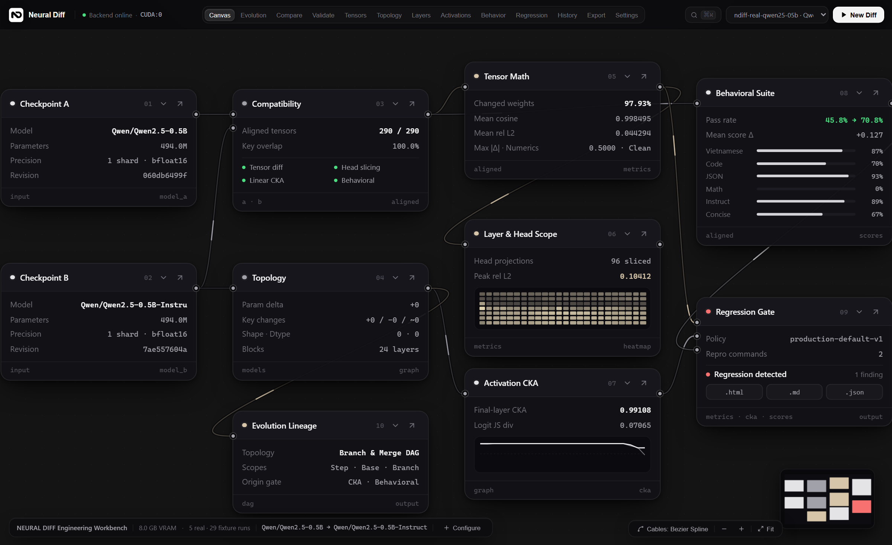
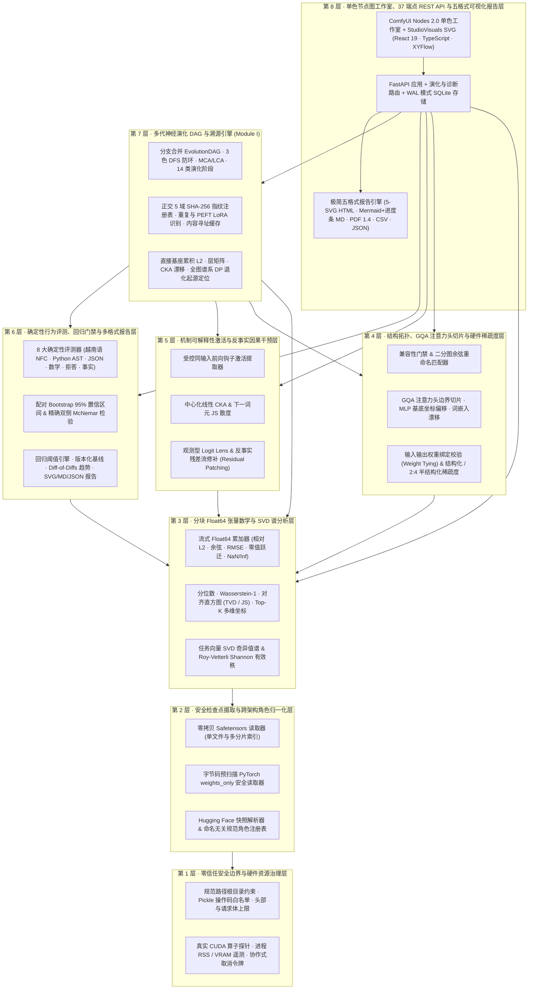
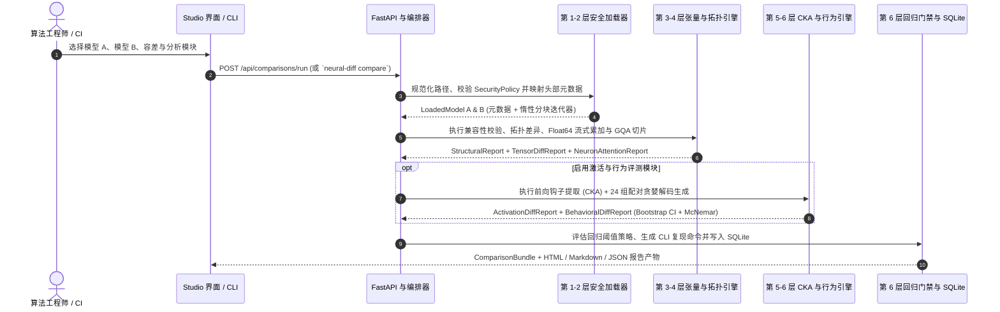
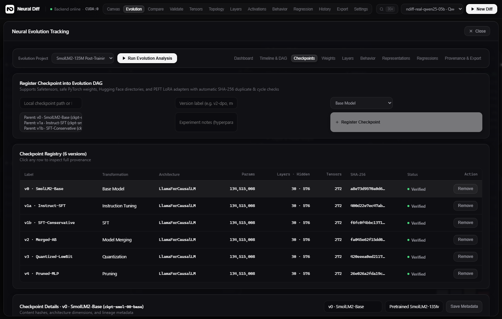
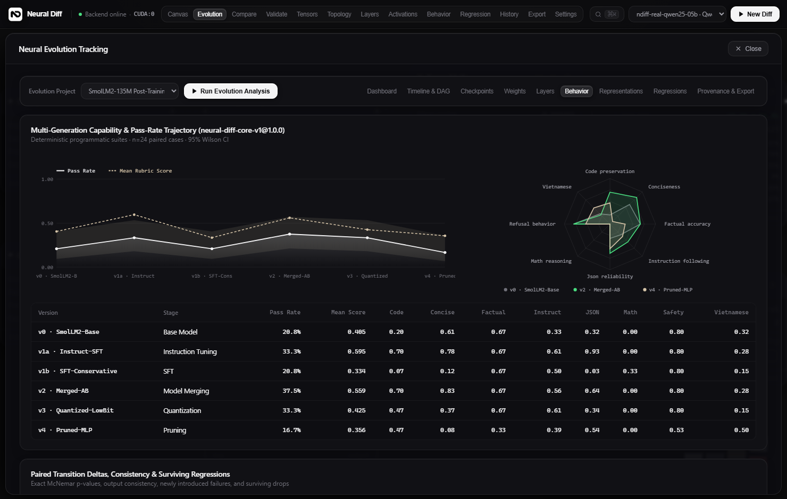
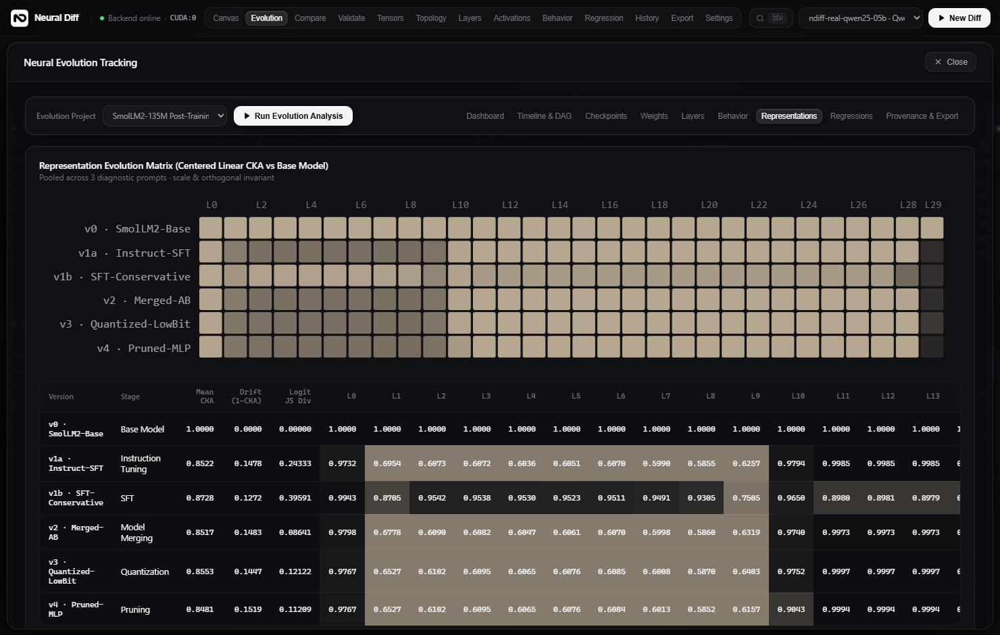
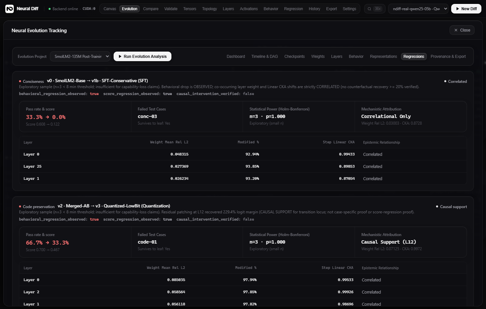
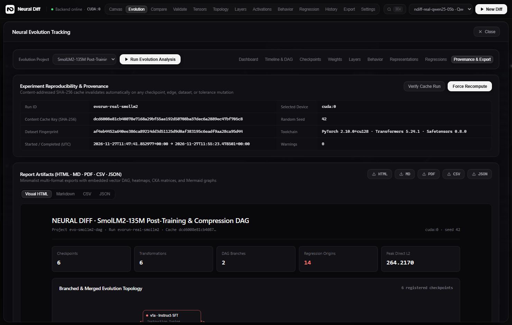

<p align="left">
  
</p>

# NEURAL DIFF — AI 模型大脑的 Git

**面向预训练基座与微调大模型的结构拓扑、神经表征与确定性行为对比工程平台**

[**English**](../../README.md) · [**Tiếng Việt**](README.vi.md) · [**简体中文**](README.zh-CN.md) · [**日本語**](README.ja.md) · [**Français**](README.fr.md)

[](../../.github/workflows)
[](../../pyproject.toml)
[](../../frontend/package.json)
[](../../uv.lock)
[](../../frontend/package.json)
[-18181b?style=flat-square)](../../evidence/tests/coverage.log)
[](../../LICENSE)

---

**NEURAL DIFF** 是一套生产级开源机器学习工程平台，集成 Python 核心库、命令行工具（`neural-diff`）、FastAPI + SQLite 后端服务，以及采用 **ComfyUI Nodes 2.0 单色极简建筑设计语言**（React 19 + TypeScript + `@xyflow/react`）构建的交互式节点图与演化追踪工作室。NEURAL DIFF 摒弃主观感觉与黑盒权重对比，通过 **八层解耦系统架构** 与 **五大正交分析维度** 严谨解构检查点全生命周期演化：

1. **结构与拓扑差异（Structural & Topology Diff）** — 检测新增/删除张量、基于二分图余弦匹配（$\cos \ge 0.985$）的重命名推断、形状与精度变更、分组查询注意力（GQA）逐头切片、输入输出词嵌入权重绑定验证（Weight Tying）、结构化通道剪枝及 NVIDIA `2:4` 半结构化稀疏合规率。
2. **Float64 分块流式数学与 SVD 谱有效秩** — 恒定内存开销的 `float64` 分块累加器（`max_abs_diff`、`mean_abs_diff`、`RMSE`、`Relative L2`、`Cosine Similarity`、零值跃迁、经验分位数、Wasserstein-1 距离、对齐直方图 TVD/JS 散度、Top-$K$ 多维坐标反解），以及基于奇异值谱 Roy-Vetterli **Shannon 有效秩** 的低秩 LoRA 合并与全秩 SFT 更新判别。
3. **机制可解释性表征对齐、Logit Lens 与因果激活修补** — 在受控同输入序列上挂载确定性前向钩子，测量逐层隐藏态/注意力/MLP 余弦、正交尺度不变的 **中心化线性 CKA**（支持跨架构不同隐藏维度对比）、观测型 **Logit Lens** 词表投影，以及反事实 **残差流激活修补（Residual-Stream Activation Patching）**（达到 `CAUSALLY VERIFIED` 因果验证级别）。
4. **8 大领域确定性行为评测与回归门禁（Regression Gate）** — 24 个配对测试用例，由 8 个确定性评估器（Unicode NFC、Python `ast.parse` 语法树、严格 JSON Schema、数学数值提取、安全拒答等，零外部 LLM 裁判调用）打分，支持 2,000 次重采样配对 Bootstrap 95% 置信区间、精确双侧 McNemar 检验、版本化 SQLite/JSON 基线、多轮 `diff-of-diffs` 趋势追踪及一键复制 CLI 复现指令。
5. **多代神经演化追踪（`Module I`）与极简五格式可视化报告** — 支持分叉与多父节点合并有向无环图（`Base → SFT → DPO → Merge → Quantization → Pruning`）、三色 DFS 环路拦截、4 MiB 流式 SHA-256 指纹与 PEFT LoRA 识别、精确直接累积距离 $\|W_{\text{current}} - W_{\text{base}}\|_2$、跨代 CKA 矩阵、自动退化起源定位（`Regression Origin Pinpointing`），并导出零冗余极简五格式报告（内嵌 5 幅 SVG 图表的 `HTML`、含 Mermaid 与 `█░` 进度条的 `Markdown`、纯 Python 矢量图 `%PDF-1.4`、`CSV` 与严格 `JSON`）。



---

## 目录

1. [认识论分级与实验溯源准则](#1-认识论分级与实验溯源准则)
2. [八层解耦系统架构深度解析](#2-八层解耦系统架构深度解析)
3. [端到端执行管线与数据流序列](#3-端到端执行管线与数据流序列)
4. [核心数学与统计公式体系](#4-核心数学与统计公式体系)
5. [完整实机运行图集（100% 全部 27 张实拍截图）](#5-完整实机运行图集100-全部-27-张实拍截图)
6. [真实公开模型基准测试（`REAL MODEL EXPERIMENT`）](#6-真实公开模型基准测试real-model-experiment)
7. [分块流式吞吐量与内存开销基准（`SYNTHETIC FIXTURE EXPERIMENT`）](#7-分块流式吞吐量与内存开销基准synthetic-fixture-experiment)
8. [安装部署与可复现快速启动](#8-安装部署与可复现快速启动)
9. [CLI 命令行参考手册（`neural-diff`）](#9-cli-命令行参考手册neural-diff)
10. [REST API 接口参考手册（37 个端点）](#10-rest-api-接口参考手册37-个端点)
11. [10 条多节点 CI/CD 流水线、`89%` 覆盖率与安全加固审计](#11-10-条多节点-cicd-流水线89-覆盖率与安全加固审计)
12. [SHA-256 证据完整性与已知工程边界](#12-sha-256-证据完整性与已知工程边界)

---

## 1. 认识论分级与实验溯源准则

NEURAL DIFF 在核心领域模型（[`core/types.py`](../../core/types.py)）与五格式导出报告中强制编码认识论标签，严禁将观测相关性、诊断提示词修补或分数波动夸大为完整因果证明：

| 认识论状态 | 数学与科学判定标准 | 对应生成子系统 |
| :--- | :--- | :--- |
| **`OBSERVED`** | 直接由检查点权重、前向钩子激活或贪婪解码词元序列确定性计算得到的观测函数值（独立记录二值通过率退化 `behavioral_regression_observed` 与连续评分退化 `score_regression_observed`）。 | `TensorDiffEngine`、`NeuronAttentionAnalyzer`、`ActivationDiffEngine`、`LogitLens`、`BehavioralDiffEngine`、`SparsityAnalyzer` |
| **`INFERRED`** | 在显式数学阈值下得出的高置信度结构或谱推断，不静默等同于训练真值。 | 同形状张量二分图重命名匹配（$\cos \ge 0.985$）；SVD 更新形态判别（`low_rank_adapter` vs `full_rank_update`） |
| **`CORRELATED`** | 同一检查点对中同时出现的参数/CKA 偏移与行为或纯评分变化，未经用例级反事实干预隔离。纯评分退化（`behavioral_regression_observed = false`）上限严格锁定为 `CORRELATED`，防止将单 token Logit 修补误读为连续评分退化的因果证明。 | 峰值相对 $L_2$/CKA 跨阶段汇总；`RegressionOriginEngine` |
| **`CAUSAL SUPPORT`** | 通用诊断提示词跨检查点单层残差修补恢复 $\ge 20\%$ 正向目标/干扰词元 Logit 边界（`case_targeted = false`），或多失败事件中仅部分失败用例通过验证——支持过渡位点假设，但不等同于全用例或评分退化的因果证明。 | `run_cross_checkpoint_layer_patching`、`RegressionOriginEngine` |
| **`CAUSALLY VERIFIED`** | 仅当 `behavioral_regression_observed = true` 且事件内 100% 失败用例同时显式满足 `case_targeted`、`target_vs_foil_verified`、`negative_control_verified` 与用例+层位级 `verification_scope` 四项独立证据时成立（`causal_intervention_verified = true`），严格限定于被测提示词指纹与层位的词元 Logit 恢复。 | `run_residual_patching`（[`patching.py`](../../core/activation_analysis/patching.py)）；`RegressionOriginEngine` |
| **`NOT VERIFIED` / `BLOCKED`** | 未执行路径或受外部权限门禁拦截的资源，完整保留原始 HTTP/运行时错误证据。 | `google/gemma-3-270m` 门禁仓库匿名探测（`HTTP 401`） |

---

## 2. 八层解耦系统架构深度解析

NEURAL DIFF 采用严格的 **八层水平分层架构**，核心数学与演化谱系层与 Web 框架完全零耦合，可在 Python 库、`neural-diff` CLI、CI 流水线或 Studio Web 界面中一致运行。



### 第 1 层 — 零信任安全边界与硬件资源治理层（Layer 1）
* **核心代码：** [`core/security.py`](../../core/security.py)、[`core/resource_manager.py`](../../core/resource_manager.py)、[`api/security_middleware.py`](../../api/security_middleware.py)
* **路径根目录强约束：** 所有本地路径经 `Path.resolve()` 规范化后强制校验是否落在 `SecurityPolicy.allowed_roots`（工作区根目录、合法 Hugging Face 缓存目录与存储目录）内；任何 `../` 路径穿越或逃逸符号链接均立即抛出 `SecurityValidationError`（`HTTP 403`）。
* **Pickle 字节码审计与远程代码封锁：** 所有 Hugging Face 加载调用硬编码 `trust_remote_code=False`。针对 `.pt`/`.bin` 归档文件，在调用 `torch.load(..., weights_only=True)` 之前，先通过 `pickletools.genops()` 反汇编 ZIP 内全部 pickle 流，拒绝白名单外的 `REDUCE`、`GLOBAL`、`STACK_GLOBAL`、`BUILD`、`INST`、`OBJ`、`NEWOBJ` 操作码。
* **真实 CUDA 算子验证与协作取消：** `ResourceManager` 在初始化时执行真实的 GPU 张量分配与矩阵乘法探针（验证 RTX 5050 `sm_120` 算力可用），并在分块循环与推理循环中传播线程安全的 `CancellationToken`。

### 第 2 层 — 安全检查点摄取与跨架构角色归一化层（Layer 2）
* **核心代码：** [`core/loaders/`](../../core/loaders/)、[`adapters/safetensors/`](../../adapters/safetensors/)、[`adapters/pytorch/`](../../adapters/pytorch/)、[`adapters/huggingface/`](../../adapters/huggingface/)、[`adapters/architectures/registry.py`](../../adapters/architectures/registry.py)
* **零拷贝惰性流式读取：** `SafetensorsReader` 校验 8 字节头部长度（上限 `64 MiB`），在不读取权重本体的情况下构建 `TensorDescriptor` 目录，原生支持 `model.safetensors.index.json` 多分片路由，并通过 `iter_tensor_chunks(name, chunk_elements=1_048_576)` 按块流式输出。
* **跨架构规范化角色映射：** `ArchitectureRegistry` 将 **Llama / Qwen2 / Mistral / Gemma / SmolLM**（`model.layers.{i}.self_attn.{q,k,v,o}_proj`）、**GPT-2**（`transformer.h.{i}.attn.c_attn`）、**GPT-NeoX / Pythia** 与 **Phi** 的异构参数名称统一映射为规范 `(layer_index, CanonicalRole)`。

### 第 3 层 — 分块 Float64 张量数学、统计分布与 SVD 谱分析层（Layer 3）
* **核心代码：** [`core/tensor_engine/`](../../core/tensor_engine/)、[`core/statistics/`](../../core/statistics/)
* **消除大数吃小数的 Float64 流式累加：** 上亿元素的 `bfloat16`/`float16` 张量若以 `float32` 累加内积会产生严重舍入误差。本层将每个流式分块提升为 CPU `torch.float64`，单遍精确计算范数、余弦相似度、RMSE、相对 $L_2$、容差掩码（`|b - a| <= atol + rtol * |a|`）、零值跃迁及 `NaN`/`Inf` 计数。
* **分布偏移与多维极值定位：** 计算经验分位数（`p01`–`p99`）、一维 Wasserstein-1 距离、共享边界直方图（`PairedHistogram`）的总变差距离（TVD）与 JS 散度，并通过 `extract_top_k_element_deltas` 精确反解峰值 $|\Delta w|$ 的多维坐标 `(row, col)`。
* **SVD 任务向量奇异值谱：** 对二维权重增量 $\Delta W = W_B - W_A$ 执行双精度奇异值分解，输出谱范数、Frobenius 范数、90%/99% 累积能量秩与 **Shannon 有效秩**（`analyze_task_vector_spectrum`）。

### 第 4 层 — 结构拓扑、GQA 注意力头切片与硬件稀疏度层（Layer 4）
* **核心代码：** [`core/structural_analysis/`](../../core/structural_analysis/)
* **兼容性预检与重命名推断：** 检验键集合 Jaccard 重叠率、隐藏层维度与分词器词表；对未匹配的同形状张量执行贪婪二分图余弦匹配（$\cos \ge 0.985$，标记为 `INFERRED`）以识别参数重命名。
* **GQA 感知的注意力头与 MLP 定位：** 依据 `num_attention_heads` 与 `num_key_value_heads` 精确切分投影矩阵（例如 `Qwen2.5-0.5B` 中 `14 × 64d` 的 Q/O 头与 `2 × 64d` 的 KV 头），并定位偏移最大的 MLP 中间维基底坐标。
* **权重绑定与 NVIDIA `2:4` 稀疏度检测：** 验证微调前后 `embed_tokens` 与 `lm_head` 是否意外解绑（`compare_weight_tying`），并量化结构化行列剪枝率与 Tensor Core `2:4` 半结构化稀疏合规比例（`analyze_matrix_sparsity`）。

### 第 5 层 — 机制可解释性激活对齐、Logit Lens 与反事实因果修补层（Layer 5）
* **核心代码：** [`core/activation_analysis/`](../../core/activation_analysis/)
* **前向钩子表征几何：** 在严格一致的输入词元序列（`seed=42`、`torch.no_grad()`）下挂载 `register_forward_hook`，计算逐层隐藏态余弦、注意力/MLP 输出余弦、末词元概率 JS 散度，以及支持跨架构异构宽度对比（如 `Qwen2.5` $d=896$ vs `SmolLM2` $d=576$）的 **中心化线性 CKA**。
* **观测型 Logit Lens：** 将每层末位置的残差态经最终归一化层（避免对 Hugging Face 末层状态重复归一化）与 `lm_head` 投影至词表空间，度量逐层对最终预测的 KL 收敛轨迹（`OBSERVED`）。
* **反事实残差流修补（Residual Patching）：** 缓存干净输入的逐层残差激活，在受污染输入的前向传播中逐层执行干预 $\text{do}(h_\ell^{\text{corr}} \leftarrow h_\ell^{\text{clean}})$，量化目标词元对 Logit 差值的因果恢复比例（`CAUSALLY VERIFIED`）。

### 第 6 层 — 8 大确定性行为评测、回归门禁与多格式报告层（Layer 6）
* **核心代码：** [`benchmarks/`](../../benchmarks/)、[`core/behavioral_analysis/`](../../core/behavioral_analysis/)、[`core/regression_engine/`](../../core/regression_engine/)、[`core/report_engine/`](../../core/report_engine/)
* **8 个零 LLM 裁判的确定性评估器：** 覆盖越南语 NFC 声调密度（`vietnamese`）、Python `ast.parse` 语法树与函数签名保持（`code_preservation`）、严格 JSON 解析与类型校验（`json_reliability`）、精确数学答案提取（`math_reasoning`）、结构化指令约束（`instruction_following`）、篇幅精炼度（`conciseness`）、安全拒答与零误拒校验（`refusal_behavior`）及事实核验（`factual_accuracy`）。
* **统计推断与回归门禁：** 计算 2,000 次配对 Bootstrap 95% 置信区间与精确双侧 McNemar $p$ 值；按阈值策略生成严重度分级报告、一键 CLI 复现指令、多轮 `diff-of-diffs` 趋势对比（`compare_run_history`），以及内嵌原生 SVG 图表的独立 HTML、Markdown 与 JSON 报告。

### 第 7 层 — 多代神经演化有向无环图（DAG）与溯源引擎（Layer 7 · Module I）
* **核心代码：** [`core/evolution/`](../../core/evolution/)（`dag.py`、`registry.py`、`store.py`、`tensor_evolution.py`、`layer_evolution.py`、`behavioral_evolution.py`、`representation_evolution.py`、`regression_origin.py`、`orchestrator.py`）
* **分支合并 DAG 与截断安全的谱系动态规划：** 支持 14 种演化阶段、多父节点融合权重、Kahn 拓扑排序、最近公共祖先（LCA）、7 类对偶关系判定 `classify_pair_scope()` 及 3 色 DFS 防环（`CYCLIC_DEPENDENCY_ERROR`）。通过 $O(V+E)$ `count_total_branches()` 精确计数根到叶路径并配合惰性 `iter_branches(max_paths)`；当 `branch_count > max_branches` 时显式标记 `branches_truncated = true`，并由 `RegressionOriginEngine` 运行 $O(|V|\cdot|E|)$ 全图谱系状态动态规划回退，确保零遗漏边、零重复事件、跨合并点零分支历史污染。
* **正交 5 域 SHA-256 指纹与缓存失效：** 独立流式计算 `weights_sha256`（纯张量数据片）、`architecture_config_sha256`（`config.json`、`generation_config.json`、`quantize_config.json`）、`tokenizer_sha256`（`tokenizer.json`、`tokenizer.model`、`spiece.model`、`tokenizer_config.json`、`vocab.json`、`merges.txt`、`special_tokens_map.json`、`added_tokens.json`、`chat_template.jinja`、`chat_template.json`）、`adapter_sha256`（`adapter_config.json`、`adapter_model.safetensors`）与 `metadata_sha256`（Safetensors 张量描述符与 `__metadata__`），五域共同汇入 `sha256_fingerprint` 与行为缓存键。
* **4 级认识论分层与统计方法学：** 严格区分 `OBSERVED`、`CORRELATED`、`CAUSAL SUPPORT`（诊断提示词跨检查点修补恢复 $\ge 20\%$）与 `CAUSALLY VERIFIED`（要求 `case_targeted`、`target_vs_foil_verified`、`negative_control_verified` 与用例+层位级 `verification_scope` 四项独立证据全部显式为真，缺失项绝不默认为真）；结合 95% Wilson 二项区间、配对 Bootstrap 95% 区间、精确双侧 McNemar 原始 $p$ 值、逐步下降 **Holm-Bonferroni** 校正、`pass_rate_and_score` / `pass_rate_only` / `score_only` 分类及 `min_category_sample_size = 8` 探索性门禁。

### 第 8 层 — 任务编排、SQLite WAL 持久化、37 端点 REST API、5 格式报告与工作室界面层（Layer 8）
* **核心代码：** [`core/orchestrator.py`](../../core/orchestrator.py)、[`core/cli.py`](../../core/cli.py)、[`core/report_engine/visuals.py`](../../core/report_engine/visuals.py)、[`core/evolution/exporter.py`](../../core/evolution/exporter.py)、[`api/`](../../api/)、[`frontend/`](../../frontend/)
* **编排与五格式导出：** 支持 `HTML`（内嵌 5 幅原生数据驱动 SVG）、`Markdown`（动态 `mermaid` DAG 与比例条）、零依赖 `%PDF-1.4`、`CSV` 与 `JSON` 导出，配合 WAL 模式 SQLite（`data/neural_diff.db`）持久化。
* **ComfyUI Nodes 2.0 单色工作室：** 基于 React 19、TypeScript、Vite 8、`@xyflow/react` 与 `framer-motion` 构建，集成双模型 9 节点画布与 9 标签页多代神经演化工作室。

---

## 3. 端到端执行管线与数据流序列



---

## 4. 核心数学与统计公式体系

1. **分块 Float64 相对 $L_2$ 与余弦相似度：**
   $$\text{Rel-}L_2(A, B) = \frac{\sqrt{\sum_{i=1}^{N} (b_i - a_i)^2}}{\max\!\left(\sqrt{\sum_{i=1}^{N} a_i^2},\, 10^{-12}\right)}, \qquad \cos(A, B) = \frac{\sum_{i=1}^{N} a_i b_i}{\sqrt{\sum_{i=1}^{N} a_i^2}\sqrt{\sum_{i=1}^{N} b_i^2}}$$
2. **任务向量奇异值谱与 Roy-Vetterli Shannon 有效秩：**
   设 $\Delta W = W_B - W_A \in \mathbb{R}^{m \times n}$ 的非零奇异值为 $\sigma_1 \ge \dots \ge \sigma_r > 0$，归一化谱分布 $p_i = \sigma_i / \sum_{j=1}^{r} \sigma_j$：
   $$\text{erank}(\Delta W) = \exp\!\left(-\sum_{i=1}^{r} p_i \ln p_i\right) \in [1, \min(m, n)]$$
3. **中心化线性 CKA（正交变换与各向同性缩放不变）：**
   对词元对齐并中心化后的激活矩阵 $X_c = H X \in \mathbb{R}^{T \times d_A}$ 与 $Y_c = H Y \in \mathbb{R}^{T \times d_B}$（$H = I_T - \frac{1}{T}\mathbf{1}\mathbf{1}^\top$）：
   $$\text{CKA}(X, Y) = \frac{\|Y_c^\top X_c\|_F^2}{\|X_c^\top X_c\|_F \, \|Y_c^\top Y_c\|_F} \in [0, 1]$$
4. **反事实残差流修补恢复率：**
   $$\text{Recovery}(\ell) = \frac{\big(z_{\text{patched}}^{(\ell)}[t^+] - z_{\text{patched}}^{(\ell)}[t^-]\big) - \big(z_{\text{corr}}[t^+] - z_{\text{corr}}[t^-]\big)}{\big(z_{\text{clean}}[t^+] - z_{\text{clean}}[t^-]\big) - \big(z_{\text{corr}}[t^+] - z_{\text{corr}}[t^-]\big)}$$

---

## 5. 完整实机运行图集（100% 全部 27 张实拍截图）

全部 27 张 PNG（双模型画布 `01`..`15` 与多代神经演化追踪 `16`..`27`）均由 [`scripts/capture_screenshots.py`](../../scripts/capture_screenshots.py) 与 [`scripts/capture_evolution_evidence.py`](../../scripts/capture_evolution_evidence.py) 通过无头 Playwright Chromium 对实时运行的 FastAPI（`127.0.0.1:8000`）与 Vite（`127.0.0.1:4173`）服务器自动采集。

### 01. 9 节点交互式工作流图画布（Bezier 曲线模式）


### 02. 模型 A 与模型 B 对比参数与阶段配置


### 03. 检查点兼容性与架构校验（`Qwen/Qwen2.5-0.5B` vs `Instruct`）


### 04. Float64 张量浏览器与按需 SVD / 2:4 稀疏度探测


### 05. 跨架构结构拓扑差异（`Qwen2.5-0.5B` 24 层 vs `SmolLM2-135M` 30 层）


### 06. 24 层子模块相对 $L_2$ 矩阵与 GQA 注意力头分歧比例条


### 07. 前向钩子激活对齐、线性 CKA 与 Top-5 下一词元概率条


### 08. 8 大行为评测套件与主从分栏（Master-Detail）配对输出工作台


### 09. 回归门禁状态、超限发现列表与一键复制 CLI 复现指令


### 10. SQLite 实验历史台账与运行耗时审计


### 11. 多格式独立报告预览与下载（`.html`、`.md`、`.json`）


### 12. 自动化测试与 `89%` 语句覆盖率验证台账（71 项 Python 测试）


### 13. 实时路径穿越安全拦截提示（`HTTP 403`）


### 14. 计算后端与安全序列化策略持久化设置


### 15. 正交 PCB 走线模式下的最终工作室状态


### 16–27. 多代神经演化追踪工作室与极简 5-SVG 导出报告实拍（`SmolLM2-135M` 6 代分叉合并 DAG）

| 16 · 演化三联轨迹仪表盘 | 17 · 分支谱系与任意版本对比 | 18 · 分叉与合并交互式 DAG |
| :---: | :---: | :---: |
|  |  |  |
| **19 · SHA-256 检查点注册表** | **20 · 量化元数据溯源详情** | **21 · 直接累积 $L_2$ 轨迹对比** |
|  |  |  |
| **22 · 30 层权重演化热力矩阵** | **23 · 行为轨迹与 8 维雷达图** | **24 · 中心化线性 CKA 矩阵** |
|  |  |  |
| **25 · 自动退化起源定位** | **26 · SHA-256 缓存与报告预览** | **27 · 独立导出的 5-SVG HTML 报告** |
|  |  |  |

---

## 6. 真实公开模型基准测试（`REAL MODEL EXPERIMENT`）

测试平台：**Windows 11 (`10.0.26320`, 16 逻辑核 CPU, `15.71 GB` 内存, `NVIDIA GeForce RTX 5050 Laptop GPU` `sm_120` 8 GB 显存, `CPython 3.12.16`, `torch 2.10.0+cu128`)**，数据存档于 [`evidence/benchmarks/real_model_benchmarks.json`](../../evidence/benchmarks/real_model_benchmarks.json)。

### 6.1 真实公开模型对比实验汇总

| 实验 ID | 模型 A（HF 提交） | 模型 B（HF 提交） | 参数量 | 张量数 | 修改比例 | 平均余弦 | 末层池化 CKA | 行为通过率 ($A \to B$) | 平均得分 $\Delta$ | 耗时 |
| :--- | :--- | :--- | ---: | ---: | ---: | ---: | ---: | ---: | ---: | ---: |
| `ndiff-real-qwen25-05b` | `Qwen/Qwen2.5-0.5B` (`060db6499f`) | `Qwen2.5-0.5B-Instruct` (`7ae557604a`) | 494.03M | 290 | `97.93%` | `0.998495` | `0.991076` | `45.8% → 70.8%` | `+0.1265` | `238.51s` |
| `ndiff-real-smollm2-135m` | `SmolLM2-135M` (`93efa2f097`) | `SmolLM2-135M-Instruct` (`12fd25f773`) | 134.52M | 272 | `97.67%` | `0.996951` | `0.951782` | `20.8% → 33.3%` | `+0.1819` | `191.13s` |
| `ndiff-real-cross-arch` | `Qwen2.5-0.5B-Instruct` | `SmolLM2-135M-Instruct` | 494M vs 135M | 290 vs 272 | 跨架构 | — | `0.966758` | — | — | `4.79s` |
| `ndiff-real-regression-detected` | `Qwen2.5-0.5B-Instruct` | `Qwen2.5-0.5B` | 494.03M | 290 | — | — | — | `62.5% → 37.5%` | `-0.228` | `117.09s` |

* **门禁模型透明披露（`BLOCKED`）：** 未配置 `HF_TOKEN` 时匿名访问 `google/gemma-3-270m` 返回 `HTTP 401 Unauthorized`，完整记录保存于 [`evidence/model_comparisons/gemma3_270m_access_probe.json`](../../evidence/model_comparisons/gemma3_270m_access_probe.json)。

### 6.2 八大行为套件得分明细（`Qwen/Qwen2.5-0.5B` $\to$ `Qwen/Qwen2.5-0.5B-Instruct`）

| 评测套件 | 用例数 | A 通过率 | B 通过率 | A 均分 | B 均分 | 得分差 $\Delta$ | 提升 / 退化 |
| :--- | ---: | ---: | ---: | ---: | ---: | ---: | ---: |
| **越南语质量** (`vietnamese`) | 3 | `0%` | `67%` | `0.500` | `0.867` | `+0.367` | `+2 / -0` |
| **代码保持** (`code_preservation`) | 3 | `33%` | `67%` | `0.417` | `0.700` | `+0.283` | `+1 / -0` |
| **JSON 结构可靠性** (`json_reliability`) | 3 | `100%` | `100%` | `0.925` | `0.925` | `0.000` | `+0 / -0` |
| **数学推理** (`math_reasoning`) | 3 | `67%` | `0%` | `0.667` | `0.000` | `-0.667` | `+0 / -2` |
| **指令遵循** (`instruction_following`) | 3 | `0%` | `67%` | `0.389` | `0.889` | `+0.500` | `+2 / -0` |
| **简洁性约束** (`conciseness`) | 3 | `0%` | `67%` | `0.338` | `0.667` | `+0.329` | `+2 / -0` |
| **安全拒答** (`refusal_behavior`) | 3 | `67%` | `100%` | `0.800` | `1.000` | `+0.200` | `+1 / -0` |
| **事实准确性** (`factual_accuracy`) | 3 | `100%` | `100%` | `1.000` | `1.000` | `0.000` | `+0 / -0` |
| **总计（24 组配对用例）** | **24** | **`45.8%`** | **`70.8%`** | **`0.629`** | **`0.756`** | **`+0.1265`** | **`9W · 12T · 3L`** |

### 6.3 6 阶段 `SmolLM2-135M` 分支与合并演化基准（`evorun-real-smollm2`）

完整 5 域 SHA-256 指纹与演化指标存档于 [`evidence/evolution/evolution_benchmark.json`](../../evidence/evolution/evolution_benchmark.json)：

| 版本 | 演化阶段 | 父节点 | 稀疏率 | 直接基座 $L_2$ | 逐步累加 $L_2$ | 对基座均值 CKA | 通过率（`95%` Wilson CI） | 均分 |
| :--- | :--- | :--- | ---: | ---: | ---: | ---: | :--- | ---: |
| `v0 · SmolLM2-Base` | `Base Model` | — | `0.00%` | `0.0000` | `0.0000` | `1.0000` | `20.8%` (`[9%, 40%]`) | `0.405` |
| `v1a · Instruct-SFT` | `Instruction Tuning` | `v0` | `0.00%` | `180.6458` | `180.6458` | `0.8522` | `33.3%` (`[18%, 53%]`) | `0.595` |
| `v1b · SFT-Conservative` | `SFT` | `v0` | `0.00%` | `63.2538` | `63.2538` | `0.8728` | `20.8%` (`[9%, 40%]`) | `0.334` |
| `v2 · Merged-AB` | `Model Merging` | `0.75 v1a + 0.25 v1b` | `0.00%` | `151.2651` | `210.2947` | `0.8517` | **`37.5%`** (`[21%, 57%]`) | `0.559` |
| `v3 · Quantized-LowBit` | `Quantization` (`step=0.045`) | `v2` | `11.71%` | `213.1721` | `360.7001` | `0.8553` | `33.3%` (`[18%, 53%]`) | `0.425` |
| `v4 · Pruned-MLP` | `Pruning` (`|w|<0.06`, `L6..29`) | `v3` | **`20.84%`** | **`264.2170`** | **`518.1110`** | **`0.8481`** | **`16.7%`** (`[7%, 36%]`) | **`0.356`** |

---

## 7. 分块流式吞吐量与内存开销基准（`SYNTHETIC FIXTURE EXPERIMENT`）

独立存档于 [`evidence/benchmarks/synthetic_throughput_benchmarks.json`](../../evidence/benchmarks/synthetic_throughput_benchmarks.json)：

| 基准 ID | 元素数量 | 源精度 | 分块大小 | 耗时 | 吞吐速率 | 进程 RSS 增量 | 观测余弦值 |
| :--- | ---: | :--- | ---: | ---: | ---: | ---: | ---: |
| `1M_float32_chunk64k` | 1,000,000 | `float32` | 65,536 | `0.0306s` | `32.651M 元素/秒` | `+153.57 MB` | `0.999950` |
| `1M_float32_chunk1M` | 1,000,000 | `float32` | 1,048,576 | `0.0123s` | `81.080M 元素/秒` | `+49.59 MB` | `0.999950` |
| `10M_float32_chunk256k` | 10,000,000 | `float32` | 262,144 | `0.0891s` | `112.188M 元素/秒` | **`+0.54 MB`** | `0.999950` |
| `10M_float32_chunk1M` | 10,000,000 | `float32` | 1,048,576 | `0.0857s` | **`116.645M 元素/秒`** | `+24.94 MB` | `0.999950` |
| `10M_bfloat16_chunk1M` | 10,000,000 | `bfloat16` | 1,048,576 | `0.0971s` | `102.934M 元素/秒` | `+22.82 MB` | `0.999949` |
| `25M_bfloat16_chunk2M` | 25,000,000 | `bfloat16` | 2,097,152 | `0.2628s` | `95.124M 元素/秒` | `+87.70 MB` | `0.999949` |
| `safetensors_8x512x1024_bf16_lazy_stream` | 4,194,304 | `bfloat16` | Lazy mmap | `0.2950s` | — | **`+0.52 MB`** | `0.999997` |

---

## 8. 安装部署与可复现快速启动

```powershell
git clone https://github.com/williamcachamwri/neural-diff.git
cd neural-diff
python -m uv sync
npm --prefix frontend ci

# 启动 FastAPI 后端 (http://127.0.0.1:8000) 与 Studio 前端 (http://127.0.0.1:5173)
.\.venv\Scripts\python.exe -m uvicorn api.app:app --host 127.0.0.1 --port 8000
npm --prefix frontend run dev
```

---

## 9. CLI 命令行参考手册（`neural-diff`）

| 子命令 | 调用示例 | 功能说明 |
| :--- | :--- | :--- |
| `inspect` | `python -m core.cli inspect Qwen/Qwen2.5-0.5B` | 仅读取头部安全元数据、分片数、精度与模型架构信息 |
| `validate` | `python -m core.cli validate --model-a A --model-b B` | 执行结构、GQA 注意力头、激活钩子与行为评测兼容性校验 |
| `compare` | `python -m core.cli compare --model-a A --model-b B --output-dir ./out` | 运行指定分析模块并导出 HTML、Markdown 与 JSON 报告 |
| `behavior` | `python -m core.cli behavior --model-a A --model-b B --category vietnamese --seed 42` | 运行确定性行为评测或单领域退化复现 |
| `suites` | `python -m core.cli suites` | 列出已注册的确定性评测套件与用例统计 |
| `svd` | `python -m core.cli svd --model-a A --model-b B --tensor <name>` | 计算指定二维权重差值的 SVD 奇异值谱与 Shannon 有效秩 |
| `evolution` | `neural-diff evolution {create-project,register,analyze}` | 管理多代演化 DAG 项目、SHA-256 指纹注册及 `json`/`csv`/`md`/`html`/`pdf` 五格式报告导出 |

---

## 10. REST API 接口参考手册（37 个端点）

| 方法 | 路径 | 职责说明 |
| :--- | :--- | :--- |
| `GET` | `/api/health` | 硬件/显存快照、依赖版本与台账统计计数 |
| `GET` | `/api/models/discover` | 扫描本地 Safetensors 夹具与已缓存 Hugging Face 模型 |
| `POST` | `/api/models/inspect` | 安全读取模型头部元数据与前 25 个张量描述符 |
| `POST` | `/api/models/validate` | 双模型预检兼容性校验 |
| `GET` | `/api/benchmarks/suites` | 查询确定性行为基准套件元数据 |
| `POST` | `/api/comparisons/run` | 启动同步或后台异步对比任务 |
| `POST` | `/api/comparisons/{id}/cancel` | 向运行中的任务发送协作式取消信号 |
| `GET` | `/api/comparisons` | 查询 SQLite 中的历史实验摘要列表 |
| `GET` | `/api/comparisons/{id}` | 获取完整的 `ComparisonBundle` 结果对象 |
| `GET` | `/api/comparisons/{id}/tensors` | 搜索、按角色/状态过滤并排序张量指标 |
| `GET` | `/api/comparisons/{id}/export/{fmt}` | 导出 `html`、`markdown` 或 `json` 报告 |
| `POST` | `/api/diagnostics/tensor-probe` | 按需计算 SVD 有效秩、2:4 稀疏度、对齐直方图与 Top-$K$ 坐标差 |
| `POST` | `/api/diagnostics/weight-tying` | 检查输入词嵌入与输出头的权重绑定变化 |
| `GET` | `/api/diagnostics/history-trends` | 跨历史行为实验的 `diff-of-diffs` 趋势对比 |
| `GET/POST/DELETE` | `/api/baselines*` | 管理版本化回归基线 |
| `GET/PUT` | `/api/settings` | 读取或更新持久化的引擎运行与安全策略 |
| `GET/POST/PUT/PATCH/DELETE` | `/api/evolution/*`（20 个演化端点） | 管理多代演化项目、SHA-256 检查点、3 色 DFS 防环边、任意对比较、演化分析与 `json`/`csv`/`markdown`/`html`/`pdf` 导出 |

---

## 11. 10 条多节点 CI/CD 流水线、`89%` 覆盖率与安全加固审计

* **10 条多节点 GitHub Actions 流水线（[`.github/workflows/`](../../.github/workflows)）：** 覆盖 `Python 3.11 / 3.12` 矩阵、`Node.js 20 / 22 LTS` 矩阵、`ubuntu-latest` + `windows-latest` 跨平台验证、Playwright 分片并行 E2E、多代演化 DAG 与五格式报告门禁（`evolution-pipeline.yml`）、37 端点 OpenAPI 与 SQLite WAL 并发门禁（`api-contract-and-db.yml`）、CodeQL 静态污点分析、CVE/密钥扫描及隔离 `/tmp` Wheel 冒烟测试。
* **静态检查与 Python 测试套件（`71 passed`）：** `ruff check`（`exit 0`）、全量 `86` 个源文件 `mypy` 检查（`exit 0`），核心语句覆盖率达 **`89%`**（共 `8,168` 条语句，见 [`evidence/tests/coverage.log`](../../evidence/tests/coverage.log)）。
* **前端与端到端测试：** `tsc --noEmit`（`exit 0`）、Vitest（`4 passed`）、Vite 8 生产构建（`exit 0`，单块 `< 500 KB`）及 Playwright Chromium 全栈 E2E（`2 passed`）。
* **安全扫描与发布记录：** `pip-audit` 零漏洞、`npm audit` 零漏洞、仓库密钥扫描零发现；完整版本演进见 [`CHANGELOG.md`](../../CHANGELOG.md) 与 [`docs/NEURAL_EVOLUTION_TRACKING.md`](../NEURAL_EVOLUTION_TRACKING.md)。

---

## 12. SHA-256 证据完整性与已知工程边界

* **SHA-256 校验：** 运行 `.\.venv\Scripts\python.exe scripts/verify_evidence.py` 可校验 [`evidence/EVIDENCE_MANIFEST.json`](../../evidence/EVIDENCE_MANIFEST.json) 中全部 `99` 份证据文件的字节大小与 SHA-256 摘要。
* **已知限制与统计边界（[`docs/LIMITATIONS.md`](../../docs/LIMITATIONS.md)）：** MLP/注意力头坐标偏移在叠加态下仍具多义性；`default_suite_v1` 每类 $n=3$ 严格标记为探索性（`is_exploratory = true`、`statistically_significant = false`）；精确双侧 McNemar 离散下界为 $p_{\min}(n)=2^{1-n}$（`min_category_sample_size = 8` 时为 `0.0078125`，在 $m \ge 7$ 类 Holm-Bonferroni 校正下需 $n \ge 9$ 方可达到 $\alpha=0.05$ 显著性、需 $n \ge 30$ 获得 $\ge 80\%$ 统计检验力，且无二值翻转的 `score_only` 退化其 McNemar $p=1.0$）；`CAUSALLY VERIFIED` 结论严格限定于已验证的提示词指纹与层位干预点。

## 开源许可

基于 [MIT License](../../LICENSE) 授权发布。
