# NEURAL DIFF — AI 模型大脑的 Git

**面向预训练与微调大模型的结构、神经表征与确定性行为对比工程平台**

[**English**](../../README.md) · [**Tiếng Việt**](README.vi.md) · [**简体中文**](README.zh-CN.md) · [**日本語**](README.ja.md) · [**Français**](README.fr.md)

---

**NEURAL DIFF** 是一套完整的机器学习工程工作台，包含 Python 核心库、命令行工具（`neural-diff`）、FastAPI + SQLite 后端服务，以及基于 **ComfyUI Nodes 2.0 单色极简建筑美学**（React 19 + TypeScript + `@xyflow/react`）的交互式节点图工作室。NEURAL DIFF 摒弃主观感觉与不透明权重黑盒，从四个正交维度严谨解构两个模型检查点之间的演化：

1. **结构与拓扑差异（Structural & Topology Diff）** — 检测新增/删除张量、基于余弦相似度（$\cos \ge 0.985$）的重命名推断、形状与数据类型变更、分组查询注意力（GQA）几何切片、词嵌入权重绑定验证（Weight Tying）以及 NVIDIA `2:4` 半结构化稀疏度分析。
2. **Float64 分块流式数学与 SVD 有效秩** — 逐块流式提升至 `float64` 精度计算相对 $L_2$ 范数、余弦相似度、RMSE、分位数与 Wasserstein-1 / TVD / JS 分布偏移，并通过任务向量奇异值谱的 Shannon 有效秩区分低秩 LoRA 合并与全秩 SFT 更新。
3. **机制可解释性激活对齐与因果修补** — 在严格受控的同输入序列上挂载前向钩子，计算逐层隐藏态余弦、正交尺度不变的 **线性 CKA**、观测型 **Logit Lens** 词表投影，以及反事实 **残差流激活修补（Residual Activation Patching）**（对特定提示词对达到 `CAUSALLY VERIFIED` 因果验证级别）。
4. **8 大领域确定性行为评测与回归门禁（Regression Gate）** — 零外部 LLM 裁判调用的 24 个配对确定性评测用例，支持 95% 配对自助法（Bootstrap）置信区间、精确双侧 McNemar 检验、版本化基线管理、多轮历史趋势对比（Diff-of-Diffs）及一键复制 CLI 复现命令。


---

## 1. 认识论分级准则（Epistemic Discipline）

| 认识论标签 | 工程定义 | 对应引擎模块 |
| :--- | :--- | :--- |
| **`OBSERVED`** | 直接由检查点张量、前向激活或输出词表概率确定性计算得到的观测值。 | `TensorDiffEngine`、`ActivationDiffEngine`、`LogitLens`、`BehavioralDiffEngine`、`SparsityAnalyzer` |
| **`INFERRED`** | 基于显式数学阈值的结构或谱推断（绝不静默伪装为真值）。 | 同形状张量重命名匹配（$\cos \ge 0.985$）、SVD 低秩适配器与全秩更新判别 |
| **`CORRELATED`** | 权重偏移与行为得分变化同向出现，但未经反事实干预隔离。 | 高相对 $L_2$ 层与行为评测退化的交叉关联 |
| **`CAUSALLY VERIFIED`** | 通过直接反事实干预 $\text{do}(h_\ell \leftarrow h_\ell^{\text{clean}})$ 在指定输入对与层位上验证的因果效应。 | `run_residual_patching`（`core/activation_analysis/patching.py`） |
| **`BLOCKED`** | 受外部环境或门禁限制无法执行的任务，完整保留原始错误证据。 | `google/gemma-3-270m` 门禁仓库探测（`HTTP 401`） |

所有实验均严格区分 **`REAL MODEL EXPERIMENT`**（带 Hugging Face 提交哈希的真实公开模型）与 **`SYNTHETIC FIXTURE EXPERIMENT`**（合成测试夹具与吞吐量微基准），绝不混用结果。

---

## 2. 完整真实运行界面图集（100% 全部 15 张实拍截图）

以下全部 15 张 PNG 截图均由 [`scripts/capture_screenshots.py`](../../scripts/capture_screenshots.py) 启动真实 FastAPI（`127.0.0.1:8000`）与 Vite（`127.0.0.1:4173`）服务后，通过无头 Playwright Chromium（`1600×980 @ 1.5x`）自动采集。

### 01. 9 节点工作流画布（Bezier 曲线布线模式）


### 02. 模型 A 与模型 B 对比参数配置
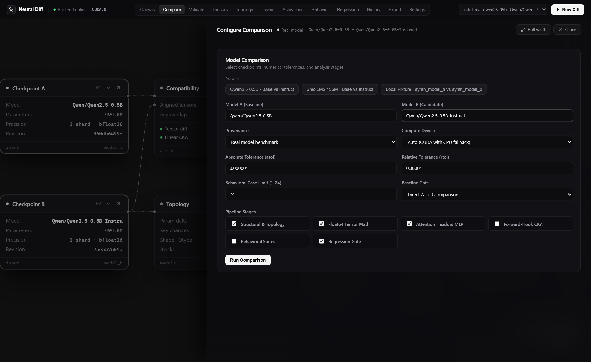

### 03. 检查点兼容性与架构元数据校验（`Qwen/Qwen2.5-0.5B` vs `Instruct`）
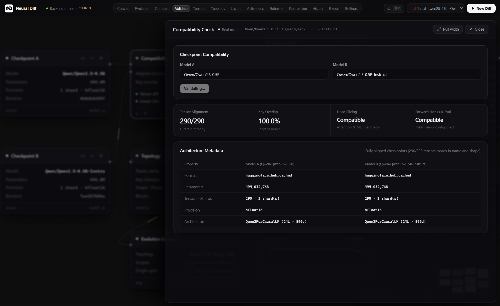

### 04. Float64 张量浏览器与按需 SVD 有效秩 / 稀疏度探测
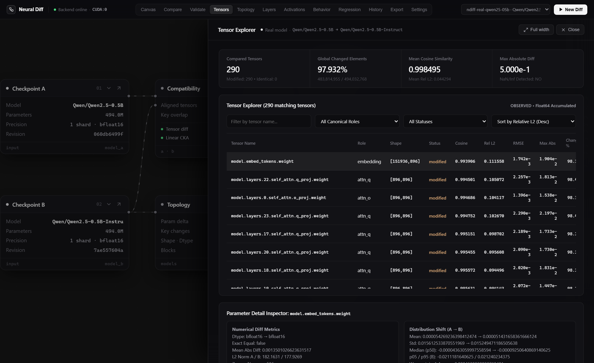

### 05. 跨架构拓扑结构对比（`Qwen2.5-0.5B` 24 层 vs `SmolLM2-135M` 30 层）
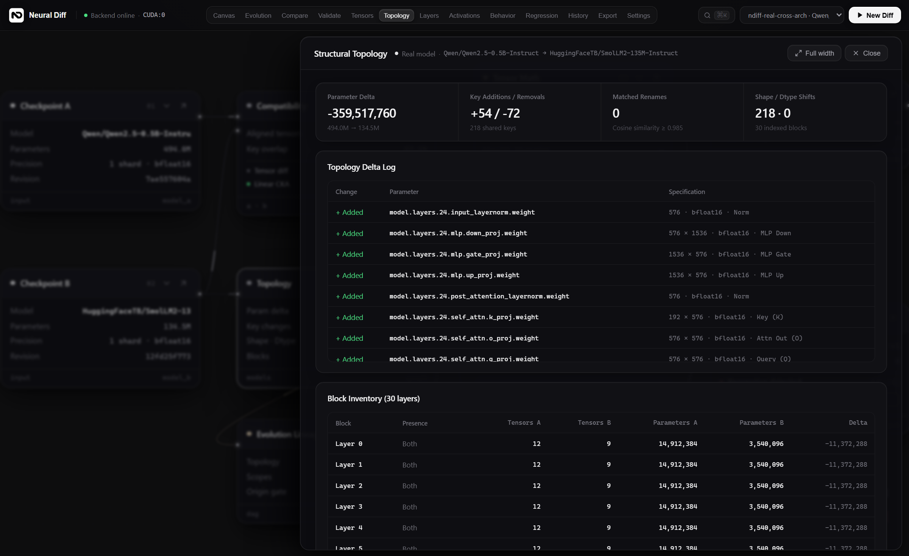

### 06. 24 层子模块相对 $L_2$ 热力图与 GQA 注意力头分歧条形图
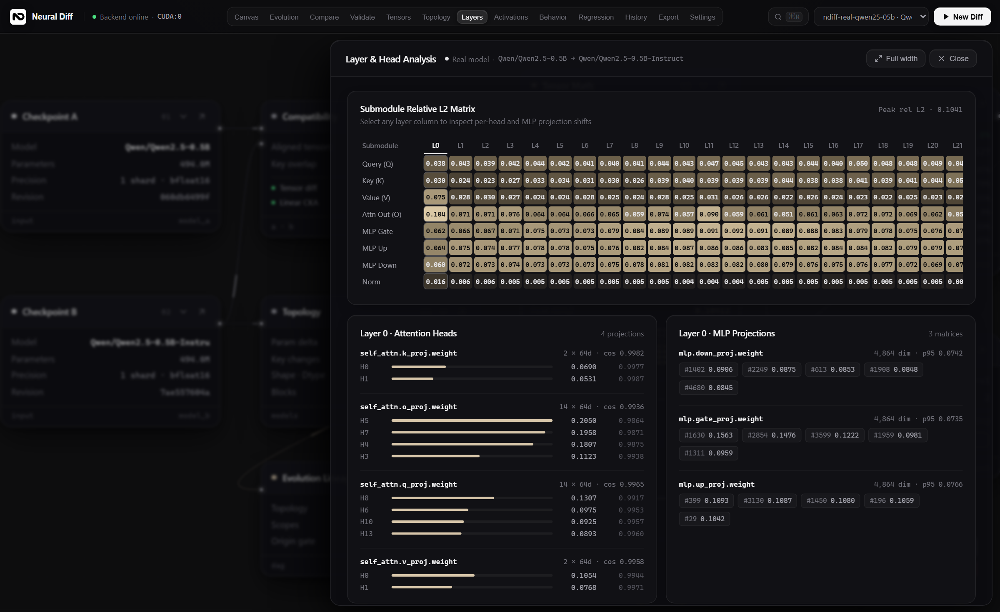

### 07. 前向钩子激活对齐、线性 CKA 与 Top-5 下一词元概率分布
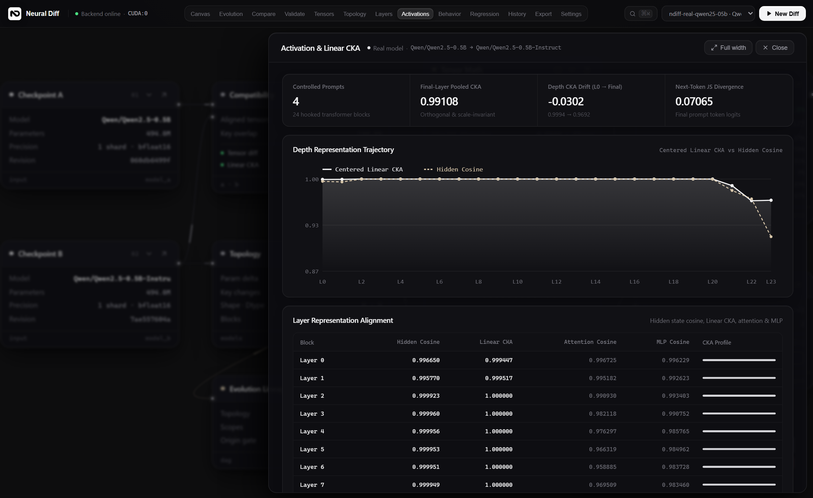

### 08. 8 大确定性行为套件与主从分栏（Master-Detail）配对输出对比


### 09. 回归门禁裁决、阈值发现与一键复制 CLI 复现指令
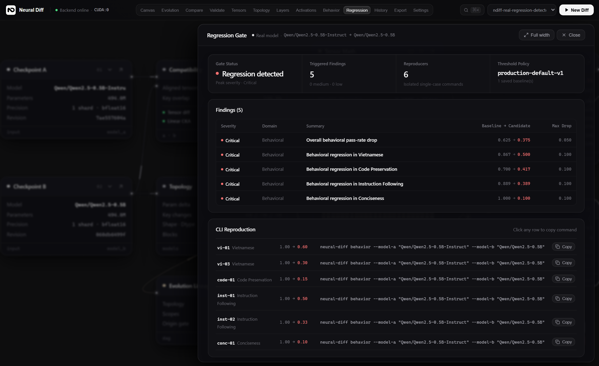

### 10. SQLite 实验历史台账与运行耗时审计
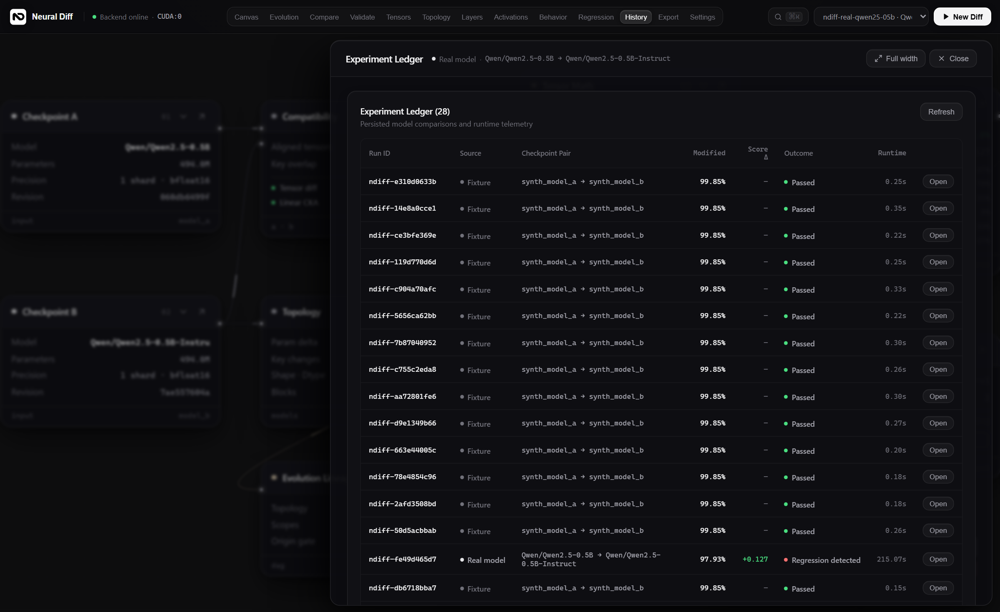

### 11. 多格式报告预览与导出（独立 SVG HTML / Markdown / JSON）
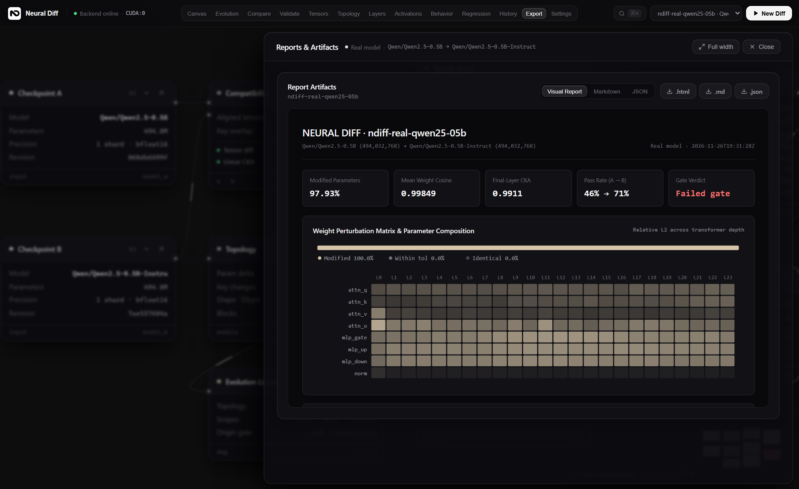

### 12. 自动化测试与代码语句覆盖率总览（55 项 Python 测试通过，90% 覆盖率）
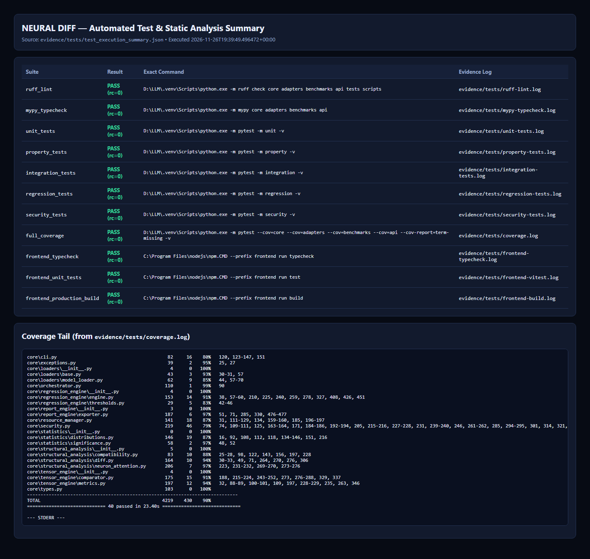

### 13. 路径穿越攻击拦截与结构化安全错误处理（`HTTP 403`）
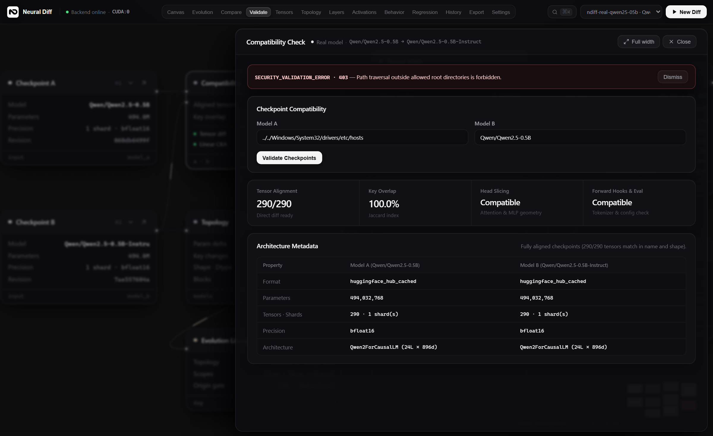

### 14. 运行时计算设备与安全序列化策略设置
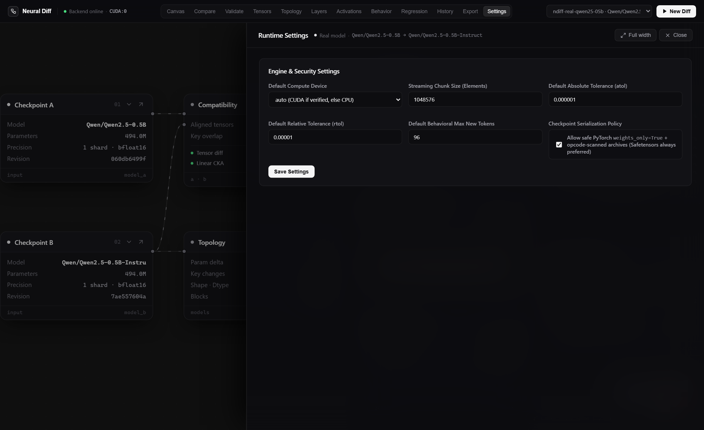

### 15. 正交 PCB 走线模式下的最终工作区状态
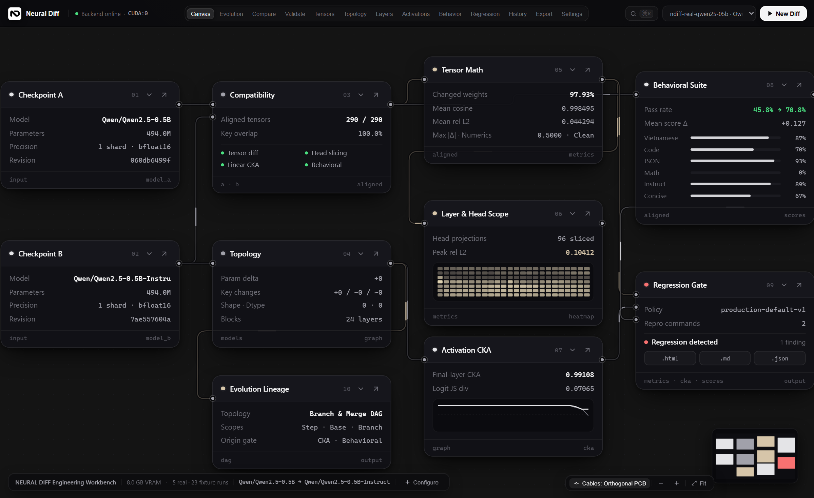

---

## 3. 完整真实基准测试结果（100% 实测数据）

测试硬件环境：**Windows 11 (`10.0.26320`, 16 逻辑核 CPU, `15.71 GB` 内存, `NVIDIA GeForce RTX 5050 Laptop GPU` `sm_120` 8 GB 显存, `CPython 3.12.16`, `PyTorch 2.10.0+cu128`)**。原始记录见 [`evidence/benchmarks/real_model_benchmarks.json`](../../evidence/benchmarks/real_model_benchmarks.json) 与 [`evidence/benchmarks/synthetic_throughput_benchmarks.json`](../../evidence/benchmarks/synthetic_throughput_benchmarks.json)。

### 3.1 真实公开模型对比实验（`REAL MODEL EXPERIMENT`）

| 实验 ID | 模型 A（修订哈希） | 模型 B（修订哈希） | 参数量 | 张量数 | 修改比例 | 平均余弦 | 末层池化 CKA | 行为通过率 ($A \to B$) | 平均得分 $\Delta$ | 耗时 |
| :--- | :--- | :--- | ---: | ---: | ---: | ---: | ---: | ---: | ---: | ---: |
| `ndiff-real-qwen25-05b` | `Qwen/Qwen2.5-0.5B` (`060db6499f`) | `Qwen2.5-0.5B-Instruct` (`7ae557604a`) | 494.03M | 290 | `97.93%` | `0.998495` | `0.991076` | `45.8% → 70.8%` | `+0.1265` | `238.51s` |
| `ndiff-real-smollm2-135m` | `SmolLM2-135M` (`93efa2f097`) | `SmolLM2-135M-Instruct` (`12fd25f773`) | 134.52M | 272 | `97.67%` | `0.996951` | `0.951782` | `20.8% → 33.3%` | `+0.1819` | `191.13s` |
| `ndiff-real-cross-arch` | `Qwen2.5-0.5B-Instruct` | `SmolLM2-135M-Instruct` | 494M vs 135M | 290 vs 272 | 跨架构 | — | `0.966758` | — | — | `4.79s` |
| `ndiff-real-regression-detected` | `Qwen2.5-0.5B-Instruct` | `Qwen2.5-0.5B` | 494.03M | 290 | — | — | — | `62.5% → 37.5%` | `-0.228` | `117.09s` |

* **门禁仓库透明披露（`BLOCKED`）：** 在未配置 `HF_TOKEN` 的匿名环境下请求 `google/gemma-3-270m` 返回 `HTTP 401 Unauthorized`，完整探测响应保存于 [`evidence/model_comparisons/gemma3_270m_access_probe.json`](../../evidence/model_comparisons/gemma3_270m_access_probe.json)。

### 3.2 `Qwen/Qwen2.5-0.5B` $\to$ `Qwen/Qwen2.5-0.5B-Instruct` 八大领域行为明细

| 评测套件 | 用例数 | A 通过率 | B 通过率 | A 均分 | B 均分 | 得分差 $\Delta$ | 提升 / 退化 |
| :--- | ---: | ---: | ---: | ---: | ---: | ---: | ---: |
| **越南语质量** (`vietnamese`) | 3 | `0%` | `67%` | `0.500` | `0.867` | `+0.367` | `+2 / -0` |
| **代码保持** (`code_preservation`) | 3 | `33%` | `67%` | `0.417` | `0.700` | `+0.283` | `+1 / -0` |
| **JSON 结构可靠性** (`json_reliability`) | 3 | `100%` | `100%` | `0.925` | `0.925` | `0.000` | `+0 / -0` |
| **数学推理** (`math_reasoning`) | 3 | `67%` | `0%` | `0.667` | `0.000` | `-0.667` | `+0 / -2` |
| **指令遵循** (`instruction_following`) | 3 | `0%` | `67%` | `0.389` | `0.889` | `+0.500` | `+2 / -0` |
| **简洁性约束** (`conciseness`) | 3 | `0%` | `67%` | `0.338` | `0.667` | `+0.329` | `+2 / -0` |
| **安全拒答** (`refusal_behavior`) | 3 | `67%` | `100%` | `0.800` | `1.000` | `+0.200` | `+1 / -0` |
| **事实准确性** (`factual_accuracy`) | 3 | `100%` | `100%` | `1.000` | `1.000` | `0.000` | `+0 / -0` |

### 3.3 分块流式计算吞吐量与内存开销（`SYNTHETIC FIXTURE EXPERIMENT`）

| 基准 ID | 元素数量 | 数据类型 | 分块大小 | 耗时 | 吞吐量（百万元素/秒） | 进程内存增量 (RSS) |
| :--- | ---: | :--- | ---: | ---: | ---: | ---: |
| `1M_float32_chunk1M` | 1,000,000 | `float32` | 1,048,576 | `0.0123s` | `81.080M/s` | `+49.59 MB` |
| `10M_float32_chunk256k` | 10,000,000 | `float32` | 262,144 | `0.0891s` | `112.188M/s` | **`+0.54 MB`** |
| `10M_float32_chunk1M` | 10,000,000 | `float32` | 1,048,576 | `0.0857s` | **`116.645M/s`** | `+24.94 MB` |
| `10M_bfloat16_chunk1M` | 10,000,000 | `bfloat16` | 1,048,576 | `0.0971s` | `102.934M/s` | `+22.82 MB` |
| `25M_bfloat16_chunk2M` | 25,000,000 | `bfloat16` | 2,097,152 | `0.2628s` | `95.124M/s` | `+87.70 MB` |
| `safetensors_lazy_stream` | 4,194,304 | `bfloat16` | Lazy mmap | `0.2950s` | — | **`+0.52 MB`** |

---

## 4. 可复现安装与启动指南

```powershell
cd d:\LLM
python -m uv sync
npm --prefix frontend ci

# 启动后端与前端工作室
.\.venv\Scripts\python.exe -m uvicorn api.app:app --host 127.0.0.1 --port 8000
npm --prefix frontend run dev

# 执行全套自动化测试与 SHA-256 证据清单校验
.\.venv\Scripts\python.exe scripts/run_all_tests.py
.\.venv\Scripts\python.exe scripts/verify_evidence.py
```

## 开源许可

基于 [MIT License](../../LICENSE) 授权发布。
