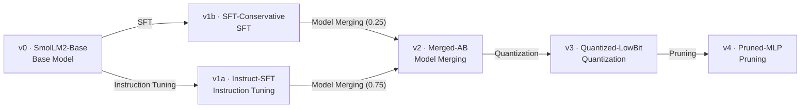

# NEURAL DIFF · Evolution Report — `SmolLM2-135M Post-Training & Compression DAG`

| Project ID | Run ID | Checkpoints | Branches | Regressions | Peak Direct L2 |
| :--- | :--- | ---: | ---: | ---: | ---: |
| `evo-smollm2-dag` | `evorun-real-smollm2` | 6 | 2 | 14 | `264.2170` |

## Empirical Findings

| Domain | Evidence | Observation | Scope |
| :--- | :--- | :--- | :--- |
| Weight evolution | Observed | Instruction Tuning (v0 · SmolLM2-Base → v1a · Instruct-SFT) introduced the largest observed weight perturbation (Relative L2 = 0.085753, RMSE = 0.015576, 97.67% parameters modified). | `2 checkpoints` |
| Weight evolution | Observed | Direct cumulative L2 distance from v0 · SmolLM2-Base to v4 · Pruned-MLP is 264.216986 versus 518.110991 summed across individual transitions (direct/sum ratio = 0.5100), reflecting non-collinear multi-stage parameter updates. | `2 checkpoints` |
| Representation evolution | Observed | Most representation drift occurred between v1b · SFT-Conservative and v2 · Merged-AB (Model Merging: mean Linear CKA = 0.835273, drift = 0.164727). | `2 checkpoints` |
| Behavioral evolution | Observed | Rubric 'instruction_following' mean score increased after Instruction Tuning (v0 · SmolLM2-Base → v1a · Instruct-SFT, Δ=+0.278) and decreased downstream after Model Merging (v1a · Instruct-SFT → v2 · Merged-AB, Δ=-0.056, n=3 (exploratory small sample)). | `3 checkpoints` |
| Regression origin | Correlated | SFT (v0 · SmolLM2-Base → v1b · SFT-Conservative) is the first observed transition associated with regression in 'conciseness' (pass rate 33.3% → 0.0%, score 0.608 → 0.122, exploratory n=3, Holm p=1.000, failed cases: conc-03). | `conc-03` |
| Layer evolution | Observed | Layer 0 exhibited an unusually concentrated weight modification (peak Relative L2 = 0.138055, z-score = +5.03). | `0 checkpoints` |

## Direct Cumulative Weight Trajectory (`Base → Current`)

| Checkpoint | Stage | Direct L2 | Step Sum L2 | Direct / Sum | Cosine | Magnitude |
| :--- | :--- | ---: | ---: | ---: | ---: | :--- |
| `v0 · SmolLM2-Base` | Base Model | `0.0000` | `0.0000` | `1.000` | `1.00000` | `░░░░░░░░░░░░` |
| `v1a · Instruct-SFT` | Instruction Tuning | `180.6458` | `180.6458` | `1.000` | `0.99634` | `████████░░░░` |
| `v1b · SFT-Conservative` | SFT | `63.2538` | `63.2538` | `1.000` | `0.99955` | `███░░░░░░░░░` |
| `v2 · Merged-AB` | Model Merging | `151.2651` | `210.2947` | `0.719` | `0.99743` | `███████░░░░░` |
| `v3 · Quantized-LowBit` | Quantization | `213.1721` | `360.7001` | `0.591` | `0.99490` | `██████████░░` |
| `v4 · Pruned-MLP` | Pruning | `264.2170` | `518.1110` | `0.510` | `0.99214` | `████████████` |

## Behavioral Capability Trajectory (`neural-diff-core-v1@1.0.0`, n=24)

| Version | Stage | Pass Rate | 95% Wilson CI | Mean Score | Pass Profile |
| :--- | :--- | ---: | :--- | ---: | :--- |
| `v0 · SmolLM2-Base` | Base Model | `20.8%` | `[9%, 40%]` | `0.405` | `██░░░░░░░░░░` |
| `v1a · Instruct-SFT` | Instruction Tuning | `33.3%` | `[18%, 53%]` | `0.595` | `████░░░░░░░░` |
| `v1b · SFT-Conservative` | SFT | `20.8%` | `[9%, 40%]` | `0.334` | `██░░░░░░░░░░` |
| `v2 · Merged-AB` | Model Merging | `37.5%` | `[21%, 57%]` | `0.559` | `████░░░░░░░░` |
| `v3 · Quantized-LowBit` | Quantization | `33.3%` | `[18%, 53%]` | `0.425` | `████░░░░░░░░` |
| `v4 · Pruned-MLP` | Pruning | `16.7%` | `[7%, 36%]` | `0.356` | `██░░░░░░░░░░` |

## Representation Alignment (`Centered Linear CKA vs Base`)

| Version | Stage | Mean CKA | Drift (1−CKA) | Alignment |
| :--- | :--- | ---: | ---: | :--- |
| `v0 · SmolLM2-Base` | Base Model | `1.0000` | `0.0000` | `████████████` |
| `v1a · Instruct-SFT` | Instruction Tuning | `0.8522` | `0.1478` | `██████████░░` |
| `v1b · SFT-Conservative` | SFT | `0.8728` | `0.1272` | `██████████░░` |
| `v2 · Merged-AB` | Model Merging | `0.8517` | `0.1483` | `██████████░░` |
| `v3 · Quantized-LowBit` | Quantization | `0.8553` | `0.1447` | `██████████░░` |
| `v4 · Pruned-MLP` | Pruning | `0.8481` | `0.1519` | `██████████░░` |

## Regression Origin Pinpointing

| Transition | Stage | Category | Pass-Rate Reg | Score Reg | Causal Verified | Pass / Score Shift | Evidence |
| :--- | :--- | :--- | :---: | :---: | :---: | ---: | :--- |
| `v0 · SmolLM2-Base → v1b · SFT-Conservative` | SFT | conciseness | `Yes` | `Yes` | `No` | `33.3% → 0.0%` · `0.61→0.12` | Correlated |
| `v2 · Merged-AB → v3 · Quantized-LowBit` | Quantization | Code preservation | `Yes` | `Yes` | `No` | `66.7% → 33.3%` · `0.70→0.47` | Causal support |
| `v3 · Quantized-LowBit → v4 · Pruned-MLP` | Pruning | Factual accuracy | `Yes` | `Yes` | `No` | `66.7% → 33.3%` · `0.67→0.33` | Correlated |
| `v2 · Merged-AB → v3 · Quantized-LowBit` | Quantization | Json reliability | `Yes` | `Yes` | `No` | `66.7% → 33.3%` · `0.64→0.34` | Causal support |
| `v3 · Quantized-LowBit → v4 · Pruned-MLP` | Pruning | Refusal behavior | `Yes` | `Yes` | `No` | `66.7% → 33.3%` · `0.80→0.53` | Correlated |
| `v0 · SmolLM2-Base → v1a · Instruct-SFT` | Instruction Tuning | conciseness | `Yes` | `No` | `No` | `33.3% → 0.0%` · `0.61→0.78` | Correlated |
| `v3 · Quantized-LowBit → v4 · Pruned-MLP` | Pruning | Instruction following | `Yes` | `Yes` | `No` | `33.3% → 0.0%` · `0.61→0.39` | Correlated |
| `v1b · SFT-Conservative → v2 · Merged-AB` | Model Merging | Math reasoning | `Yes` | `Yes` | `No` | `33.3% → 0.0%` · `0.33→0.00` | Correlated |
| `v0 · SmolLM2-Base → v1b · SFT-Conservative` | SFT | Json reliability | `No` | `Yes` | `No` | `0.0% → 0.0%` · `0.32→0.03` | Correlated |
| `v1a · Instruct-SFT → v2 · Merged-AB` | Model Merging | Json reliability | `No` | `Yes` | `No` | `66.7% → 66.7%` · `0.93→0.64` | Correlated |
| `v0 · SmolLM2-Base → v1b · SFT-Conservative` | SFT | vietnamese | `No` | `Yes` | `No` | `0.0% → 0.0%` · `0.32→0.15` | Correlated |
| `v2 · Merged-AB → v3 · Quantized-LowBit` | Quantization | overall | `No` | `Yes` | `No` | `37.5% → 33.3%` · `0.56→0.43` | Correlated |
| `v0 · SmolLM2-Base → v1b · SFT-Conservative` | SFT | Code preservation | `No` | `Yes` | `No` | `0.0% → 0.0%` · `0.20→0.07` | Correlated |
| `v2 · Merged-AB → v3 · Quantized-LowBit` | Quantization | vietnamese | `No` | `Yes` | `No` | `0.0% → 0.0%` · `0.28→0.15` | Correlated |

## Provenance

| Parameter | Value |
| :--- | :--- |
| Content Cache Key | `dcd6008e81cb40878e7168a29bf55ae192d58708ba57dec6a2889ec47bf705c8` |
| Device & Seed | `cuda:0` · seed `42` |
| Dataset SHA-256 | `af4eb4452a640ee386ca8921` |
