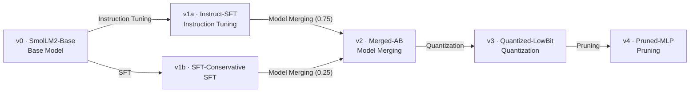

# NEURAL DIFF · Evolution Report — `SmolLM2-135M Post-Training & Compression DAG`

| Project ID | Run ID | Checkpoints | Branches | Regressions | Peak Direct L2 |
| :--- | :--- | ---: | ---: | ---: | ---: |
| `evo-smollm2-dag` | `evorun-real-smollm2` | 6 | 2 | 12 | `293.2059` |

## Empirical Findings

| Domain | Evidence | Observation | Scope |
| :--- | :--- | :--- | :--- |
| Weight evolution | Observed | Quantization (v2 · Merged-AB → v3 · Quantized-LowBit) introduced the largest observed weight perturbation (Relative L2 = 0.119012, RMSE = 0.021662, 98.71% parameters modified). | `2 checkpoints` |
| Weight evolution | Observed | Direct cumulative L2 distance from v0 · SmolLM2-Base to v3 · Quantized-LowBit is 293.205943 versus 461.536515 summed across individual transitions (direct/sum ratio = 0.6353), reflecting non-collinear multi-stage parameter updates. | `2 checkpoints` |
| Representation evolution | Observed | Most representation drift occurred between v1b · SFT-Conservative and v2 · Merged-AB (Model Merging: mean Linear CKA = 0.835273, drift = 0.164727). | `2 checkpoints` |
| Behavioral evolution | Observed | Category 'instruction_following' improved after Instruction Tuning (v0 · SmolLM2-Base → v1a · Instruct-SFT, Δ=+0.278) but declined downstream after Model Merging (v1a · Instruct-SFT → v2 · Merged-AB, Δ=-0.056, n=3). | `3 checkpoints` |
| Regression origin | Causally verified | Quantization (v2 · Merged-AB → v3 · Quantized-LowBit) is the first observed transition associated with regression in 'code_preservation' (pass rate 66.7% → 0.0%, failed cases: code-01, code-03). | `code-01, code-03` |
| Layer evolution | Observed | Layer 0 exhibited an unusually concentrated weight modification (peak Relative L2 = 0.140196, z-score = +5.21). | `0 checkpoints` |

## Direct Cumulative Weight Trajectory (`Base → Current`)

| Checkpoint | Stage | Direct L2 | Step Sum L2 | Direct / Sum | Cosine | Magnitude |
| :--- | :--- | ---: | ---: | ---: | ---: | :--- |
| `v0 · SmolLM2-Base` | Base Model | `0.0000` | `0.0000` | `1.000` | `1.00000` | `░░░░░░░░░░░░` |
| `v1a · Instruct-SFT` | Instruction Tuning | `180.6458` | `180.6458` | `1.000` | `0.99634` | `███████░░░░░` |
| `v1b · SFT-Conservative` | SFT | `63.2538` | `63.2538` | `1.000` | `0.99955` | `███░░░░░░░░░` |
| `v2 · Merged-AB` | Model Merging | `151.2651` | `210.2947` | `0.719` | `0.99743` | `██████░░░░░░` |
| `v3 · Quantized-LowBit` | Quantization | `293.2059` | `461.5365` | `0.635` | `0.99043` | `████████████` |
| `v4 · Pruned-MLP` | Pruning | `293.2059` | `461.5365` | `0.635` | `0.99043` | `████████████` |

## Behavioral Capability Trajectory (`neural-diff-core-v1@1.0.0`, n=24)

| Version | Stage | Pass Rate | 95% Wilson CI | Mean Score | Pass Profile |
| :--- | :--- | ---: | :--- | ---: | :--- |
| `v0 · SmolLM2-Base` | Base Model | `20.8%` | `[9%, 40%]` | `0.405` | `██░░░░░░░░░░` |
| `v1a · Instruct-SFT` | Instruction Tuning | `33.3%` | `[18%, 53%]` | `0.595` | `████░░░░░░░░` |
| `v1b · SFT-Conservative` | SFT | `20.8%` | `[9%, 40%]` | `0.334` | `██░░░░░░░░░░` |
| `v2 · Merged-AB` | Model Merging | `37.5%` | `[21%, 57%]` | `0.559` | `████░░░░░░░░` |
| `v3 · Quantized-LowBit` | Quantization | `12.5%` | `[4%, 31%]` | `0.256` | `██░░░░░░░░░░` |
| `v4 · Pruned-MLP` | Pruning | `12.5%` | `[4%, 31%]` | `0.256` | `██░░░░░░░░░░` |

## Representation Alignment (`Centered Linear CKA vs Base`)

| Version | Stage | Mean CKA | Drift (1−CKA) | Alignment |
| :--- | :--- | ---: | ---: | :--- |
| `v0 · SmolLM2-Base` | Base Model | `1.0000` | `0.0000` | `████████████` |
| `v1a · Instruct-SFT` | Instruction Tuning | `0.8522` | `0.1478` | `██████████░░` |
| `v1b · SFT-Conservative` | SFT | `0.8728` | `0.1272` | `██████████░░` |
| `v2 · Merged-AB` | Model Merging | `0.8517` | `0.1483` | `██████████░░` |
| `v3 · Quantized-LowBit` | Quantization | `0.8446` | `0.1554` | `██████████░░` |
| `v4 · Pruned-MLP` | Pruning | `0.8446` | `0.1554` | `██████████░░` |

## Regression Origin Pinpointing

| Transition | Stage | Category | Pass Shift | Evidence | Failed Cases |
| :--- | :--- | :--- | ---: | :--- | :--- |
| `v2 · Merged-AB → v3 · Quantized-LowBit` | Quantization | Code preservation | `66.7% → 0.0%` | Causally verified | `code-01, code-03` |
| `v0 · SmolLM2-Base → v1b · SFT-Conservative` | SFT | conciseness | `33.3% → 0.0%` | Causally verified | `conc-03` |
| `v2 · Merged-AB → v3 · Quantized-LowBit` | Quantization | Factual accuracy | `66.7% → 33.3%` | Causally verified | `fact-01` |
| `v2 · Merged-AB → v3 · Quantized-LowBit` | Quantization | Refusal behavior | `66.7% → 33.3%` | Causally verified | `ref-02` |
| `v0 · SmolLM2-Base → v1a · Instruct-SFT` | Instruction Tuning | conciseness | `33.3% → 0.0%` | Causally verified | `conc-03` |
| `v1b · SFT-Conservative → v2 · Merged-AB` | Model Merging | Math reasoning | `33.3% → 0.0%` | Causally verified | `math-02` |
| `v2 · Merged-AB → v3 · Quantized-LowBit` | Quantization | overall | `37.5% → 12.5%` | Causally verified | `code-01, code-03, json-01, json-03, inst-01` |
| `v0 · SmolLM2-Base → v1b · SFT-Conservative` | SFT | Json reliability | `0.0% → 0.0%` | Causally verified | `—` |
| `v1a · Instruct-SFT → v2 · Merged-AB` | Model Merging | Json reliability | `66.7% → 66.7%` | Causally verified | `—` |
| `v0 · SmolLM2-Base → v1b · SFT-Conservative` | SFT | vietnamese | `0.0% → 0.0%` | Causally verified | `—` |
| `v0 · SmolLM2-Base → v1b · SFT-Conservative` | SFT | Code preservation | `0.0% → 0.0%` | Causally verified | `—` |
| `v2 · Merged-AB → v3 · Quantized-LowBit` | Quantization | Instruction following | `33.3% → 33.3%` | Causally verified | `inst-01` |

## Provenance

| Parameter | Value |
| :--- | :--- |
| Content Cache Key | `d984226c67dc9c7a2a474ec783bdbd503ecf960d4226a25a2ea904c1b080a9b8` |
| Device & Seed | `cuda:0` · seed `42` |
| Dataset SHA-256 | `af4eb4452a640ee386ca8921` |
