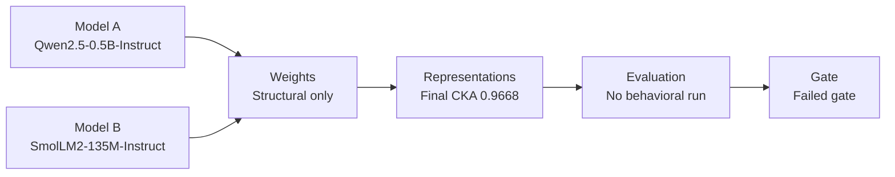

# NEURAL DIFF Report — `ndiff-real-cross-arch`

| Baseline (A) | Candidate (B) | Mode | Gate | Generated (UTC) |
| :--- | :--- | :--- | :--- | :--- |
| `Qwen/Qwen2.5-0.5B-Instruct` (494,032,768) | `HuggingFaceTB/SmolLM2-135M-Instruct` (134,515,008) | Real model | **Failed gate** | `2026-11-26T19:35:27` |

## Key Findings

| Evidence | Observation | Source |
| :--- | :--- | :--- |
| Observed | Model A (494,032,768 params) vs Model B (134,515,008 params) share 218 tensor keys. | Module C — StructuralDiffEngine |
| Unverified | Causal mediation of individual neurons or circuits via counterfactual activation patching was not executed in this observational diff run. | Epistemic boundary declaration (Causal Patching Gate) |

## Architecture & Alignment

| Shared Tensors | Added | Removed | Renamed (Inferred) | Shape Δ | Dtype Δ | Param Δ |
| ---: | ---: | ---: | ---: | ---: | ---: | ---: |
| 218 | 54 | 72 | 0 | 218 | 0 | `-359,517,760` |

## Representation Geometry

| Prompts | Final-Layer Linear CKA | Next-Token Logit JS |
| ---: | ---: | ---: |
| 4 | `0.96676` | `—` |

| Layer | Linear CKA | Hidden Cosine | CKA Alignment |
| :--- | ---: | ---: | :--- |
| `L0` | `0.90741` | `—` | `█████████████░` |
| `L1` | `0.53046` | `—` | `███████░░░░░░░` |
| `L2` | `0.99922` | `—` | `██████████████` |
| `L3` | `0.99907` | `—` | `██████████████` |
| `L4` | `0.99930` | `—` | `██████████████` |
| `L5` | `0.99933` | `—` | `██████████████` |
| `L6` | `0.99877` | `—` | `██████████████` |
| `L7` | `0.99780` | `—` | `██████████████` |
| `L8` | `0.99323` | `—` | `██████████████` |
| `L9` | `0.46258` | `—` | `██████░░░░░░░░` |
| `L10` | `0.58266` | `—` | `████████░░░░░░` |
| `L11` | `0.99999` | `—` | `██████████████` |
| `L12` | `1.00000` | `—` | `██████████████` |
| `L13` | `1.00000` | `—` | `██████████████` |
| `L14` | `0.99999` | `—` | `██████████████` |
| `L15` | `0.99999` | `—` | `██████████████` |
| `L16` | `0.99999` | `—` | `██████████████` |
| `L17` | `0.99999` | `—` | `██████████████` |
| `L18` | `0.99999` | `—` | `██████████████` |
| `L19` | `0.99999` | `—` | `██████████████` |
| `L20` | `0.99999` | `—` | `██████████████` |
| `L21` | `0.66886` | `—` | `█████████░░░░░` |
| `L22` | `0.74868` | `—` | `██████████░░░░` |
| `L23` | `0.53127` | `—` | `███████░░░░░░░` |

## Regression Gate — Failed gate (`production-default-v1`)

| Severity | Evidence | Finding | Detail |
| :--- | :--- | :--- | :--- |
| High | Observed | **Removed tensors detected in candidate model** | 72 tensor(s) were removed. |

## Provenance

| Parameter | Value |
| :--- | :--- |
| Platform | `Windows-11-10.0.26320-SP0` |
| Python / PyTorch | `3.12.16` / `2.10.0+cu128` |
| Transformers / Safetensors | `5.24.1` / `0.8.0` |
| Executed Modules | `structural, activation, regression` |
