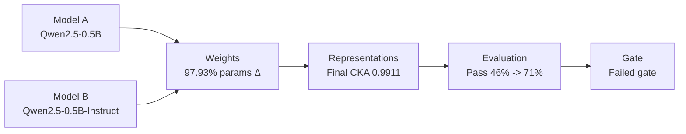

# NEURAL DIFF Report — `ndiff-real-qwen25-05b`

| Baseline (A) | Candidate (B) | Mode | Gate | Generated (UTC) |
| :--- | :--- | :--- | :--- | :--- |
| `Qwen/Qwen2.5-0.5B` (494,032,768) | `Qwen/Qwen2.5-0.5B-Instruct` (494,032,768) | Real model | **Failed gate** | `2026-11-26T19:31:28` |

## Key Findings

| Evidence | Observation | Source |
| :--- | :--- | :--- |
| Observed | Model A (494,032,768 params) vs Model B (494,032,768 params) share 290 tensor keys. | Module C — StructuralDiffEngine |
| Observed | 97.9318% of aligned parameters exceeded numerical tolerance (mean cosine=0.99849455, max abs diff=0.5). | Module B — TensorDiffEngine |
| Correlated | Internal hidden-state and MLP activation shifts co-occurred alongside observed behavioral score deltas; without targeted activation patching, internal-to-behavioral linkage is correlational. | Module E + Module F joint comparison |
| Unverified | Causal mediation of individual neurons or circuits via counterfactual activation patching was not executed in this observational diff run. | Epistemic boundary declaration (Causal Patching Gate) |

## Architecture & Alignment

| Shared Tensors | Added | Removed | Renamed (Inferred) | Shape Δ | Dtype Δ | Param Δ |
| ---: | ---: | ---: | ---: | ---: | ---: | ---: |
| 290 | 0 | 0 | 0 | 0 | 0 | `+0` |

## Weight Perturbation

| Compared | Modified | Changed Params | Mean Cosine | Mean Rel L2 | Max \|Δ\| |
| ---: | ---: | ---: | ---: | ---: | ---: |
| 290 | 290 | `97.93%` (483,814,955) | `0.998495` | `0.044294` | `0.50000` |

### Layer Perturbation Profile

| Layer | Mean Rel L2 | Mean Cosine | Changed % | Magnitude |
| :--- | ---: | ---: | ---: | :--- |
| `L0` | `0.05049` | `0.998281` | `97.4%` | `██████████████` |
| `L1` | `0.04044` | `0.998761` | `97.6%` | `███████████░░░` |
| `L2` | `0.04013` | `0.998781` | `97.6%` | `███████████░░░` |
| `L3` | `0.04165` | `0.998656` | `97.7%` | `████████████░░` |
| `L4` | `0.04177` | `0.998655` | `97.7%` | `████████████░░` |
| `L5` | `0.04166` | `0.998691` | `97.7%` | `████████████░░` |
| `L6` | `0.04154` | `0.998688` | `97.7%` | `████████████░░` |
| `L7` | `0.04151` | `0.998686` | `97.8%` | `████████████░░` |
| `L8` | `0.04126` | `0.998622` | `97.9%` | `███████████░░░` |
| `L9` | `0.04658` | `0.998357` | `97.9%` | `█████████████░` |
| `L10` | `0.04493` | `0.998450` | `98.0%` | `████████████░░` |
| `L11` | `0.04932` | `0.998128` | `98.0%` | `██████████████` |
| `L12` | `0.04549` | `0.998403` | `98.0%` | `█████████████░` |
| `L13` | `0.04518` | `0.998448` | `97.9%` | `█████████████░` |
| `L14` | `0.04431` | `0.998523` | `97.9%` | `████████████░░` |
| `L15` | `0.04422` | `0.998512` | `97.9%` | `████████████░░` |
| `L16` | `0.04320` | `0.998578` | `97.9%` | `████████████░░` |
| `L17` | `0.04580` | `0.998363` | `97.8%` | `█████████████░` |
| `L18` | `0.04467` | `0.998445` | `97.8%` | `████████████░░` |
| `L19` | `0.04444` | `0.998490` | `97.7%` | `████████████░░` |
| `L20` | `0.04393` | `0.998520` | `97.7%` | `████████████░░` |
| `L21` | `0.04478` | `0.998469` | `97.7%` | `████████████░░` |
| `L22` | `0.04726` | `0.998263` | `97.7%` | `█████████████░` |
| `L23` | `0.04533` | `0.998360` | `97.6%` | `█████████████░` |

### Top Diverged Tensors

| Tensor | Role | Cosine | Rel L2 | Max \|Δ\| | Profile |
| :--- | :--- | ---: | ---: | ---: | :--- |
| `model.embed_tokens.weight` | `embedding` | `0.993906` | `0.11156` | `0.01904` | `██████████` |
| `model.layers.22.self_attn.q_proj.weight` | `attn_q` | `0.994501` | `0.10507` | `0.01813` | `█████████░` |
| `model.layers.0.self_attn.o_proj.weight` | `attn_o` | `0.994686` | `0.10412` | `0.01538` | `█████████░` |
| `model.layers.23.self_attn.q_proj.weight` | `attn_q` | `0.994752` | `0.10267` | `0.02197` | `█████████░` |
| `model.layers.17.self_attn.q_proj.weight` | `attn_q` | `0.995151` | `0.09870` | `0.01733` | `█████████░` |
| `model.layers.20.self_attn.q_proj.weight` | `attn_q` | `0.995455` | `0.09561` | `0.01730` | `█████████░` |
| `model.layers.18.self_attn.q_proj.weight` | `attn_q` | `0.995572` | `0.09450` | `0.01831` | `████████░░` |
| `model.layers.19.self_attn.q_proj.weight` | `attn_q` | `0.995631` | `0.09414` | `0.01447` | `████████░░` |
| `model.layers.21.self_attn.q_proj.weight` | `attn_q` | `0.995643` | `0.09374` | `0.01514` | `████████░░` |
| `model.layers.11.self_attn.q_proj.weight` | `attn_q` | `0.995673` | `0.09367` | `0.02734` | `████████░░` |

## Representation Geometry

| Prompts | Final-Layer Linear CKA | Next-Token Logit JS |
| ---: | ---: | ---: |
| 4 | `0.99108` | `0.07065` |

| Layer | Linear CKA | Hidden Cosine | CKA Alignment |
| :--- | ---: | ---: | :--- |
| `L0` | `0.99945` | `0.99665` | `██████████████` |
| `L1` | `0.99952` | `0.99577` | `██████████████` |
| `L2` | `1.00000` | `0.99992` | `██████████████` |
| `L3` | `1.00000` | `0.99996` | `██████████████` |
| `L4` | `1.00000` | `0.99996` | `██████████████` |
| `L5` | `1.00000` | `0.99995` | `██████████████` |
| `L6` | `1.00000` | `0.99995` | `██████████████` |
| `L7` | `1.00000` | `0.99995` | `██████████████` |
| `L8` | `1.00000` | `0.99995` | `██████████████` |
| `L9` | `1.00000` | `0.99994` | `██████████████` |
| `L10` | `1.00000` | `0.99994` | `██████████████` |
| `L11` | `1.00000` | `0.99994` | `██████████████` |
| `L12` | `1.00000` | `0.99993` | `██████████████` |
| `L13` | `1.00000` | `0.99993` | `██████████████` |
| `L14` | `1.00000` | `0.99992` | `██████████████` |
| `L15` | `1.00000` | `0.99991` | `██████████████` |
| `L16` | `1.00000` | `0.99989` | `██████████████` |
| `L17` | `1.00000` | `0.99986` | `██████████████` |
| `L18` | `1.00000` | `0.99983` | `██████████████` |
| `L19` | `1.00000` | `0.99978` | `██████████████` |
| `L20` | `1.00000` | `0.99970` | `██████████████` |
| `L21` | `0.99043` | `0.98343` | `██████████████` |
| `L22` | `0.96856` | `0.97132` | `██████████████` |
| `L23` | `0.96924` | `0.91644` | `██████████████` |

## Behavioral Evaluation (`neural-diff-core-v1@1.0.0`)

| Cases | Pass A → B | Mean Score A → B | 95% Bootstrap CI | McNemar p |
| ---: | :--- | :--- | :--- | ---: |
| 24 | `45.8% → 70.8%` (`+25.0%`) | `0.629 → 0.756` (`+0.127`) | `[-0.054, +0.308]` | `0.1094` |

| Suite | Cases | Score A | Score B | Delta | Candidate Profile |
| :--- | ---: | ---: | ---: | ---: | :--- |
| vietnamese | 3 | `0.500` | `0.867` | `+0.367` | `██████████░░` |
| Code preservation | 3 | `0.417` | `0.700` | `+0.283` | `████████░░░░` |
| Json reliability | 3 | `0.925` | `0.925` | `+0.000` | `███████████░` |
| Math reasoning | 3 | `0.667` | `0.000` | `-0.667` | `░░░░░░░░░░░░` |
| Instruction following | 3 | `0.389` | `0.889` | `+0.500` | `███████████░` |
| conciseness | 3 | `0.338` | `0.667` | `+0.329` | `████████░░░░` |
| Refusal behavior | 3 | `0.800` | `1.000` | `+0.200` | `████████████` |
| Factual accuracy | 3 | `1.000` | `1.000` | `+0.000` | `████████████` |

## Regression Gate — Failed gate (`production-default-v1`)

| Severity | Evidence | Finding | Detail |
| :--- | :--- | :--- | :--- |
| Critical | Observed | **Behavioral regression in 'math_reasoning'** | Category 'math_reasoning' mean score changed 0.667 -> 0.000 (2 regressed case(s)). |

## Provenance

| Parameter | Value |
| :--- | :--- |
| Platform | `Windows-11-10.0.26320-SP0` |
| Python / PyTorch | `3.12.16` / `2.10.0+cu128` |
| Transformers / Safetensors | `5.24.1` / `0.8.0` |
| Executed Modules | `structural, tensor, neuron, activation, behavioral, regression` |
