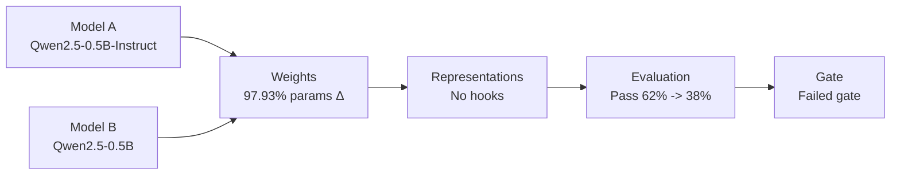

# NEURAL DIFF Report — `ndiff-real-regression-detected`

| Baseline (A) | Candidate (B) | Mode | Gate | Generated (UTC) |
| :--- | :--- | :--- | :--- | :--- |
| `Qwen/Qwen2.5-0.5B-Instruct` (494,032,768) | `Qwen/Qwen2.5-0.5B` (494,032,768) | Real model | **Failed gate** | `2026-11-26T19:35:32` |

## Key Findings

| Evidence | Observation | Source |
| :--- | :--- | :--- |
| Observed | Model A (494,032,768 params) vs Model B (494,032,768 params) share 290 tensor keys. | Module C — StructuralDiffEngine |
| Observed | 97.9318% of aligned parameters exceeded numerical tolerance (mean cosine=0.99849455, max abs diff=0.5). | Module B — TensorDiffEngine |
| Unverified | Causal mediation of individual neurons or circuits via counterfactual activation patching was not executed in this observational diff run. | Epistemic boundary declaration (Causal Patching Gate) |

## Architecture & Alignment

| Shared Tensors | Added | Removed | Renamed (Inferred) | Shape Δ | Dtype Δ | Param Δ |
| ---: | ---: | ---: | ---: | ---: | ---: | ---: |
| 290 | 0 | 0 | 0 | 0 | 0 | `+0` |

## Weight Perturbation

| Compared | Modified | Changed Params | Mean Cosine | Mean Rel L2 | Max \|Δ\| |
| ---: | ---: | ---: | ---: | ---: | ---: |
| 290 | 290 | `97.93%` (483,814,955) | `0.998495` | `0.044997` | `0.50000` |

### Layer Perturbation Profile

| Layer | Mean Rel L2 | Mean Cosine | Changed % | Magnitude |
| :--- | ---: | ---: | ---: | :--- |
| `L0` | `0.05119` | `0.998281` | `97.4%` | `██████████████` |
| `L1` | `0.04115` | `0.998761` | `97.6%` | `███████████░░░` |
| `L2` | `0.04085` | `0.998781` | `97.6%` | `███████████░░░` |
| `L3` | `0.04236` | `0.998656` | `97.7%` | `████████████░░` |
| `L4` | `0.04245` | `0.998655` | `97.7%` | `████████████░░` |
| `L5` | `0.04233` | `0.998691` | `97.7%` | `████████████░░` |
| `L6` | `0.04225` | `0.998688` | `97.7%` | `████████████░░` |
| `L7` | `0.04220` | `0.998686` | `97.8%` | `████████████░░` |
| `L8` | `0.04196` | `0.998622` | `97.9%` | `███████████░░░` |
| `L9` | `0.04739` | `0.998357` | `97.9%` | `█████████████░` |
| `L10` | `0.04569` | `0.998450` | `98.0%` | `████████████░░` |
| `L11` | `0.05022` | `0.998128` | `98.0%` | `██████████████` |
| `L12` | `0.04624` | `0.998403` | `98.0%` | `█████████████░` |
| `L13` | `0.04591` | `0.998448` | `97.9%` | `█████████████░` |
| `L14` | `0.04499` | `0.998523` | `97.9%` | `████████████░░` |
| `L15` | `0.04491` | `0.998512` | `97.9%` | `████████████░░` |
| `L16` | `0.04384` | `0.998578` | `97.9%` | `████████████░░` |
| `L17` | `0.04648` | `0.998363` | `97.8%` | `█████████████░` |
| `L18` | `0.04537` | `0.998445` | `97.8%` | `████████████░░` |
| `L19` | `0.04514` | `0.998490` | `97.7%` | `████████████░░` |
| `L20` | `0.04458` | `0.998520` | `97.7%` | `████████████░░` |
| `L21` | `0.04542` | `0.998469` | `97.7%` | `████████████░░` |
| `L22` | `0.04790` | `0.998263` | `97.7%` | `█████████████░` |
| `L23` | `0.04588` | `0.998360` | `97.6%` | `█████████████░` |

### Top Diverged Tensors

| Tensor | Role | Cosine | Rel L2 | Max \|Δ\| | Profile |
| :--- | :--- | ---: | ---: | ---: | :--- |
| `model.embed_tokens.weight` | `embedding` | `0.993906` | `0.11421` | `0.01904` | `██████████` |
| `model.layers.22.self_attn.q_proj.weight` | `attn_q` | `0.994501` | `0.10656` | `0.01813` | `█████████░` |
| `model.layers.0.self_attn.o_proj.weight` | `attn_o` | `0.994686` | `0.10633` | `0.01538` | `█████████░` |
| `model.layers.23.self_attn.q_proj.weight` | `attn_q` | `0.994752` | `0.10410` | `0.02197` | `█████████░` |
| `model.layers.17.self_attn.q_proj.weight` | `attn_q` | `0.995151` | `0.10000` | `0.01733` | `█████████░` |
| `model.layers.20.self_attn.q_proj.weight` | `attn_q` | `0.995455` | `0.09687` | `0.01730` | `████████░░` |
| `model.layers.18.self_attn.q_proj.weight` | `attn_q` | `0.995572` | `0.09585` | `0.01831` | `████████░░` |
| `model.layers.19.self_attn.q_proj.weight` | `attn_q` | `0.995631` | `0.09571` | `0.01447` | `████████░░` |
| `model.layers.11.self_attn.q_proj.weight` | `attn_q` | `0.995673` | `0.09519` | `0.02734` | `████████░░` |
| `model.layers.21.self_attn.q_proj.weight` | `attn_q` | `0.995643` | `0.09507` | `0.01514` | `████████░░` |

## Behavioral Evaluation (`neural-diff-core-v1@1.0.0`)

| Cases | Pass A → B | Mean Score A → B | 95% Bootstrap CI | McNemar p |
| ---: | :--- | :--- | :--- | ---: |
| 16 | `62.5% → 37.5%` (`-25.0%`) | `0.696 → 0.549` (`-0.147`) | `[-0.400, +0.140]` | `0.2891` |

| Suite | Cases | Score A | Score B | Delta | Candidate Profile |
| :--- | ---: | ---: | ---: | ---: | :--- |
| vietnamese | 3 | `0.867` | `0.500` | `-0.367` | `██████░░░░░░` |
| Code preservation | 3 | `0.700` | `0.417` | `-0.283` | `█████░░░░░░░` |
| Json reliability | 3 | `0.925` | `0.925` | `+0.000` | `███████████░` |
| Math reasoning | 3 | `0.000` | `0.667` | `+0.667` | `████████░░░░` |
| Instruction following | 3 | `0.889` | `0.389` | `-0.500` | `█████░░░░░░░` |
| conciseness | 1 | `1.000` | `0.100` | `-0.900` | `█░░░░░░░░░░░` |

## Regression Gate — Failed gate (`production-default-v1`)

| Severity | Evidence | Finding | Detail |
| :--- | :--- | :--- | :--- |
| Critical | Observed | **Overall behavioral pass-rate drop** | Pass rate decreased from 62.5% to 37.5% (drop=25.0%). |
| Critical | Observed | **Behavioral regression in 'vietnamese'** | Category 'vietnamese' mean score changed 0.867 -> 0.500 (2 regressed case(s)). |
| Critical | Observed | **Behavioral regression in 'code_preservation'** | Category 'code_preservation' mean score changed 0.700 -> 0.417 (1 regressed case(s)). |
| Critical | Observed | **Behavioral regression in 'instruction_following'** | Category 'instruction_following' mean score changed 0.889 -> 0.389 (2 regressed case(s)). |
| Critical | Observed | **Behavioral regression in 'conciseness'** | Category 'conciseness' mean score changed 1.000 -> 0.100 (1 regressed case(s)). |

## Provenance

| Parameter | Value |
| :--- | :--- |
| Platform | `Windows-11-10.0.26320-SP0` |
| Python / PyTorch | `3.12.16` / `2.10.0+cu128` |
| Transformers / Safetensors | `5.24.1` / `0.8.0` |
| Executed Modules | `structural, tensor, behavioral, regression` |
