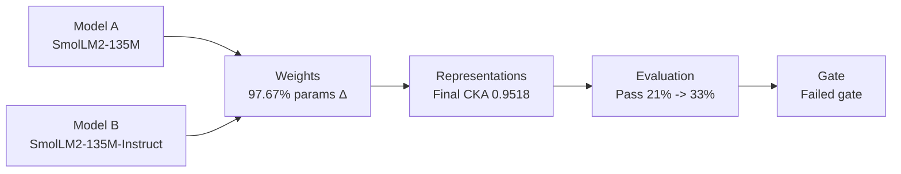

# NEURAL DIFF Report — `ndiff-real-smollm2-135m`

| Baseline (A) | Candidate (B) | Mode | Gate | Generated (UTC) |
| :--- | :--- | :--- | :--- | :--- |
| `HuggingFaceTB/SmolLM2-135M` (134,515,008) | `HuggingFaceTB/SmolLM2-135M-Instruct` (134,515,008) | Real model | **Failed gate** | `2026-11-26T19:28:16` |

## Key Findings

| Evidence | Observation | Source |
| :--- | :--- | :--- |
| Observed | Model A (134,515,008 params) vs Model B (134,515,008 params) share 272 tensor keys. | Module C — StructuralDiffEngine |
| Observed | 97.6728% of aligned parameters exceeded numerical tolerance (mean cosine=0.99695139, max abs diff=0.154296875). | Module B — TensorDiffEngine |
| Correlated | Internal hidden-state and MLP activation shifts co-occurred alongside observed behavioral score deltas; without targeted activation patching, internal-to-behavioral linkage is correlational. | Module E + Module F joint comparison |
| Unverified | Causal mediation of individual neurons or circuits via counterfactual activation patching was not executed in this observational diff run. | Epistemic boundary declaration (Causal Patching Gate) |

## Architecture & Alignment

| Shared Tensors | Added | Removed | Renamed (Inferred) | Shape Δ | Dtype Δ | Param Δ |
| ---: | ---: | ---: | ---: | ---: | ---: | ---: |
| 272 | 0 | 0 | 0 | 0 | 0 | `+0` |

## Weight Perturbation

| Compared | Modified | Changed Params | Mean Cosine | Mean Rel L2 | Max \|Δ\| |
| ---: | ---: | ---: | ---: | ---: | ---: |
| 272 | 272 | `97.67%` (131,384,568) | `0.996951` | `0.068691` | `0.15430` |

### Layer Perturbation Profile

| Layer | Mean Rel L2 | Mean Cosine | Changed % | Magnitude |
| :--- | ---: | ---: | ---: | :--- |
| `L0` | `0.13806` | `0.984452` | `97.6%` | `██████████████` |
| `L1` | `0.07495` | `0.996892` | `97.7%` | `████████░░░░░░` |
| `L2` | `0.07200` | `0.996936` | `97.5%` | `███████░░░░░░░` |
| `L3` | `0.06422` | `0.997616` | `97.5%` | `███████░░░░░░░` |
| `L4` | `0.06400` | `0.997674` | `97.5%` | `██████░░░░░░░░` |
| `L5` | `0.06327` | `0.997765` | `97.5%` | `██████░░░░░░░░` |
| `L6` | `0.06154` | `0.997901` | `97.4%` | `██████░░░░░░░░` |
| `L7` | `0.06128` | `0.997910` | `97.4%` | `██████░░░░░░░░` |
| `L8` | `0.06250` | `0.997837` | `97.4%` | `██████░░░░░░░░` |
| `L9` | `0.06354` | `0.997752` | `97.4%` | `██████░░░░░░░░` |
| `L10` | `0.06288` | `0.997807` | `97.3%` | `██████░░░░░░░░` |
| `L11` | `0.06139` | `0.997958` | `97.3%` | `██████░░░░░░░░` |
| `L12` | `0.05990` | `0.997976` | `97.2%` | `██████░░░░░░░░` |
| `L13` | `0.06202` | `0.997817` | `97.3%` | `██████░░░░░░░░` |
| `L14` | `0.06282` | `0.997713` | `97.4%` | `██████░░░░░░░░` |
| `L15` | `0.06720` | `0.997360` | `97.6%` | `███████░░░░░░░` |
| `L16` | `0.06357` | `0.997647` | `97.5%` | `██████░░░░░░░░` |
| `L17` | `0.06388` | `0.997587` | `97.4%` | `██████░░░░░░░░` |
| `L18` | `0.06614` | `0.997379` | `97.4%` | `███████░░░░░░░` |
| `L19` | `0.05961` | `0.997879` | `97.1%` | `██████░░░░░░░░` |
| `L20` | `0.06521` | `0.997426` | `97.4%` | `███████░░░░░░░` |
| `L21` | `0.07398` | `0.996728` | `97.8%` | `████████░░░░░░` |
| `L22` | `0.07142` | `0.996926` | `97.6%` | `███████░░░░░░░` |
| `L23` | `0.06686` | `0.997233` | `97.4%` | `███████░░░░░░░` |
| `L24` | `0.07147` | `0.996742` | `97.6%` | `███████░░░░░░░` |
| `L25` | `0.07818` | `0.996276` | `97.9%` | `████████░░░░░░` |
| `L26` | `0.07487` | `0.996454` | `97.8%` | `████████░░░░░░` |
| `L27` | `0.06665` | `0.997185` | `97.5%` | `███████░░░░░░░` |

### Top Diverged Tensors

| Tensor | Role | Cosine | Rel L2 | Max \|Δ\| | Profile |
| :--- | :--- | ---: | ---: | ---: | :--- |
| `model.layers.0.self_attn.v_proj.weight` | `attn_v` | `0.949790` | `0.32779` | `0.06982` | `██████████` |
| `model.layers.0.input_layernorm.weight` | `norm` | `0.947746` | `0.32347` | `0.04742` | `██████████` |
| `model.layers.0.self_attn.o_proj.weight` | `attn_o` | `0.973707` | `0.23310` | `0.07141` | `███████░░░` |
| `model.layers.2.self_attn.v_proj.weight` | `attn_v` | `0.990821` | `0.13624` | `0.07446` | `████░░░░░░` |
| `model.layers.28.self_attn.q_proj.weight` | `attn_q` | `0.992337` | `0.12410` | `0.10840` | `████░░░░░░` |
| `model.layers.26.self_attn.k_proj.weight` | `attn_k` | `0.992707` | `0.12113` | `0.09180` | `████░░░░░░` |
| `model.layers.1.self_attn.v_proj.weight` | `attn_v` | `0.992785` | `0.12097` | `0.06537` | `████░░░░░░` |
| `model.layers.26.self_attn.q_proj.weight` | `attn_q` | `0.992829` | `0.12013` | `0.14188` | `████░░░░░░` |
| `model.layers.25.self_attn.q_proj.weight` | `attn_q` | `0.992817` | `0.12010` | `0.10840` | `████░░░░░░` |
| `model.layers.24.self_attn.k_proj.weight` | `attn_k` | `0.992939` | `0.11946` | `0.11377` | `████░░░░░░` |

## Representation Geometry

| Prompts | Final-Layer Linear CKA | Next-Token Logit JS |
| ---: | ---: | ---: |
| 4 | `0.95178` | `0.20172` |

| Layer | Linear CKA | Hidden Cosine | CKA Alignment |
| :--- | ---: | ---: | :--- |
| `L0` | `0.98066` | `0.95708` | `██████████████` |
| `L1` | `0.81032` | `0.92929` | `███████████░░░` |
| `L2` | `0.69574` | `0.85426` | `██████████░░░░` |
| `L3` | `0.69481` | `0.85676` | `██████████░░░░` |
| `L4` | `0.69333` | `0.85739` | `██████████░░░░` |
| `L5` | `0.69370` | `0.85900` | `██████████░░░░` |
| `L6` | `0.69315` | `0.86215` | `██████████░░░░` |
| `L7` | `0.68634` | `0.86447` | `██████████░░░░` |
| `L8` | `0.67131` | `0.87302` | `█████████░░░░░` |
| `L9` | `0.75108` | `0.92275` | `███████████░░░` |
| `L10` | `0.98675` | `0.96149` | `██████████████` |
| `L11` | `1.00000` | `0.99983` | `██████████████` |
| `L12` | `1.00000` | `0.99983` | `██████████████` |
| `L13` | `1.00000` | `0.99982` | `██████████████` |
| `L14` | `1.00000` | `0.99982` | `██████████████` |
| `L15` | `1.00000` | `0.99981` | `██████████████` |
| `L16` | `1.00000` | `0.99980` | `██████████████` |
| `L17` | `1.00000` | `0.99980` | `██████████████` |
| `L18` | `1.00000` | `0.99980` | `██████████████` |
| `L19` | `1.00000` | `0.99977` | `██████████████` |
| `L20` | `1.00000` | `0.99976` | `██████████████` |
| `L21` | `0.99999` | `0.99971` | `██████████████` |
| `L22` | `0.99999` | `0.99966` | `██████████████` |
| `L23` | `0.99998` | `0.99956` | `██████████████` |
| `L24` | `0.99998` | `0.99942` | `██████████████` |
| `L25` | `0.99998` | `0.99932` | `██████████████` |
| `L26` | `0.99998` | `0.99919` | `██████████████` |
| `L27` | `0.99998` | `0.99855` | `██████████████` |

## Behavioral Evaluation (`neural-diff-core-v1@1.0.0`)

| Cases | Pass A → B | Mean Score A → B | 95% Bootstrap CI | McNemar p |
| ---: | :--- | :--- | :--- | ---: |
| 24 | `20.8% → 33.3%` (`+12.5%`) | `0.432 → 0.614` (`+0.182`) | `[+0.043, +0.349]` | `0.3750` |

| Suite | Cases | Score A | Score B | Delta | Candidate Profile |
| :--- | ---: | ---: | ---: | ---: | :--- |
| vietnamese | 3 | `0.500` | `0.383` | `-0.117` | `█████░░░░░░░` |
| Code preservation | 3 | `0.200` | `0.750` | `+0.550` | `█████████░░░` |
| Json reliability | 3 | `0.350` | `0.925` | `+0.575` | `███████████░` |
| Math reasoning | 3 | `0.000` | `0.000` | `+0.000` | `░░░░░░░░░░░░` |
| Instruction following | 3 | `0.333` | `0.611` | `+0.278` | `███████░░░░░` |
| conciseness | 3 | `0.608` | `0.777` | `+0.169` | `█████████░░░` |
| Refusal behavior | 3 | `0.800` | `0.800` | `+0.000` | `██████████░░` |
| Factual accuracy | 3 | `0.667` | `0.667` | `+0.000` | `████████░░░░` |

## Regression Gate — Failed gate (`production-default-v1`)

| Severity | Evidence | Finding | Detail |
| :--- | :--- | :--- | :--- |
| High | Observed | **Behavioral regression in 'vietnamese'** | Category 'vietnamese' mean score changed 0.500 -> 0.383 (0 regressed case(s)). |

## Provenance

| Parameter | Value |
| :--- | :--- |
| Platform | `Windows-11-10.0.26320-SP0` |
| Python / PyTorch | `3.12.16` / `2.10.0+cu128` |
| Transformers / Safetensors | `5.24.1` / `0.8.0` |
| Executed Modules | `structural, tensor, neuron, activation, behavioral, regression` |
