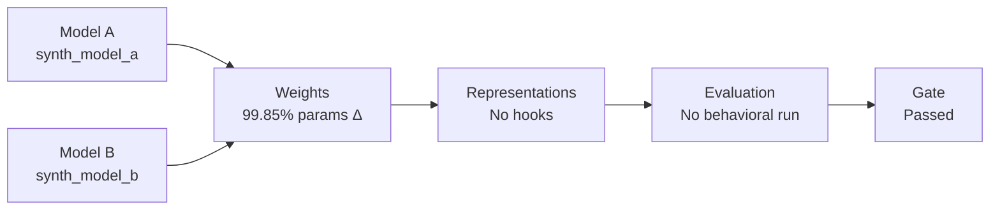

# NEURAL DIFF Report — `ndiff-synth-demo`

| Baseline (A) | Candidate (B) | Mode | Gate | Generated (UTC) |
| :--- | :--- | :--- | :--- | :--- |
| `synth_model_a` (26,784) | `synth_model_b` (26,784) | Synthetic fixture | **Passed** | `2026-11-26T19:28:15` |

## Key Findings

| Evidence | Observation | Source |
| :--- | :--- | :--- |
| Observed | Model A (26,784 params) vs Model B (26,784 params) share 21 tensor keys. | Module C — StructuralDiffEngine |
| Observed | 99.8507% of aligned parameters exceeded numerical tolerance (mean cosine=0.99866593, max abs diff=0.30177921056747437). | Module B — TensorDiffEngine |
| Unverified | Causal mediation of individual neurons or circuits via counterfactual activation patching was not executed in this observational diff run. | Epistemic boundary declaration (Causal Patching Gate) |

## Architecture & Alignment

| Shared Tensors | Added | Removed | Renamed (Inferred) | Shape Δ | Dtype Δ | Param Δ |
| ---: | ---: | ---: | ---: | ---: | ---: | ---: |
| 21 | 0 | 0 | 0 | 0 | 0 | `+0` |

## Weight Perturbation

| Compared | Modified | Changed Params | Mean Cosine | Mean Rel L2 | Max \|Δ\| |
| ---: | ---: | ---: | ---: | ---: | ---: |
| 21 | 20 | `99.85%` (26,744) | `0.998666` | `0.044625` | `0.30178` |

### Layer Perturbation Profile

| Layer | Mean Rel L2 | Mean Cosine | Changed % | Magnitude |
| :--- | ---: | ---: | ---: | :--- |
| `L0` | `0.02130` | `0.999746` | `99.6%` | `████░░░░░░░░░░` |
| `L1` | `0.07473` | `0.997239` | `100.0%` | `██████████████` |

### Top Diverged Tensors

| Tensor | Role | Cosine | Rel L2 | Max \|Δ\| | Profile |
| :--- | :--- | ---: | ---: | ---: | :--- |
| `model.layers.1.self_attn.v_proj.weight` | `attn_v` | `0.996709` | `0.08128` | `0.27437` | `██████████` |
| `model.layers.1.self_attn.q_proj.weight` | `attn_q` | `0.996825` | `0.07983` | `0.24350` | `██████████` |
| `model.layers.1.mlp.down_proj.weight` | `mlp_down` | `0.997066` | `0.07702` | `0.25521` | `█████████░` |
| `model.layers.1.self_attn.k_proj.weight` | `attn_k` | `0.997106` | `0.07612` | `0.26526` | `█████████░` |
| `model.layers.1.mlp.up_proj.weight` | `mlp_up` | `0.997256` | `0.07423` | `0.26146` | `█████████░` |
| `model.layers.1.input_layernorm.weight` | `norm` | `0.997441` | `0.07326` | `0.18573` | `█████████░` |
| `model.layers.1.self_attn.o_proj.weight` | `attn_o` | `0.997339` | `0.07312` | `0.30178` | `█████████░` |
| `model.layers.1.mlp.gate_proj.weight` | `mlp_gate` | `0.997352` | `0.07297` | `0.24453` | `█████████░` |
| `model.layers.1.post_attention_layernorm.weight` | `norm` | `0.998057` | `0.06473` | `0.16621` | `████████░░` |
| `model.layers.0.self_attn.v_proj.weight` | `attn_v` | `0.999665` | `0.02588` | `0.08250` | `███░░░░░░░` |

## Provenance

| Parameter | Value |
| :--- | :--- |
| Platform | `Windows-11-10.0.26320-SP0` |
| Python / PyTorch | `3.12.16` / `2.10.0+cu128` |
| Transformers / Safetensors | `5.24.1` / `0.8.0` |
| Executed Modules | `structural, tensor, neuron, regression` |
